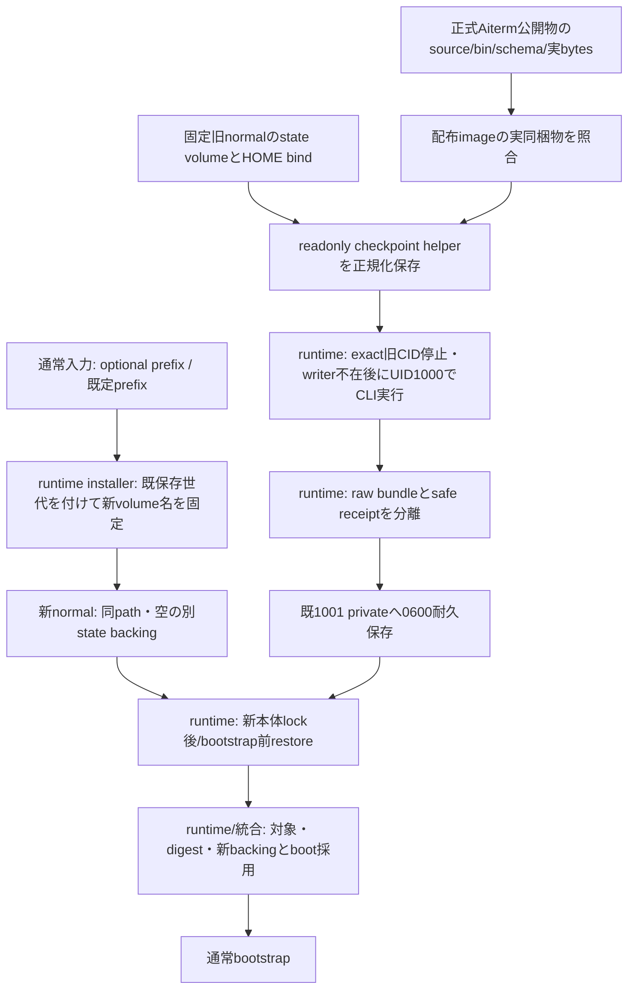

# H1 offline保存更新の配布入力

商用構成/bin/packageはセンチ、installer/環境/pipe/writer検査/起動順はruntime、対象・CID・digestと通常反映結果は統合が持つ。[既供給図](../../distribution-details.md)と[runtime復旧図](../runtime/recovery.md)へ接続する。これは供給入力の実装図で、製品正式公開やH1更新全体の完成を示さない。

| 配布入力/全caller | 所有と契約 |
| --- | --- |
| internal `compose.yaml` / public `distribution/server/compose.yaml` | logical volume `aiterm-state`を`/srv/bellteam-aiterm`へnocopyでmount、`AITERM_STATE_BASE`は同path。通常installerでは`BELLTEAM_AITERM_STATE_VOLUME`の解決済み名はoptional prefix。既保存世代を末尾へ付けた新しい実volume名を新normalと環境へ固定する。未指定の通常更新に手動volume指定や保持要求は不要。これは旧新別backingの確認やH1対応能力の証拠ではない |
| `distribution/server/compose.aiterm-checkpoint.yaml` | UID1000:1000、networkなし、read-only、cap_drop ALL/NNP。helperへ渡す`BELLTEAM_AITERM_STATE_VOLUME`は旧normalの保存済み実volume名で、prefixとして再計算しない。そのvolumeを同pathへreadonly、HOME bindも元の`/home/bell`へreadonly。helperは1001 privateとDocker socketをmountしない |
| helper image/HOME入力 | `BELLTEAM_SERVER_IMAGE`と`BELLTEAM_AITERM_CHECKPOINT_HOME`は必須。imageは固定採用物、HOMEは旧normalの正規化済み絶対bind source。Config.Envの本体鍵や無関係なmountを複写しない |
| helper公開entry | Aitermの公開bin `/usr/local/bin/aiterm-resume-state`（package exports `./resume-state-cli`と同じfile）。distの中のpathは書かない。runtimeが検証した`checkpoint --session ... --launch ...`だけを渡す。引数なしは製品CLIが拒否 |
| `Dockerfile` / `scripts/package-server.mjs` / installer | internal/public共通のsource `distribution/server/{install-resume-state.sh,compose.aiterm-checkpoint.yaml}` から `/app` 直下の同名2fileを作る。public context/archiveもsource用2fileと直下2fileを同bytesで保持する。installerはruntimeが選択・正規化・固定・呼出しを所有する。既maintenanceのmount2本/caps/NNPを緩めない |
| 関連試験 | `test/server-aiterm-checkpoint-compose.test.mjs`で非公開mount/環境/UIDの境界、`test/server-distribution.test.mjs`でarchive同梱を確認。実container/volume/pipe/起動順はruntimeと実imageの必要受入で別に結ぶ |

recoverは旧normalの実volume名をwriter検査に含めて戻し、新volumeの生成や初期化をしない。sourceの旧normal/volumeは保持する。

新旧volumeのUID/GID1000・0700初期準備と別backing、初回からの全writer同base、private0700/0600・LF込みraw SHA・16MiB bundleと別receipt<=512B・個別exit・同digest再開/boot採用はruntimeの公開接点へ依存する。Compose変数を設定しただけで成立とはしない。

H1の未公開候補をpackage version文字列だけで正式0.63.2の能力としない。正式0.63.2にH1 binはない。Dockerfileのofficial latestを未公開枝へpinしない。正式公開source/版と実両archを結んだ後だけH1の供給能力を採用する。旧0631/0632 tmpfs初回保持はunsupported。既許可のreset更新へH1待ちを一律追加しない。本番・一般配布の既Owner保留は維持する。
