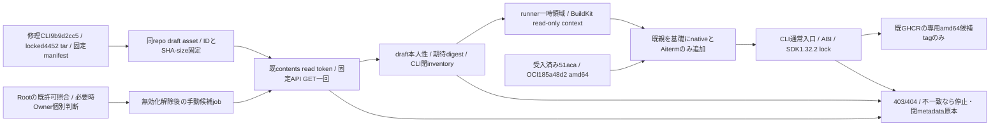
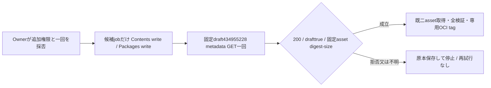

# M nativeを含む親imageの公開候補

所有センチ。Rootの2026-11-05 17:22指示によるレビュー用sourceで、upload/dispatch/build/pushの許可を含まない。候補jobは`if: false`、入力readyもfalseで止めてある。Rootが既Owner許可と公開内容を照合し、必要なら完成した固定案をOwnerへ申請する。

全体feature-map→distribution/module.json→本図、通常のdistribution-details、execution/model-handoffとruntime CLI登録契約を接続する。元親source51acaのhandler/actor anchor/receipt/50fileと保存データは変更しない。overlay sourceは別labelへ記録する。通常両archworkflow、latest/preview、catalog、Host、本番を変更しない。専用DockerfileはrootのDockerfile.m-nativeに置き、既通常image workflowのdistribution/server/**やDockerfileの自動build対象へ一致させない。main採用もRootの実行許可前には行わない。新しい私有registryや別基盤を作らない。

候補はamd64 GNUだけ。arm64へ代替CLIを入れてM成立にしない。既dual-arch通常imageを置き換えず、`ghcr.io/kitepon/bellteam-server:m-<overlay Git>-amd64`という一つの候補が一般取得可能になる案である。元source51acaのOCIラベルと、候補変更sourceの別labelを分ける。既実証はOCI identity/CIであり、OCI自体の新暗号署名をこのworkflowは追加しない。既OIDC署名execution/catalogとOCI署名を混同しない。

公開される実内容はfullCLI bin/codex、同source code-mode-host/exec-server、既rg/bwrap、package metadata、4452全distとSDK1.32.2固定依存。raw入力tar、token、Owner資格・実HOME/dataは追加しない。入力tarはread-only BuildKit mountで消費しlayerへCOPYしない。実CLI/JS bytesはimageから取得可能になるため、draftを読む許可だけではこの公開を許可しない。

fetchは既contents:readのGITHUB_TOKENをそのstepだけに渡し、同repo release/asset IDのAPIだけを読む。metadataのdraft=true/asset digest-sizeと固定manifestを照合し、binary GETのSHA-sizeを照合する。403/404/不明/不一致でbuild前に停止、再試行・local admin tokenへの切替・write権限追加を行わない。固定manifestのCLI/Aiterm版・SHA-sizeとdraft/asset IDは完成原本から全て固定した。ready=falseとjob無効はOwner公開採否前の停止状態として維持し、承認後の有効化差分だけ別のreview patchにする。CLI sourceは7139295を親にTUI二callerだけ直した9b9d2cc5。作者full-cli-supply-result.json8159B/SHA125e456fのrelease成功・4ABI・通常3入口と、CLI app-serverを通る新gRPC1caseを継承する。新case時間は未計測、旧15秒を流用しない。

私有stageはdraft434955228、CLI asset712887672（181765938B/SHAbb5ba901a16638461ff14605b5c83697b885e9fb60c94c68687295cfa356f4c2）、Aiterm asset712701322（771892B/SHA214fb376ef70ee47dfc11d362832b17d452350b80207333895cc521926bf3ca9）。実CLI表示はcodex-cli 0.166.0、package版は0.166.0-bellteam.9b9d2cc.release1として分ける。匿名release/asset/download経路の404と既publisher全SHA一致を私有stage receiptに記録。sameCI contentsreadの取得成功は未実証で、最初の必要CI fetchで一回検証する。draft自体は公開しない。

Aitermはdigest確認済tarのglobal install --ignore-scripts後、installed package内npm ci --ignore-scripts、SDK1.32.2実版assertを必須とする。CLIはcanonical prefixのbin/codexを/usr/local/bin/codexへ結び、resume/app-serverを同fullCLIへ通す。standalone AppServer代用0。ldd未解決、版/入口不一致、lock不一致はpush前に停止し、OSパッケージ追加で推測修理しない。

必要なCI確認は新しいCLI/ABI/lock/入口だけ。実Root認証・同会話一連・親製品導入、arm64、全M、本番はこの候補の成立に含めず、既担当の次接点へ渡す。作者旧群・既成功群の再走、追加module再署名は行わない。

## 403後の追加一回候補（Owner個別採否前・未実行）

担当センチ。固定main860539/run42011244053の既read tokenは、最初のdraft release434955228 metadata GETで403。asset取得/build/push0。旧一回許可は消費済み。追加候補はこのmanual candidate jobだけcontents:writeを明示し、同じGITHUB_TOKENで同固定IDを読む。通常workflow・repository既定権限・別credentialは変更しない。

公式Releases APIはdraft一覧をpush access保持者に限定し、GET endpoint自体のfine-grained permissionはContents readと記載する。この差からwriteを限定追加する候補を選ぶが、job tokenでのdraft ID取得成功やwriteの十分性は未実証。403は原因を一意に特定していない。次の追加一回でも拒否なら停止し、PAT/別token/公開draftへ迂回しない。

contents:writeはreadより広く、当該repoの内容・releaseへ書ける権限をjobに与える。API操作は既固定GETだけ、checkout persist-credentials:false、tokenはfetch stepのenvだけ、Docker buildへARG/env/secretを渡さない。ただしGitHub token権限はstep単位に絞れず、同jobのactionsも持ち得る。Packages writeは既登録権限を維持する。承認はこの露出差と追加一回を含む必要がある。

固定CLI/Aiterm/親と検証は前節どおり。公開候補tagは追加採用SHAのm-<SHA>-amd64一本、latest/preview/catalog/本番/Host/arm64/新署名/draft公開0。拒否・不明・digest/ABI/版/lock不一致は同じ停止条件。追加実行前にRootがOwner個別判断を取得する。

出典: https://docs.github.com/en/rest/releases/releases / https://docs.github.com/en/rest/releases/assets / https://docs.github.com/en/actions/reference/workflows-and-actions/workflow-syntax#permissions 。実アクセス成功は出典から補完しない。
