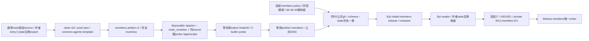
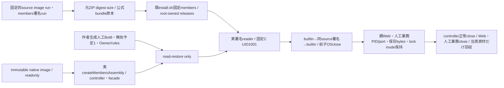

# members固定artifact・配布接点

配布担当センチ。Root members-update-contract-20261103 v1、runtime Epi、唯一writer Belorta、共通Mollyへ接続する。members以外の既schema/wireは保持し、固定componentを明示追加する。任意entry/policy/module登録を許可しない。

固定entryはpayload/src/members-entry.mjs、linux amd64/arm64、Node26/parentProtocol1。runtime.stateCompatibilityは作者src/members/state-compatibility.mjsのMEMBERS_STATE_COMPATIBILITYを完全一致で収録する。現既形式のbotProfileSchema/scheduleSchema/ownerProfileSchema/deletionReceiptSchema/userRulesEncoding/initializedMarkerだけを持ち、未知field/値/不足を拒否する。作者最終source/commit/hashを署名前に照合し、仮schema名やmigration許可を作らない。producerは固定sourceの同exportを読み一致assert、verifierは署名後もpayload JSを実行せず同じ固定値を検査する。

membersのsrc/package/lock/clean production依存に、本文生成が読むpayload/config/common-agents.mdを必須収録する。実Owner/rules/Bot予定/私有state/HOME/envは収録しない。全file path/bytes/SHA256と既512MiB/20000file等上限、link/越境/重複拒否を維持する。

署名policyは固定repo kitepon/BellTeam/ID1404510084/main/SLSAv1/publish-members.ymlと既trustroot。root承認archive/source/signerの3期待値を用い、Web/通知のpolicyや署名をmembersへ流用しない。package-members.py/verify-members.pyは既共通内部処理の固定members入口だけを公開する。

固定Cはscripts/members-start.c→/usr/local/libexec/bellteam-members-start、root所有0755/非setuid。roothelper scripts/install-members-release.py、readerとplanは既src収録、署名前probeはscripts/probe-members-runtime.mjsの引数0窓口をEpiが供給する。Host updater14entryとは別。初回通常main後のbuiltin→同source署名archive→同image builtinを両nativeで受入し、OSexit/lock/readonly/親Web人工業務/台帳Owner予定state保持を確認する。異source互換・実AI・本番は加算しない。

現工程は配布source実装。作者固定state/entry/closure・Epi probe/caller・Molly通常mainが結合されるまで実署名/native/配置成功を主張しない。正式catalog公開/実Host/実席/実予定発行はこの差分から開始しない。

署名前のmembers-artifact-probe.pyは既通知の使い捨てroot/native mount namespace機構を固定membersへ限定して再利用する。既/app・private・state・home・Cがあれば作用前拒否。archive通常fileだけをroot-owned/appへ配置し、Node26の固定pathを必要時だけprivate bind、C compile0755後、Epi固定probeへ接続する。fixtureはstate/bots/.initialized空markerとowner/profile.jsonの既schema最小値・user-rules.md空だけを1001:1001/0700・0600で先に作る。Bot subdir0/.transaction無し、業務seed/migrationをreadyへ入れない。empty projection ACK以外のparent effect/予定/実席作用はEpi probeで拒否する。

publish-membersは両nativeでarchive→unsigned builtin/ready/OSclose→公式attest→取得後公式identity確認→成功資材だけを供給する。失敗時のentry-probe stdout/stderrは別diagnostics artifactへ保存し、未署名/失敗結果を正式供給成功にしない。実Bot/Owner/予定stateをfixtureへコピーしない。

正式catalog側もmembersだけ厳密5key（既4key＋stateCompatibility6実値）を持つ。schema/producerとarchive/consumerの照合は[正式catalog](update-catalog.md)が正本、実state read-restoreはwriter/runtimeが所有する。

親Nodeprobeは同固定sourceのscripts/probe-members-runtime.mjsを使い捨て/app/scriptsへ同bytesコピーしてからreadonly化し、その固定pathで起動する。相対importはarchiveの/app/srcと/app/node_modulesへ解決する。checkoutへ依存を追加せずNODE_PATH/CWD fallbackも使わない。この試験用コピーは署名payload inventoryに含めず、/appと一緒に回収する。C/IPC/作者DTOの契約変更はない。

## image上の初回署名往復fixture

verify-members-image.ymlはpull-onlyの両native専用工程で、新build/署名生成はしない。同sourceのpush image runとpublish-members runの成功・attempt1・repoID・workflowを検査して元ZIPを全SHA-size確認する。通常imageの実assembly/controller/facadeと既roothelper/reader/Cを使い、親HTTP先の人工業務と別の人工processだけをfixtureにする。slots/model/CLI/実席を開始せず、Owner authorityを作らない。公開members更新HTTPや未供給のall/module耐久coordinatorを新設・試験済み扱いにせず、controller reserve/replaceの有限境界として明記する。

人工stateはtest/fixtures/members-saved-state/manifest.jsonへ全document/作者sourceを束縛。baseはactive Bot1、2100年の無効予定1/nextRunAt:null、人工Owner/rules/.initializedだけ。全bytes hashを交換の前後と正常close後で比較する。deletion receiptは別examplesの完全例として保持し、baseへ混入しない。project値をpath権限へ使わない。fixtureがbootstrap initialize/cleanup/seed/migrationを呼ばず、実assembly startのread-restoreだけを使う。個別SHA・別source・tamperはroot公開前拒否し、rootstore/採用record不変を確認。失敗・取消も共通有限allocation/cleanup契約で当席container/volume/tempだけ回収する。

専用runnerはhost native archだけを許可し、pullにlinux/archを明示した固定immutable参照をinspectする。image inspectの追加platform flagを要求せず、返却Os/Architecture/source label/完全RepoDigestを検査する。Dockerのconfig ID・native manifest・indexは種類を混同せず、前後container比較は同じ検査値同士で行う。fixtureだけの修理では既image/source/署名を読み替えず、固定試験source SHAを別記録して既完成の同source image/archiveへ接続する。
