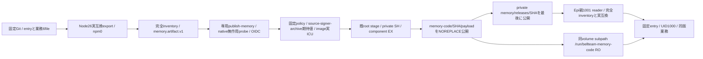

# memory固定archiveとcode専用読取view

配布センチ。業務は[Biscuit memory](../memory/update.md)、runnerと初回state準備は[Epi runtime](../runtime/memory-process.md)、更新ledger/共通facadeはMolly。既root installerと固定catalogをmemoryへ接続し、実Host・公開catalog発行を開始しない。

archiveはsrc/run-memory-runtime.mjs、memory/{factory,dispatcher,state-compatibility}.mjs、memory-service.mjs、memory-search.mjsの6fileだけ。Node組込/Intl以外の依存、package/lock、DB/WAL/本文/資格は収録しない。parentProtocol1、Node26、実互換7fieldを収録する。producerは固定Gitの実export、root verifierは信頼済imageの実exportを使う。静的parserは6固定値とsearchIndexVersionの厳密形式を検査し、catalog/manifest/consumerは全値一致。検証中に署名payloadのJSを実行しない。

code rootと全directoryはroot:root/0555、file0444。private control0:1001/0750とinstallation/採用recordを席1000へ公開しない。初回mount/state準備はruntime所有、以後code追加は同volume内。codeを先に公開し、manifest/installationを持つprivate releaseを最後に公開する。中断でcodeだけ残ればreaderは選択不可。再入時は同SHAの全inventory/owner/modeを検査してからprivate公開へ進み、既codeを上書きしない。追加未知file/リンク/改変を拒否する。既private SHとcomponent lock、root検証、stage清掃、fsyncを維持する。

署名workflowは両nativeの実UID1000・archive entry無作用restore probe/OS終了を経て公式OIDCを発行する。交換・実DB更新・親停止影響は同source imageの別native工程であり、archive probeだけで成立とはしない。通常imageへの初回mount導入と実Host判断は別工程。元state形式の移行や既DB全schema照合は追加しない。

同sourceの有限実物確認は `verify-memory-image.yml` が既通常image digestと専用署名runを両nativeでpullする。`memory-real-boundary.py` は既Web fixtureの割当・同image比較・cleanupを再利用し、人工supervisorだけをRO差替えする。実初回prepareのcode root0555/private750とreceipt再入保持、実root署名検証→code専用view、UID1001の実SeatRuntime.memory→既sudo/seat-exec C→UID1000の固定entry/業務を使う。fixture sourceはimage sourceと別に固定し、通常imageを再buildしない。

親の公開run接点は既createSeatProcessRunnerへそのまま委譲し、実OS/stdio closeを返すPromiseと世代/entryを記録するだけで出力・取消・遅延を偽装しない。人工DBへの受付済writerが終端してから新版無作用restoreへ進む順序、保存の再送0、restore前後のDB/notes全bytes一致、builtin→署名→builtin後の最新改訂/新知識保持を確認する。codeは1000/1001可読・書込拒否、private receiptは1000拒否。親CID/PIDbirth・別人工businessと実gateway PIDbirth/portの保持、close後の受付拒否と自己cleanupを原本に残す。公開Update ledger、実席/実データ/Host/本番、60秒busy反例の再走はこのfixtureへ足さない。
署名workflowのunsigned entry probeはrootが固定`/tmp`に作る専用一時directory（外側0755、code0555/0444、empty-data0555）を使い、別UID1000へ切り替える。runner checkoutの祖先権限へ依存せず、checkoutのchmod/chownをしない。stdout/stderrは元archive側へ保存し、成功・失敗とも専用directoryだけ回収する。a960署名run41646901277は両archでcheckout配下entryのMODULE_NOT_FOUND、OIDC未到達を保持し、この修理の後続source成功へ読み替えない。

fixtureの原本GETだけはHTTP502/503/504に限り最大3回（1秒・2秒待ち）とし、認可失敗・不正ZIP・identity不一致は繰り返さない。起動中の最後の段階・実runner開始/closeとstatus読取のstdout/stderr、清掃前の人工コンテナprocess一覧を保存する。readyの45秒期限、実処理の再送禁止、判定とcleanupは維持する。旧41651056389のarm64 ready timeoutは途中原本が不足しており、追加記録だけを原因修理や実交換成功とは扱わない。
有限native fixtureの状態出力はphaseを検査工程（ready/b-active/done）、runtimePhaseを実controller snapshot.phaseとして分ける。snapshotの展開で検査工程を上書きせず、親/子の不変条件を確認してから同じatomic renameで公開する。製品snapshotの契約、45秒期限、実交換・署名・cleanup条件は変更しない。
