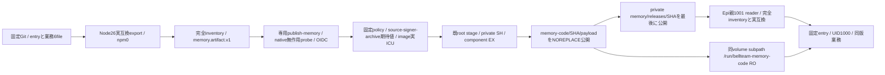

# memory固定archiveとcode専用読取view

配布センチ。業務は[Biscuit memory](../memory/update.md)、runnerと初回state準備は[Epi runtime](../runtime/memory-process.md)、更新ledger/共通facadeはMolly。既root installerと固定catalogをmemoryへ接続し、実Host・公開catalog発行を開始しない。

archiveはsrc/run-memory-runtime.mjs、memory/{factory,dispatcher,state-compatibility}.mjs、memory-service.mjs、memory-search.mjsの6fileだけ。Node組込/Intl以外の依存、package/lock、DB/WAL/本文/資格は収録しない。parentProtocol1、Node26、実互換7fieldを収録する。producerは固定Gitの実export、root verifierは信頼済imageの実exportを使う。静的parserは6固定値とsearchIndexVersionの厳密形式を検査し、catalog/manifest/consumerは全値一致。検証中に署名payloadのJSを実行しない。

code rootと全directoryはroot:root/0555、file0444。private control0:1001/0750とinstallation/採用recordを席1000へ公開しない。初回mount/state準備はruntime所有、以後code追加は同volume内。codeを先に公開し、manifest/installationを持つprivate releaseを最後に公開する。中断でcodeだけ残ればreaderは選択不可。再入時は同SHAの全inventory/owner/modeを検査してからprivate公開へ進み、既codeを上書きしない。追加未知file/リンク/改変を拒否する。既private SHとcomponent lock、root検証、stage清掃、fsyncを維持する。

署名workflowは両nativeの実UID1000・archive entry無作用restore probe/OS終了を経て公式OIDCを発行する。交換・実DB更新・親停止影響は同source imageの別native工程であり、archive probeだけで成立とはしない。通常imageへの初回mount導入と実Host判断は別工程。元state形式の移行や既DB全schema照合は追加しない。
