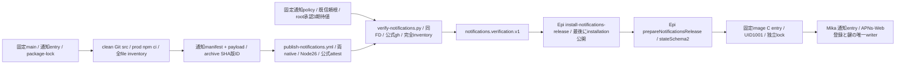
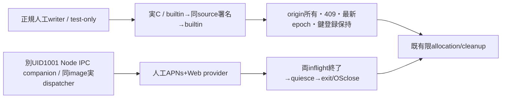

# 通知専用の固定artifact・公式署名供給

配布の正本。Root通知単独更新契約とWeb Push v1.1のABI2を実装し、runtimeの通知配置/reader、usageの通知entry/状態へ接続する。通知独立更新の基盤を初回imageへ入れる工程と、その後の署名archive単独更新を分ける。実署名・実root配置・本番の成立は固定run原本で別に確認する。

component=notifications、artifact/installation/verification各bellteam.notifications.*.v1、entry=payload/src/notifications-entry.mjs。runtimeはlinux/amd64又はarm64/Node26/parentProtocol2/stateSchema2。Webのschema/runtimeキー/公開CLIは不変。固定Web/通知とRootが別途採用したmembersの内部契約だけを使い、manifestが任意policy/entry/workflowを選ぶ入口は作らない。

archiveはmanifest.json先頭とpayload通常fileのみ。sourceCommit40hex、完全inventory各path/bytes/SHA256。通知のsrc/package/lockとclean production依存を自己完結させる。通知はWeb資材を必要条件にしない。実HOME/APNs鍵/端末/状態/envは収録しない。既archive512MiB/展開512MiB/bundle16MiB/manifest8MiB/20000file、link/越境/重複拒否を維持する。

CLIはpackage-notifications.py OUTPUT --source SHA40 --arch amd64|arm64、およびverify-notifications.py ARCHIVE BUNDLE EXPECTATION。期待JSONはroothelperが承認済archiveSha256/sourceCommit/signerCommitの3key/64・40・40hexから作る。未検証manifestから自己生成しない。署名policyはrepo kitepon/BellTeam/ID1404510084/main/SLSAv1/通知専用publish-notifications.ymlを固定。public trust rootは既config/web-gateway-trusted-root.jsonlを一か所で使う。公式ghの同FD/json名alias/秘密env不継承/証明書repoID検証を共通化し、Web署名の通知流用を拒否する。

package-serverは通知verifier/policy/共通Python、Epi roothelperとnotifications-start.cを明示収録。既src全収録に通知entry/reader/planが入る。DockerfileはCを固定/usr/local/libexec/bellteam-notifications-startへroot所有0755で収録する。setuid/新mount/任意commandは追加しない。roothelper/installer/Cの業務とlockはruntimeが所有する。Rootが採用後のstate更新と交換、Mikaが通知DTO/処理/保存、Mollyがassemblyと通常mainを持つ。

公式OIDC前に実archiveのentry/ready/閉じ方/自己完結を人工provider・隔離stateで確認する。通知A-B-A/登録保持/署名拒否/UID1001実lock/readonly/他process保持は同新sourceと実署名資材/固定imageで受け入れる。実APNs送信/Host/本番を人工providerで代用済みとしない。旧全成功群や既署名の再発行をgateにしない。

## 初回の同source builtin/署名版/戻し

Root初回裁定はimage builtin A→同sourceの署名archive B→同image builtin A。異source互換の証明にしない。公開POSTのversionIdはSHA又は固定literal builtinだけ。署名前probeは捨てnative runnerのprivate mount namespaceへ閉じ、setup-nodeのNode26を必要時だけ固定Node pathへbindして原本を上書きしない。runner既Nodeが別majorでも製品のNode26拒否を緩めない。

verify-notifications-image.yml→test/helpers/notifications-real-boundary.pyが通常source/専用署名run/auto image run/indexを固定し、実imageのinstaller/C/reader/controllerと公開APIで交換する。既Web fixtureの有限allocation/cleanup契約だけを再利用し、旧Web署名や旧成功群を再実行しない。guest supervisorだけを人工bootstrap/client/businessへ置換し、通知は固定C/実UID1001/実SH/EXで動かす。人工端末の既push-devices配列とorigin付きWeb登録/合成鍵をseedし、実送信せず登録・鍵bytesとlock inodeを保持、同時writerを実拒否する。親・Web・他processのPID出生/port/client.close0、raw container before/after、改変archive/誤sourceのroot公開前拒否、root receipt/旧採用不変、自己資材清掃を確認する。実APNs/実AI/Host/本番を示さない。

## Web Push ABI2 / Root v1.1

Root Web Push v1.1（b64a7c27）により通知だけparentProtocol2/stateSchema2へ更新する。既artifact/receipt schemaと専用OIDC workflow/信頼根/完全inventoryは維持する。catalogは既4keyのままnodeMajor26/parentProtocol2/stateSchema2/containerUpdate:nullを厳密照合し、公式資材のsource/arch/runtimeとの不一致も拒否する。旧P1受入は履歴であり新ABIの証拠にせず、戻しは同P2の固定builtinと最新鍵/登録/settings。親settingsの旧image互換は別判定。

web-pushはMika固定prod dependencyとlockからnpm ciで自己完結収録する。親probeはarchive配置後の/app/scriptsへ同source同bytesを追加し、readonly化して/app/srcとprod node_modulesで解決する。probe自体は署名payload inventoryへ混ぜない。ready鍵生成/外部call0、実OSclose後のみ成功JSONとする。runtimeのABI2 entry/channel/probe完成sourceと原本が揃う前は署名可能/実物成功としない。

private登録照会/register/unregisterだけに親検証済canonical HTTPS originを必須とする。公開状態status/configureへoriginを増やさず、公開bodyのoriginは拒否する。probe/nativeの人工登録はorigin付きで、欠測/非canonical拒否、別origin照会/解除falseかつ保持、同endpoint別origin/previousEndpoint非所有・欠測は同409で全保存不変、同origin置換成功を作者原本へ結合する。鍵0600/再生成0/設定epoch保持、APNs-Web全inflightとsavingの実終端、同source builtin→署名→builtinを両nativeで測る。実鍵/実送信/Host本番0。

ABI2 native fixtureはMika正規 `writeNotificationsWebFixture` をtest-only readonly配置から呼び、人工APNs配列・VAPID・2origin登録を0600で作る。実facade/C経路で欠測・非canonical origin拒否、別origin照会/解除false、409時の3保存file全bytes不変、同origin置換を確認する。各交換前に最新Web設定を保存し、P2/S2・公開鍵・最新epoch/設定と3保存hash、writer inode、親/Web/業務processの出生・portを照合する。

companionは専用使い捨てrootの実IPCと実dispatcherへ人工providerを渡す。APNs解放後もWeb2件解放まではquiesce未完、保存不変・実OScloseを検査し、固定C/署名子内の実送信とは区別する。製品entryのprovider/path/envは増やさない。managed normalの人工data rootは本番契約と同じ1000:1000/0711にし、privateと書込子directoryは既所有条件を守る。fixture sourceと検査対象image sourceは独立固定し、実Owner鍵・実送信・本番・AIは扱わない。
