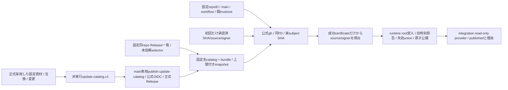
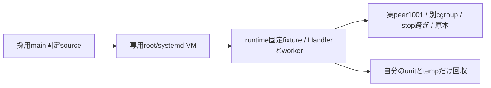
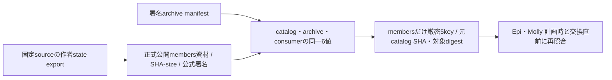

# 正式Update catalogの信頼境界

配布が非実行JSONのschema/固定publisher公式検証/正式発行、runtimeがroot受入と鮮度/失効state、integrationがread-only providerとUpdate APIを持つ。CI候補・単なるarchive署名を一般Updateへ昇格しない。公開発行と本番設置の成立は別の具体原本で確認する。

catalog rootはschema/publishedAt/expiresAt/releases/revokedCatalogs。固定container/web-gateway/notifications、同platform重複不可、OCIは固定GHCR repo@digest、moduleは同repo正式Release archive/bundleのhash/sizeで固定する。source/version/互換/変更の供給と、現在稼働版/計画/実行結果を分ける。未知互換はnullで保持し、旧正式d9dの通知対応を捏造しない。

公式検証はverify-update-catalog.py CATALOG BUNDLE EXPECTATION（初回catalogSha256/sourceCommit/signerCommit）又は固定--publisher CATALOG BUNDLE（常用）。未信頼JSONから期待値を作らず、固定policyで公式gh検証後の証明書/subjectから実SHA/source/signerを導出する。sourceとsignerを抽出できない証明や複数の異なるidentityは拒否。root通常file/同FD/bundle.json alias/秘密env不継承/既public trustrootを継承する。CLIは認証receiptだけを返し、採用stateを書かない。

署名publishedAtの未来許容300秒、最大期限7日、期限到達以後plan不可。runtimeは最後の時刻/hash/認証事実と失効unionを耐久保持し、同時刻異SHA/旧時刻を拒否、同時刻同SHAはidempotent、失効の省略で解除しない。時計逆行・期限切れ・失効は新plan不可/現稼働維持。UIは独自時刻/失効判定を作らない。

実行artifactの固定二component契約を任意module registryへ広げない。新正式catalog/署名発行/実Host/本番をsource単体やmock試験の成功から推定しない。

containerUpdateは対応Host installer契約の検証済値又はnull。現一般公開imageに新Host helperがあると補完しない。Host root closureの収録はEpi sourceと合わせる後続差分とする。今回のcatalog verifier/policy収録はそこから独立する。後続package-serverはEpi固定root-code-paths.jsonのimagePath/installPath宣言を読み、flatten後の実通常fileから14file（import10＋unit/overlay4）のbytes/SHAをroot-code-manifest.v1へ束縛する。distribution/server/updaterは削除前に退避して同じpathへ復元、Host clientは既src、root helper/cleanup/save/verifier closureは明示収録する。root updater/OS条件とroot公開/実行はruntimeが所有する。

正式publisherは固定config/update-catalog.jsonが存在しschema/期限/既公開target確認を通る場合だけ署名する。containerは現一般latestのindex/source、moduleは非draft/nonprereleaseの同repo正式Release asset/digest/sizeを確認し、通常CI候補を取り込まない。config/update-catalog.jsonは正式main e3e64b13（PR342）の署名usage両arch資材を保持し、正式Release `updates-20261104T091740Z` の署名memory両arch資材を追加する。memoryのsource/signerは`19e739e5625d217ae769df7dad8350190b3f4585`、Node26/P1/stateSchema:nullと実7fieldを保持する。archive/bundleは既署名と同じbytesで、共通provider/ledgerと既module installerへ接続する。親bootstrapとconsumerの開発者設定許可を同単位で修理し、公開profileの拒否は維持する。共通IPCのroot/effect/callback同時数64を持つ同sourceのmodule-ipcとusage channelを収録し、旧9cb資材の上限8を再導入しない。PR314の旧secret状態互換とPR317のstream修理を含み、Node26/P1と作者実stateCompatibilityを維持する。archiveのsource/signerはe3e64b13、catalogのpublisherはこの固定asset設定を通常採用した後続mainへ別に束縛し、同じruntime bytesを維持する。正式資材Releaseとcatalog本文の供給は、catalogの公式OIDC公開・Host配置・runtimeの公開plan/start・本番の反映結果と分けて記録する。既catalog契約内の入力供給であり、接続・状態所有・実行入口は変えない。

Host収録の後続差分はEpi固定root-code-pathsの14entryを使い、bootstrap installerも明示収録する。code manifestはsourceCommit/filesとschemaだけを持ち、path越境・link・重複を拒否し全14fileの最終bytes/hashを固定する。実root provision/設置はこのsource試験から推定しない。

固定unitの実名はbellteam-container-update-host.service.in / bellteam-update-catalog-refresh.service.in / bellteam-update-catalog-refresh.timer。Epi root-code-pathsのこの3名とcompose.overlay.yamlだけをpackagerで許可し、14fileの接続を維持する。

専用verify-container-updater-systemdは採用mainのsourceを照合し、使い捨てamd64 root/systemd VMだけでEpiの固定fixtureを実行する。actual Handler/worker launch_service、UID1001 peer、別service cgroup、受付stop後worker生存、同requestId読戻し、socket親inodeと対象unit/temp回収を原本へ保存する。engine・署名receipt・root prefixは人工、production entry load/実Docker/公式crypto/Host導入の証明にはしない。

## membersだけの複合状態互換

Rootのmembers catalog裁定に従い固定componentへmembersだけを追加する。既container/Web/通知のcompatibilityは既4key/型/意味のまま。membersだけnodeMajor=26/parentProtocol=1/stateSchema=null/containerUpdate=null/stateCompatibility=作者実6key-valueの厳密5keyを持つ。欠測/余剰/型変換/未知/部分一致を拒否し、架空stateSchema:1を与えない。

producerは同固定sourceの作者state exportを照合し、membersの既正式Release assetをSHA-sizeまで実読取り、固定専用workflowの公式OIDCを確認してからarchive manifestとcatalog/consumerの互換6値/source/archを一致検査する。verifierは非実行JSONのまま、payload JSを実行しない。validate_members_archive(release,manifest,consumer_state)が計画時/交換直前にも使う固定の照合窓口。実state read-restoreを静的manifest検査へ置き換えない。

旧consumerの未知component拒否を緩めない。新consumer/validator/root受入/provider/plan/module executorの同契約が供給された正式catalogだけを提供し、未対応はcapability false/計画無し・現稼働保持にする。今回source差分で正式catalog/Release/Host/本番は発行しない。

Web Push対応の新notifications consumerは既4key形の値を26/2/2/nullへ厳密固定する。P1/欠測/unknown/型変換/余剰を新対応へ丸めない。validate_notifications_archiveは正式catalogと公式通知archiveのsource/arch/ABI一致を照合し、publisher preflightも専用policy検証後にこの窓口を通る。旧通知正式資材を値だけP2へ書き換えて受け入れない。

memoryも固定componentとして扱い、compatibilityの5keyと作者実7fieldを厳密検査する。`validate_memory_archive(release, manifest, consumer_state)`でsource/arch/Node26/P1/実ICUを含む互換全値を一致照合する。producerは正式公開archive/bundleをSHA-size＋専用OIDCで確認し、信頼済sourceの実互換exportへ結ぶ。catalog本文の値から現在imageのICUを推測せず、各readerが実exportを照合する。公開操作の承認は別で、本差分は公開しない。

## 現行会話・新版通知の公開資材

usageとmemoryの既固定recordを保持し、正式Release `updates-20261104T094501Z` の会話・通知両archを追加する。archive source/signerは`0f6bde5b5208e3d15aabb55132e20947f2e9f2d6`、catalog publisherは後続採用mainに別束縛する。会話はNode26/P1・実stateCompatibilityを保持し、現親のhistory.page/recentBatch/recentと容量64へ対応する。通知はNode26/P2/state2で、Lの閉じたupdate種を持つ。旧ABI受入だけから未収録の公開operationを成功へ補完せず、旧0c4/4fは現機能候補に使わない。正式署名/native結果は配布担当の原本を継承し、共通API/provider/ledgerの状態所有は変えない。公開単品操作・利用・外部通知と本番は後工程の結果で分離する。

## 終了診断・現行Webの公開資材

usage/memory/会話/通知の既8recordを保持し、正式Release `updates-20261104T100349Z` の診断とWeb両archを追加する。archive source/signerは`febbe3a129dd580e63e3cb26f7331c869daf06a3`、catalog publisherは後続採用mainへ別束縛。診断はNode26/P1/stateSchema:nullと実2fieldを保持し、閉じた子終了情報を唯一writerで受ける。WebはNode26/P1/state1で現共通Update UIと通知受口の資材を収録する。診断の観測/親登録、各部品の公開単品利用、外部通知と本番は独立した後工程で確認する。署名・匿名取得・固定C probe・作者内部結果は正式供給原本を継承する。

## 現行execution・membersの公開資材

既12recordを保持し、正式Release `updates-20261104T100935Z` のexecution/members両archを追加する。archive source/signerは`3d59588f7f3dcfcd626cc4bb62707be88c753936`、catalog publisherは後続採用mainへ別束縛。executionは47literalの固定閉包と現親のmoduleOperations ports/会話接続を持ち、membersは共通64/4avatarVersionを含む。Node26/P1/stateSchema:nullと各実stateCompatibilityを維持する。M先行投影の後発sourceやnative gateをこの資材へ後付けせず、既J機能の公開交換/利用と本番は各単位の担当結果で分離する。

## 専用serviceを持つ本体の正式target

先行module16recordを保持し、Centiが既通常CI41813832142と匿名OCI受入で固定した本体source `80a139e74ab8231553650797fcea656dc6359b40`・index `sha256:758b0b9ab1632f4180fe11f4ba3d36759eb9c47cf139c3bc8ebfce8cdfacec02` を両archへ追加する。artifactは固定GHCRのoci-index、containerUpdateだけ実契約1、他のcompatibilityはnull。既正式promotion後のlatest/preview同index本人原本へ結び、publisherのlatest同SHA/source検査を維持する。K現物の公開本体Updateは未実施で、bootstrap66e0と異なるtargetの正式供給だけを表す。親API/ledger/socket契約は変えず、新imageのbuild・同bytes署名を追加しない。
