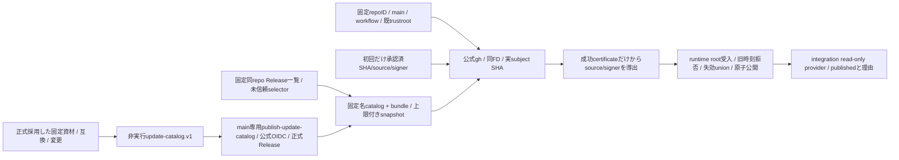
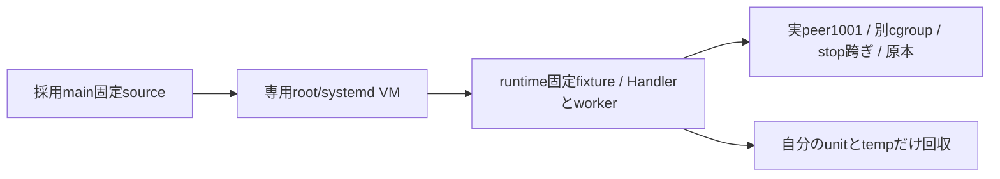
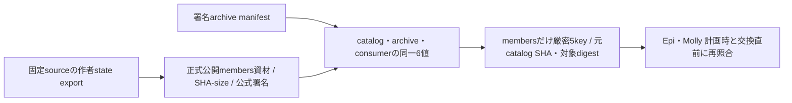

# 正式Update catalogの信頼境界

配布が非実行JSONのschema/固定publisher公式検証/正式発行、runtimeがroot受入と鮮度/失効state、integrationがread-only providerとUpdate APIを持つ。CI候補・単なるarchive署名を一般Updateへ昇格しない。公開発行と本番設置の成立は別の具体原本で確認する。

catalog rootはschema/publishedAt/expiresAt/releases/revokedCatalogs。固定container/web-gateway/notifications、同platform重複不可、OCIは固定GHCR repo@digest、moduleは同repo正式Release archive/bundleのhash/sizeで固定する。source/version/互換/変更の供給と、現在稼働版/計画/実行結果を分ける。未知互換はnullで保持し、旧正式d9dの通知対応を捏造しない。

公式検証はverify-update-catalog.py CATALOG BUNDLE EXPECTATION（初回catalogSha256/sourceCommit/signerCommit）又は固定--publisher CATALOG BUNDLE（常用）。未信頼JSONから期待値を作らず、固定policyで公式gh検証後の証明書/subjectから実SHA/source/signerを導出する。sourceとsignerを抽出できない証明や複数の異なるidentityは拒否。root通常file/同FD/bundle.json alias/秘密env不継承/既public trustrootを継承する。CLIは認証receiptだけを返し、採用stateを書かない。

署名publishedAtの未来許容300秒、最大期限7日、期限到達以後plan不可。runtimeは最後の時刻/hash/認証事実と失効unionを耐久保持し、同時刻異SHA/旧時刻を拒否、同時刻同SHAはidempotent、失効の省略で解除しない。時計逆行・期限切れ・失効は新plan不可/現稼働維持。UIは独自時刻/失効判定を作らない。

実行artifactの固定二component契約を任意module registryへ広げない。新正式catalog/署名発行/実Host/本番をsource単体やmock試験の成功から推定しない。

containerUpdateは対応Host installer契約の検証済値又はnull。現一般公開imageに新Host helperがあると補完しない。Host root closureの収録はEpi sourceと合わせる後続差分とする。今回のcatalog verifier/policy収録はそこから独立する。後続package-serverはEpi固定root-code-paths.jsonのimagePath/installPath宣言を読み、flatten後の実通常fileから14file（import10＋unit/overlay4）のbytes/SHAをroot-code-manifest.v1へ束縛する。distribution/server/updaterは削除前に退避して同じpathへ復元、Host clientは既src、root helper/cleanup/save/verifier closureは明示収録する。root updater/OS条件とroot公開/実行はruntimeが所有する。

正式publisherは固定config/update-catalog.jsonが存在しschema/期限/既公開target確認を通る場合だけ署名する。containerは現一般latestのindex/source、moduleは非draft/nonprereleaseの同repo正式Release asset/digest/sizeを確認し、通常CI候補を取り込まない。config/update-catalog.jsonは正式main e3e64b13（PR342）の署名usage両arch資材を保持し、正式Release `updates-20261104T091740Z` の署名memory両arch資材を追加する。memoryのsource/signerは`19e739e5625d217ae769df7dad8350190b3f4585`、Node26/P1/stateSchema:nullと実7fieldを保持する。archive/bundleは既署名と同じbytesで、共通provider/ledgerと既module installerへ接続する。親bootstrapとconsumerの開発者設定許可を同単位で修理し、公開profileの拒否は維持する。共通IPCのroot/effect/callback同時数64を持つ同sourceのmodule-ipcとusage channelを収録し、旧9cb資材の上限8を再導入しない。PR314の旧secret状態互換とPR317のstream修理を含み、Node26/P1と作者実stateCompatibilityを維持する。archiveのsource/signerはe3e64b13、catalogのpublisherはこの固定asset設定を通常採用した後続mainへ別に束縛し、同じruntime bytesを維持する。正式資材Releaseとcatalog本文の供給は、catalogの公式OIDC公開・Host配置・runtimeの公開plan/start・本番の反映結果と分けて記録する。既catalog契約内の入力供給であり、接続・状態所有・実行入口は変えない。

Host収録の後続差分はEpi固定root-code-pathsの14entryを使い、bootstrap installerも明示収録する。code manifestはsourceCommit/filesとschemaだけを持ち、path越境・link・重複を拒否し全14fileの最終bytes/hashを固定する。実root provision/設置はこのsource試験から推定しない。

固定unitの実名はbellteam-container-update-host.service.in / bellteam-update-catalog-refresh.service.in / bellteam-update-catalog-refresh.timer。Epi root-code-pathsのこの3名とcompose.overlay.yamlだけをpackagerで許可し、14fileの接続を維持する。

専用verify-container-updater-systemdは採用mainのsourceを照合し、使い捨てamd64 root/systemd VMだけでEpiの固定fixtureを実行する。actual Handler/worker launch_service、UID1001 peer、別service cgroup、受付stop後worker生存、同requestId読戻し、socket親inodeと対象unit/temp回収を原本へ保存する。engine・署名receipt・root prefixは人工、production entry load/実Docker/公式crypto/Host導入の証明にはしない。

## membersだけの複合状態互換

Rootのmembers catalog裁定に従い固定componentへmembersだけを追加する。既container/Web/通知のcompatibilityは既4key/型/意味のまま。membersだけnodeMajor=26/parentProtocol=1/stateSchema=null/containerUpdate=null/stateCompatibility=作者実6key-valueの厳密5keyを持つ。欠測/余剰/型変換/未知/部分一致を拒否し、架空stateSchema:1を与えない。

producerは同固定sourceの作者state exportを照合し、membersの既正式Release assetをSHA-sizeまで実読取り、固定専用workflowの公式OIDCを確認してからarchive manifestとcatalog/consumerの互換6値/source/archを一致検査する。verifierは非実行JSONのまま、payload JSを実行しない。validate_members_archive(release,manifest,consumer_state)が計画時/交換直前にも使う固定の照合窓口。実state read-restoreを静的manifest検査へ置き換えない。

旧consumerの未知component拒否を緩めない。新consumer/validator/root受入/provider/plan/module executorの同契約が供給された正式catalogだけを提供し、未対応はcapability false/計画無し・現稼働保持にする。今回source差分で正式catalog/Release/Host/本番は発行しない。

Web Push対応の新notifications consumerは既4key形の値を26/2/2/nullへ厳密固定する。P1/欠測/unknown/型変換/余剰を新対応へ丸めない。validate_notifications_archiveは正式catalogと公式通知archiveのsource/arch/ABI一致を照合し、publisher preflightも専用policy検証後にこの窓口を通る。旧通知正式資材を値だけP2へ書き換えて受け入れない。

memoryも固定componentとして扱い、compatibilityの5keyと作者実7fieldを厳密検査する。`validate_memory_archive(release, manifest, consumer_state)`でsource/arch/Node26/P1/実ICUを含む互換全値を一致照合する。producerは正式公開archive/bundleをSHA-size＋専用OIDCで確認し、信頼済sourceの実互換exportへ結ぶ。catalog本文の値から現在imageのICUを推測せず、各readerが実exportを照合する。公開操作の承認は別で、本差分は公開しない。

## 現行会話・新版通知の公開資材

usageとmemoryの既固定recordを保持し、正式Release `updates-20261104T094501Z` の会話・通知両archを追加する。archive source/signerは`0f6bde5b5208e3d15aabb55132e20947f2e9f2d6`、catalog publisherは後続採用mainに別束縛する。会話はNode26/P1・実stateCompatibilityを保持し、現親のhistory.page/recentBatch/recentと容量64へ対応する。通知はNode26/P2/state2で、Lの閉じたupdate種を持つ。旧ABI受入だけから未収録の公開operationを成功へ補完せず、旧0c4/4fは現機能候補に使わない。正式署名/native結果は配布担当の原本を継承し、共通API/provider/ledgerの状態所有は変えない。公開単品操作・利用・外部通知と本番は後工程の結果で分離する。

## 終了診断・現行Webの公開資材

usage/memory/会話/通知の既8recordを保持し、正式Release `updates-20261104T100349Z` の診断とWeb両archを追加する。archive source/signerは`febbe3a129dd580e63e3cb26f7331c869daf06a3`、catalog publisherは後続採用mainへ別束縛。診断はNode26/P1/stateSchema:nullと実2fieldを保持し、閉じた子終了情報を唯一writerで受ける。WebはNode26/P1/state1で現共通Update UIと通知受口の資材を収録する。診断の観測/親登録、各部品の公開単品利用、外部通知と本番は独立した後工程で確認する。署名・匿名取得・固定C probe・作者内部結果は正式供給原本を継承する。

## 現行execution・membersの公開資材

既12recordを保持し、正式Release `updates-20261104T100935Z` のexecution/members両archを追加する。archive source/signerは`3d59588f7f3dcfcd626cc4bb62707be88c753936`、catalog publisherは後続採用mainへ別束縛。executionは47literalの固定閉包と現親のmoduleOperations ports/会話接続を持ち、membersは共通64/4avatarVersionを含む。Node26/P1/stateSchema:nullと各実stateCompatibilityを維持する。M先行投影の後発sourceやnative gateをこの資材へ後付けせず、既J機能の公開交換/利用と本番は各単位の担当結果で分離する。

## 専用serviceを持つ本体の正式target

先行module16recordを保持し、Centiが既通常CI41813832142と匿名OCI受入で固定した本体source `80a139e74ab8231553650797fcea656dc6359b40`・index `sha256:758b0b9ab1632f4180fe11f4ba3d36759eb9c47cf139c3bc8ebfce8cdfacec02` を両archへ追加する。artifactは固定GHCRのoci-index、containerUpdateだけ実契約1、他のcompatibilityはnull。既正式promotion後のlatest/preview同index本人原本へ結び、publisherのlatest同SHA/source検査を維持する。K現物の公開本体Updateは未実施で、bootstrap66e0と異なるtargetの正式供給だけを表す。親API/ledger/socket契約は変えず、新imageのbuild・同bytes署名を追加しない。

## Q実行追跡とM原本照合の新署名資材

正式Release `updates-20261104T123701Z` のexecution・会話両archだけを置換し、他14recordと固定K80a/758b本体targetを保持する。archive source/signerは`a94d27f1564e7bd998c1a011fe10203ef79a6a08`へ固定する。executionは48literalでRoot09aのQ Transport/実追跡を収録し、会話は56literalでM72bの保存確定一件readを収録する。Node26/P1・stateSchema:null・実stateCompatibilityは旧値と一致する。

catalog正式公開と、旧reader47から新48へ対応する正規reader資材供給を分ける。対応readerの供給確認前に新executionを試しStartせず、旧archiveを削除したbuiltin強制や任意extra許可で代用しない。M callerも同source builtin親子又は対応新immutable子を確認してから呼ぶ。Qの実稼働は新payloadの実選択bytesと公開利用、M native全体・本番元unknownは別の工程結果で判断する。

## 利用者向けUpdate画面の最終署名資材

正式Release `updates-20261104T130908Z` のWeb両arch2recordだけを置換し、他16record（Q/Mのa94資材と固定K80a/758b本体targetを含む）を保持する。archive source/signerは`e26a95f708884ab2110ac718ba09256c22eb768d`、最終HTML/CSS/JS3fileをAdmi79a合成sourceへ束縛した本人公式OIDC/正規probe/匿名4asset一致を継承する。初稿3d75/4ed7は正式供給原本を保持するがcatalog未採用/未Startであり、最終UIの成立には使わない。

既nodeMajor/parentProtocol/stateSchemaの互換値と公開plan/start/get・元unknown保持は変更しない。標準画面の簡潔化は選択中の正式Web moduleの実配信bytesへ接続して確認し、imageにsourceがあるだけで画面更新成功にしない。Q reader製品接点と本番元unknown、native内部配布は独立した実原本を用いる。catalog publisherは本config採用後のmainへ別束縛する。

## T report専用未発行結果の正式資材

正式Release `updates-20261104T152220Z` のexecution・conversation両arch4recordを同じ差分で置換し、他14record・固定K80a/758b本体target・失効情報を保持する。archive source/signerは`357b4e9f640a9010e3c4608fed1429f00248c31a`、execution48/conversation56の固定inventoryとNode26/P1/stateSchema:null・実stateCompatibilityは既値を維持する。作者のreport専用閉unionと実job/status保存/finish・releaseACKの限定結果を含み、一般lifetime/背景wireは変更しない。dispatch後の元pty_send反例・原事故の解消は対象外。

同sourceの必要親imageは自然CI41855701702/正式index `sha256:58e0420fe6237a689aa74afd673c7d2722bc18fbdbcf17005fe846fe23624486`。公式OIDC/既probe/作者bytesと匿名8asset一致は配布担当原本を継承する。対応conversation子と親adapterが選ばれる前に新transportを有効化しない。builtin/nullの対応部品は同完全親imageから、非null旧選択は対応新署名の明示正規選択から供給される。catalog公開・署名供給を実選択/本番/報告成功にしない。publisherは本config採用後のmainへ別に束縛し、現labや本番の操作条件を変更しない。

正式publisherはconfigのpublishedAtからRelease名を作るため、対象を更新したcatalogは公開前にpublishedAtと7日以内のexpiresAtも更新する。同時刻の別内容を既Releaseやruntime受入へ上書きせず、既18record・失効情報とは独立した新しい公開時刻に束縛する。

## T生存会話writerの退役に対応する正式資材

正式Release `updates-20261104T164143Z` のconversation両arch2recordだけを置換し、他16record・固定K80a/758b本体target・失効情報を保持する。archive source/signerは`6f2f579738fdcc829e3fd3d18fb34277a6f765da`、56literal/Node26/P1/stateSchema:nullと実7値stateCompatibilityは維持。保存/effect専用の正式quiesceWriter/exitWriterを収録し、旧native実参照/同Bot占有/元unknownを保持する親の一回退役へ接続する。

対応親は自然CI41869024662/正式image `sha256:2a718bd6f7ae1c8807f71864bc756c917d0699079b283be9ffe4ad426acd22a7`。専用署名41869647701の公式OIDC/正規probe/作者56fileと匿名4asset一致は配布担当原本を継承する。execution48payloadは変更0で既357b署名を保持し、追加署名を発行しない。builtin/nullは同完全親image、非null会話旧選択は正規新署名選択まで旧bytes。親imageだけで旧選択子の新退役成功を補完せず、旧control拒否は停止を許可しない。

catalog公開は実選択・自然故障の再現・元事故因果・本番成功と分ける。公開時刻/期限は新内容へ更新し、publisher sourceは本config採用後mainへ別束縛する。既Jlabの次の製品利用はRoot指定とCenti担当のまま、元53dやnamespace本人性を新資材だけで証明しない。

## 履歴：旧V開始時仕事要約ルールの正式資材

正式Release `updates-20261104T225328Z` のmembers/execution両arch4recordだけを置換し、他14record・固定K80a/758b本体target・失効情報を保持する。archive source/signerは`f6fcedaf36e578dab443c09af9175458a77433f4`、両payload/config/common-agents.mdのSHAは`fd374ba8e62bb8e59efc8e1037085c71a8719407f1c335e7d519c97519d09d01`。Node26/Linux/P1・stateSchema:null、members実6値とexecutionのbellteam.execution-state.v1は維持する。公式OIDC/既正規native probe・匿名8asset一致は配布担当原本を継承し、作者群を再走しない。

必要親は同sourceの自然CI41928676683で別に正式受入する。新親のbuiltin/null、members全文生成template、execution配送付記templateを区別し、nonnull旧選択は正規新署名選択まで旧bytesのまま。規範全文は正規bootstrap又は実際の正規Owner/UserRules保存→既global writer→CLI次読込、付記は有効executionの次dispatchから。module initialize/個別profile再生成・同値UserRules保存・各席手書換えを反映の代用にしない。10分TTL/入力/handler/DTO・拒否非再送を変更せず、非Codex拡張・heartbeat・強制gateを追加しない。

catalogの公開時刻/期限を新しい内容へ更新し、publisherのsourceは本config採用後mainへ別束縛する。正式資材/catalog公開を全席実効・既選択の変更・本番利用の成功にせず、09:10 preflightと10時の421d/e228候補をVで差替えない。

## T終了経路診断と旧V本人義務の撤去資材

Owner最新指示により旧186Bの本人記入義務を撤去し、旧V資材の新展開を停止する。members/execution/Webはsource13e302cb、conversationはT sourcecb796759の正式両arch資材へ対象8recordだけ接続し、他10・固定K本体target・失効情報を保持する。全runtime/state互換は既契約内、Webのcatalog stateSchema:1も維持。公式署名/匿名assetの受入原本は配布担当を継承する。

親のMCP登録/dispatchから本人要約更新口を撤去する。新members全文とexecution付記のconfigはSHA9266cd706bedc02557a2d8c31254459fdfe68c5cdea93d77690cf5c9258ad433、旧421dと同bytes。Webはbackground_agentと旧self_reportedの表示を区別し、未供給の背景生成を成功へ補完しない。会話は子の閉終了origin→親consoleへの観測を追加し、元事故原因/13分帰属は欠測を保つ。

catalog公開と実選択/正規global生成/CLI次読込/背景生成・本番は別。各席手書換えや同値UserRules保存を反映に使わず、09:10→09:20と10時固定421d/e519/e228を保持する。publisherはこのconfig採用後の固定mainから必要一回だけ発行する。

## V共有背景エージェントの正式資材

正式Release `updates-20261105T001445Z` のusage/execution/conversation/web-gateway両arch8recordをsource `7204438ed08a5a2b8482df008a936183eb4f9b25` の署名archiveへ更新する。他10record、membersの本人義務撤去資材13e302cb、固定K本体target、失効情報と全runtime/state互換は保持する。既catalog契約内の固定資材供給であり、公開窓口・状態所有・失敗処理は変更しない。公式OIDC/作者確認/匿名16asset一致は配布担当の正式原本を継承する。

必要親はUID1001から既席実行経路でUID1000/0700の背景project準備を待つ修理source `c507bbeb2da108fc05427be03ae208c4fe01b626`。自然CI41942351518の両arch installer確認と正式index `sha256:df05f9919ef1971701c4aea3667235cb38a3b78e92991f14698454262448f911` を受け入れた。catalogのcontainer targetは従来のKを保持する。

背景実行はClaudeのtool無しprintに対応し、他の背景harnessは未対応。主Botのharnessは制限しない。正式catalogの公開と、新親の実選択・背景実生成・端末の保存再読込・本番反映は個別の結果として確認する。固定421d/e519/01f9/e228の本番候補は変更しない。新しい公開時刻/7日期限を与え、publisherはこのconfig採用後のmainから必要一回だけ発行する。

## T会話子不在後の自動復帰修理資材

正式Release `updates-20261105T010348Z` のconversation両arch2recordをsource `5ee0bb2a62ba6baea01fbcdff3c36a4f2185142f` の署名archiveへ更新する。他16record、Vのusage/execution/Web、membersの本人義務撤去資材、固定K本体target、失効情報と全runtime/state互換を保持する。既catalog契約内の固定資材供給であり、公開窓口・状態所有・失敗処理は変更しない。署名archive/schema/公式crypto/source-signer/固定Git全literalと匿名4asset一致は配布担当の正式原本を継承する。

必要親は同sourceの自然CI41945584224。親controllerは実OS/IPC/全pipe終了後に固有childClosedを待ち、会話はcallback自身の保存effect終端後にそのcompletionだけをCHILD_EXITED/unknownで拒否してincoming/reaped/lostへ進む。旧native/lease/root/control/背景ACKの実終端は保持する。新会話資材のV限定readも同じ署名に含まれ、V実背景生成を本修理の供給条件には加えない。

既存の状態互換・一般Update契約を広げず、公開時刻と7日期限だけ新内容へ結ぶ。catalog公開と新親/会話資材の実選択・標準製品・本番反映は別の原本で確認する。事故0916の採用source/generationと因果は未束縛で、固定421d/e519/01f9/e228の本番候補は変更しない。publisherはこのconfig採用後のmainから必要一回だけ発行する。

## 提出済secretの管理一回consumer修理資材

正式Release `updates-20261105T043439Z` のusage両arch2recordをsource/signer `576e21f255284db8041a5ff045f98a874f20fbfc` の署名archiveへ接続する。他16record、V/T資材、固定K本体target、失効と全runtime/state互換を保持する。既catalog機能内の資材更新であり、公開窓口・状態所有・失敗処理は変えない。公式crypto/schema/source全bytes/匿名4asset一致と両arch installer成功は配布担当の正式原本を継承する。

必要親は同source自然CI41968363182のimage `sha256:69a01c23093fd77deba32a302d4edc175d3161ee8a6cdc0b166d7abfe1cdf989`。親の固定Centi/request認可捕捉・opaque grant・登録owner検証能力とusage consumerを同時に必要とし、usage単独選択では新入口は成立しない。構成は[integration担当図](../integration/submitted-secret-caller.md)と[usage担当図](../usage/submitted-secret-consumption.md)を参照する。

新公開時刻/7日期限へ結び、publisherは本config採用後の固定mainから必要一回だけ発行する。正式供給/catalog公開と、管理1001新親実稼働・実秘密消費・認証成功は別工程。本番親導入は未解決JとRootの通常反映判断に従い、保存済み秘密の再入力・新auth・特別導入で迂回しない。

## J保留継続処理のdrain局所修理資材

正式Release `updates-20261105T051655Z` のexecution両arch2recordをsource/signer `cfbc693f2ad1d99ada6d91a5969daaa147c6677f` の正式archiveへ更新する。他16record、V/T/提出済secretのusage資材、固定K本体target、失効と全互換を保持する。公式crypto/OIDC/schema/48固定source/匿名4asset一致と作者最小結果は配布・実行担当の原本を継承する。既catalogの資材供給内の更新で、接続・状態所有・失敗処理は不変。

製品差分は既drain while内の2行で、保留intentを捨てず実EXECUTION_BUSY終端→既controller finally/resume回収へ戻す。公開ABI/imports/Node26-P1/execution-state.v1と421dの固定execution closureは不変、局所修理そのものは新親を必要としない。自然親CI41972729667は別事実として保存し、本体導入へ既定接続しない。

正式新資材の公開は、元53dのunknown/hostPending/閉fence guardや旧engine quiesceを解消しない。既原本どおり未終端なら通常plan/Startは拒否される。Rootの新Start/close/本体入口保留を維持し、guard免除・私製導入で迂回しない。新公開時刻/7日期限へ結び、publisherは本config採用後の固定mainから一回だけ発行する。

## 元MCPモデル切替consumerの署名資材

正式Release `updates-20261105T073942Z` のexecution両arch2recordをsource/signer `51aca18e5f7fae6c64ba591148c6aa13e80b0f8a` の正式archiveへ更新する。他16record、失効と全runtime/state互換を保持する。固定50file・公式OIDC/crypto/schema/source-signer・匿名4asset一致は配布担当の正式原本を継承し、作者・独立fixture・配布の既成功群を再走しない。既catalog供給契約内の更新で、公開窓口・状態所有・失敗処理は変えない。

親の元handler/fullExtra/同graph/private actor anchorと共有AitermClientを同sourceで採用済み。接続は[integration担当図](../integration/model-handoff.md)、consumerは[execution担当図](../execution/model-handoff.md)、closureは[配布図](execution-artifact.md)を参照する。matching execution単独、自然親CI成功、同じ公開version表示をprivate native/CLIの正式配置や全M実一連の代用にしない。正式親のnative起動配置mapping/lockと標準製品は各担当の別原本で確認する。

新公開時刻と7日期限へ結び、本config採用mainから必要publisher一回だけを発行する。元53d unknown・正規guard・本番/Start/close/Host/本体入口の保留はこの資材公開では解除しない。会話/membersの再署名と追加buildは不要。

## 旧正式executionを保持する修理親とI本体更新target

自然親CI `42022666958` / source `9fccf85c59a528838f6e442c28ad8e32f9698515` の正式index `sha256:00fe86497500def7fbbf918ff271ab9ad1b77e6943f6b4a84ecba25b19425991` をcontainer両arch2recordへ採用する。他16record、全互換値、失効情報は保持する。CI3job成功と匿名OCIの両arch manifest/config/source一致は配布担当の固定原本を継承し、余分なimage build・作者群再走・他module署名を追加しない。既catalog供給契約内のtarget更新であり、公開窓口・保存状態・guardは変更しない。

親は検証済み現factoryの能力にstorage viewとMCP入口を合わせ、旧署名executionの閉3keyと通常configureを維持する。新factoryだけ同actor deliveryAnchorとMCP context/metaへ接続し、invoke直前の同generation照合で交換済み要求を発行前に拒否する。接点図は[integration/model-handoff.md](../integration/model-handoff.md)、固有engineとの境界は[execution/host-factory.md](../execution/host-factory.md)を参照する。

新公開時刻/7日期限を付けた初回publisher42024342816はNOT_STABLEで失敗し、正式公開は未成立。追加publisherはRootの別stable/正規target裁定前に発行しない。Rootが選んだI本番複製の本体更新targetであり、正式catalog公開だけでclone本体交換・Host認可・plan/Start/既unknown guard成立や本番成功を示さない。M private native候補は旧185a pinのままでは本修理を含まず、新修理親digest/core labelを別に固定し新採否へ接続する。I供給をM実Root/auth/Windows/Macの待ち条件へ戻さない。

## read-window修理の正式execution資材入力

source/signer `24a854e49d753f7c60be3f556124920353900c7d`、専用run42037815613の正式Release `updates-20261105T134357Z` をexecution両archの2recordへ結ぶ。既図の正式入力→catalogの供給契約内で、固定50file/Node26/P1/実stateCompatibilityを保持する。caller待機の打切りと元readの実completionは[consumer正本](../execution/model-handoff.md)・[親DFD](../../data-flow.md#mh04mh06-read-window修理のデータ寿命)に従う。

他16record・全互換・失効は保持する。container target9fcc/00feとstable latestの不一致による既NOT_STABLEは未解消であり、この2record採用だけではcatalogを公開できない。Rootの別stable昇格又は正規target変更の裁定までpublisherを発行せず、containerの私製差替え・検査回避・既失敗run再実行をしない。自然親24a854/d442の受入と、Iの9fcc/00fe targetは別の事実であり、ここでIのtargetを替えない。
