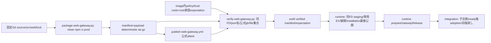
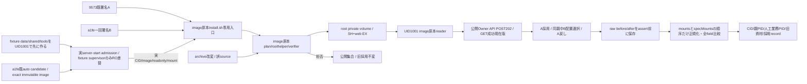

# Web受付専用の固定artifact・公式verifier・OIDC発行

商用配布の正本。runtimeの[配置/reader](../runtime/web-gateway-release.md)とintegrationの[子切替](../integration/README.md)へ接続する。正式供給run41545179742/source9573では両native archive/ABI/OIDC/公式検証が成功。root配置/Host/本番は未成立。online配置はruntimeの専用EXと既全体SHを使い、こちらから全体lockや採用stateを変更しない。

実装とcaller: scripts/package-web-gateway.py、scripts/web_gateway_artifact.py、scripts/verify-web-gateway.py、config/web-gateway-verification.json、config/web-gateway-trusted-root.jsonl、専用workflow。既scripts/package-server.mjsがverifier共通moduleと2configをimageへ収録する。既DockerfileのCOPY/chown rootを使用し、新mountや署名秘密鍵を追加しない。

署名検証CLIは /usr/bin/python3 /app/scripts/verify-web-gateway.py ARCHIVE BUNDLE EXPECTATION。image内policyは固定repo/workflow/ref/Node26/protocol1とtrustrootを持つ。EXPECTATIONはrootwriterが承認済archive/source/signer各SHAからroot通常fileへ作り、未検証manifestから自己生成しない。archive/bundleはEpiの同FD snapshot先。成功時だけ schema bellteam.web-gateway.verification.v1 とarchiveSha256/manifestSha256/manifest/verificationを返す。installation.json/採用stateを書かない。

packagerは固定Git treeからsrc/web/package/lockと購読用public JSON2fileを新stagingへ取り、clean npm ci --omit=dev後に全fileをhash。内部npm file symlinkだけをfileへ正規化、外部linkや特殊fileを拒否。archiveの版IDは外側SHA64hex。内容validatorは通常fileの完全集合/重複/越境/サイズ/bytes/SHA/固定entry/Node26/parentProtocol1を確認する。fixtureとunsigned入力はcrypto成功やroot配置へ拡張しない。

公式仕様: [GitHub attestation](https://docs.github.com/en/actions/how-tos/secure-your-work/use-artifact-attestations/use-artifact-attestations)、[gh verifier](https://cli.github.com/manual/gh_attestation_verify)、[offline trust roots/repository ID](https://docs.github.com/en/actions/how-tos/secure-your-work/use-artifact-attestations/verify-attestations-offline)。trusted-rootは公式ghのTUF検証出力をsourceに収録し、archive由来のrootを使わない。固定source採否後の実CIでcrypto・OIDC・両native archを確認する。

上限はarchive512MiB/bundle16MiB/manifest8MiB、展開総量512MiB/file20000。POSIX path/通常fileだけのUSTAR、先頭manifest、完全inventory、重複や余分fileを拒否。manifestのNode26/親契約1と現在archを照合する。Node currentが別majorなら公開資材生成を止め、自己申告で対応を広げない。

root expectationのwriterは通常installerのprivileged operatorから64/40/40hexを受けたroothelper。入力はarchiveSha256/sourceCommit/signerCommitの3fieldで、incoming側期待JSONを読まない。公式verifierへはroot-owned通常fileと固定policyをO_NOFOLLOWで開き、同FDを/proc/self/fdでghへ渡す。GH_TOKENや本体の環境を渡さない。内容検査前に期待archiveSHAと公式crypto/repoIDを検証する。

公開packagerの--archはamd64/arm64。native workflowは対応runner自身を必須とし、ローカルのcross-arch入力はlockにinstall script/CPU/OS制約がなく、インストール出力にnative binaryがないJS依存だけを許す。native依存が増えたら対応runnerで作成する。署名していないローカル入力はnative両arch受入へ代用しない。

検証fixtureはtest/web-gateway-artifact.test.py、既収録境界はtest/server-distribution.test.mjs。正の単体試験はmock wiringの検査で、crypto成功へ加算しない。実OIDC workflowはsource採否後の固定run原本で別に記録する。

実archiveの子起動確認で、http-assets→http-server→subscriptionsがservices/subscriptions/{product,endpoints}.jsonをstatic importすることを確認。公開JSON2fileも固定収録し、完全自己完結を親/app fallbackで代用しない。

正式資材の親契約1はRoot交換候補78ce32b以降のentry ABIで、versionId/旧資材catalog引数とready.protocolVersion1/assetVersion/addressを要求する。専用workflowは実archiveからtest/helpers/web-gateway-artifact-probe.mjsを実行してこのABIと資材自己完結を検査してからattestする。旧f1deのentryはこの検査を通さず、正式parentProtocol1へ流用しない。正式署名sourceは交換/採用recordを統合した固定mainとする。ローカル入力の内容試験は正式署名やnativeARM実行を示さない。

Epiのonline installerは第三shell案をやめ、既install.sh早期modeへ直接収める。公開2file導入の接点を保ち、固定modelから現在CID/exact imageとroothelperを使う。収録3pathはdistribution/server/install.sh（既copy）、src/web-gateway-install-plan.mjs（既src全体archive）、scripts/install-web-gateway-release.py（明示追加）。第三COPYやCompose変更は不要。このruntime sourceはEpi固定commitを別に取り込み、配布側からroot実装を改変しない。

正式供給初回41544433881ではsetup-nodeのnode指定が27.0.0-alpha.0.0.0を選び、両archともNode26契約でpackagerが拒否した。専用workflowは承認済みruntime.nodeMajor26に合わせ26系の現行版を使う。packager/readerの互換拒否は維持し、全体imageや他CLIの公式現行版方針は変更しない。実署名工程には未到達、元run失敗を保持し同runを無変更再走しない。

正式供給run41545179742の実bundleを固定verifierへ渡すと、公式ghはbundleの拡張子を要求し/proc/self/fd/Nを拒否した。root専用0700一時dir内のbundle.jsonを同じ継承FDへのsymlinkにし、公式CLIの形式判定と同FD snapshot契約を両立する。通常入力pathの再openや検証前copyへ戻さず、gh終了・失敗時ともaliasを削除する。CLI3引数/公開schema/runtime writerへの契約は変わらない。

## 署名済二版と実root配置の有限CI

callerは`.github/workflows/verify-web-gateway-image.yml`→`test/helpers/web-gateway-real-boundary.py`→imageの既install.sh。guestは`test/helpers/web-gateway-runtime-guest.mjs`で、supervisorだけを置換し全業務bootstrapを合成する。roothelper/installer/verifier/reader/application-runtime/API/gatewayはimage実bytes。実署名/実rootと空Bot/合成client/人工業務processを区別する。通常起動全体・Owner実認証・実AI保持・Host/本番の保証へ拡張しない。

Aは9573/run41545179742、Bはmain a1feから新しく一回だけ作る有効署名版。fixture source採否後かつCI sourceをmainへ統合する前にB生成する。CIはA/B runの成功/attempt1/source/署名workflowとAPI ZIP SHA-sizeを検査し、同a1fe auto run41548170408のindex artifactに一致するimageだけpullする。追加build・署名A再発行・Release/promotionを持たない。

有限CI初回run41552323889は両archともfixture bootstrapのshared/memory作成でEACCESとなり、A配置前に停止した。fixtureは空dataのshared/tools中間dirをnested volume mountより前にUID1001/0755で作り、UID/GID/modeをassertする。Dockerに中間dir生成を任せず、private root 0:1001/0750と実image/helper/readerの所有・mode拒否は変更しない。両cleanup残存0と失敗原本を保持し、同runの無変更再走はしない。

最終inspectはraw before/afterをassert前に保存し、比較用copyのmountsをDestination順、specMountsをTarget順に整列する。target欠落/重複は拒否し、ID/image/PIDと全選択field、Source/Mode/RW/Propagation/VolumeOptions.Subpath/NoCopyを含む全要素を保持する。他配列は変更しない。最終確認stageはverify-final、差分top-level field名をerrorへ残し、空例外は型名を残す。失敗でも既finally cleanupとresult保存を通す。run41554930932のafter欠測は復元せず総合失敗を維持し、Root別件の順序差観測から元runの具体差分を断定しない。
