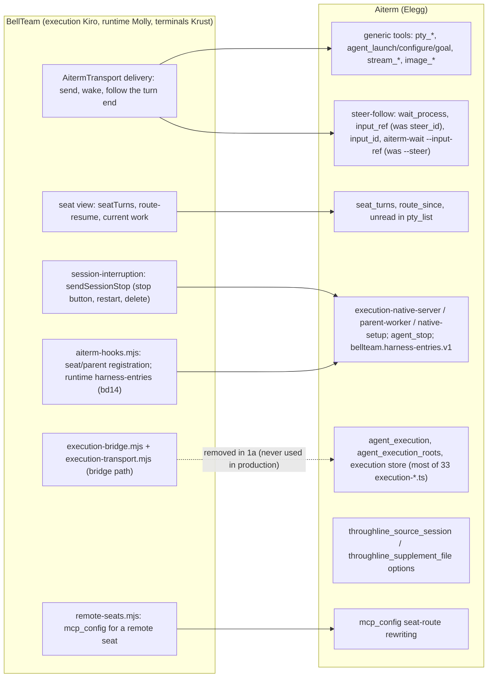

# Moving BellTeam's execution model out of Aiterm (a532b2, Tronie ruling a532, 2026-11-23 JST)

Owner: Kiro (execution). Counterpart: Elegg (Aiterm; mirror in aiterm-mcp `docs/architecture/bellteam-boundary.md`). Owner's principle: Aiterm relays what the machine's mouth offers; BellTeam-specific features live in BellTeam. Staged, nothing stops: BellTeam takes each piece live before Aiterm drops it, and Aiterm stays usable standalone. Source of the piece list: Elegg's inventory (`bot-c2adbe04/docs/aiterm-boundary-inventory-20261123.md`, aiterm-mcp 0.70.98). Rulings: Tronie accepted the order and owners below (2026-11-23).

## Function diagram (who calls which Aiterm piece today)

## Data flow

Nothing here adds a data path. Each stage replaces an Aiterm-shaped fact by one BellTeam derives from generic Aiterm facts (`pty_list`, `pty_observe`, the seat's events and transcript through `aiterm-transcript-read`), compares both in a shadow run, switches, and only then Aiterm drops the shaped one. State files stay Aiterm's (state root); BellTeam reads them only through tools and CLIs.

## Pieces, live conditions and drop conditions

| Stage | Piece | BellTeam caller today | Live in production? | BellTeam-live condition | Aiterm drops when |
| --- | --- | --- | --- | --- | --- |
| 1 | `agent_execution`, `agent_execution_roots`, execution store | `execution-bridge.mjs` (class removed in the 1a PR; only the reference builders stay) | **No**: production never built an `ExecutionBridge` (`executionBridge` was always null; tests only) | BellTeam deleted the bridge path (1a, this change); one live delivery after the train | Elegg's 1b, after BellTeam's 1a is live |
| 1 | `throughline_*` launch options | none in `src` | No | none needed | **Stay in Aiterm** as a generic cross-harness fork feature if they carry no BellTeam names (Tronie ruling 2026-11-23) |
| 2 | `mcp_config` seat-route rewriting | `remote-seats.mjs` builds the config | Yes (remote seats) | BellTeam builds the final config, Aiterm passes it unchanged; lab remote-seat run | after that |
| 3 | `seat_turns` / `route_since` / `unread` (design: [seat-view-shadow.md](seat-view-shadow.md)) | `#seatTurns`, route resume | Yes (seat view, current work, remote route) | BellTeam derives them from generic facts; shadow run with zero differences | after the shadow run |
| 4 | steer-follow outputs (`wait_process`, `steer_id`, `input_id`, `aiterm-wait --steer`) | `waitProcess`, `steerFollow`, `waitUntilDone` | Yes, every delivery | **Not a move (Tronie ruling A, 2026-11-23):** steer-follow stays in Aiterm as a neutral machine-mouth feature: `steer_id` -> `input_ref`, `--steer` -> `--input-ref`, no BellTeam wording and no caller gating; BellTeam keeps only its consumer and adopts the new names | Elegg's rename (Aiterm 0.70.105 offers both names); BellTeam reads `input_ref` and falls back to `steer_id` only for an older Aiterm (2026-11-23, a532b2k); Elegg drops the old names once container and terminals are >= 0.70.105 |
| 5 | `agent_stop` | `sendSessionStop` | Yes (Owner's stop) | BellTeam stops through `pty_key` + the seat's child lineage; lab-compared | after that |
| 5 | `execution-native-server`, `execution-parent-worker`, `execution-native-setup`, `bellteam.harness-entries.v1` | `aiterm-hooks.mjs` (runtime bd06), `harness-entries.mjs` (bd14) | Yes | runtime runs on a generic Aiterm entry (Molly) | after that |

## Ownership

Execution (Kiro): stages 1a, 2 (BellTeam side), 3, 4, 5 stop. Runtime (Molly): registration and harness-entries (stage 5), the door a532b1. Terminals (Krust): the terminal side of the seat route (stage 2). Aiterm (Elegg): every Aiterm drop, any generic read BellTeam still needs. Adoption: Epinel. Lab: Centi.

## Rules for every stage

A stage ships as: diagram here first, BellTeam change live (train), one live confirmation, only then Aiterm's drop PR. A drop never precedes its replacement being live. A step that cannot be shadow-compared (stop) is compared in a lab first. No stage adds a guard that gives up a delivery.
