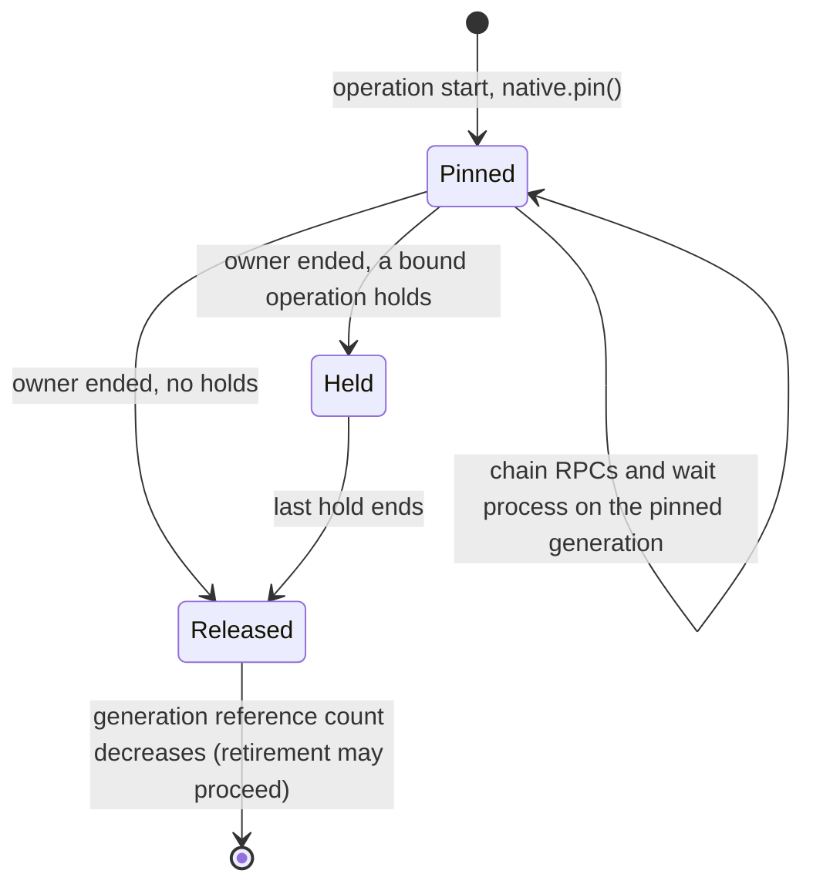

# Aiterm generation pin in execution (Trony priority 3)

Owner: Kiro. Facade and lease contract: [runtime/aiterm-generation-client.md](../runtime/aiterm-generation-client.md) (Elegg). Design: Kiro `docs/aiterm-hot-generation-execution-seam-20261108.md`, Elegg `aiterm-hot-generation-adoption-20261108.md` (A3), Trony 2026-11-08.

An execution operation whose RPCs and child processes share generation-local values (receipt, `event_cursor`, `launch_id`, interim offset, `wait_process` closure, SDK/transport identity) takes one `native.pin()` at its start and sends every RPC of the chain to that generation. The pin is released once, at the operation's real end. A caller timeout never releases it. With a single generation the pin only delegates.

| Function | Input -> output | Pin scope |
| --- | --- | --- |
| `operationLease(client)` (`src/aiterm-transport.mjs`; the execution release is a closed 51-file set, so it lives in an existing file) | dispatcher native -> `{ client, generation, hold(), release() }` | one `pin()`; the pin is released when the owner's `release()` and every `hold()` have ended. A client without `pin` (tests, plain AitermClient) is used as is |
| dispatcher `native.pin()` | facade lease -> lease whose `call`/`connect` keep the dispatcher's `alive()`, method allowlist and `track()` | the facade lease; `release` is forwarded |
| `AitermTransport.submit` / `DeliveryJob.native` | job -> lease taken before dispatch | `pty_send` (`sendToSession`), `wait_process` (`waitUntilDone`), interim `pty_observe` (`followInterim`), transcript `pty_read` (`readTurnAnswer`). Released where the job leaves the registry (`activity.release`): after native completion settles. An unconfirmed native completion keeps the job and its pin |
| `watchSeatTurns` -> `watchTurn` | one lease per scan; each started `SeatTurnWatch` holds it | `pty_list` seat-turn read, the turn's `wait_process` and interim reads. Released at `endWatch` |
| `observe(bot, chain)` cursor chain (`IdleSessions`) | `{ cursor, generation }` -> observation + next chain | one pinned `pty_observe`. A cursor is sent only to the generation that issued it; after a switch the chain restarts without it (re-baseline: the idle count starts again) |
| `ModelHandoff.prepare` / `begin` | the handed-off job -> connection from `job.native` | `captureHandoffConnection` comes from the job's generation, so the capture boundary and `job.receipt.event_cursor` come from one store. prepare holds the job pin during capture; begin holds it until `operation.completion` |

Not pinned (per-RPC on the current generation):

| Call | Why |
| --- | --- |
| `agent_launch`, `pty_close`, cursor-less `observe`, `pty_list`, `screen()`, goal reads | single RPC; the facade holds a temporary reference to its real completion |
| `ConfigurationRequests.apply` / `reconcile` (`agent_configure`) | each is one RPC with no SDK/transport identity binding (`expectedConfiguration` has no caller). Reconcile is a same-ID seat-level read; live generations share native ownership (Elegg A3 overlap), so it is valid on the current generation. A lease cannot be stored in the handover-cloned request record |
| seat-level stops (`sendSessionStop`) | Elegg A3: seat-level stops share native ownership across live generations |
| execution reservations / `interruptExecutions` | only with `executionBridge`, which the dispatcher's managed transport does not assemble (`executionBridge: null`) |

DFD: dispatcher native (facade) -> `pin()` -> lease (dispatcher checks) -> DeliveryJob / SeatTurnWatch / observe chain -> original AitermClient of that generation -> receipt / turn / cursor stays with the operation -> real end -> `release()` -> facade reference count -> `retireGeneration` waiter (Elegg/Molly).

Guard check: the pin adds no stop and no wait state. Its exit is the operation's existing real completion.

Tests: `test/aiterm-generation-pin.test.mjs` with an injected two-generation native fake (publish while an operation is active).
