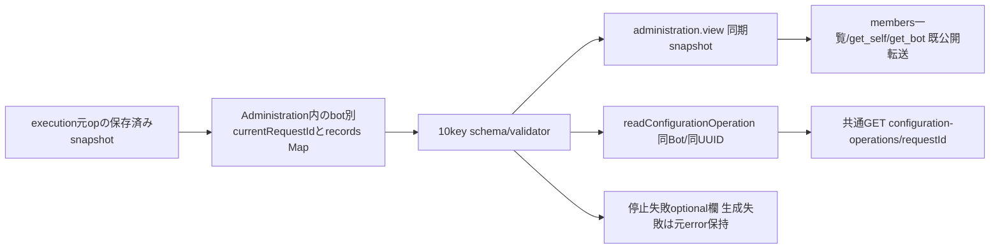

# 自動設定操作の閉じた公開状態

所有キロ。既configuration port内の追加状態。公開HTTP登録はモリー、membersの一覧/MCP転送はベロータ。自動中断/設定/再開を発行するnative gateは別差分で、本sourceは合意済みDTO/同期snapshot/同ID読取/stop失敗への安全な追加欄だけを持つ。

`automaticConfigurationApplicationSchema`と`automaticConfigurationApplication`が唯一の閉DTO正本。schema/requestId/state/phase/effect/laterEffect/stopIntent/admissionStopped/revocation/errorCodeの10keyだけを許可し、accessor/余分key/不正UUID/不正enumを拒否。新snapshotを返し、native point/本文/設定/関数/Promise/生例外を公開しない。

Administrationの`automaticConfigurationOperations`は投影専用のvolatile Map。Bot ID→`{currentRequestId,records:Map<UUID,DTO>}`。gateの権限・耐久intent・native結果そのものはこのMapから作らない。writerは元bindingへ検証済みのsnapshotだけをpublishする将来のnative gate所有者で、本sourceは自動operationを生成しない。交換handoffはMapをcloneして運び、旧handoffで欄が無ければ空とする。process再起動後の耐久復元は本sourceの成立範囲に含めない。

`view(bot)`はcurrentRequestIdの同期snapshotだけをoptional `automaticConfigurationApplication`へ追加。既configurationApplication/configurationRequestの意味と値を保つ。AのrecordsはBのcurrentへ付け替えず、`readConfigurationOperation(botId,requestId)`は指定の元recordを独立に返す。native RPC/commit/revoke/launchを呼ばず、unknownや未記録でfenceを解除しない。認可とfresh対象確認は既親入口、methodもBOT_NOT_FOUNDを不正IDより先に返す。不正ID400/未記録404/不正record又は読取不能503、unknown recordは正常DTO。

stop失敗は既BOT_STOP_UNCONFIRMED/causeを維持し、validatorを通した同optional欄だけを添える。生成に失敗しても元停止errorを置換しない。親は既502/messageを維持する。local intentだけでstop_sent/interruptedへ変更しない。

この先行sourceはnative受領/非波及/終端/unknown収束の実装成功ではない。旧成功群を再走せず、直接DTOの入力拒否/同Bot・同ID読取/同期view/失敗時の旧stop契約だけを確認する。新相対import `src/automatic-configuration-application.mjs` は将来のM execution署名closureに必要で、J既署名工程の待ち条件にはしない。
