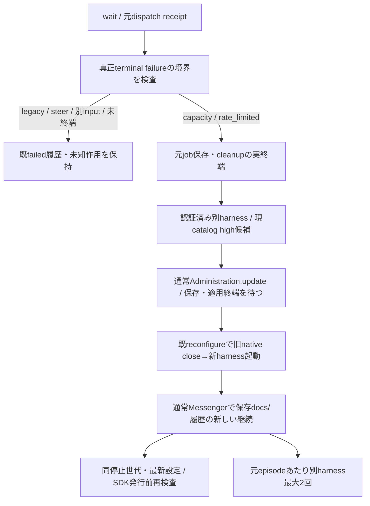

# capacity・利用上限からの継続

所有キロ、native failureとinput_id境界はAiterm担当。元本文は再送しない。

分類は固定capacity/rate_limited、真正terminalとreceiptのsession/launch/vendor/event_cursor・turn/operationを照合。Claudeはinput_idも完全一致、Codexは当該cursor/turnを使う。future_effects unknownと実行started/unknownを保持し、分類からnot_startedや元本文再送権を作らない。画面のみ/欠測/別会話watchは自動継続の証拠にならない。

新配送は元deliveryのfailedを変更せず、保存docs/会話から未完了の目的を確認する固定指示だけを送る。元jobのcallback/画像cleanup/lease終端を先に終える。候補は既HarnessAuth.statusとLiveModelCatalogから認証済み・high対応だけを選び、Codexは現在catalogの最新Sol、他は同catalog既定を優先。同harnessを連打せず元episodeあたり別harness最大2回。catalog/認証失敗は飛ばし、設定適用失敗/不明は追加送信しない。新しいOwner仕事・設定変更・個別/全体停止・closeは古い回復を中止する。

設定保存と実適用の受付を混同しないため親内部waitForApplicationを使い、通常reconfigure Promiseを既configurationChangesへ登録して配送の発行順を保つ。親の同期admissionCheckだけを送信先へ閉包し、child DTO/履歴へ関数や内部設定を出さない。終了時はcoordinatorを閉じ、進行中の受付/設定終端を回収してからSDKを閉じる。既moduleのwriter/guardを再利用し新しい復旧UI/汎用queue/停止権限は作らない。

Claudeのアカウント上限（`accountLimit`）は別harnessより先に同じharnessの別アカウントで続ける。`continue`は`pending`を登録簿へ書き、`transport.recoverAccount`へ渡すだけで、席の移動と一回だけの継続文（`resume`）は[harness-accounts.md](harness-accounts.md)の「account recovery」が持つ。空きアカウントが無く、Aitermの真正terminal証拠がある時だけ従来の別harness切替へ進む。
