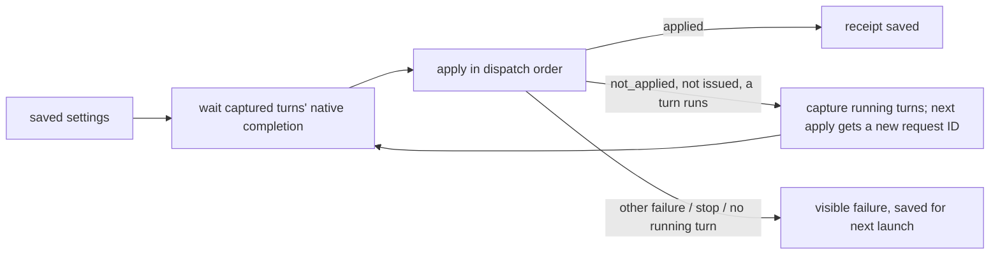

# Delivery admission and deferred settings

Owner: Kiro. Owner/Trony D-steer ruling, 2026-11-07. Settings changes are owned by the configuration operation, not a prerequisite of every message. The full configuration state machine is [configuration-requests](configuration-requests.md).

## Function map and DFD

Original saved Owner/Bot/room/schedule ID → authorized current member → execution generation → registered job → stop/restart checks → per-target native acceptance order → native send with `require_agent` → receipt/stop reconciliation → saved acceptance → background completion. No presence observation precedes ordinary input. After an explicit not-sent refusal, matching presence/failed-record observation can authorize recovery; observation failure alone never refuses the original send. A missing audit receipt does not prevent sending to the selected session. No old message is replayed after an unknown send.

Saved model/effort/fast → explicit configuration operation → captured current-turn completion → same dispatch acceptance order → apply desired settings → persisted applied receipt → next delivery. Messages while that captured turn is running bypass the deferred settings operation. The wait captures existing turn completions rather than following newly arriving jobs indefinitely. Once the captured boundary is reached, an already-queued delivery can perform the same idempotent configuration operation inside its ordered slot; it never waits on a configuration slot queued behind itself. No running-turn message is required to wait for an idle-only configure call.

New launch still receives saved settings. Present-session delivery no longer invents a fresh configuration request because an audit record is absent. Failed/unknown historical configuration audit remains a fact, not a lock on input. Explicit configuration/restart failures retain their original receipt and visible failure. A native autonomous successor (goal/queued steer/child return) is outside BellTeam's delivery order; a strict before-every-native-successor guarantee requires Aiterm's boundary contract, not a caller-side claim.

A delivery can reach the CLI as a new turn before BellTeam's wait for the captured turn returns (production 2026-11-13 06:33Z: an `after_turn` continuation arrived at the boundary; Aiterm refused the apply, which was never applied again, and the seat kept running on the old model). So a deferred apply refused with `CONFIGURATION_NOT_APPLIED` / `not_started` while a turn of that Bot runs captures the running turns again and applies at their end, as a NEW configuration request (fresh ID): the refused request keeps its terminal `not_applied` receipt under its own ID ([configuration-requests](configuration-requests.md)), and the caller's application takes the ID of the final receipt. Stderr: `BellTeam configuration: not applied while a turn runs, again at its end`.

## Guard and wait inventory

The allowed protection names below are data loss, wrong target, secret exposure, privilege escalation, and overwriting state. A terminal rejection exits that request; it does not authorize replay or undo an explicit Owner stop. Existing component owners retain their own implementations.

| Contact / condition | Decision and named protection | Exit / progress |
| --- | --- | --- |
| HTTP/MCP actor, target lookup, input/image validation | Keep: privilege escalation, wrong target, secret exposure | Valid request proceeds; invalid request ends with the existing error |
| Durable original save/fsync and append queue | Keep: data loss, overwriting state | Write completion releases queue; failed write rejects that request; later writes retain their chain |
| Durable ID claim / queued-only eligibility / one target lane | Keep: overwriting state through duplicate external actions; saved order | Native acceptance/error releases lane; new pending IDs drain; historical unknown IDs remain terminal and are not replayed |
| Parent exchange mutex, ready/AI-enabled check | Keep: overwriting state during module exchange; privilege escalation after explicit pause | Exchange completes/rolls back and existing ready notification drains saved inputs; pause is explicit Owner authority and ends the attempt until Owner resume |
| Fresh member read, opaque members lease | Keep: wrong target / privilege escalation after member deletion or replacement | Short read/lease completes; module resume admits new requests; revoked request ends |
| Execution factory availability, method allowlist, generation checks | Keep: wrong target, privilege escalation, overwriting retired state | Existing lifecycle rollback/recovery restores available generation; stale request ends |
| Conversation native claim / callback lifetime | Keep: data loss and duplicate/overwritten conversation history | Accepted operation retains writer lifetime until terminal; module recovery admits later requests |
| Register/admit job | Keep bookkeeping, not an acceptance prerequisite from a historical receipt | Released on completion/failure; failed projection is outside active jobs |
| Explicit stop epoch/job stop check, executionStopping wait | Keep: privilege escalation by running canceled work; wrong target during stop/restart | Stop operation settles; canceled request ends, independent later request proceeds |
| Nondeferred restart/reset barrier | Keep: wrong target and overwriting state while replacing a session | Explicit operation settles success/error; subsequent dispatch judges target afresh |
| Deferred model/effort/fast wait before current-turn message | Remove: no allowed protection from holding an authorized steer | Input goes to current turn; captured boundary applies settings before later BellTeam delivery |
| Deferred apply refused because a new turn already runs (a53) | None held: the refusal is Aiterm's, not issued (`not_applied`, `later_effect: excluded`) | The apply runs again when the turns running at the refusal end; it repeats only for this refusal while a turn runs. A stop, another failure, or a refusal with no running turn ends the operation as before |
| dispatchInOrder acceptance serialization | Keep minimum: data loss/overwriting the same composer; prevents two launches or overlapping inputs | Prior acceptance or rejection settles; chain never awaits turn completion |
| Desired-configure-before-every-send / matching persisted audit prerequisite | Remove from message path: settings are an explicit operation, no allowed protection from delaying steer | Explicit boundary configuration owns desired apply/audit; input does not wait on missing history |
| Observation RPC and strict BOT_OBSERVATION_FAILED before native input | Remove both from ordinary input | Send goes directly to the selected agent; observation is only part of refusal recovery |
| Matching observation before absence launch or failed-record close | Keep: wrong target / overwriting a live session | Valid observation permits the operation; otherwise return the original refusal without mutation or replay |
| Temporary image validation/create/cleanup | Keep: secret exposure, data loss, overwriting existing files | Existing bounded read/write finishes or rejects; cleanup follows completion; borrowed files are never deleted |
| SDK connection wait and final admissionCheck | Keep: wrong target connection / privilege escalation after stop | Connection succeeds or rejects with transport deadline; next request can reconnect; no replay of uncertain call |
| pty_send require_agent | Keep: secret exposure/wrong target from typing a message into an ordinary shell | Registered agent accepts; explicit not-sent missing registration uses existing authorized wake path |
| Native receipt shape / steer-follow metadata | Keep AFTER input: data loss / wrong target from attributing answer or acceptance to unrelated work | Valid receipt tracks completion; invalid receipt records unknown/failure and ends, never resends |
| BOT_SEND_OUTCOME_UNKNOWN / resume error versus unsent classification | Keep: overwriting state from duplicate external effects | That input ends with original fact; independent later inputs remain admissible |
| Known missing-seat/registration wake and bounded just-woken readiness retry | Keep minimal: wrong target, data loss; retry only explicit not-sent | Wake or bounded refusal ends the attempt; no blind retry after uncertainty |
| Status callback before acceptance return and completion receipt tracking | Keep: data loss of durable result | Save settles before ACK; completion runs separately, does not serialize subsequent input |
| Legacy ExecutionBridge reservation/registration | Not on ordinary path (`createManagedTransport` fixes null); preserve compatibility validation for injected callers | Its existing bound receipt/error ends that optional request; no new ordinary-input prerequisite |

Aiterm owns its native locks, queue, readiness and refusal audit. BellTeam does not duplicate those internals or use a valid caller-side proof to claim native/live success.

## Failure visibility

Original groupId and terminal failures remain in history. Accepted input with unknown completion retains the existing tracking marker; no automatic replay. Failure callback finishes before acceptance rejection. Latest failed queue projection is outside active/idle state and clears on a later accepted job. Diagnostics contain fixed stage and IDs only. Diagnostic failure does not change admission.
