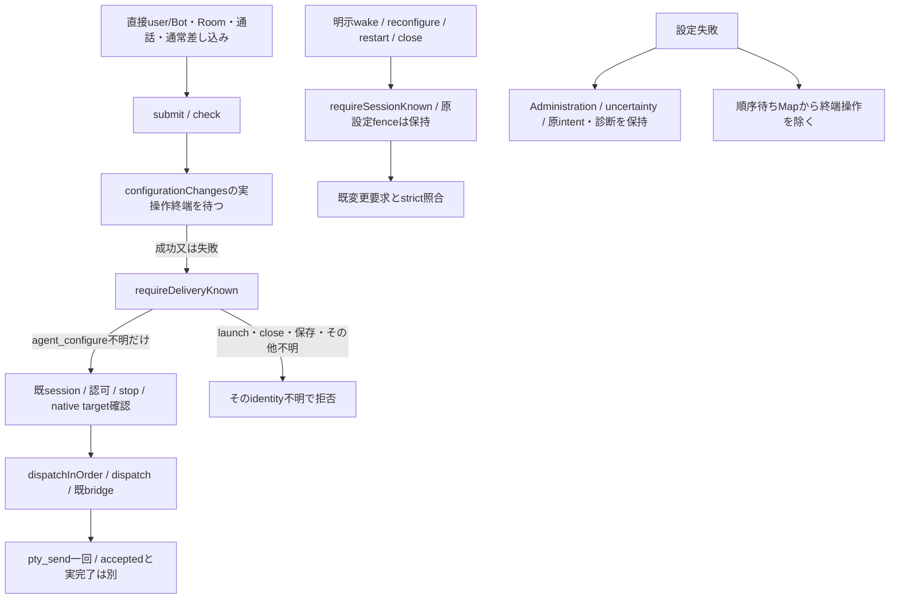

# 設定適用の不明と通常配送の分離

所有キロ。Owner直接訂正/Root configuration-uncertainty-delivery-fix-20261103.md（SHA2a6fcbb）が本契約の根拠。原設定の未確定を、稼働する既存席への通常連絡の拒否理由にしない。旧legacy/null-bindingと新trackedを同じ判定にする。設定画面・原診断・希望/application・原bindingと不明versionは保持する。

| 接点 | 判定・所有 |
| --- | --- |
| `BotSessionState.requireDeliveryKnown` | agent_configure causeだけを配送拒否から除く。Map/versionを書かず、未知causeは従来の拒否 |
| `requireSessionKnown` / `configurationFence` | 変更・新要求・元要求の照合はstrictのまま。配送可能は設定成功/適用確定/解除ではない |
| `ensure` | 既session実在なら配送用判定。実在読取後に停止世代/identityを再検査。席不在からのwakeはstrict、設定不明を起動・設定再applyへ変換しない |
| `memberOperation` / `awaitUnboundAdmission` | fresh本人/同live lease/停止世代と配送用identityを確認。変更callerはnative変更前のstrict changeSession/wake/reconfigure/restart検査を別に保持 |
| `submit/check` | 順序待ちのrejectを設定失敗の再送拒否へ伝搬しない。待ちの後と認可後、発行前に配送用判定を再検査。停止・認可・leaseは従来のまま |
| `dispatchInOrder/dispatch` | 同Bot発行順序を維持。直接dispatch callerにも配送用判定を適用し、既bridgeのcheckへ同じ検査を渡す。target不明から新席を作らない |
| `SeatActivity.configurationChanges` | 進行中操作の順序待ち。restart/stopForConfigurationの終端失敗も除く。過去の残留rejectがあっても配送は終端後のidentityを判断。application/診断/uncertaintyを代用・消去しない |

Bridgeは通常のreserveExecution/dispatchExecutionの公開接点を保持する。旧adapter注入時の観測・target validationは既契約だけ、モデル不明のための新observer/退役証拠/承認は加えない。直接連絡・Room・通話は全て既notify/turn/submitへ合流し、本文再送や新配送queueを作らない。既sessionへの通常入力の成立と、旧設定の根因/実効model/原RPC後発作用は別に扱う。

直接確認はtest/configuration-uncertainty-delivery.test.mjs。実AitermClient/ConfigurationRequests/Intents/BotAdministration/transportへ隔離SDKを注入し、legacyとtrackedの失敗を生成→既同session一回配送→原version/希望/application/診断の不変と設定RPC追加0を確認。失敗Promise残留と進行中reject、strictなlaunch/close/保存不明、認可・全体/個別停止、既bridge相関、ensure不在時のwake拒否を扱う。これはsource/fixtureの受入で、実席復旧・本番反映の証明ではない。
