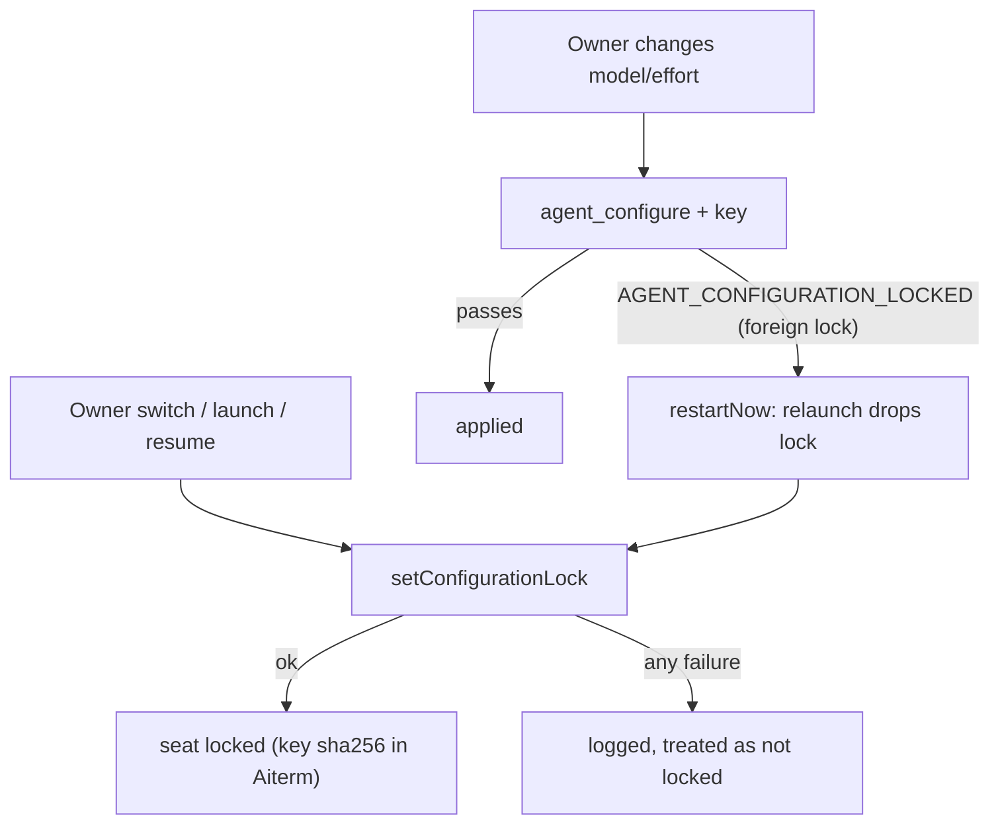

# AI settings lock on the seat (a314)

Owner: Kiro. Owner spec 2026-11-17 "AI設定の固定". BellTeam's refusal of a Bot's own change is [control-details.md](../../control-details.md) (a312); this page is the Aiterm side: a locked seat also refuses an AI's direct Aiterm calls.

Public contract used (aiterm-mcp 0.70.71, Elegg a313): `agent_configure {session_id, configuration_lock: "lock"|"unlock", configuration_lock_key}`; a call that changes model/effort carries the same `configuration_lock_key`. Aiterm keeps only sha256(key) per launch; `pty_close`/relaunch drops it. Refusal = `AGENT_CONFIGURATION_LOCKED` (`configureRefusal.code`).

| Function | Contract |
| --- | --- |
| `ConfigurationLock.key(botId)` (`src/configuration-lock.mjs`) | key = hex HMAC-SHA256(install secret, "aiterm-configuration-lock:" + botId), 64 chars, stable across body restarts and generations. The install secret is created once (`wx`, 0600) at `execution-configuration-lock.key` beside the other execution state; the key is passed to Aiterm only, never to the seat's AI, log or diagnostics. No path configured (tests) = no key = no lock. |
| `AitermTransport.setConfigurationLock(bot, locked)` | One `agent_configure` lock/unlock call on a running seat. Any failure (old terminal drops the fields, foreign lock, Aiterm down) is logged and returns false: "not confirmed" means not locked, never a reason to stop the seat or refuse the Owner. |
| After every launch / resume | `wakeNow` and `resumePreviouslyActive` call `setConfigurationLock(bot, true)` when the saved Bot has `configurationLocked===true`, because a new launch has no lock. |
| After the execution module starts (a339) | `initialize` of a new engine (exchange, restart, handover) calls `AitermTransport.relockSeats(all Bots)`: one `pty_list` read, then `setConfigurationLock(bot, true)` for each running Bot with `configurationLocked===true`. A seat locked on a body that never sent the lock (the lock goes out only at launch, resume on a fresh body, or an Owner flip) is protected from the first start of this engine. Same key = no-op for a seat already locked; failures only log. `resume` after a quiesce does not repeat it (Aiterm still holds the lock). |
| Owner flips the switch | `BotAdministration.update` saves first; when `configurationLocked` changed and the seat runs it calls `setConfigurationLock` (tracked, never fails the PATCH). |
| Owner's change on a locked seat | `ConfigurationRequests.apply` and the plain configure add the key, so BellTeam's own configure passes. |
| Foreign lock | A lock BellTeam did not set (an AI locked an unlocked seat with its own key) refuses BellTeam's keyed configure with `AGENT_CONFIGURATION_LOCKED`. `reconfigureNow` then relaunches the seat (`restartNow`, which drops the foreign lock and starts with the saved model/effort) and the launch locks again if the switch is on. The Owner's change always lands. A foreign lock on a seat whose switch is off is left alone (unlock with BellTeam's key is refused, logged). |

Protection: the Owner's chosen model/effort are not rewritten by an AI through Aiterm. Exit: the Owner turns the switch off (unlock), or the seat closes. Limit: the key derives from a file in BellTeam's state; an AI with that file could unlock, which this lock does not defend against (honest-AI protection, as the Owner specified).
