# Saved settings, turn boundaries and append-only audit

Owner: Kiro. Owner/Trony D-steer contract, 2026-11-07. Preserve saved model/effort/fast changes without placing idle-only configuration ahead of current-turn input.

| Function / owner | Contract |
| --- | --- |
| Members saved settings | Canonical desired model/effort/fast remain in the member record. BotAdministration saves first and owns the pending/accepted/failed application view. |
| Explicit configuration | Capture existing turn completions, allow new steering, then apply in the per-target native acceptance order before later BellTeam delivery. Concurrent arrival can invoke the same idempotent apply in its slot instead of waiting on itself. Actual configuration remains tracked for exchange/shutdown. |
| Native turn boundary | Existing accepted native completion, or existing watched external turn completion, is the boundary signal. The next BellTeam-started turn waits for configuration. Native goal/queued-steer/child-result successors need the Aiterm boundary contract; caller code alone cannot serialize them. |
| UUID-bound apply | Observed session/launch and desired digest bind a fresh explicit request. Original request/receipt remain immutable. Stop/member/generation checks prevent stale configuration from affecting a replacement. |
| Applied receipt | Only a terminal applied native receipt, persisted by ConfigurationIntents, proves application. Saved desired settings and a skipped busy apply are never promoted to applied. Existing storage validation stays; audit I/O failure is visible and is not a global seat lock. |
| Delivery | Saved original input does not require an applied audit record or a new configuration request. It steers while explicit settings are deferred. New launch receives desired settings through the launch contract. |
| Reconcile | Explicit same-ID historical inspection only; does not replay apply or original message. Failed/unknown records do not block new input. |
| Aiterm generation | apply and reconcile are single `agent_configure` RPCs on the current generation; not pinned across requests ([aiterm-generation-pin.md](aiterm-generation-pin.md)). |

```mermaid
stateDiagram-v2
  [*] --> Saved: save desired settings
  Saved --> WaitingBoundary: existing turn active
  WaitingBoundary --> WaitingBoundary: current-turn input steered
  WaitingBoundary --> Applying: captured turn completes
  Saved --> Applying: no existing turn
  Applying --> Applied: native applied and audit persisted
  Applying --> Failed: native rejection or recorded application failure
  Applied --> NextDelivery: same acceptance order
  Failed --> [*]: failure visible; independent input remains possible
  NextDelivery --> [*]
```

DFD: member save → explicit pending operation → captured turn completion → ordered idempotent apply → native terminal receipt → append-only audit/application view → subsequent BellTeam delivery. Separate DFD: original input → ordered send, bypassing deferred wait → current turn. There is no message-triggered cold-audit reapply, configuration-outcome fence, automatic old-ID retry, or private effective-settings getter.

Caller scope: BotAdministration update/apply, AitermTransport reconfigure/dispatch/submit completion, ConfigurationRequests/ConfigurationIntents persistence, and existing execution generation lifetime. The full [guard inventory](configuration-delivery.md) records named protections and exits. Existing explicit restart/reset/stop and public DTOs remain; native autonomous turn ordering is an identified integration boundary, not silently approximated.

## Native boundary evidence (Elegg, PR12 head 526262d)

Running-turn configure now refuses immediately with not_applied/not_started; the former 30-second recheck is removed. Codex active Goal configure can pause the goal, await its current turn, apply, then resume; that RPC must be an independent settings job, never a delivery prerequisite. A queued steer waiter identifies the end of the turn that consumed the input, including next_turn placement. BellTeam may order configuration and its next delivery after that waiter.

There is no public atomic boundary primitive for a non-goal successor the CLI starts itself. Claude/Grok/Cursor goal configuration remains unsupported. The current caller repair guarantees ordering for BellTeam-controlled next delivery, not a native autonomous successor; saved settings and application failure remain visible. This is an explicit outstanding native contact, not proof of full Owner boundary completion.

Elegg subsequently confirmed that the Codex Goal wait releases the native send FIFO: only pause/apply RPCs take it. He owns a planned 0.63.17 `agent_configure` implementation using the bound Codex `thread/settings/update` control call for subsequent turns while a turn is running. This avoids composer typing and covers native successors if verified. It is not released evidence: experimental API support, isolated native confirmation, and Windows lacking the control transport remain his stated constraints. No caller uses this proposed capability yet.
