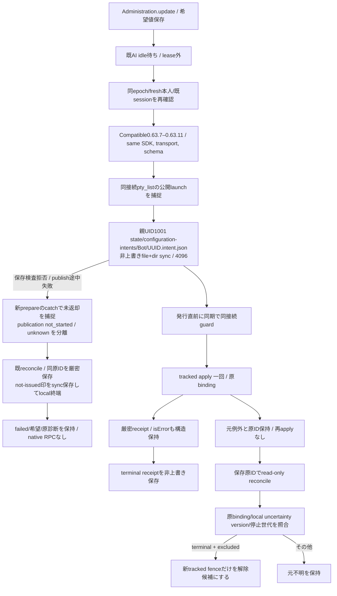

# 原要求を保持する設定適用と照合

Permanent owner Kiro; Root authorizes Molly for the bounded combined06311 lab compatibility repair. Formal aiterm-mcp0.63.11/source5ba97054 preserves the tracked configure contract (Elegg configure-contract-06311.json; configure-request.ts identical to public0.63.7). New requests accept the compatible published0.63.7–0.63.11 set on the same local SDK/transport plus the existing tools/list schema checks. Root selected a bounded compatible set rather than a new single-release pin; unknown future versions, older-runtime fallback and connection replacement remain refused. The persisted intent version names the current common contract, not a readback of the connected producer.

親のみが固定rootを組立て、HTTP/MCPでroot/pathを受けない。0700/0600、owner/realpath/祖先の非信頼writerを検査。既publishResumeFile/readResumeFileだけを再利用し、保存失敗・temp/nlink2・ACK欠測を未保存や新IDの許可へ変えない。members交換/通常更新で移管・消去せずTTL無し。廃棄はproduct state明示廃棄と同じ判断。stateが欠測した事から未受理を作らない。

runtimeの`acquireConfigurationStateAnchor(root)`が保証する固定stateの`{path,uid,dev,ino}`を内部assemblyから`trustedAnchor`として注入する。consumerはanchor自身のowner/realpath/no group-other write/dev/inoを毎回照合し、配下のprivate0700/0600を検査する。anchorより上のUID1000を一般許可しない。未注入は従来の全祖先検査。runtimeの信頼根拠と取得契約は[runtime](../runtime/README.md)が所有する。

新prepareのcatchだけが原objectに束縛した`preparation:{state:'not_returned',publication:'not_started'|'unknown'|'confirmed'}`を保持する。`not_started`は実storeがintent file writerへ入る前に拒否した内部証拠、`unknown`はpublish呼出の保存結果欠測、`confirmed`はpublish返却後。いずれもprepareがcallerへ返らなかった事実と、disk保存の状態を別にする。既reconcileはこの新しい同pending証拠がある場合にだけ、nativeへ送らず、原ID/全設定が一致するintentとnot-issued印の耐久保存を完成して原pendingを終端する。途中temp/不正file/別binding/active/別uncertainty/保存失敗は拒否・保持。新IDやnative receiptを生成しない。返却`localCompletion`はnative結果と別のschemaで、applicationはfailedのまま保持する。

旧Centi4faf/Molly146e/bot220 b6d3の表示、ENOENT、現行sourceから新preparation証拠を後付けしない。証拠無しの旧pendingはlocal終端対象外で、従来の保存原要求によるnative read-only reconcileだけが適用候補。元b5152件の欠測を補完しない。新証拠も、local終端保存前に親processを失えば欠測として扱い、再起動後のintentから未返却を推測しない。

保存原要求はschema/botId/binding/canonical requested/version。0.63.5–0.63.11 intentの読取は同一正式契約として保持するが、新発行guardは互換集合0.63.7–0.63.11と構造化能力検査。receiptにはapplyかreconcileかの取得起源を併記する。reconcileで歴史的applied/unconfirmedを得ても元の不明を解除せず、再起動後もpendingとして復元する。通常applyで直接確認したappliedと同一視しない。terminal以外は原intentを保持し、terminal receiptは一回だけ公開、再読取のobserved_at差以外を上書きしない。

application-servicesが同execution client/storeを注入し、公開受付前にpending intentをBotSessionStateの新tracked不明へ復元する。旧legacy不明を消さない。BotAdministration.viewのconfigurationRequestは原binding/requested/歴史的receiptで、currentはunsupported。既希望保存とconfigurationApplicationのpending/accepted/failedを現設定readbackへ変えない。known not_issuedは既表示not_applied/not_startedに写す。

Owner認証済みの既HTTP枠の`POST /api/bots/:id/configuration/reconcile`はbodyを`{request_id:UUID}`だけに限定する。保存済み原要求を読み、同approved local SDKで設定値無しreconcile一回。原ID/launchが無いlegacy不明、別bindingはnative発行前に拒否。現在のlocal uncertainty/versionと停止世代が変われば解除0。画面操作/goal/送信/再構成を行わない。新MCP toolやUIボタンは追加しない。

read-only結果のterminal/excludedは保存済terminal/native未発行だけ。成功でもnative入力ありはunconfirmedで、現在値一致・時間経過・handler終端・新版導入を解除根拠にしない。原設定の確定と[既存席への通常配送](configuration-delivery.md)は分離する。旧legacy/null-bindingも設定不明だけでは配送を拒否しないが、本口で新IDを付けたり原不明を消したりしない。親共有SDK closeも対象限定quiescence証明にしない。

callerはBotAdministration.apply/view/reconcile、AitermTransport.reconfigure/reconcileConfiguration、BotSessionStateのfence照合、Client限定bound call、application-servicesとhttp-bot-api。native変更をtracked apply以外へ迂回させない。同harnessの変更値消去やharness変更など既restart分岐は従来契約として分離する。低層単独transportの既legacy callerは明示注入無しの従来契約を保ち、通常本体は必ずtracked serviceを注入する。

ローカルでSDK発行前と確認できたguard拒否/停止は、原intentを残したまま`UUID.not-issued.json`を非上書きsync保存する。この印はnative receiptではなく、固定コードのWeakSetにある発行前例外からだけ作る。単なるerror.effect/codeやnative文字列を証拠にしない。保存失敗やpost-wire例外へこの印を付けない。後続の新しい明示要求は別原IDだが、同原IDのapply再発行は無く、known local not-issuedの原要求にnative reconcileを投げてnot_recordedを成功へ変えない。印とnative terminal receiptが同時にあれば不整合として拒否する。

有効な原apply応答を既に受けた後のローカル履歴保存失敗は、native原RPCの応答喪失と同一視しない。原intentと検証済み歴史的receipt/receipt_persisted=falseを保持し、新設定は保存回復まで止める。後のread-only結果が保持中の原応答と一致した時だけその原応答をapply起源のまま永続化できる。元応答を失ったRPC不明がreconcileだけで得たapplied/unconfirmedをapply起源へ昇格しない。

同じBotの後続要求が始まっても、失敗の補助情報は捕捉済み原bindingから作り、latestや時刻から付け替えない。安全診断は検証済みconfiguration_requestの4fieldだけを追加し、requested/receipt本文/SDK参照/任意messageをログへ混ぜない。既診断code/重大度/fingerprintは維持する。

SDKが同じ例外objectを異なる原要求へ再利用した場合は、binding補助情報を曖昧として省く。原例外を変形せず、別原要求の識別子を診断へ割り当てない。

0.63.7のfailure/input_id公開契約へconsumerを接続し、Dockerのnative pinも同じ正式版に固定する。旧.5/.6 intent bytesを書き換えず元IDで照合のみ可能。SDK/transport途中交換・未承認.6/.8からの新発行は引き続き拒否する。

## Combined0.63.11 changed contact

Function: configurationConnection accepts the published compatible0.63.7–0.63.11 producer set; configurationCapability still verifies apply/reconcile, binding and output schema before prepare. DFD: normal live PATCH→same approved local connection/schema→existing durable intent version0.63.11→same bound tracked apply→validated terminal receipt. Existing0.63.5/.6/.7 intent bytes remain readable; no replay, migration or history rewrite. Actual prior lab PATCH was refused before intent/dispatch and remains failed. One new explicit configuration on a different new management Bot verifies the repaired contact; no replay of the refused operation. Unsupported versions outside that bounded set still fail before writing/dispatch.
