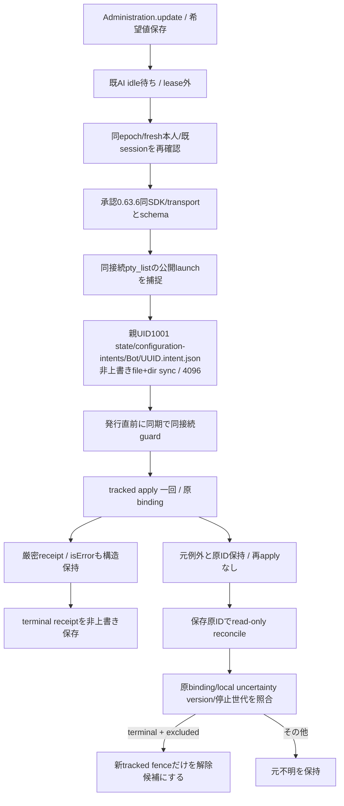

# 原要求を保持する設定適用と照合

所有キロ。正式0.63.6/tag258b8aef、Root configure-consumer-supply正本と0636 formal handoffが配布根拠。設定契約は正式0.63.5と同bytesだが、発行は承認0.63.6の同local SDK/transport/initialize版とtools/list能力を必須にする。旧版へのfallback/接続交換はしない。

親のみが固定rootを組立て、HTTP/MCPでroot/pathを受けない。0700/0600、owner/realpath/祖先の非信頼writerを検査。既publishResumeFile/readResumeFileだけを再利用し、保存失敗・temp/nlink2・ACK欠測を未保存や新IDの許可へ変えない。members交換/通常更新で移管・消去せずTTL無し。廃棄はproduct state明示廃棄と同じ判断。stateが欠測した事から未受理を作らない。

保存原要求はschema/botId/binding/canonical requested/version。0.63.5/0.63.6 intentの読取は同一正式契約として保持するが、新発行guardは0.63.6だけ。receiptにはapplyかreconcileかの取得起源を併記する。reconcileで歴史的applied/unconfirmedを得ても元の不明を解除せず、再起動後もpendingとして復元する。通常applyで直接確認したappliedと同一視しない。terminal以外は原intentを保持し、terminal receiptは一回だけ公開、再読取のobserved_at差以外を上書きしない。

application-servicesが同execution client/storeを注入し、公開受付前にpending intentをBotSessionStateの新tracked不明へ復元する。旧legacy不明を消さない。BotAdministration.viewのconfigurationRequestは原binding/requested/歴史的receiptで、currentはunsupported。既希望保存とconfigurationApplicationのpending/accepted/failedを現設定readbackへ変えない。known not_issuedは既表示not_applied/not_startedに写す。

Owner認証済みの既HTTP枠の`POST /api/bots/:id/configuration/reconcile`はbodyを`{request_id:UUID}`だけに限定する。保存済み原要求を読み、同approved local SDKで設定値無しreconcile一回。原ID/launchが無いlegacy不明、別bindingはnative発行前に拒否。現在のlocal uncertainty/versionと停止世代が変われば解除0。画面操作/goal/送信/再構成を行わない。新MCP toolやUIボタンは追加しない。

read-only結果のterminal/excludedは保存済terminal/native未発行だけ。成功でもnative入力ありはunconfirmedで、現在値一致・時間経過・handler終端・新版導入を解除根拠にしない。原設定の確定と[既存席への通常配送](configuration-delivery.md)は分離する。旧legacy/null-bindingも設定不明だけでは配送を拒否しないが、本口で新IDを付けたり原不明を消したりしない。親共有SDK closeも対象限定quiescence証明にしない。

callerはBotAdministration.apply/view/reconcile、AitermTransport.reconfigure/reconcileConfiguration、BotSessionStateのfence照合、Client限定bound call、application-servicesとhttp-bot-api。native変更をtracked apply以外へ迂回させない。同harnessの変更値消去やharness変更など既restart分岐は従来契約として分離する。低層単独transportの既legacy callerは明示注入無しの従来契約を保ち、通常本体は必ずtracked serviceを注入する。

ローカルでSDK発行前と確認できたguard拒否/停止は、原intentを残したまま`UUID.not-issued.json`を非上書きsync保存する。この印はnative receiptではなく、固定コードのWeakSetにある発行前例外からだけ作る。単なるerror.effect/codeやnative文字列を証拠にしない。保存失敗やpost-wire例外へこの印を付けない。後続の新しい明示要求は別原IDだが、同原IDのapply再発行は無く、known local not-issuedの原要求にnative reconcileを投げてnot_recordedを成功へ変えない。印とnative terminal receiptが同時にあれば不整合として拒否する。

有効な原apply応答を既に受けた後のローカル履歴保存失敗は、native原RPCの応答喪失と同一視しない。原intentと検証済み歴史的receipt/receipt_persisted=falseを保持し、新設定は保存回復まで止める。後のread-only結果が保持中の原応答と一致した時だけその原応答をapply起源のまま永続化できる。元応答を失ったRPC不明がreconcileだけで得たapplied/unconfirmedをapply起源へ昇格しない。

同じBotの後続要求が始まっても、失敗の補助情報は捕捉済み原bindingから作り、latestや時刻から付け替えない。安全診断は検証済みconfiguration_requestの4fieldだけを追加し、requested/receipt本文/SDK参照/任意messageをログへ混ぜない。既診断code/重大度/fingerprintは維持する。

SDKが同じ例外objectを異なる原要求へ再利用した場合は、binding補助情報を曖昧として省く。原例外を変形せず、別原要求の識別子を診断へ割り当てない。
