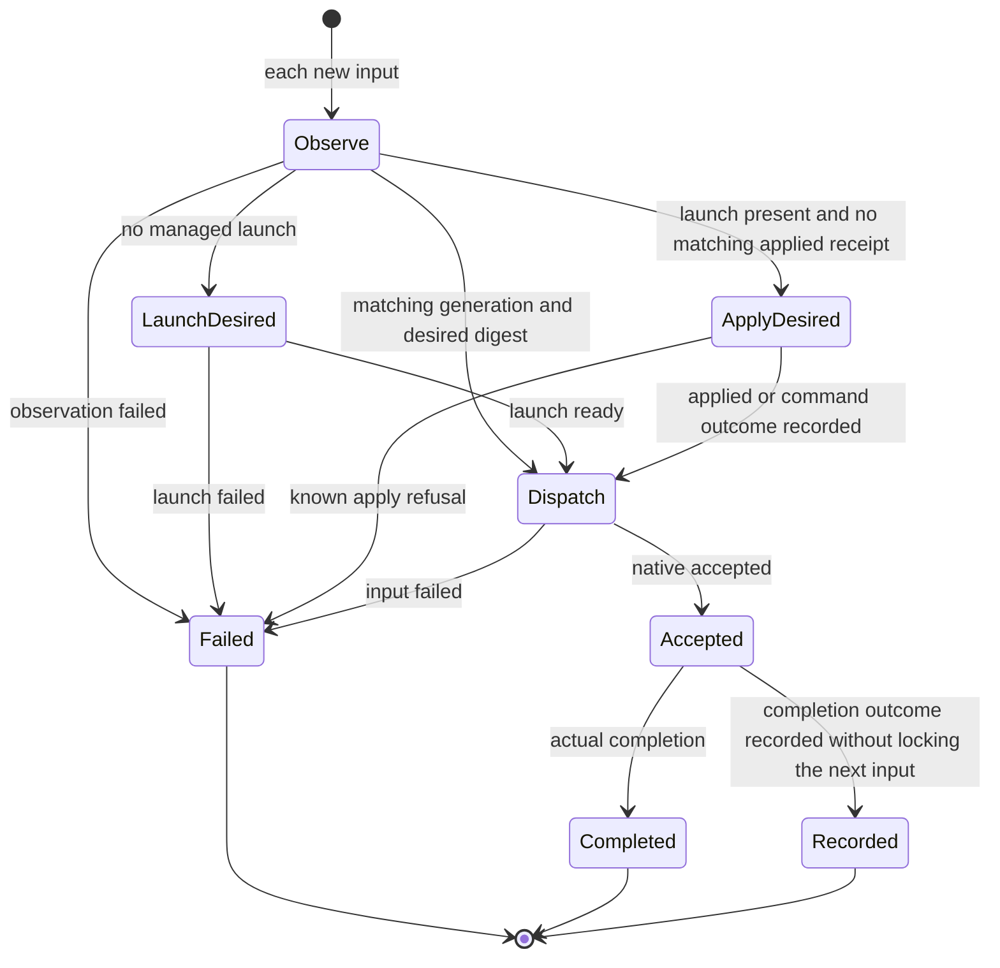

# Desired configuration and append-only audit

Owner: Kiro. Root/Owner final decision, 2026-11-07: configuration outcomes never create a seat lock. No effective-settings getter, closure certificate, issued marker, restore-time fence, or automatic retry loop is added. Existing Aiterm0.63.11 presence observation and UUID-bound apply are sufficient.

## Function map and owned data

| Function | Input/output and ownership |
| --- | --- |
| Desired settings | Members owns bots.json model/effort/fast. Each ordered delivery uses its fresh member snapshot. A desired seat should exist. |
| Presence observation | Aiterm pty_observe reports the current session name, managed launch ID or absence. Validate the typed response and generation before use. Saved desired settings are never called actual native settings. |
| Last applied receipt | ConfigurationRequests owns the latest verified audit receipt. Certainty is only a terminal applied receipt for this session/generation and canonical desired digest. Missing/failed/unknown/different digest is no lock: issue a fresh UUID apply. Cold restart may conservatively reapply. |
| UUID apply | Canonical settings, exact observed generation and append-only intent/receipt files. No version/tools-list/capability guard is placed before apply. Audit validation rejects unsafe writes but its failure becomes a warning, never an apply/dispatch refusal. A duplicate UUID is never applied twice; a new attempt uses a fresh UUID because reapplying identical settings is harmless. |
| Delivery | Observe every user/schedule/Bot input. Absent: normal launch already carries desired settings, then send. Present: apply desired if no matching last receipt, then send. Unknown command outcomes are visible facts, not gates for this or future operator operations. Known rejected work is failed under the same delivery ID. |
| Audit | Existing private owner/realpath/size/atomic publication validation remains. Original intent/receipt bytes stay immutable. Unsafe storage is never written through; the audit warning does not prevent the native apply/send. Old fence/preparation tests are retired with their deleted model; unrelated stop/member/native identity assertions are retained without inspecting the removed map. Prior incomplete records never block new apply or dispatch. Explicit old-ID reconcile is historical inspection only. |

DFD: desired member snapshot → ordered dispatch → pty_observe → absent: launch(desired) → send; present: compare last terminal-applied generation+digest → matching: send; no match: intent(new UUID) → bound apply → append receipt/failure fact → send. A failed observation/known failed launch/send/configure records failed under that delivery ID. A command response lost/invalid records its unknown effect and the next input observes again. No replay of an old message.

There is no uncertain node or transition through restart. Operator restart/stop/idle-close use ordinary operation ordering and no configuration-outcome gate. Stop-version/member/authorization checks and actual native receipt validation remain. Native request/delivery generation binding prevents stale apply from targeting a replacement. Historical unknown effects remain in audit; they neither authorize replay nor lock the seat.

## Callers and verification

AitermTransport dispatch/ConfigurationRequests; BotAdministration explicit configuration; application-services/execution cold initialize does not restore configuration fences; generation handoff transfers audit view only. Existing HTTP reconcile returns original receipt with fence absent for wire compatibility, without dispatch authority. Handoff-specific same-invocation preparation remains owned by its existing contract and is not converted to a new persistent seat lock.

Two focused units cover (1) present launch without matching settings receipt → fresh UUID apply → one send, including visible failure/history and next-attempt independence; (2) no launch → normal launch with desired settings → one send. Existing native/lab tests are inherited. No production operation or all-suite rerun.

Compatibility: engine handoff emits empty legacy uncertainty fields solely for old reader shape compatibility, with no live state or guard. A cold engine does not load old incomplete intents into admission. Live invocation-bound handoff preparation remains a separate active operation; its audit write errors are warnings.
