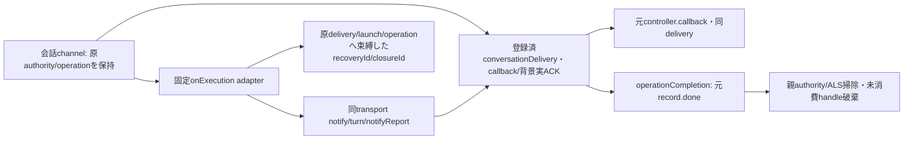

# 会話childからexecutionへの親固定adapter

`createConversationExecutionEffects({getServices,getController,admission})`は親だけの固定onExecution関数を返す。親channelが型/actor/元authority/許可対象を検査し、登録した同conversationDeliveryとenriched contextを渡す。adapterは新規登録・native claim・通常finish・callback/背景予約を再実装せず、同opaqueを既Transportへ渡す。元admissionCheckとoperationContext/conversationLease/capturedAuthority（供給時）/actualCompletionは同identity。fresh member await後にも元check/current stop/同leaseを再確認し、native直前のguardは既Transport/Clientが同関数で行う。

notify/turn/reportは固定公開口のみ。turnはnative受付Promiseだけをeffectへ返し、reply/user.complete保存/実ACKは既gateとTransportが保持する。callbackは登録時の元controller channelが発行し、adapterで上書きしない。execution.background.begin/endは既conversation-ipcが消費するため、このadapterへの直接到達は拒否する。observation.source/shownは親channelの許可済observer operationに限定する。

reconcileは既deliveryExecutionRefとtransport.reconcileLaunchを使い、実execution objectを親に保持して同operation/target/deliveryのrecoveryIdを一回notifyへ消費する。closeLaunchも元公開検証を使い、子にはclosureIdだけ返す。親最終HTTPは固定`effect.consumeClosure(closureId,operationContext)`で同operationの元生receiptを一回取り出す。未知/別operation/再利用を拒否し、元要求やreceiptを形から再作成しない。shown handleも元object/取得prefixに束縛し、古いhandleで新watchを消費しない。

`ConversationLifetimes.operationCompletion(lease)`はliveなoperationだけから同private record.done Promiseを返す。delivery done/親release ACK/backgroundが実終端しfinish済みになった後だけ親authorityを解放する。RPC完了/別deferredで置換しない。

親IPCのonExecution前処理拒否には`finishUnclaimedDelivery(同opaque)`をcatchで使用する。登録済かつnative claim前の陽性だけ一回finishし、claimed/終端済みはfalse。Transport到達後のunknownを未発行へ変更せず、通常native claim/finishはTransport一回のまま。

application-services/ALS/authority/ledgerはMolly所有。新wire/保存schema/任意method・Proxy/SDK操作は作らない。
