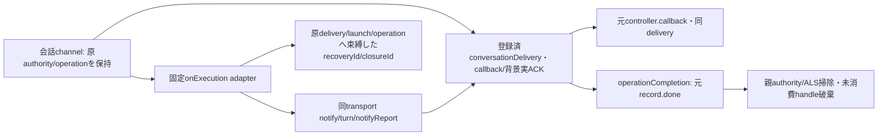
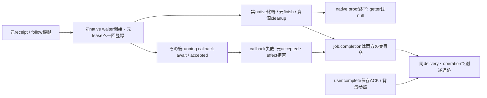
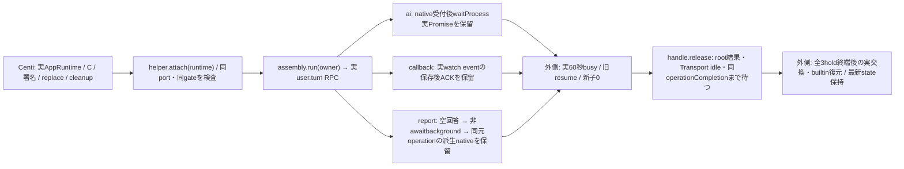

# 会話childからexecutionへの親固定adapter

`createConversationExecutionEffects({getServices,getController,admission})`は親だけの固定onExecution関数を返す。親channelが型/actor/元authority/許可対象を検査し、登録した同conversationDeliveryとenriched contextを渡す。adapterは新規登録・native claim・通常finish・callback/背景予約を再実装せず、同opaqueを既Transportへ渡す。元admissionCheckとoperationContext/conversationLease/capturedAuthority（供給時）/actualCompletionは同identity。fresh member await後にも元check/current stop/同leaseを再確認し、native直前のguardは既Transport/Clientが同関数で行う。

notify/turn/reportは固定公開口のみ。turnはnative受付Promiseだけをeffectへ返し、reply/user.complete保存/実ACKは既gateとTransportが保持する。callbackは登録時の元controller channelが発行し、adapterで上書きしない。execution.background.begin/endは既conversation-ipcが消費するため、このadapterへの直接到達は拒否する。observation.source/shownは親channelの許可済observer operationに限定する。

不足報告は元conversationLease/operationContext/delivery/actualCompletionを保持し、元members leaseが既に終了していても新しい通常members入場を一回だけ行う。同親`transport.membersAdmission.withLease`で短命leaseを取得し、fresh `bots.readMember(id,{membersLease})`と`notifyReport`のoptions.membersLeaseへ渡す。元operationContextのmembersLeaseを書き換えず、会話の新root・予約・authorityを生成しない。withLeaseはnotifyReportのaccepted返却まで、Transportは既admissionCompletionを同leaseへnative前に登録するため、準備/受付失敗cleanupは保持しAI/callback完走まで不要にmembers準備64枠を占有しない。members閉鎖・本人削除・元stop checkの拒否はそのまま返し、resume後に自動再発行しない。fork応答の中継（`rootMethod` `fork.ask`の`execution.notify`、forkの`delivery.answer` callbackから出る。fork-inquiry.md「Live relay members lease」、2026-11-12）も同じく新しい通常members入場を一回だけ行う。fork.ask rootのmembers leaseはroot結果で返却済みのため。それ以外の通常notify/turnは既元contextのmembers leaseを維持する。

reconcileは既deliveryExecutionRefとtransport.reconcileLaunchを使い、実execution objectを親に保持して同operation/target/deliveryのrecoveryIdを一回notifyへ消費する。closeLaunchも元公開検証を使い、子にはclosureIdだけ返す。親最終HTTPは固定`effect.consumeClosure(closureId,operationContext)`で同operationの元生receiptを一回取り出す。未知/別operation/再利用を拒否し、元要求やreceiptを形から再作成しない。shown handleも元object/取得prefixに束縛し、古いhandleで新watchを消費しない。

`ConversationLifetimes.operationCompletion(lease)`はliveなoperationだけから同private record.done Promiseを返す。delivery done/親release ACK/backgroundが実終端しfinish済みになった後だけ親authorityを解放する。RPC完了/別deferredで置換しない。

## 既受付nativeの実continuation公開口（Qで追跡を分離）

`getNativeContinuation(delivery,{generation,operationId,deliveryId,target})` は同live opaque・現generation・完全4field自己所有binding・native陽性receipt・元native実追跡未終端の時だけ、元native waiter/実finishの同Promiseを返す。caller resultやuser.complete保存ACKとは別。未登録/claimだけ/偽opaque/別RPC・target/型・key不一致/失敗/退役/終端後はnull。active件数は証明に使わない。

Transportだけが既claim後・陽性receipt/follow確認後・callback await前に `trackNativeContinuation(delivery,receipt,completion)` を一回呼ぶ。native awaitは一つで、第二native待受け/架空pending Promise/別operationDoneによる代用0。callback失敗は元accepted/effectへ直ちに返す一方、元job.completion・activity占有・leaseは実nativeとcleanup終端まで保持する。running callbackの保存待ち中にも実native参照は存在する。

nativeのunknown rejectは元エラーのまま、物理終端の証明にはしない。元receipt/job/opaqueに明示unconfirmed占有guardを残し、同Botの新native/watch/legacy submitとclose成功を拒否する。idleは同元エラーを返して空転待ちを避ける。retired callback失敗は新writer failed/onProtocolFailureへ作用せず、新root/他Botの入場を妨げない。全体drain/closeは両世代の元未確認を保持する。旧実追跡unknownのguardを自動解除する接点は作らない。

user.complete保存ACKと背景は従来の実参照で別に残る。nativeが先に終わればgetterはnullでも、保存ACK前にdelivery.doneは終端しない。共通channelは元RPC/context/4bindingからだけこのgetterを使う。共通期限・資源ACK・通常64枠は各所有者の既契約を保持する。変更した公開境界と新retired Transport fixtureだけを直接確認し、旧成功群を追加再走しない。

親IPCのonExecution前処理拒否には`finishUnclaimedDelivery(同opaque)`をcatchで使用する。登録済かつnative claim前の陽性だけ一回finishし、claimed/終端済みはfalse。Transport到達後のunknownを未発行へ変更せず、通常native claim/finishはTransport一回のまま。

application-services/ALS/authority/ledgerはMolly所有。新wire/保存schema/任意method・Proxy/SDK操作は作らない。

## 同imageの実AppRuntimeで使う寿命検査helper

`test/helpers/conversation-execution-lifetime.mjs:createConversationExecutionLifetimeFixture({botId})`は同期で`client/createExecutionAssembly/attach/hold/snapshot/close`を返す。外側Centiが実createApplicationRuntimeにtop-level `client:f.client`、bootstrapに`createExecutionAssembly:f.createExecutionAssembly`を渡す。bootstrap.clientだけではruntimeの明示client引数に上書きされる。wrapperは実createExecutionAssemblyへ委譲し、既ports.seat.waitProcess/handoffContextだけを人工化する。同親members/conversation/moduleOperationsと全その他optionsを保持する。実会話Assembly/default createProcess、loader、署名、controller.replaceは差し替えない。

AppRuntime構築後の`attach(runtime)`は実execution返却実体、native client、conversationAdmission/moduleOperationsの同identityを確認する。`await hold('ai'|'callback'|'report')`は対象rootの受付と各保留点到達まで待ち、snapshot/assertResumed/releaseのhandleを返す。native発行時は実元currentOperationを捕捉し、reportでは同object/会話leaseを確認する（元operationContextの古いmembers leaseは再利用しない）。callbackは受理済みrootのdelivery-status変更通知を同assembly.watchで待ち、native完了後も実callback/event ACKを保留する。reportは空transcriptから実missing判定を通し、元RPC結果/実completionが返った後も同元operationが派生deliveryを保持していることを要求する。

外側がcontroller.replaceを実時間で実行してbusy/旧resumeを確認した後、`handle.assertResumed()`は同generation/running/availableと未終端operation、abort/stop/本文再送0を検査する。helper自身はreplace/admission.close/reserveを呼ばず、60秒経過や新子0の代替証明を作らない。`await handle.release()`は保留native/eventを解放し、元root結果→全同Bot配送idle→捕捉済み同admission.operationCompletionまで待つ。bool/整数だけのsnapshotにnative呼出/待機/終端/abort/stop/launch/SDKclose/PTYclose/本文再送を返す。closeは保留を解放してwatchを外し、runtimeや外側data/Cを閉じない。

N102 preservationの固定timeline検査は先に終え、寿命phaseの人工AI追記と混ぜない。同rootで追加した最新記録のbytes/mode/mtime保持、同image/C/署名/既定loader/実60秒/旧新OS終端/cleanupは外側の成立範囲。新直接検査は実AppRuntime/実Assembly/実IPC/実executionを使い、ローカルだけloaderの明示I/OとNode子のroot引数を人工化する。ai/callbackの局所timer進行とreportの実時間60秒を区別し、C/UID1001/署名/image成功へ補完しない。新report準備の3反例は期限切れ元membersからの通常新入場、members閉鎖時の再発行0、fresh await後stop拒否とlease解放を確認する。

callerの結果がtimeout/rejectしてもreleaseはfinallyでTransport idleと同元operationCompletionの双方を実終端まで待つ。結果の失敗は最後に同一error objectとして返し、再releaseは同Promise。caller errorを成功へ読み替えず、実done前のrejectで外側cleanupを先行させない。新直接反例は実user.turnのaccepted/completionを保ったcaller結果拒否と別の遅い実watch callback ACKを組み合わせ、ACK前のrelease未終端→ACK後の元error同identityを確認する。

Epiの固定common/parentと上記native公開口を独立合成した新1境界は、実AppRuntime/元user.turn/実execution/実gateで人工native waitを61秒の実時間保留する。60秒後もroot結果/実completion未終端・元operation live/同子generation・nativeDone0を確認し、解放後だけroot結果/実completionと元operationが終端する。timer/期限値/共通controller/leaseを検査用に置き換えず、既loader明示I/OとNode子rootだけlocal用のDIを使う。実C/署名/両nativeや既失敗runの当該RPC特定は別の証拠を要する。

callbackの実時間境界は別の新検査にする。親watchの保存後ACKを保留したまま既controller.replaceの実60秒busy→同子generation/旧resumeを確認し、ACK解放後に元root結果/RPC実completion/元operationDoneが全て終端することを要求する。gateは元dispatch.completionを判定し、子event実ACKの正規接点はEpi/N102の固定sourceを結ぶ。親だけのmock時計やAI61秒成功を子event60秒の代わりにしない。

Q故障writer退役では、effect入口/check・delivery新作用・closure消費の4検査を `assertCurrentLease` とする。正規cleanup用 `assertLease` と分け、退役元contextから新native/reconcile/shown消費を発行しない。共通moduleOperationsとN102 channelの入口検査は各所有者が接続する。
