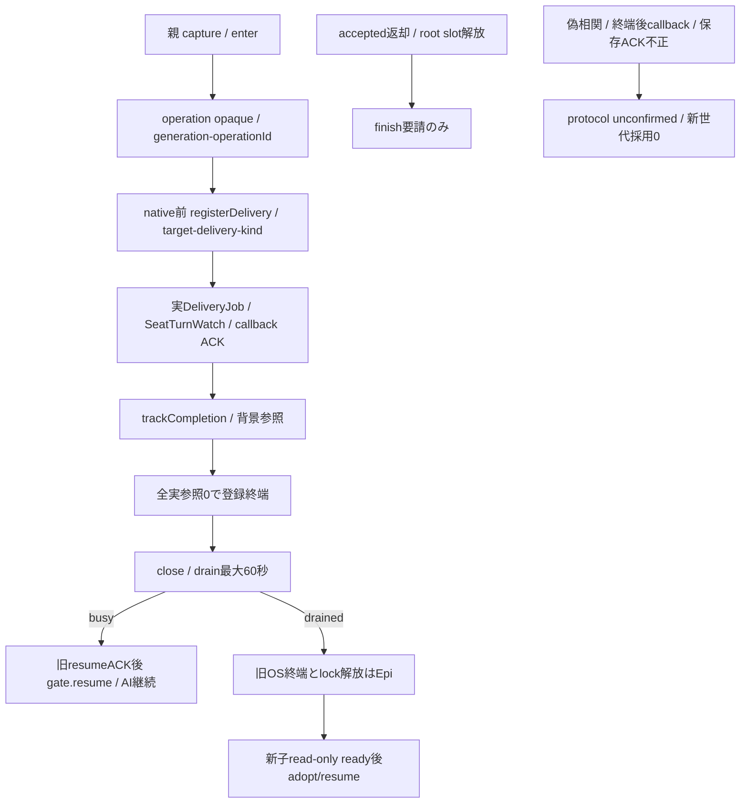

# ConversationLifetimes：親callbackと実終端

所有キロ。Root conversation-update-contract-20261103.md SHA133222cfのexecution接点。root8枠/stream/ACK期限/OScloseはEpi、本文writer/回答選択/報告はN102、入場の一括予約と交換mutex/facadeはMolly。親gateは会話子と別寿命、本文を複製した新queueを持たない。

## 同期入場と実参照

`new ConversationLifetimes(generation='builtin',{onProtocolFailure?})`。generation/operationIdは親生成の空白無し1〜128字、runtimeはversion/builtin＋UUID、operationIdはUUIDを使用する。モデルJSONからopaqueを復元しない。

| 公開方法 | 固定意味 |
| --- | --- |
| `capture()` | frozen `{generation,epoch}` |
| `assertOpen(expected=capture())` | 新root入場。閉鎖/旧epoch/異世代/未確認はCONVERSATION_NOT_ACCEPTED |
| `enter(expected=capture(), operationId=UUID)` | opaque operationLease。wire operationIdはlease.correlation。**AI lifetimeの8上限無し**、8枠はruntime別 |
| `tryEnter(...)` | 閉鎖/未確認ならnull、新watch入場専用。既watchを止めない |
| `assertLease(lease,{generation=lease.generation,correlation=lease.correlation}={})` | object identity＋同live/generation/correlation。close後旧epochもliveなら通る |
| `trackCompletion(lease, realPromise)` | 同Promise一回、finish要請後も実settleまで保持。caller期限/受付結果をrealPromiseへ代用しない |
| `finish(lease)` | finishRequestedだけ。pendingが0になるまでlive |
| `withLease(operation,{lease?,expected?,correlation?}={})` | ownedだけfinally finish。同期operation内で実completionを登録してから返す |
| `close()` | 同opaque ticketを返し新入場だけ閉じる |
| `drain(ticket,{timeoutMs=60000}={})` | 全実参照0で`{status:'drained'}`、上限まで残れば`{status:'busy'}`。実参照保持/AIabort0。timeoutMsは0〜60000、productionは60000 |
| `adopt(ticket,newGeneration)` | 参照0/未確認0/別generationのみ。OS/lock/ready確認は呼出元runtimeが先に行う |
| `resume(ticket)` | 同ticketを開く。busyでも旧live参照を維持。子resumeACK5秒の確認後だけ呼ぶ |
| `snapshot()` | `{generation,closed,active,unconfirmed}`。activeは実参照登録数でnative並行数ではない |

## 固定callback登録

`registerDelivery(operationLease,{deliveryId,target,dispatch,kinds}) -> deliveryLease`。deliveryId/targetは親の固定callerが捕捉した1〜128字、同operation/target/deliveryの再登録拒否。dispatchは親ローカルclosure、kindsは下記5種の重複無しsubset。delivery自身のdone参照を親operationへ同期登録する。deliveryLeaseもfinish/trackCompletion対象。nativeを呼ばない失敗経路でもその登録は明示finishが必要。

`dispatch(kind, localParams, capturedBinding)`を呼ぶ。bindingは親が作る `{generation,operationId,deliveryId,target,callbackKind}` のexact5値。localParams内に権限を混ぜない。`assertDelivery(deliveryLease,{deliveryId?,target?}={})`、`binding(deliveryLease,kind)`、`assertCallback(deliveryLease,wireBinding)`で同opaqueへ完全照合する。kindはdelivery.status/words/answer/user.complete/turn.endだけ。

`callbacks(deliveryLease)`は登録subsetだけのonStatus/onInterim/onAnswer/onTurnEnd/userCompleteを返す。親ローカルparamsはstatus={delivery,error,tracking}、words={words}、answer={text}、user.complete={reply}、turn.end={startedAt,endedAt}。statusのErrorはまだ親内の値。**Epiの親dispatchはN102公開src/conversation/callbacks.mjsのnormalizeConversationCallback(kind,params)へ通してからwireへ送り**、Error自由message/stack/causeを送らない。子はvalidateとsafe failure fieldsだけを使う。N102供給元d40c1ffdの公開formatter/ACK schemaと接続する。dispatcher/context/frameの私有実装は当gateからimportしない。

`invoke(deliveryLease,kind,localParams)`は発行前に実参照を取得し、dispatchの実保存/check/report ACKまで保持する。返却はexact `{applied:true}`だけ。欠測/extra/拒否/例外はprotocol unconfirmed。終端後や偽相関はdrop成功にせず、以後drain/adopt/resumeの成功を拒む。runtimeはcallerunknownでも実callback result/OScloseまで実Promiseをsettleさせない。

## 背景と一回派生報告

`runBackground(deliveryLease, operation)`は元turnの非await afterTurn用。呼出した同期stack内で参照を取得し、operationを起動する。nativeのaccepted/通常完了はこのPromiseを待たず、quiesceだけが参照を待つ。同sourceへの二重起動と派生reportからの再帰は禁止。turn.endのinvokeも同じ一回背景windowを開き、そのACKはN102が実check/report終端まで返さない。

`deriveReport(sourceDeliveryLease,{deliveryId,reason,dispatch,kinds?}) -> reportDeliveryLease`。reason=missing/content、元targetを固定、同sourceで一回消費、元背景window中だけ許可。default kinds=status/words/answer、user.complete/turn.endは禁止。新root入場は行わず同旧operationへ実参照を登録する。実native前のmembers新準備/全体stop/本人資格拒否は通常どおり、失敗しても再派生・再発行しない。親固定report effectだけがこのAPIを使い、外部本文やJSONからsourceLeaseを選ばせない。

SelfTurns/子afterTurnは、元observer/保存operationのregistered sourceから背景開始を親へ登録する。子側の同期背景count登録と親実参照取得が済む前にrootの最後の参照を落とさない。user.completeの保存ACKと非await報告の終端は分離し、native完了を報告待ちへ変えない。親/子protocolの対応はN102/Epiが固定する。

## 実装段階

本gateの単独直接9境界が成立。transportへのnative前登録/実job・watch・followInterim/背景hookの接続は続く別作者差分。gate sourceだけで会話交換や実AI保持の受入にはしない。既currentWork一observerは保持し、新watchだけtryEnterで閉じる。図/必要caller/否定例を同差分で進め、旧成功群/実native/実席Hostは使わない。
