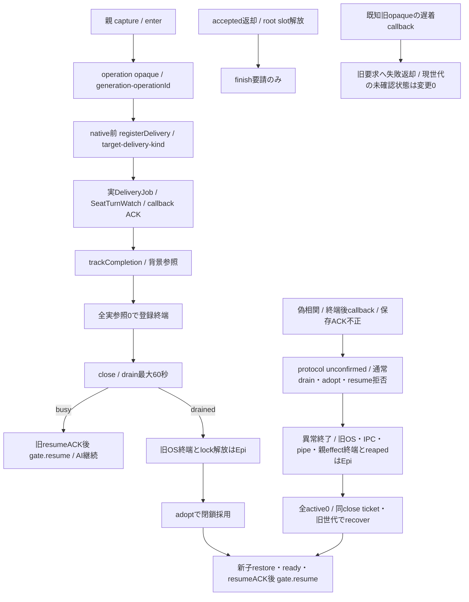
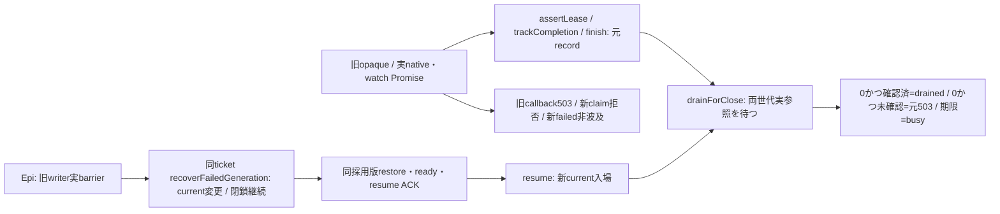

# ConversationLifetimes：親callbackと実終端

所有キロ。Root conversation-update-contract-20261103.md SHA133222cfのexecution接点。RPCroot64枠/stream/ACK期限/OScloseはEpi、本文writer/回答選択/報告はN102、入場の一括予約と交換mutex/facadeはMolly。親gateは会話子と別寿命、本文を複製した新queueを持たない。

## 同期入場と実参照

`new ConversationLifetimes(generation='builtin',{onProtocolFailure?})`。generation/operationIdは親生成の空白無し1〜128字、runtimeはversion/builtin＋UUID、operationIdはUUIDを使用する。モデルJSONからopaqueを復元しない。

| 公開方法 | 固定意味 |
| --- | --- |
| `capture()` | frozen `{generation,epoch}` |
| `assertOpen(expected=capture())` | 新root入場。閉鎖/旧epoch/異世代/未確認はCONVERSATION_NOT_ACCEPTED |
| `enter(expected=capture(), operationId=UUID)` | opaque operationLease。wire operationIdはlease.correlation。**AI lifetime自体の件数上限無し**、RPC同時64枠はruntime別 |
| `tryEnter(...)` | 閉鎖/未確認ならnull、新watch入場専用。既watchを止めない |
| `assertLease(lease,{generation=lease.generation,correlation=lease.correlation}={})` | object identity＋同live/generation/correlation。close後旧epochもliveなら通る |
| `trackCompletion(lease, realPromise)` | 同Promise一回、finish要請後も実settleまで保持。caller期限/受付結果をrealPromiseへ代用しない |
| `finish(lease)` | finishRequestedだけ。pendingが0になるまでlive |
| `withLease(operation,{lease?,expected?,correlation?}={})` | ownedだけfinally finish。同期operation内で実completionを登録してから返す |
| `close()` | 同opaque ticketを返し新入場だけ閉じる |
| `drain(ticket,{timeoutMs=60000}={})` | 全実参照0で`{status:'drained'}`、上限まで残れば`{status:'busy'}`。実参照保持/AIabort0。timeoutMsは0〜60000、productionは60000 |
| `adopt(ticket,newGeneration)` | 参照0/未確認0/別generationのみ。旧OS/lock確認は呼出元runtimeが先に行い、新子restore/readyは閉鎖採用後に行う |
| `recover(ticket,previousGeneration,newGeneration)` | 異常終了専用。現在close ticket本人性とticket/現世代=previous、全active0、妥当な別newを要求。failedを解除してnewを閉鎖採用。旧OS/IPC/pipes・親effect・await channel.reapedの実終端はruntimeが先に確認し、通常adoptの代わりに呼ぶ。native生存/ACK待ちは拒否。 |
| `resume(ticket)` | 同ticketを開く。busyでも旧live参照を維持。子resumeACK5秒の確認後だけ呼ぶ |
| `snapshot()` | `{generation,closed,active,unconfirmed}`。activeは実参照登録数でnative並行数ではない |

## 固定callback登録

`registerDelivery(operationLease,{deliveryId,target,dispatch,kinds}) -> deliveryLease`。deliveryId/targetは親の固定callerが捕捉した1〜128字、同operation/target/deliveryの再登録拒否。dispatchは親ローカルclosure、kindsは下記5種の重複無しsubset。delivery自身のdone参照を親operationへ同期登録する。deliveryLeaseもfinish/trackCompletion対象。nativeを呼ばない失敗経路でもその登録は明示finishが必要。

`deliveryFor(operationLease,{deliveryId,target}) -> deliveryLease`は親captured operationの登録だけを検索する。異operation/target・未登録/終端/複製opaqueはprotocol unconfirmed。新root/新sourceを子IDから生成しない。登録済みIDの再使用禁止も元Mapに保持する。

`dispatch(kind, localParams, capturedBinding)`を呼ぶ。bindingは親が作る `{generation,operationId,deliveryId,target,callbackKind}` のexact5値。localParams内に権限を混ぜない。`assertDelivery(deliveryLease,{deliveryId?,target?}={})`、`binding(deliveryLease,kind)`、`assertCallback(deliveryLease,wireBinding)`で同opaqueへ完全照合する。kindはdelivery.status/words/answer/user.complete/turn.endだけ。

`callbacks(deliveryLease)`は登録subsetだけのonStatus/onInterim/onAnswer/onTurnEnd/userCompleteを返す。親ローカルparamsはstatus={delivery,error,tracking}、words={words}、answer={text}、user.complete={reply}、turn.end={startedAt,endedAt}。statusのErrorはまだ親内の値。**Epiの親dispatchはN102公開src/conversation/callbacks.mjsのnormalizeConversationCallback(kind,params)へ通してからwireへ送り**、Error自由message/stack/causeを送らない。子はvalidateとsafe failure fieldsだけを使う。N102供給元d40c1ffdの公開formatter/ACK schemaと接続する。dispatcher/context/frameの私有実装は当gateからimportしない。

`invoke(deliveryLease,kind,localParams)`は発行前に実参照を取得し、dispatchの実保存/check/report ACKまで保持する。dispatch返却に`completion`があれば同元Promiseを判定源にし、無ければ返却Promiseを使う。caller結果だけの期限切れを実保存ACK失敗へ昇格させず、実completionがpendingの間は参照を保持する。返却はexact `{applied:true}`だけ。実completionの欠測/extra/拒否/例外はprotocol unconfirmed。同世代の終端後や偽相関はdrop成功にせず、以後drain/adopt/resumeの成功を拒む。親WeakMapに実登録された別世代opaqueの遅着callbackは元要求へprotocol失敗を返し、現世代のfailed/onProtocolFailure/drain waiterを変更しない。自己申告generationや複製opaqueはこの例外を得ない。runtimeはcallerunknownでも実callback result/OScloseまで実Promiseをsettleさせない。

## 背景と一回派生報告

`runBackground(deliveryLease, operation)`は元turnの非await afterTurn用。呼出した同期stack内で参照を取得し、operationを起動する。nativeのaccepted/通常完了はこのPromiseを待たず、quiesceだけが参照を待つ。同sourceへの二重起動と派生reportからの再帰は禁止。turn.endのinvokeも同じ一回背景windowを開き、そのACKはN102が実check/report終端まで返さない。

`deriveReport(sourceDeliveryLease,{deliveryId,reason,dispatch,kinds?}) -> reportDeliveryLease`。reason=missing/content、元targetを固定、同sourceで一回消費、元背景window中だけ許可。default kinds=status/words/answer、user.complete/turn.endは禁止。新root入場は行わず同旧operationへ実参照を登録する。実native前のmembers新準備/全体stop/本人資格拒否は通常どおり、失敗しても再派生・再発行しない。親固定report effectだけがこのAPIを使い、外部本文やJSONからsourceLeaseを選ばせない。

SelfTurns/子afterTurnは、元observer/保存operationのregistered sourceから背景開始を親へ登録する。子側の同期背景count登録と親実参照取得が済む前にrootの最後の参照を落とさない。user.completeの保存ACKと非await報告の終端は分離し、native完了を報告待ちへ変えない。親/子protocolの対応はN102/Epiが固定する。

## 実装段階

本gateの単独直接9境界が成立。transportへのnative前登録/実job・watch・followInterim/背景hookの接続は続く別作者差分。gate sourceだけで会話交換や実AI保持の受入にはしない。既currentWork一observerは保持し、新watchだけtryEnterで閉じる。図/必要caller/否定例を同差分で進め、旧成功群/実native/実席Hostは使わない。

## Transportへの実接続

既createManagedTransport/AitermTransportのconstructor option `conversationAdmission`に同gate一実体を渡す（省略nullは既低層互換）。通常child dispatcherはnative発行より先にregisterDeliveryし、`turn/notify/submit`の第3内部optionsへ `conversationDelivery: deliveryLease` を渡す。Tokenと同時にraw onStatus/onInterim/onAnswer/onTurnEndを渡さない。registered kindsから親内handlerを生成し、自由callbackとの二重writerを拒否する。tokenをqueue/info/本文/結果へ混入しない。membersLeaseは従来の準備/受付までで解放し、conversationの実AI lifetimeへ延長しない。

`claimNative(deliveryLease,{deliveryId,target,kind:turn|notify|report})`をtransportが同job作成直後・native前に一回だけ消費する。groupId（無ければjob.id）/Bot.idを登録へ一致させ、同tokenからの二重発行0。実completionを同期trackし、accepted/admissionCompletionは従来の時点に返す。登録user.completeがあればその保存/回答claim ACKのPromiseを別に同期trackし、turnの返却replyはその保存まで保持する。非await onTurnEndはinvoke自身が起動前に参照を取得するので、native job idleと報告完了を分ける。実jobと保存ACK/背景参照が全て終端するまでdelivery/operationはlive。

派生は親固定report effectから `transport.notifyReport(bot,message,{conversationDelivery,queue:{context:report,groupId,...}})` だけを使用。元target/deriveReport一回権に束縛し、通常global stop/新members準備を迂回しない。新onTurnEndを渡さず再帰0。parent dispatchはN102のnormalizeで安全plain DTOを作ってchildへ送り、親元Errorをwireへ直接渡さない。保存ACKが不正/不明になったdeliveryは以後のcallback発行も拒否し、同保存を再送しない。

既親watchは同gateを参照する。新watch作成時だけtryEnterし、閉鎖中はskip。元pty_list読取/currentWork更新と既watchのidle/別turn終了検知は継続する。新watchはnative waiterより前にdeliveryと実completionを登録し、既followInterimの最後のread/保存ACKまで保持。onInterimの第4内部引数へcapturedBindingを渡すため、parent facadeはそのgenerationへ固定して保存しexact{applied:true}を返す。root callback枠8をAI終了まで占有しない。watch pollの返却はfinish条件ではない。

source/fakeのgate9＋native接続8境界を確認。native接続の初期fixture一件は全体停止をfailedと誤期待していたため、既DeliveryJobのAI_GLOBAL_PAUSED→stopped契約へ訂正（本体意味変更0）。旧watch互換は変更点に限り選択確認する。SelfTurns/子afterTurn、channelの実ACK/timeout、dispatcher/両入場/OS exchangeは各所有者の結合が残り、この源sourceだけで会話交換成功としない。

## background effect adapterへの固定接点

N102の`execution.background.begin {deliveryId,target}`は親captured operationでdeliveryForを引き、parent所有のdeferred実completionをrunBackgroundへ同期登録してからopaque背景登録に対応するbackgroundIdをACKする。backgroundIdは同operation/sourceに束縛し、子paramsから権限を作らない。`execution.background.end {backgroundId} -> {requested:true}`は終了要求だけでdeferredをsettleしない。既channelの実子背景/保存/check/report終端又は確認済みOScloseと親effect終端が揃ってruntimeが実completionを終端させる。caller timeout/ACKだけではreleaseしない。turn.endはinvokeが既に背景windowを開くので同sourceへbeginを重ねない。

native effectはparentの承認targetからregisterDelivery→transport.turn/notify（claimNativeはtransportが一度だけ行う）。queue.groupIdを登録deliveryIdへ親が一致させ、子queueの別値を権限にしない。turnは従来の最終reply Promiseを保ち、acceptedだけを別窓口でrunning/steeredへ返す。reportは同sourceのderiveReport一回→notifyReport、targetを元登録から固定、queue.context=reportを親が設定。

SelfTurnsは新native操作ではなくobserver source。親が捕捉したobservation.pollのopaqueと検証済みBot snapshot/各保存対象を使う固定callerが、afterTurn一回ごとのsourceをkinds:[]でregisterDeliveryし、子へ本人sourceのIDだけを渡す必要がある。子自己申告IDだけでbeginがsource登録を兼ねることは認めない。現通常SeatTurnWatchはwordsだけのsourceであり、Throughline SelfTurnsの元turn証明へ代用しない。既root/observer readのどの箇所がこの登録を所有するかはN102/Epi/Mollyのdispatcher結合で固定し、未供給ならbeginを拒否して未結合を残す。source登録Promise/子の同期pendingとparent begin ACKが揃うまで元root/保存callbackの最後の参照を落とさない。

## delivery実終端と子registry解放

`deliveryCompletion(deliveryOpaque) -> Promise<void>`は登録済みlive deliveryのprivate doneだけを読み取り公開する。native発行/finishより先に同opaqueから捕捉する。operation/偽object/終端後からの新取得はprotocol failure。PromiseはfinishRequestedかつ全登録native/callback/背景pending0でだけresolveし、accepted/finish呼出し直後/発行結果では解決しない。words/answer無しのreportも同じ終端である。公開は状態を変更せずfinishもしない。

runtimeはnative前にこのPromiseとcaptured exact4 {generation,operationId,deliveryId,target}を保存する。Promise終端後の専用resource-close/controlで子releaseDeliveryを呼びACKまで追う。そのACKの実completionは**deliveryではなく親operationへnative前にtrackCompletionしておく**。delivery.doneを待って発行するACKをdelivery.pendingへ入れると循環するので禁止。done後に初めてoperation参照を追加する方法も、既にrootが終端するraceがあるため使わない。child registryの解放/ACKとparent operationの最後の解放をruntimeが結合する。原callback失敗/誤相関/OS断線のprotocol failureは既channel/gateの未確認制御を維持し、このdoneを正常保存証明にしない。

## SelfTurnsの表示済みprefix

既`shownInSelfTurn(botId)`は親SeatActivityの実{words,endedAt}参照。endedAtはwatch終端のDate.parse(now)によるnumber又はnull。parent fixed observer adapterが同captured poll/許可Botを検査し、実objectとprefixコピーをparent-only shownIdへ束縛する。wire readはnull又は{shownId,words:[string],endedAt:number|null}。IDは同operation/generation/botで一回消費し、snapshotをcurrentWork/本人性へ昇格しない。

`consumeShownWords(botId, capturedShownObject, capturedPrefix) -> boolean`は実object同一＋現words先頭が捕捉prefixと全一致した場合だけ、そのprefix長をspliceしtrue。取得後に末尾へ増えたwordsを保持し、別watch object/先頭変化/空prefixはfalseで変更0。parent adapterはchildからwords/objectを受けず、保存したhandleからこのメソッドを呼ぶ。一回権は送信前に消費し、同値の新wordsが後着しても同shownIdで再消費しない。

private consume返却は{applied:boolean}を必要とする。競合時にtrueを偽らず、falseは実表示objectが変化済みという通常競合でnative/protocolの成功・失敗証明にしない。子はprefixが実際に外れた時だけconsumeし、既withoutShownWordsの60秒幅/全文消失時は外さない意味を保つ。追加native/AI/observer/永続queue無し。親handleのlifetime/lookupはEpiが既operation registryへ結合する。

## 異常終了後の世代回復

`recover`は旧要求を新世代へ移さず、旧native/作用不明/保存ACK不明を成功又はnot_startedへ変更しない。全active0を確認するだけでfinish/abort/再送やPromiseのsettleを行わない。旧native、callback実completion、親effect、release ACKが一つでも登録中ならCONVERSATION_NOT_ACCEPTEDで拒否する。失敗した旧参照も元の実Promiseがsettleした時点で通常releaseされる。

runtimeは旧OS/IPC/pipes→drainIncoming→await channel.reapedの実終端後に呼ぶ。返却voidの後も同ticketで閉鎖したまま、新子の同state restore/ready/resume ACKが完了して初めてresume(ticket)する。旧generation/ticketを使う回復の二重実行は拒否する。通常adopt/drainの未確認拒否は維持し、failedだけを無条件に解除する窓口は作らない。

新直接境界はtest/conversation-generation-recovery.test.mjs。共通controllerの異常終了/reaped/再起動はruntimeの図と試験が所有し、このhookの単独試験で実再起動成功を主張しない。

recover後の新candidateがrestore/ready/resume ACK前に失敗した場合、runtimeはそのcandidateのOS/IPC/pipes・incoming/reapedを完了し、同ticketを閉じたまま通常adopt(ticket,nextGeneration)で次candidateを採用できる。前提はunconfirmed=falseかつactive=0で、旧callbackの遅着はこの条件を変更しない。close ticketは採用履歴の各世代IDと同値である必要がなく、同一閉鎖の本人性を持つ。新candidate自身が現世代protocol失敗を生じた場合は通常adoptも拒否されるので、この経路で未確認を無条件解除しない。

## Q：故障writerの退役（gate先行source）

Root `conversation-failed-generation-contract-20261104.md` とキロ `docs/q-retired-generation-io-20261104.md` が横断契約。gate identityと全live record/元Promiseを維持する。runtimeが旧writerのOS/IPC/全pipe/incoming/effect/reaped barrierを確認した後、同期 `recoverFailedGeneration(ticket, old, next)` を呼ぶ。native完走はbarrier条件へ加えない。

`assertCurrentLease` は新作用入口。既 `assertLease` は元generation/correlation/opaqueの正当なcleanupを認める。旧callback/claim/reportの新作用を拒否し新writerへ転送しない。既claim済みの元receipt/実追跡Promiseだけは退役後も一回登録でき、その実Promiseを同deliveryへtrackする。未resume候補再失敗は候補自身のbarrier後、同ticketと未使用の次generationで同口を呼ぶ。世代再使用/偽ticket/旧generation誤指定は無変更で拒否。

`drain` は正常交換用でglobal active/未確認を保持。`drainForClose(ticket,{timeoutMs:60000})` は未確認でも両世代の実参照0を待ってから元503を返す。期限0〜60000ms、未終端はbusy。既snapshot三値は合算active/合算unconfirmedとcurrent generationを返す。旧保存成功へ読み替えない。

gate先行sourceはTransportのcallback/native追跡分離の完了を意味しない。同Bot占有を含む一組は後続Transport sourceと直接結果で成立判定する。旧continuation節のrunning ACK後・callback結合result登録は後続で置換予定。
