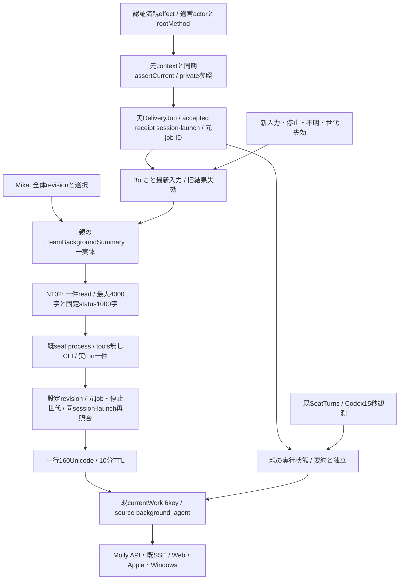

# 全体バックグラウンド要約と実行状態

所有キロ。Root `team-background-agent-contract-20261105.md` の方式を採用。主agentの本人要約writerは使わず、親同graphの `TeamBackgroundSummary` 一実体が全Botの変更入力を逐次処理する。Mollyがassemblyの別引数backgroundSummaryから同実体を各execution世代へ渡す。既閉portsへ新keyを追加せず、factory呼出の加法的引数を使うため旧dispatcherは無視でき、旧選択sourceに未提供要約機能を補完しない。設定はusageの全体一件、限定本文はconversationの専用readだけを使う。

## 親の固定port

`new TeamBackgroundSummary({configuration,readInput,run,notify,enabled})`。configurationはfresh `Promise<{revision,selection}>`、selectionはnull又はharness/model/reasoningEffortの閉3key。effort空文字はモデル個別effortsが空の時だけCLI指定無しとして許可する。Mikaが保存前にlive catalogで検証し、runnerも発行直前に再検証する。設定の保存成功callbackは `configure(record)`、shutdownは `await close()`。同値は再生成しない。未設定やgetter失敗を別モデルへ補完しない。

`readInput(input,authority)` はJSON閉7key `{botId,sessionId,launchId,inputRevision,deliveryId,context,contextId}` と、private `{context,assertCurrent}` を受ける。元contextは既認証済enriched objectを保持しclone/JSON化しない。assertCurrent(input)は同期で元lease・世代・delivery・親session/launch/inputRevision・停止世代を照合、false/throwは失効。返却はnull又は同7key＋text/progressの閉9key、本文最大4000・保存固定status最大1000 Unicode。interim/自由callback/全文履歴/画像/secret値/任意fileを渡さない。

`createConversationExecutionEffects` は既親の認証済actorがowner/bot/scheduler、rootMethodがuser.post/user.turn/direct.post/room.post/room.replyの時だけauthorityを捕捉する。usage secret/question/onboarding/observer/bridge/report/recoveryは除外。通常文中の未知の秘密を判定する新分類器は作らない。N102の専用callerが読取前後に同authorityを検査し保存済み元一件と宛先を照合する。既deliveryAnchorの本人actorを緩めない。

## 実行と結果

入力変更は実配送イベントから発行し、GET/描画や全席周期AIから発行しない。inputRevisionは既DeliveryJob.idを使い、session/launchは同Aiterm pty-send receiptの正規fieldを使う。native turnを作らず全主harnessの通常配送へ使える。受理前queue/onlineを実行証明にしない。次入力は元jobを失効、Botごと最新一件を保持する。actual runは全体一件で、取消後もrun Promiseの実終端まで次を開始しない。

`createBackgroundSummaryRunner({project,models,runner})` は既createSeatProcessRunnerのbase環境/取消・group終端を再利用。専用projectは親が `shared/tools/bellteam-background-agent` に用意し、Bot席として登録しない。所有はexecutionキロ、READMEへ目的と保持する空lock fileを記す。既authを使い、CLIのtools/MCP/hooks/自動指示読取を無効にした非対話面だけを許可する。現在供給するadapterはClaudeのprint/safe-mode/tools空/strict-mcp-config空/settings-source空/no-session-persistence。その他harnessはBACKGROUND_SUMMARY_HARNESS_UNSUPPORTED、無断代替0。vendor CLI自体に対応不能と断定せず、他adapterは実契約確定後に供給する。60秒期限・64KiB出力上限、失敗後同入力の再発行0。

runへ渡すのは選択済み設定と限定JSONだけ。出力はplain stringで親がtrim後1〜160Unicode/制御文字無しを検証し、元run closureの対象・入力/設定revisionと現recordを保存直前に照合する。AIに対象や状態の本人性を選ばせない。空・不正・取消・未知はmissing、主仕事を待たせない。

## currentWork

既6keyはstate/summary/summaryStatus/summaryUpdatedAt/observedAt/source。新生成のsourceは `background_agent`。currentは本文有り、missingは本文・更新時刻・source=null、staleは本文null/元更新時刻/source維持。要約TTLはmonotonic10分。要約失敗は実行状態から独立。state/observedAtは既native観測を維持し、accepted receiptからworkingを生成しない。native非対応や観測15秒失効でunknownでも、親の元input/設定が有効ならsummaryはcurrent/staleにできる。入力本人性の不明・停止/新入力/失効では要約を外す。自主起動や未供給入力ではmissingのまま。idleをqueue空や取消受付から作らない。

`transport.currentWork(bot)` は同共有workerのsnapshotと既CurrentWorkのnative状態を合成する純読取。旧self_reportedは新成功に変換せず外す。`currentWorkBinding()`は常にnull、旧`updateWorkSummary()`はCURRENT_WORK_FORBIDDEN/403。共通側が主agentMCP一覧/dispatchから旧writerを撤去する。API/SSEは同6keyを転送し、共通validatorはbackground_agentと全state×summaryStatusの組合せを許可し、unknownではobservedAt=nullも許可する。同じsnapshotをBot/Room参加者表示へ使う。

## callerと収録

当差分はworker/runner、transportのsubmit/accepted/stop/close、conversation親effectのauthority capture、assembly/generation/factoryの別引数backgroundSummary、直接fixtureを持つ。Mollyはapplication-services/runtimeへ親一実体・限定read・usage record getter/callback・SSE notify・shutdown closeを配線する。N102はStore/RoomHistory/専用read/子dispatcherとfacade、Mikaは設定writer、Centiは正式資材/producerを所有する。

worker/runnerは親imageの所有sourceで、実engineの相対importは追加しない。execution署名はtransport/dispatcher変更が必要。親のworker/runner→seat-process→seat-command/run-seat-command等の既依存は同imageへ収録し、runtimeの内部試験は継承する。会話/usageは各新read・設定sourceに対応した必要署名だけを同mainから供給する。実module交換/正式資材/実表示/本番は作者fixture成功から補完しない。
