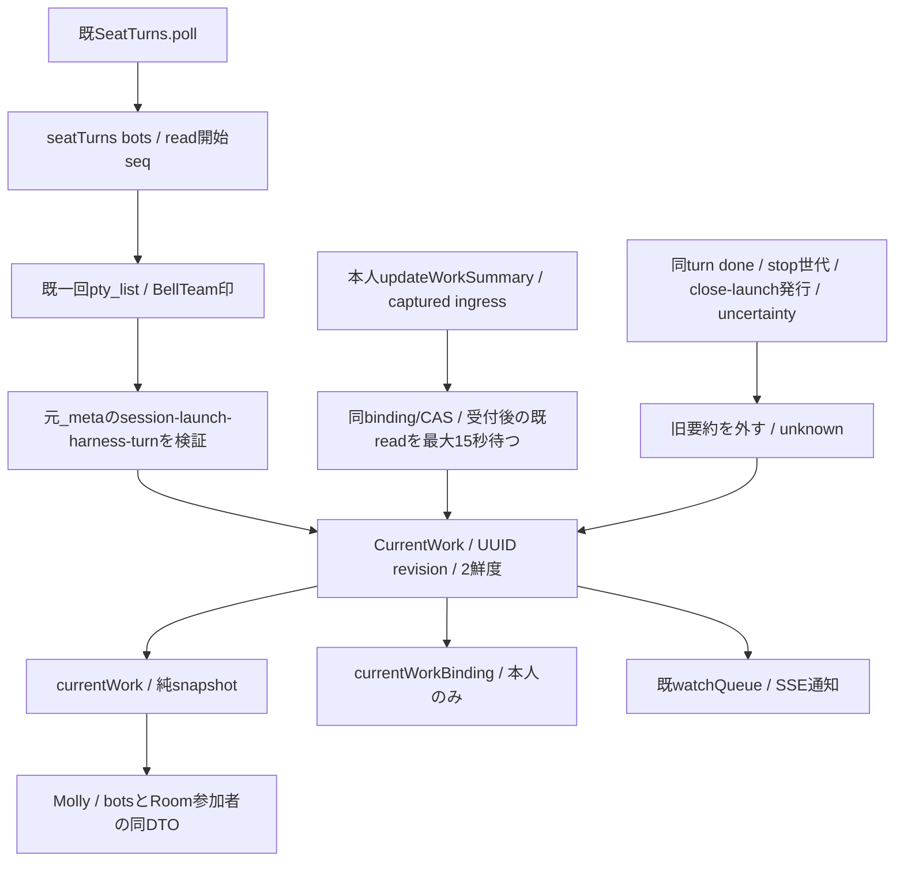

# 現在の仕事 v1：本人要約とnative状態

所有キロ。横断正本はRootのcurrent-work-contract-20261103.md（UUID revision追補込み）。親メモリだけで観測と本人宣言を合成し、members/Room/profile/Goalへwriterを増やさない。

## 固定source窓口

factoryは既 `createManagedTransport` / `AitermTransport`。同transportが唯一の`CurrentWork`実体を構築する。commonが別factoryを呼んだり`new CurrentWork`を追加しない。

| 方法 | 入出力/責任 |
| --- | --- |
| `transport.currentWork(bot)` | 同じ現登録Bot記述を渡す。全key固定DTOを同期返却。native/AI/RPC 0。awaitを跨ぐ一覧は最後に改めて呼ぶ |
| `transport.currentWorkBinding(bot, source)` | fresh working＋本人ingress一致ならsessionId/launchId/turnId/revision、他はnull。一覧へbindingを出さない |
| `transport.updateWorkSummary(bot, {expected,summary}, source)` | 純memory更新Promise。最初と保存直前に現在session/stop世代/uncertainty/進行session変更を再検査。最大15秒/同時1/追加queue無し |
| `transport.watchQueue(listener)` | 既SSE登録を再利用。変更時にtopics queue/botIdsを既形で通知。別watch/daemon/新native読取を作らない |
| `transport.close()` | memory expiry timerと未決更新を閉じ、既watch/client終了順へ戻る |

`bot`は既登録本人をcommonが解決した結果。raw入力のbotIdからこの窓口を勝手に選ばない。`source`は既 `seatExecutionSource(request,bots)` がHTTP ingressで捕捉する `{sourceSession,source:{launch:{session_id,launch_id}|null,boundary:null}}`。モデル引数で渡させずcommon closureから注入する。actorは受付時に安全なsession/launchだけをコピーし、待機中に元objectを変えても原actorは変わらない。headerはnative起源turnの強い証明ではない。表示の宣言sourceはself_reportedのまま。

expectedのexact keyはsessionId/launchId/turnId/revision、revisionはopaque UUID文字列。summaryはnull又はtrim後1〜160 Unicode codepointの一行、C0/C1/U+2028/U+2029拒否。HTML/Markdownを解釈しない。Mollyの公開toolは作業段階変化時だけ本人更新・秘密/生配送の自動転記禁止・heartbeat不要をdescriptionに持つ。get_selfにこの本人bindingと同read-only DTOを注入する。

拒否は固定Error.code/status：CURRENT_WORK_INPUT_INVALID/400、CURRENT_WORK_FORBIDDEN/403、CURRENT_WORK_CONFLICT/409、CURRENT_WORK_UNAVAILABLE/503。任意本文/stackを診断へ転記しない。成功は `{currentWork,currentWorkBinding}`。nullの既missingへのclearは変化が無いのでrevisionを変えない。同じrunningを再観測しただけでも変えない。

## 観測・終端・鮮度

既 `SeatTurns.poll → watchSeatTurns(bots) → seatTurns(bots)` の一回pty_listを再利用する。戻りのsession→turn Mapは旧watch互換だけに維持し、本機能は変換前の元seat rowを使う。schema/重複/session/launch/harness/turnが不正、nonCodex/null/欠測/例外、親uncertainty又はsession変更進行中はunknown。online/queue/Goalで埋めない。

read開始に親seqを捕捉。古いreadの返却は新しい開始readの結果やstop/終端のbarrierを越えず、更新は受付後に開始したreadでだけ確定する。freshnessは完了受領から親monotonic15秒。readが長く止まってもmemoryの単発expiry timerがunknown/SSEへ変える。新しいdaemon/AI/native呼出ではない。

同session/launch/turnのschema=aiterm.agent-wait-result.v1/outcome=doneは、既wait結果から同turnだけをunknownへ変え、旧inflight readと同完了turnの再登場を拒否する。別turnのdoneは現在要約を消さない。stop世代更新とclose/launch発行も同期で無効化する。sent/timeout/abort/job releaseはidleの証明にしない。新しい公開runningでだけworking、陽性idleでだけidleへ移る。

要約はmonotonic10分でstale、本文は返さず元summaryUpdatedAt/sourceを保持する。native失効はunknown/missingで本文・更新時刻・sourceを外し、observedAtは最後の有効観測時刻を保持。期限を完了へ変えない。更新、binding又は無効化の変化でUUIDを更新し、親restartでは別UUIDでunknownから始める。永続epoch/journal/TTL削除無し、members交換でも親recordを維持する。

同turnに複数配送があっても一record。複数queueをnative並行数へ変換しない。Room帰属やGoal対応は作らず、Mollyが現在参加者ごとの同DTOを投影する。SSE通知は状態/要約の変化時だけで、同じrunningの観測時刻更新では追加通知しない。

検証はcurrent-work/current-work-transportの直接境界、変更接点に限るseat-turns/bot-session-stateと既watch互換。sourceとfakeのみ、実席/実native/Host/旧consumer46/7681群の再走0。commonの認証/登録/退役とGET最終await後の再検査、公開MCP/schemaと両一覧DTOはMolly、表示はWeb/Appleが所有する。
