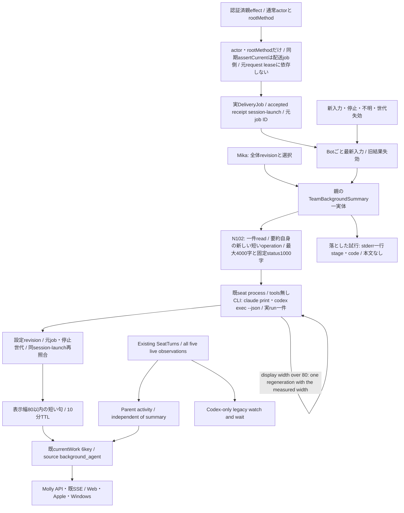
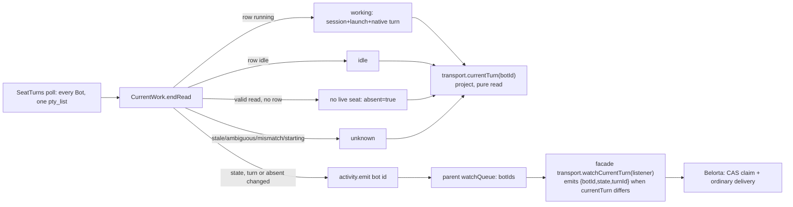

# 全体バックグラウンド要約と実行状態

所有キロ。Root `team-background-agent-contract-20261105.md` の方式を採用。主agentの本人要約writerは使わず、親同graphの `TeamBackgroundSummary` 一実体が全Botの変更入力を逐次処理する。Mollyがassemblyの別引数backgroundSummaryから同実体を各execution世代へ渡す。既閉portsへ新keyを追加せず、factory呼出の加法的引数を使うため旧dispatcherは無視でき、旧選択sourceに未提供要約機能を補完しない。設定はusageの全体一件、限定本文はconversationの専用readだけを使う。



## 親の固定port

`new TeamBackgroundSummary({configuration,readInput,run,notify,enabled})`。configurationはfresh `Promise<{revision,selection}>`、selectionはnull又はharness/model/reasoningEffortの閉3key。effort空文字はモデル個別effortsが空の時だけCLI指定無しとして許可する。Mikaが保存前にlive catalogで検証し、runnerも発行直前に再検証する。設定の保存成功callbackは `configure(record)`、shutdownは `await close()`。同値は再生成しない。未設定やgetter失敗を別モデルへ補完しない。

`readInput(input,authority)` はJSON閉7key `{botId,sessionId,launchId,inputRevision,deliveryId,context,contextId}` と、private `{context,assertCurrent}` を受ける。contextは元配送の `{actor,rootMethod}` だけを持つ凍結objectで、元requestのoperationContext/lease/admissionCheckを持たない。限定readは要約自身の新しい短いoperation（members/conversation lease）で行い、actorの既method上限と会話側の宛先・room照合はそのまま効く。assertCurrent(input)は同期で配送job・親session/launch/inputRevision・停止世代・最新入力・AI停止を照合、false/throwは失効。元requestのleaseは照合しない（2026-11-08 実測: HTTP/MCP配送は受理で応答しmembers leaseを解放するため、元leaseに結ぶと全要約が受理直後に失効し本番0件だった）。要約の寿命は配送jobの寿命（turn終端・停止・新入力で消える）だけで決まる。返却はnull又は同7key＋text/progressの閉9key、本文最大4000・保存固定status最大1000 Unicode。interim/自由callback/全文履歴/画像/secret値/任意fileを渡さない。

`createConversationExecutionEffects` は既親の認証済actorがowner/bot/scheduler、rootMethodがuser.post/user.turn/direct.post/room.post/room.replyの時だけauthorityを捕捉する。transportは受理後、そのauthorityから `{actor,rootMethod}` だけを要約workerへ渡す。usage secret/question/onboarding/observer/bridge/report/recoveryは除外。通常文中の未知の秘密を判定する新分類器は作らない。N102の専用callerが読取前後に同authorityを検査し保存済み元一件と宛先を照合する。既deliveryAnchorの本人actorを緩めない。

## 実行と結果

入力変更は実配送イベントから発行し、GET/描画や全席周期AIから発行しない。inputRevisionは既DeliveryJob.idを使い、session/launchは同Aiterm pty-send receiptの正規fieldを使う。native turnを作らず全主harnessの通常配送へ使える。受理前queue/onlineを実行証明にしない。次入力は元jobを失効、Botごと最新一件を保持する。actual runは全体一件で、取消後もrun Promiseの実終端まで次を開始しない。

`createBackgroundSummaryRunner({project,models,runner})` は既createSeatProcessRunnerのbase環境/取消・group終端を再利用。専用projectは親が `shared/tools/bellteam-background-agent` に用意し、Bot席として登録しない。所有はexecutionキロ、READMEへ目的と保持する空lock fileを記す。既authを使い、CLIのtools/MCP/hooks/自動指示読取を無効にした非対話面だけを許可する。現在供給するadapterは2つで、どちらもこのrunnerが直接argvと結果parseを持つ（Aiterm adapterへの依存は無い）。Claudeはprint/safe-mode/tools空/strict-mcp-config空/settings-source空/no-session-persistence、結果は単一JSON `type=result,subtype=success,is_error=false,result:string`。Codexは `codex exec --json --ephemeral --skip-git-repo-check --ignore-user-config --ignore-rules --sandbox read-only -C <project> -m <model> [-c model_reasoning_effort="<effort>"] -c project_doc_max_bytes=0 <instruction>`、入力JSONはstdin（CLIが`<stdin>`blockとして付加）。結果はJSONLで、`turn.completed`があり`turn.failed`/`error`が無く、最後の`item.completed`の`agent_message.text`が文字列の時だけ成功。user config（MCP/hooks/profile）と規則・AGENTS読取を外し、shellはread-only sandbox。grok/cursor/antigravityはBACKGROUND_SUMMARY_HARNESS_UNSUPPORTED、無断代替0。60秒期限・64KiB出力上限、失敗後同入力の再発行0。

runへ渡すのは選択済み設定と限定JSONだけ。出力はplain stringで親がtrim後、空でなく制御文字無し、表示幅80以内（East Asian Width F/W=2、他=1。全角だけなら40字）を検証し（2026-11-08 Owner裁定: メンバーカードの要約2行に収まる幅。14:5xに40から80へ。本番の32〜86字は見切れていた。句の内容は「今していること」で、ID・SHA・PR番号・「〜依頼」の定型句を書かない指示）、幅を超えた出力は切り詰めず、同じ入力と測った幅（previous_width）を添えて一度だけ再生成する。再生成も超えたら`BACKGROUND_SUMMARY_TOO_WIDE`で落とす（それ以上の再試行なし）。公開DTOの上限160は変えない（既存表示の契約）。元run closureの対象・入力/設定revisionと現recordを保存直前に照合する。AIに対象や状態の本人性を選ばせない。空・不正・取消・未知はmissing、主仕事を待たせない。落とした試行（設定なし以外）は `BellTeam background summary: <botId> <stage> <code>` をstderrへ一行書く（本文・要約文は書かない）。

## currentWork

既6keyはstate/summary/summaryStatus/summaryUpdatedAt/observedAt/source。新生成のsourceは `background_agent`。currentは本文有り、missingは本文・更新時刻・source=null、staleは本文null/元更新時刻/source維持。要約TTLはmonotonic10分。要約失敗は実行状態から独立。state/observedAtは既native観測を維持し、accepted receiptからworkingを生成しない。native非対応や観測15秒失効でunknownでも、親の元input/設定が有効ならsummaryはcurrent/staleにできる。入力本人性の不明・停止/新入力/失効では要約を外す。自主起動や未供給入力ではmissingのまま。idleをqueue空や取消受付から作らない。

`transport.currentWork(bot)` は同共有workerのsnapshotと既CurrentWorkのnative状態を合成する純読取。旧self_reportedは新成功に変換せず外す。`currentWorkBinding()`は常にnull、旧`updateWorkSummary()`はCURRENT_WORK_FORBIDDEN/403。共通側が主agentMCP一覧/dispatchから旧writerを撤去する。API/SSEは同6keyを転送し、共通validatorはbackground_agentと全state×summaryStatusの組合せを許可し、unknownではobservedAt=nullも許可する。同じsnapshotをBot/Room参加者表示へ使う。

## callerと収録

当差分はworker/runner、transportのsubmit/accepted/stop/close、conversation親effectのauthority capture、assembly/generation/factoryの別引数backgroundSummary、直接fixtureを持つ。Mollyはapplication-services/runtimeへ親一実体・限定read・usage record getter/callback・SSE notify・shutdown closeを配線する。N102はStore/RoomHistory/専用read/子dispatcherとfacade、Mikaは設定writer、Centiは正式資材/producerを所有する。

worker/runnerは親imageの所有sourceで、実engineの相対importは追加しない。execution署名はtransport/dispatcher変更が必要。親のworker/runner→seat-process→seat-command/run-seat-command等の既依存は同imageへ収録し、runtimeの内部試験は継承する。会話/usageは各新read・設定sourceに対応した必要署名だけを同mainから供給する。実module交換/正式資材/実表示/本番は作者fixture成功から補完しない。

## Shared activity observation (A-1)

The existing single `SeatTurns.poll -> transport.seatTurns -> pty_list` read supplies original `aiterm.seat-turns.v1` rows to CurrentWork. Capture each registered target's expected native harness together with its session/stop generation; recheck the same selection after the read. The supported scope is codex-cli, claude-code, grok-cli, cursor-cli and antigravity-cli. A missing harness on an internal legacy CurrentWork target retains its Codex-only interpretation.

Codex running/tracking types and validation remain unchanged. Observation-only non-Codex running has exactly state, turn_id, started_at, event_cursor, interim_from and wait_process. Its tracking trio is explicitly null. The opaque ID and start identify an actual Aiterm-managed observed parent-work span first captured by a positive LIVE native occupancy read; they do not certify historical vendor invocation birth. Preserve them across absorbed steer and attached waits. Non-Codex malformed branches, wrong target harness, ambiguous/duplicate rows and missing live evidence produce unknown.

```text
Registered session + expected harness + stop generation
 -> one existing native metadata read
 -> CurrentWork.endRead(original all-five rows)
      unique matching session, valid launch, expected harness/current selection
      contracted positive running -> working, refresh observation age
      positive parent idle -> idle, clear active binding
      null/malformed/ambiguous/mismatch -> unknown
 -> existing transport.currentWork + independent background summary
 -> unchanged public DTO / SSE
Same original rows -> Codex-only Map -> existing watch/wait/interim
```

The observation clock starts at successful valid current-read completion, not span start/file mtime; existing15s expiry is unchanged. A12-minute parent wait remains working while fresh positive reads arrive. Positive whole-parent terminal ends activity despite detached children; a child or late/vetoed Stop cannot beat current parent occupancy. This precedence and actual live evidence are native producer responsibilities; CurrentWork never reconstructs activity from input, queue, summary or cached flags. Existing unknown/idle/error and summary meanings remain unchanged.

The legacy watcher receives Codex rows only, retaining Codex null/idle/running behavior and real tracking. Observation-only rows never issue a waiter or interim call. No new native call, wire key/state, self-summary writer or background agent is introduced. One focused transport/CurrentWork fixture checks all five contracted rows, stable long parent waits, positive terminal with detached-child fixture data, stale/ambiguous/malformed/mismatched observations and no non-Codex wait issuance. Synthetic native-row fixtures are consumer evidence, not live native acceptance. Elegg supplies actual producers; normal main/supply/runtime acceptance follow that real handoff.

## Current turn for after_turn schedules (2026-11-08, contract agreed with Belorta)

Public read and change stream for the members scheduler's `after_turn` (once, prompt only). The source is the same native CurrentWork observation as the Bot list; no delivery/callback lifetime and no execution internals cross the boundary.



| Contact | Contract |
| --- | --- |
| `transport.currentTurn(botId)` | `{state:'working',turnId}` / `{state:'idle',turnId:null}` / `{state:'unknown',turnId:null}`. `turnId` is opaque (sha256 of session, launch, native turn id); compare for equality only. A Bot whose latest valid read has no seat row (offline, dead, closed) is `idle`: no turn can run. The Bot-list DTO keeps showing such Bots as `unknown` (unchanged). |
| `transport.watchCurrentTurn(listener)` | Parent facade and `AitermTransport` itself (the managed path without an execution factory), both via the one helper `watchCurrentTurn(watchQueue, read, listener)` in current-work.mjs; returns unsubscribe. Fires `listener({botId,state,turnId})` whenever `currentTurn(botId)` differs from what this listener last received, unknown transitions included. Built on the existing parent `watchQueue` stream, so it survives execution engine exchange. A read refused during an exchange is retried on the next change event of any Bot. |
| unknown self-exit | `unknown` = a live seat whose observation is stale (>15 s), ambiguous, mismatched or starting. The poll re-reads every Bot each tick; the next valid read resolves it to working/idle/absent, and each of those emits. No timer, wait or refusal is added. |
| observation semantics | A schedule saved while `unknown` binds the first resolved `working` turn, and that turn may have started after the save: an observation cannot prove which turn was current while it was unknown. The first resolved `idle` fires at once. |
| delivery semantics | The scheduler's dispatch is an ordinary delivery. If the Bot is mid-turn at dispatch (for example bound X ended and Y already started), the words are steered into Y. They are not queued as a new turn. A dead seat is woken by the same delivery. |
| compatibility | The parent facade is built from the body's method list, and the engine validates against its own list. The feature needs a body with this facade and an execution module with `transport.currentTurn`. Callers check `typeof transport.watchCurrentTurn === 'function'` and treat `EXECUTION_REQUEST_INVALID` from `currentTurn` as "not yet supported" (old engine), never as idle. |
