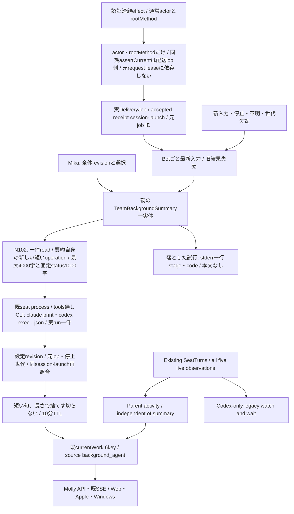
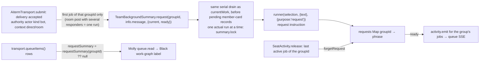
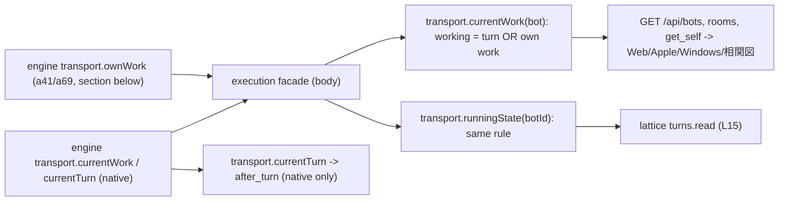

# 全体バックグラウンド要約と実行状態

所有キロ。Root `team-background-agent-contract-20261105.md` の方式を採用。主agentの本人要約writerは使わず、親同graphの `TeamBackgroundSummary` 一実体が全Botの変更入力を逐次処理する。Mollyがassemblyの別引数backgroundSummaryから同実体を各execution世代へ渡す。既閉portsへ新keyを追加せず、factory呼出の加法的引数を使うため旧dispatcherは無視でき、旧選択sourceに未提供要約機能を補完しない。設定はusageの全体一件、限定本文はconversationの専用readだけを使う。



## 親の固定port

`new TeamBackgroundSummary({configuration,readInput,run,notify,enabled})`。configurationはfresh `Promise<{revision,selection}>`、selectionはnull又はharness/model/reasoningEffortの閉3key。effort空文字はモデル個別effortsが空の時だけCLI指定無しとして許可する。Mikaが保存前にlive catalogで検証し、runnerも発行直前に再検証する。設定の保存成功callbackは `configure(record)`、shutdownは `await close()`。同値は再生成しない。未設定やgetter失敗を別モデルへ補完しない。

`readInput(input,authority)` はJSON閉7key `{botId,sessionId,launchId,inputRevision,deliveryId,context,contextId}` と、private `{context,assertCurrent}` を受ける。contextは元配送の `{actor,rootMethod}` だけを持つ凍結objectで、元requestのoperationContext/lease/admissionCheckを持たない。限定readは要約自身の新しい短いoperation（members/conversation lease）で行い、actorの既method上限と会話側の宛先・room照合はそのまま効く。assertCurrent(input)は同期で配送job・親session/launch/inputRevision・停止世代・最新入力・AI停止を照合、false/throwは失効。元requestのleaseは照合しない（2026-11-08 実測: HTTP/MCP配送は受理で応答しmembers leaseを解放するため、元leaseに結ぶと全要約が受理直後に失効し本番0件だった）。要約の寿命は配送jobの寿命（turn終端・停止・新入力で消える）だけで決まる。返却はnull又は同7key＋text/progressの閉9key、本文最大4000・保存固定status最大1000 Unicode。interim/自由callback/全文履歴/画像/secret値/任意fileを渡さない。

`createConversationExecutionEffects` は既親の認証済actorがowner/bot/scheduler、rootMethodがuser.post/user.turn/direct.post/room.post/room.replyの時だけauthorityを捕捉する。transportは受理後、そのauthorityから `{actor,rootMethod}` だけを要約workerへ渡す。usage secret/question/onboarding/observer/bridge/report/recoveryは除外。通常文中の未知の秘密を判定する新分類器は作らない。N102の専用callerが読取前後に同authorityを検査し保存済み元一件と宛先を照合する。既deliveryAnchorの本人actorを緩めない。

## 実行と結果

入力変更は実配送イベントから発行し、GET/描画や全席周期AIから発行しない。inputRevisionは既DeliveryJob.idを使い、session/launchは同Aiterm pty-send receiptの正規fieldを使う。native turnを作らず全主harnessの通常配送へ使える。受理前queue/onlineを実行証明にしない。次入力は元jobを失効、Botごと最新一件を保持する。actual runは全体一件で、取消後もrun Promiseの実終端まで次を開始しない。

`createBackgroundSummaryRunner({project,models,runner})` は既createSeatProcessRunnerのbase環境/取消・group終端を再利用。専用projectは親が `shared/tools/bellteam-background-agent` に用意し、Bot席として登録しない。所有はexecutionキロ、READMEへ目的と保持する空lock fileを記す。既authを使い、CLIのtools/MCP/hooks/自動指示読取を無効にした非対話面だけを許可する。現在供給するadapterは2つで、どちらもこのrunnerが直接argvと結果parseを持つ（Aiterm adapterへの依存は無い）。Claudeはprint/safe-mode/tools空/strict-mcp-config空/settings-source空/no-session-persistence、結果は単一JSON `type=result,subtype=success,is_error=false,result:string`。Codexは `codex exec --json --ephemeral --skip-git-repo-check --ignore-user-config --ignore-rules --sandbox read-only -C <project> -m <model> [-c model_reasoning_effort="<effort>"] -c project_doc_max_bytes=0 <instruction>`、入力JSONはstdin（CLIが`<stdin>`blockとして付加）。結果はJSONLで、`turn.completed`があり`turn.failed`/`error`が無く、最後の`item.completed`の`agent_message.text`が文字列の時だけ成功。user config（MCP/hooks/profile）と規則・AGENTS読取を外し、shellはread-only sandbox。grok/cursor/antigravityはBACKGROUND_SUMMARY_HARNESS_UNSUPPORTED、無断代替0。60秒期限・64KiB出力上限、失敗後同入力の再発行0。

runへ渡すのは選択済み設定と限定JSONだけ。出力はplain stringで親がtrim後、空でなく制御文字無しだけを検証する。長さでは捨てず切らず、再生成もしない（2026-11-09 Owner裁定: 幅を超えたら捨てる考え自体が誤り。指示の目安はメンバーカード2行に収まる全角40字で、句の内容は「今していること」、ID・SHA・PR番号・「〜依頼」の定型句を書かない）。ただしメンバーカードは公開DTO（integrationの current-work-contract.mjs、1〜160 Unicode文字）を超える句だけ `BACKGROUND_SUMMARY_DTO_LIMIT` で保存しない（保護対象: DTOを読む全readerが失敗しない。上限を外すのはintegrationの契約変更）。元run closureの対象・入力/設定revisionと現recordを保存直前に照合する。AIに対象や状態の本人性を選ばせない。空・不正・取消・未知はmissing、主仕事を待たせない。落とした試行（設定なし以外）は `BellTeam background summary: <botId> <stage> <code>` をstderrへ一行書く（本文・要約文は書かない）。

## currentWork

既6keyはstate/summary/summaryStatus/summaryUpdatedAt/observedAt/source。新生成のsourceは `background_agent`。currentは本文有り、missingは本文・更新時刻・source=null、staleは本文null/元更新時刻/source維持。要約TTLはmonotonic10分。要約失敗は実行状態から独立。state/observedAtは既native観測を維持し、accepted receiptからworkingを生成しない。native非対応や観測15秒失効でunknownでも、親の元input/設定が有効ならsummaryはcurrent/staleにできる。入力本人性の不明・停止/新入力/失効では要約を外す。自主起動や未供給入力ではmissingのまま。idleをqueue空や取消受付から作らない。

`transport.currentWork(bot)` は同共有workerのsnapshotと既CurrentWorkのnative状態を合成する純読取。旧self_reportedは新成功に変換せず外す。`currentWorkBinding()`は常にnull、旧`updateWorkSummary()`はCURRENT_WORK_FORBIDDEN/403。共通側が主agentMCP一覧/dispatchから旧writerを撤去する。API/SSEは同6keyを転送し、共通validatorはbackground_agentと全state×summaryStatusの組合せを許可し、unknownではobservedAt=nullも許可する。同じsnapshotをBot/Room参加者表示へ使う。

## callerと収録

当差分はworker/runner、transportのsubmit/accepted/stop/close、conversation親effectのauthority capture、assembly/generation/factoryの別引数backgroundSummary、直接fixtureを持つ。Mollyはapplication-services/runtimeへ親一実体・限定read・usage record getter/callback・SSE notify・shutdown closeを配線する。N102はStore/RoomHistory/専用read/子dispatcherとfacade、Mikaは設定writer、Centiは正式資材/producerを所有する。

worker/runnerは親imageの所有sourceで、実engineの相対importは追加しない。execution署名はtransport/dispatcher変更が必要。親のworker/runner→seat-process→seat-command/run-seat-command等の既依存は同imageへ収録し、runtimeの内部試験は継承する。会話/usageは各新read・設定sourceに対応した必要署名だけを同mainから供給する。実module交換/正式資材/実表示/本番は作者fixture成功から補完しない。

## Shared activity observation (A-1)

The existing single `SeatTurns.poll -> transport.seatTurns -> pty_list` read supplies original `aiterm.seat-turns.v1` rows to CurrentWork. Capture each registered target's expected native harness together with its session/stop generation; recheck the same selection after the read. The expected harness is the harness of the seat this transport launched or resumed for that session (`seatHarness`), not the saved profile: a harness change is saved before the seat restarts, and until the relaunch the live row still carries the old harness (Belota, 2026-11-08: an after_turn saved in the `update_self` codex→claude turn was stored as unknown). After an engine exchange it comes from the launch record (`execution-runtime-launches.json` `harness`); with no record at all it falls back to the profile. The supported scope is codex-cli, claude-code, grok-cli, cursor-cli and antigravity-cli. A missing harness on an internal legacy CurrentWork target retains its Codex-only interpretation.

Codex running/tracking types and validation remain unchanged. Non-Codex running has exactly state, turn_id, started_at, event_cursor, interim_from and wait_process. event_cursor and wait_process are explicitly null; interim_from is null or an interim-words start token `v1:<c>:b:<byte>` / `v1:<c>:u:<users>` (Aiterm 0.70.5, its observation-results.md A-1b: the transcript position at the seat's last settled idle under the same binding). The opaque ID and start identify an actual Aiterm-managed observed parent-work span first captured by a positive LIVE native occupancy read; they do not certify historical vendor invocation birth. Preserve them across absorbed steer and attached waits. Non-Codex malformed branches, wrong target harness, ambiguous/duplicate rows and missing live evidence produce unknown.

```text
Registered session + expected harness + stop generation
 -> one existing native metadata read
 -> CurrentWork.endRead(original all-five rows)
      unique matching session, valid launch, expected harness/current selection
      contracted positive running -> working, refresh observation age
      positive parent idle -> idle, clear active binding
      null/malformed/ambiguous/mismatch -> unknown
 -> existing transport.currentWork + independent background summary
 -> unchanged public DTO / SSE
Same original rows -> seat-turn Map (all rows) -> watchSeatTurns
      Codex row -> existing watch/wait/interim (unchanged)
      non-Codex running + interim_from token -> word watch (no waiter)
      non-Codex running + interim_from null -> observation only
```

The observation clock starts at successful valid current-read completion, not span start/file mtime; the 15 s expiry holds while a current read is in flight (see "read hold" below). A12-minute parent wait remains working while fresh positive reads arrive. Positive whole-parent terminal ends activity despite detached children; a child or late/vetoed Stop cannot beat current parent occupancy. This precedence and actual live evidence are native producer responsibilities; CurrentWork never reconstructs activity from input, queue, summary or cached flags. Existing unknown/idle/error and summary meanings remain unchanged.

The watcher keeps Codex null/idle/running behavior and real tracking unchanged.

Non-Codex word watch (2026-11-10, contract agreed with Elegg; Owner: in-turn words for every working seat). A non-Codex running row starts a `watchTurn` only when its `interim_from` is a token, the seat is idle in BellTeam, the turn is not the last followed one, and the span does not contain a BellTeam-sent turn: the last accepted dispatch/steer receipt of the same launch must have an `event_cursor` lower than the token's `c` (both are the Aiterm completion cursor; a lower sent cursor means a settled idle came after that turn's completion, so the span's words are not already shown). Such a watch reads interim words only, from the token, checking the returned `event_cursor` against `c`; it never issues a waiter. It ends through the existing observer: idle, a different turn, or a missing row. A null row keeps it, as today. An accepted non-steer dispatch to that seat also ends it, because Aiterm dispatches only to an idle seat and later reads from the same token would include the dispatched turn's words. Rows with interim_from null (Cursor, Antigravity, unseen binding, read failure) stay observation-only and never issue a waiter or interim call. A word watch that starts mid-span shows the span's words from its start, including ones written before the first busy poll. No new native call, wire key/state, self-summary writer or background agent is introduced. One focused transport/CurrentWork fixture checks all five contracted rows, stable long parent waits, positive terminal with detached-child fixture data, stale/ambiguous/malformed/mismatched observations and no non-Codex wait issuance. Synthetic native-row fixtures are consumer evidence, not live native acceptance. Elegg supplies actual producers; normal main/supply/runtime acceptance follow that real handoff.

## Current turn for after_turn schedules (2026-11-08, contract agreed with Belorta)

Public read and change stream for the members scheduler's `after_turn` (once, prompt only). The source is the same native CurrentWork observation as the Bot list; no delivery/callback lifetime and no execution internals cross the boundary.

```mermaid
flowchart LR
  Poll[SeatTurns poll: every Bot, one pty_list] --> EndRead[CurrentWork.endRead]
  EndRead -->|row running| Working[working: session+launch+native turn+started_at]
  EndRead -->|row idle| Idle[idle]
  EndRead -->|valid read, no row| Absent[no live seat: absent=true; DTO idle while fresh]
  EndRead -->|"session in data.unread (Aiterm >= 0.70.7: its terminal failed / >4 s / no seat_turns; >= 0.70.10: seat held by another reader, local seats too)"| Unread[not read: previous observation kept, expires to unknown after 15 s (held while a read is in flight); never absent]
  EndRead -->|stale/ambiguous/mismatch/starting| Unknown[unknown]
  Done["Aiterm agent wait outcome done for this exact working turn"] -->|"fresh native observation; reads begun earlier fenced; a later read still showing this turn running = unknown"| Idle
  Working & Idle & Absent & Unknown --> Turn["transport.currentTurn(botId[, {startedAt:true}])<br/>project, pure read"]
  EndRead -->|state, turn or absent changed| Notify[activity.emit bot id]
  Notify --> Queue[parent watchQueue: botIds]
  Queue --> Watch["facade transport.watchCurrentTurn(listener)<br/>emits {botId,state,turnId,startedAt} when currentTurn differs"]
  Watch --> Scheduler[Belorta: CAS claim + ordinary delivery]
```

| Contact | Contract |
| --- | --- |
| `transport.currentTurn(botId)` | `{state:'working',turnId}` / `{state:'idle',turnId:null}` / `{state:'unknown',turnId:null}`. `turnId` is opaque (sha256 of session, launch, native turn id); compare for equality only. A Bot whose latest valid read has no seat row (offline, dead, closed) is `idle`: no turn can run. The Bot-list DTO shows such Bots as `idle` too (Trony ruling 2026-11-11; Owner 「仕事がないなら落ちてていい」), with `observedAt` = that read, while the read is fresh (15 s, held by a read in flight like any row); after that the DTO is `unknown`. |
| `transport.currentTurn(botId, {startedAt:true})` | Same result plus `startedAt`: ISO string when `working`, `null` otherwise (2026-11-08, for Black's 相関図 node activeSince). Source: the running row's `started_at` captured with the binding. For Codex it is the native turn start; for the other CLIs it is the start of the Aiterm-observed parent-work span first seen by a live read (not vendor invocation birth). An invalid/missing value is `null`. Without the option the result keeps exactly `{state,turnId}`, because the members after_turn validators accept only those two keys. An old engine ignores the option, so a missing key means "not supplied". |
| `transport.watchCurrentTurn(listener)` | Parent facade and `AitermTransport` itself (the managed path without an execution factory), both via the one helper `watchCurrentTurn(watchQueue, read, listener)` in current-work.mjs; returns unsubscribe. Reads `currentTurn(botId,{startedAt:true})` and fires `listener({botId,state,turnId,startedAt})` (`startedAt` null unless supplied for a working turn) whenever that result differs from what this listener last received, unknown transitions included. Built on the existing parent `watchQueue` stream, so it survives execution engine exchange. A read refused during an exchange is retried on the next change event of any Bot. |
| unread (Aiterm >= 0.70.7) | `data.unread: [session_id]` lists terminal-bound sessions whose terminal did not answer the relay in time or answered without seat_turns. From Aiterm 0.70.10 it also lists a seat (remote or local) that another live reader holds at that instant; before 0.70.10 such a read could return that seat as `turn:null`. Such a seat was not read: endRead leaves its record as it was (no absent, no new observation), so the normal 15 s expiry turns it unknown and the next answered read resolves it. A Mac tick is read time + 5 s (9-13 s live, 2026-11-11), so one unread tick reads unknown for a few seconds; accepted as honest staleness (a longer expiry would hide real stalls). Before 0.70.7 there is no field and a missing row stays absent. Seen 2026-11-10: Mac rows dropped by the 4 s relay read as absent, so after_turn could see a working remote seat as idle |
| listed (2026-11-13, remote-seat.md "Seat liveness") | Per record, for its current session: `null` until a valid read covers the session (reset on session change), then `true` when that read had a row for it or listed it in `unread`, `false` otherwise. Set in `endRead` after the current-target check, before the unread skip; it changes no state, notification or expiry. `CurrentWork.listed(botId, sessionId)` returns it (`null` for another session). Read by `runningBots` for remote members only |
| read hold (2026-11-11, Trony N1) | Production tick after 608a7bae: read 10-27 s + 5 s sleep = 15-32 s, longer than the 15 s expiry, so every row (and its summary, which `unknown` clears) dropped to unknown before the next read: 89-140 of 140 rows unknown at any moment, all 140 for 1-5 s each tick. Rule: a row's 15 s expiry does not fire while a `beginRead` younger than 60 s has not reached `endRead` (that read settles the row: refreshed, unknown, absent or unread-kept). A read older than 60 s no longer holds, so a hung poll still turns rows unknown. `endRead(read, null)` (failed read) settles as before. No new timer kind: the expiry deadline is the later of observed + 15 s and the newest in-flight read start + 60 s. |
| unknown self-exit | `unknown` = a live seat whose observation is stale (>15 s with no read in flight), ambiguous, mismatched or starting. The poll re-reads every Bot each tick; the next valid read resolves it to working/idle/absent, and each of those emits. No timer, wait or refusal is added. A freshly launched non-Codex seat with a ready pane and no completed turn in this launch is reported by Aiterm 0.64.0 as `turn:null` (no terminal evidence yet), so it stays `unknown` until its first turn ends; reading that seat as `idle` is the native producer's part (requested from Elegg 2026-11-08). |
| observation semantics | A schedule saved while `unknown` binds the first resolved `working` turn, and that turn may have started after the save: an observation cannot prove which turn was current while it was unknown. The first resolved `idle` fires at once. |
| delivery semantics | The scheduler's dispatch is an ordinary delivery. If the Bot is mid-turn at dispatch (for example bound X ended and Y already started), the words are steered into Y. They are not queued as a new turn. A dead seat is woken by the same delivery. |
| compatibility | The parent facade is built from the body's method list, and the engine validates against its own list. The feature needs a body with this facade and an execution module with `transport.currentTurn`. Callers check `typeof transport.watchCurrentTurn === 'function'` and treat `EXECUTION_REQUEST_INVALID` from `currentTurn` as "not yet supported" (old engine), never as idle. |

## Request summary for the 相関図 edge label (2026-11-08, Owner ruling via Black)

The edge label shows what one Bot asked another, summarized once per request by the member-card model (`backgroundAgentConfiguration`). It is separate from the member-card `currentWork` summary, which is unchanged.



| Contact | Contract |
| --- | --- |
| Trigger | `submit` after acceptance, when `summaryAuthority.context.actor.kind === 'bot'`, `info.context` is `direct` or `room`, and `info.groupId` is set. Key = `groupId`. A groupId already requested is not requested again (responders of one room post share it). No GET, render or timer starts a run. |
| Input | `{ text: info.message }` only, ≤ 4000 code points (longer is not summarized: null). Untrusted material; the instruction says so. |
| Output | One Japanese phrase saying what is being asked; no IDs, SHA, PR numbers, times, quotes or Markdown. The instruction targets about 20 full-width characters. Owner ruling 2026-11-09 07:3x JST (via Black): whatever the model returns is kept (trim only); it is never dropped or cut for its length and never regenerated. (Until then over-width output was dropped as `BACKGROUND_SUMMARY_TOO_WIDE`: 18 drops in 06:45–06:59 JST.) The 相関図 label wraps any length (Black #733). |
| Order | A pending request runs before the next pending member-card record (a run already in flight finishes first). Card-first (until 2026-11-09) left Bot-to-Bot edges at 依頼を処理中 for minutes under load: Black's production reads 06:51–06:52 JST. |
| Failure | Any failure, no selection, or AI paused → stays `null`; no retry (same as the member card). The drop line is `BellTeam background summary: request <stage> <code>` (no text). |
| Lifetime | Kept while any job of that groupId is active in the queue. `SeatActivity.release` of the last one calls `forgetRequest(groupId)`. A run in flight whose `current()` turned false stores nothing. `close()` clears everything. |
| Public row | With a worker that supports requests, every `transport.queueItems()` row has `requestSummary: string \| null` (failed rows `null`). Without one the rows are unchanged (no key). |
| Compatibility | The worker and runner are parent-image source, the transport is execution. An older body (before 536e65f2) has no `requestSummary` method, so a new engine sends rows with no key, the same as an older engine; the consumer treats a missing key as null and the label falls back to 依頼を処理中. Production check: `GET /api/queue` rows have no `requestSummary` key until the body includes 536e65f2. The feature goes live only with both. |

## A schedule never makes a Bot read running (a71, 2026-11-14 Owner ruling via Trony; supersedes the 2026-11-12 script-wait section)

Owner: 「スクリプトやCIの結果をただ待つ時に予定機能を使うな。CLIの中で待つ（a41・a68）が正しい。予定機能に例外を作りたくない。」 (ruling: Trony's docs/waiting-and-running-ruling-20261114.md; common rule #1343). A Bot waits on its own script, build, test or CI inside its CLI, and that counts through own work (section below). A Bot that watches an outside condition uses a repeating command schedule and reads idle until the schedule wakes it. The execution facade has no scheduler input: an enabled `notify:'result'` command schedule or a running command job of the Bot changes neither `currentWork` nor `runningState`.



| Contact | Contract |
| --- | --- |
| Schedules | Not an input. `createExecutionFacade` and `createExecutionAssembly` take no `commandWait`; a released body that still passes one has it ignored. Removing `scheduler.commandWait` (members schedules.md SC9) is Belota's a70; the body wiring (application-services, work-graph `commandWaits.watch` W1) and the Lattice L15 wording are Molly's a72. |
| `transport.runningState(botId)` | `'working'|'idle'|'unknown'` = native `currentTurn(botId).state`, `'working'` when native is `idle` and own work is set. Lattice turns.read keeps reading it (fallback to currentTurn on an older body). |
| reason enum | `schedule` stays in the public `reason.kind` enum (current-work-contract.mjs) because released Apple/Windows clients and older bodies read it; execution no longer emits it. |
| Not changed | `currentTurn`, `watchCurrentTurn`, after_turn, the engine, own work (CLI background tasks keep counting). |
| Consequence (ruling review 3) | A Bot whose only activity is an enabled notify=result schedule reads idle and the Lattice nudge reaches it; an outside-waiter sets a Lattice stop (ruling review 3). |

## Own work counts as running, with an Owner-approved exclusion list (a41, 2026-11-13, Owner GO via Trony; contracts with Elegg and Flora)

Owner: a Bot waiting on something it started itself is running, whatever the command and however it was started; a
never-ending process must not keep it running: 「稼働中判定除外リストを作るべき。安易にリストに追加せず必ず俺が承認する形で。」
A subagent started through Aiterm counts the same. Design record: Kiro docs/running-definition-design-20261113.md (sections 3, 6, 10).

```mermaid
flowchart LR
  List["running exclusions (execution state, Kiro)<br/>entries {id, kind, exe, args, scope, decisionId, approvedAt, reason}"] --> Req
  Req["SeatTurns.poll: one pty_list(seat_turns), request _meta aiterm/own_work_exclusions {digest, entries per session}"] --> Aiterm
  subgraph Aiterm["Aiterm on the body and on each terminal (Elegg)"]
    Proc["process table, one read per call"] --> Own["own_work per seat:<br/>processes = post-startup, not plumbing, not excluded<br/>excluded, child_results, exclusions_digest, oldest {exe,args,since}"]
  end
  Own --> Row["seat row {turn, own_work}"]
  Row --> End["CurrentWork.endRead: keeps turn (unchanged) + own work"]
  End --> Facade["facade: working = turn running OR own work"]
  Facade --> Work["transport.currentWork (card, rooms, get_self) + reason"]
  Facade --> Running["transport.runningState (Lattice L15)"]
  End --> CT["transport.currentTurn -> after_turn (turn only, unchanged)"]
  Card["card shows 'background: exe args since HH:MM'"] --> Prop["propose_running_exclusion / _removal (any Bot)"]
  Prop --> File["body Approval Box connector (own token, generic decisions client): one decision, proposal stored in pending BEFORE filing, own uuid session_label"]
  File --> Ans["Owner answer -> 60 s poll decisions.read: approve for that id"]
  Ans --> List
```



| Contact | Contract |
| --- | --- |
| own work | Turn idle AND (`own_work.processes > 0` with the current list applied, OR `own_work.child_results > 0`). `processes` is applied only when the row echoes `exclusions_digest` equal to the digest sent; otherwise it is ignored for that seat (older Aiterm or terminal: turn only). `null` = cannot count = 0. `child_results` is used only after Elegg's attribution/expiry fix (until then ignored). Own work has its own 15 s freshness from the read that carried it (same read hold); a turn completion (Aiterm done) refreshes the native state only, never this. |
| own work: harness tasks (a69, 2026-11-14) | Turn idle AND `own_work.tasks > 0` also counts: the harness's OWN statement of its unfinished background tasks (in-process agents such as Claude Code's background Agent, background shells), read by Aiterm (a68) because an in-process agent has no child process (Crown 11/13: idle while its agent ran 15 min). `own_work.task` {kind agent\|shell\|other, label, since} names the oldest. `tasks` null or absent (older Aiterm, a harness that states nothing) = not supplied, the process rule alone as before. Tasks are not subject to the exclusion list (they are the CLI's own work items). The old-seat close (`quietSession`, a48) also needs `pty_observe.activity.background_tasks` absent/null/0; Aiterm's idle clock and `pty_close{hibernate}` treat tasks > 0 as busy (a68). |
| transport (agreed with Elegg 11/13, Aiterm 0.70.42) | The list travels in the pty_list request `_meta` as `aiterm/own_work_exclusions` (pty_list's public schema unchanged; the terminal relay forwards `_meta` as is). At most 256 entries, digest at most 128 characters. A malformed list is not applied: `exclusions_digest:null`, `excluded:0`, and execution ignores `processes`. Row `own_work.oldest.since` = ISO start of that process. |
| descriptor | Computed by Aiterm where the process runs, from the same process-table read; raw argv never leaves that machine. `exe` = basename of argv[0] (both `/` and `\\` are separators, quotes stripped) without .exe/.cmd, lower-case on Windows; `args` = first 2 arguments not starting with `-`, as basenames; a token > 40 characters or containing `=`, `://` or `@` is masked as `…`. Linux reads exact argv (/proc cmdline), Windows splits CommandLine by CommandLineToArgvW rules; macOS has only the joined command line and splits on whitespace, so an argument with a space splits wrongly there (documented limit). |
| entry match | `kind:"process"`: `exe` equal and entry `args` a prefix of the descriptor's `args` (exact tokens). Not counted: the matched process, its descendants and its post-startup ancestors (the CLIs' `bash -c` wrappers). `kind:"child"`: an Aiterm child seat by `{harness, session}`. `scope` = all Bots or listed Bot IDs; execution expands it to session ids. |
| store | `execution-running-exclusions.json` beside the other execution state files, schema `bellteam.running-exclusions.v1`, `{entries:[...]}` (at most 256). Read each poll by `src/running-exclusions.mjs`: absent = empty list; unreadable or invalid = no list sent (processes not counted, one `RUNNING_EXCLUSIONS_UNAVAILABLE` diagnostic per transition). Engine read `transport.ownWork(botId)` = `{kind, detail, since}` or null for a fresh idle seat; the facade treats a refused method (older engine) or any other shape as not supplied. |
| delivery order | PR 1 (read, compose, list sent; this section's top half) ships first with the empty list. PR 2 adds the proposal tool and the Approval Box writer, before the first proposal can exist; a62 adds the Owner's HTTP read and removal. PR 3 emits `reason` after integration #1274 is live. |
| list writes | Exactly three, all the Owner's own decision: an approved addition writes the entry stored when its decision was filed; an approved removal deletes that entry; the Owner's removal from a screen (`DELETE /api/running-exclusions/{id}`, a62) deletes that entry at once and drops any pending removal proposal for the same id. No Bot tool, code path or migration writes on its own, and code never proposes on its own. Protection named: no Bot can make itself or another look idle by its own decision (Owner rule). It is a write restriction; nothing stops. |
| proposal (PR 2) | Bot tools `propose_running_exclusion {kind, exe, args \| harness, session, scope, reason}`, `propose_running_exclusion_removal {id, reason}`, `list_running_exclusions {}` (body, `src/running-exclusions.mjs` `createRunningExclusions`, tools `src/running-exclusions-mcp.mjs`). The same add (kind + key + scope) or removal (id) that is listed or still pending returns that one; a pending duplicate is returned before the capacity check. An addition is refused while the list holds 256 entries (the engine's read limit). Each proposal = one Approval Box decision through the body's own connector (`createApprovalDecisions` with scope `{terminalId:'running-exclusions', purpose:'approval-box.connector'}` and secret `{botId:'bot-09e6225c', toolId:'running-exclusions-approval-box'}`; Lattice keeps its own). Each NEW proposal gets its own `session_label` `running-exclusions:<random uuid>`: an earlier proposal of the same action (approved, rejected, cancelled, removed later) is never recovered by the connector's label lookup, so every change needs a new Owner answer. The exact proposal (label, action, entry, decision title/context) is stored in the same file under `pending` BEFORE `decisions.file`; a filing whose outcome is unknown stays there with `decisionId:null` and is re-filed with the SAME label (by the next poll or the same proposal), so the connector adopts the decision it may already hold. |
| answer (PR 2) | The body polls each pending decision by id every 60 s while any is pending. Only option `approve` (label 承認) applies the stored action; any other answer or a cancel drops it; pending/held keep waiting. An approved addition that cannot apply because the list holds 256 entries stays pending (marked approved, not read again) and applies when a removal makes room; one whose entry is already listed is dropped. Connector unavailable = try next tick. The body never rewrites a store the engine reader would refuse (over 256 entries, duplicate ids, invalid entry) or whose `pending` is present but malformed. The proposing Bot sees the result with `list_running_exclusions` (no push). |
| Owner read and remove (a62) | Owner HTTP, `src/http-running-exclusions-api.mjs` (the internal port answers 403 `RUNNING_EXCLUSIONS_OWNER_REQUIRED`; Bots read with `list_running_exclusions`). `GET /api/running-exclusions` = the same projection as `list_running_exclusions`: `{entries:[{id, kind, exe, args \| harness, session, scope, decisionId?, approvedAt?, reason?, from?}], pending:[{action, entry \| id, decisionId, from, filedAt, approved?}]}`; `scope` = `"all"` or Bot ids; `from` = the proposing Bot id, kept on an entry written at approval from 11/13 (Admi a63; older entries have none) (clients show names from `/api/bots`). `DELETE /api/running-exclusions/{id}` = `{removed:id}`; unknown id 404 `RUNNING_EXCLUSION_NOT_FOUND`; store unreadable 503 `RUNNING_EXCLUSIONS_UNAVAILABLE` (never rewritten). Readers: Web (Admi a63), Apple (Rapi a64), Windows (Anis a65). No push event: a screen re-reads after its own removal and on open. |
| reason | The engine keeps why a Bot is working; one reason by the fixed order `turn`, `subagent` (Aiterm child results, then a harness task of kind agent: detail = its label), `background` (processes, then any other harness task) (with `oldest` as detail "<exe> <args>"). Public DTO key `reason: null \| {kind, detail, since}` agreed with Molly (integration, PR #1274): only when state is working; detail follows the summary line rule (non-empty, trimmed, one line); Execution emits it only after #1274 is live in the body schema and the Web reader (an earlier emit would turn every card unknown); both were live in body L (2026-11-13 16:23 JST), so PR 3 emits it. The facade composes it in `transport.currentWork`: native working -> `{kind:'turn', detail:null, since: the turn's startedAt}`; (a71: no `schedule` reason is emitted any more; the enum value stays for released clients); idle with own work -> the engine's `ownWork` value (`subagent` or `background` with the masked "<exe> <args>"). Idle and unknown carry no `reason` key. `since` is ISO or null. Showing it on the cards is each screen owner's later change (Web Admi, Apple Rapi, Windows Anis). |
| at start | The list is empty. Each long-lived process found in the go-live census of terminal seats is filed as its own proposal. |
| Owner-answer waits | No special handling (Owner 11/13: 「稼働中判定が本番に入るまでこのまま」). After go-live Kiro reports how such a seat reads. |
| idle close / nightly restart | Read the same facade fact in a later step (they read their own sources today). |
| Self-exit | No guard is added: the process exits or the result arrives and the next tick (5-30 s) reads 0. |
