# Fork port (`transport.forkInquiry`, `transport.forkSeat`)

Owner: Kiro (execution). Consumer: N102 [fork inquiry](../conversation/fork-inquiry.md) (`askReadonly`). Registry consumer: Molly [seat kind SK01/SK03/SK07](../integration/remote-seat-ingress.md#seat-kind-fork-seats-sk01-sk08). Native: Aiterm 0.70.6 `agent_launch` `fork_from` (Elegg, ADR 0140).

Owner contract 2026-11-10 (via Root and Elegg): a fork may not write inside the project folder; everything else is allowed, with the main's tools and MCP. Aiterm enforces the ban below the tools (Linux Landlock, macOS sandbox-exec). Windows answers `READONLY_UNENFORCEABLE`.

## Function diagram

```mermaid
flowchart LR
  C[conversation askReadonly] -->|"forkInquiry(bot, envelope, {forkId, deliveryId, queue?, onStatus, onInterim, onAnswer, onTurnEnd})"| F[AitermTransport.forkInquiry]
  PF["parent facade transport.forkInquiry / forkSeat<br/>(EXECUTION_METHODS dispatch / project; update hold = input)"] --> F
  F -->|"main = session(bot) at call time; no queue, stop version, steer or wake"| N["name = main + '-fork-' + sha256(forkId)[0..12]"]
  N -->|"forks.set(name, {botId, forkId, row}) before launch"| R[(activity.forks, shared across engine exchange)]
  N -->|local| L["args {harness, cwd = project, session_name, prompt, fork_from {session_id: main, fork_id}}; claudeLogin = main's slot"]
  N -->|"remote (terminalId + projectRoot)"| P["RemoteSeats.prepare(kind 'fork'): terminal, cwd, append_system_prompt, mcp_config with a fork credential"]
  L --> A[client.call agent_launch]
  P --> A
  A -->|"receipt: fork_of.write_ban + wait_process"| OK["onStatus running; resolve {delivery: running, forkId}"]
  A -->|"READONLY_UNENFORCEABLE, or Aiterm without fork_from, or receipt without write_ban"| U["FORK_UNAVAILABLE {reason: readonly_unenforceable}"]
  A -->|other refusal| E[launch error as-is]
  OK --> W["background (tracked): followInterim, waitUntilDone, readTurnAnswer"]
  W -->|done| D["onAnswer(text), onStatus delivered, onTurnEnd"]
  W -->|failed| X["onStatus failed {code FORK_FAILED, reason}"]
  D --> Z["pty_close(name); revoke remote credential; forks.delete(name)"]
  X --> Z
  U --> Z
  E --> Z
  Q[transport.queueItems] -->|"running forks as rows + seat {kind: fork, forkId}"| R
  S["transport.forkSeat(name)"] -->|"{botId, forkId} or null"| R
```

## Contract

| Item | Contract |
| --- | --- |
| input | `bot` (target member), `envelope` (the fork's first input, non-empty), `forkId` (string, 1-200 chars), `deliveryId` (row `groupId`), optional `queue` (same row info as `notify`, e.g. `from`, `fromName`; overrides the defaults `context:'direct', contextId/target: bot.id`), `executionSource` accepted and unused, callbacks as `notify`. `FORK_INVALID` (400) for a bad input or a `forkId` already running |
| main ref | `session(bot)` at call time. Aiterm forks that seat's latest saved conversation. The main is not woken: a member that never had a seat gets Aiterm's `FORK_SOURCE_UNAVAILABLE` |
| launch | One `agent_launch`, same client and seat launcher as a main launch. `cwd` is the main's folder (Aiterm accepts the same real path; the seat launcher requires it). No `write_scope`, `require_existing_resume`, `throughline_source_session`, `launch_operation_id`, `configuration_root`, `model`, `fast` |
| local MCP | None passed: the user-level BellTeam MCP sends `X-Bellteam-Seat: ${AITERM_SESSION_ID}` = the fork name, which resolves through `forkSeat` (SK01) |
| remote MCP | `RemoteSeats.prepare(..., kind:'fork')`: `seatCredential.issue({botId, sessionName: fork name, terminalId, kind:'fork'})`, same `mcp_config` shape and private env as a main remote seat. The fork is not added to `RemoteSeats.seats` (no Throughline remote ingest of a fork transcript) |
| account | Claude: the main's slot (`accounts.seatSlot`); a 2nd slot passes the same `claudeLogin` as the main. Codex: Aiterm uses the main's account |
| accept | Receipt has `fork_of.write_ban` and `wait_process`: `onStatus('running')`, then resolve `{delivery:'running', forkId}` |
| observe | `followInterim` -> `onInterim`; `waitUntilDone(receipt)`; `readTurnAnswer({session, receipt})` -> `onAnswer(text)` when non-empty; `onStatus('delivered')`; `onTurnEnd({startedAt, endedAt})` |
| failure after accept | `onStatus('failed', {code:'FORK_FAILED', delivery_error:{code:'FORK_FAILED'}, reason})`. Conversation relays its one `FORK_FAILED` message |
| failure before accept | Reject. `FORK_UNAVAILABLE{reason:'readonly_unenforceable'}` (`effect: not_started`) for Aiterm's `READONLY_UNENFORCEABLE`, an Aiterm whose `agent_launch` has no `fork_from`, or a receipt without `write_ban`; other errors as they are |
| close | Always `pty_close(name)` after the turn end or any failure once a launch was issued; remote credential revoked; registry entry removed. No resume, no follow-up turn, no requeue |
| read | `queueItems()` adds one row per running fork: `{id: name, botId, botName, status:'running', startedAt, ...queue, steered:false, seat:{kind:'fork', forkId}}`. `forkSeat(name)` -> `{botId, forkId}` while the entry exists, else `null` |
| main unaffected | Forks are not in `jobs`/`active`/`watches`: `isIdle`, stop, steer, idle close and current work of the main ignore them |
| engine exchange | The registry lives on the shared activity (`activity.forks`), so a successor's `forkSeat`/`queueItems` see forks the old engine still follows. The background is a tracked pending operation, so the old engine retires only after its forks closed |

Guard (guards.named-protection): `FORK_UNAVAILABLE` protects the project folder from a fork that could write (overwriting existing state). Self-exit: nothing is held; the same call succeeds once the machine can enforce the ban (Aiterm >= 0.70.6 in the body and on the terminal, Linux/macOS). The asker can use `sendmessage` meanwhile.

## Tests

`test/execution-fork.test.mjs`: local launch args and registry, accept/answer/close order, failure after accept, `READONLY_UNENFORCEABLE` mapping, remote fork credential kind.
