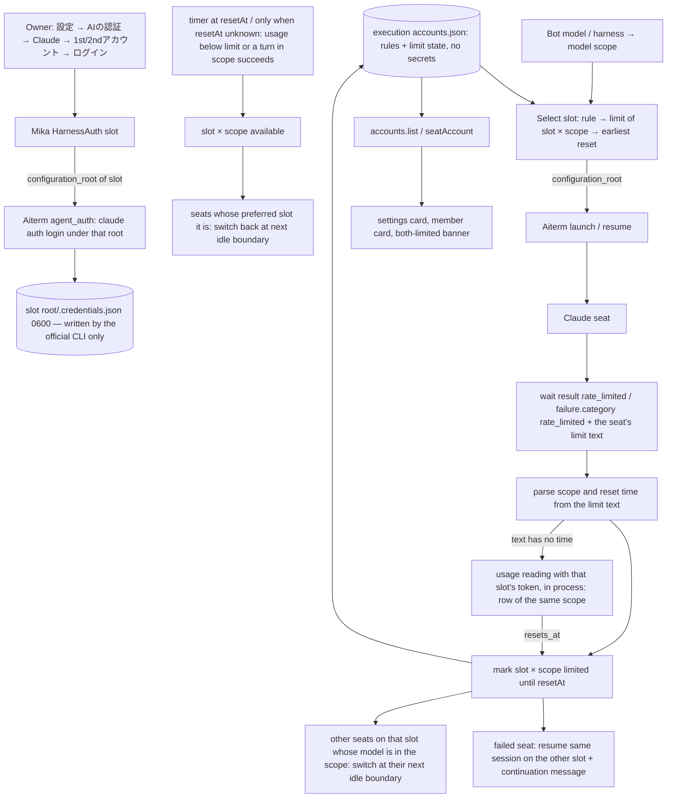

# Harness accounts: 1st/2nd slots, limit failover and return

Owner: Kiro (execution). Requested by the Owner via Trony, 2026-11-08 20:1x JST. Status: contract, not implemented.
Scope: Claude only. The shape is keyed by harness, so another harness can add slots later without a new contract; nothing Codex-specific is built.

Names in every UI and contract: 「1stアカウント」 (`slot: '1st'`, primary) and 「2ndアカウント」 (`slot: '2nd'`, fallback). No e-mail address is hard-coded. The Owner logs each slot in once from the app.

## Function map

| Function | Owner | Public contact |
| --- | --- | --- |
| Slot registry: harness × slot → config root, login label, limit state, model rules | execution (this doc) | `accounts.list()`, `accounts.setRule(rule)`, `transport.seatAccount(botId)` |
| Slot directory preparation (shared history, separate credentials) | execution | inside `accounts.prepare(harness, slot)`; called before login and before a launch |
| MCP registration in each slot's `.claude.json` | execution, reusing `mergeMcpConfig` of harness-config | same writer, one more target path per prepared slot |
| Login per slot | usage (Mika) HarnessAuth → Aiterm `agent_auth` | HarnessAuth `start/input/status/cancel(harness, {slot})` |
| Limit detection | execution | wait result (trigger) + usage reading (reset time) |
| Slot selection at launch / resume | execution | launch option `configuration_root` to Aiterm |
| Failover after a limit, return after reset | execution | existing reconfigure (apply at the next turn boundary) + capacity continuation message |
| Account-card data and slot-aware login contacts | usage (Mika) | typed auth/account-card data built from `accounts.list()` |
| Routes, private port injection, SSE, Bot DTO | Molly | `accounts.list/setRule` routes, `account` in Bot items, SSE topic `settings` |
| Rendering: card rows, rule switch, banner, member card | Admi (Web), Apple and Windows owners | the data contacts above |
| Per-seat config root on launch, resume and auth | Aiterm (Elegg) | E1–E3 below |

## Data flow

## Storage

| Item | Place | Notes |
| --- | --- | --- |
| 1st slot root | `$BELLTEAM_HOME/.claude` with `CLAUDE_CONFIG_DIR` unset (today's login) | unchanged; no migration |
| 2nd slot root | `$BELLTEAM_HOME/.bellteam-accounts/claude/2nd/` (0700) | `CLAUDE_CONFIG_DIR` set to this path |
| Credentials | `<root>/.credentials.json` (0600) | written and refreshed only by the official CLI. The parent reads the 2nd/1st token in process for the usage reading only; never logged, never returned, never put in env or argv |
| Account config | 1st: `$BELLTEAM_HOME/.claude.json`; 2nd: `<2nd root>/.claude.json` | holds the CLI's own account record and the MCP registration; not shared |
| Shared history | in the 2nd root, symlinks to the 1st root: `projects/`, `history.jsonl`, `settings.json`, `CLAUDE.md`, `AGENTS.md`, `skills/`, `commands/`, `plugins/`, `agents/`, `file-history/`, `todos/`, `session-env/`, `shell-snapshots/` | one physical transcript per conversation, so `--resume` under either root finds it, and Throughline/handoff readers keep reading `$HOME/.claude/projects` |
| Registry | `/srv/bellteam/state/harness-accounts.json`, schema `bellteam.harness-accounts.v1` | `{ rules:[{harness, modelPrefix, slot}], seats:{botId: slot}, limits:[{harness, slot, scope, since, resetAt|null, resetSource:'message'|'usage'|null, text}] }`; one entry per limited (slot, scope); an absent entry means available. `scope` is `'all'` or a model family (`'fable'`, `'opus'`, `'sonnet'`, `'haiku'`). `text` is the limit line the CLI showed (no secrets). No secrets |

`prepare` creates missing symlinks only and never overwrites an existing non-symlink entry (protection: overwriting existing state). If an entry is a real file, the slot is reported as `history: 'separate'` in `accounts.list()` and the Owner sees it. The slot still works: launch and login proceed, and resume finds only conversations written under that root.

## Limit detection (per slot × model scope; Owner correction 2026-11-08 20:3x JST)

A seat's model scope is the first family name found in its model id (`fable`, `opus`, `sonnet`, `haiku`; for example `claude-fable-5-1` → `fable`, the alias `opus` → `opus`). An unknown family is only affected by `'all'`. A slot is limited for a seat when it has an entry with scope `'all'` or the seat's family.

1. Trigger: a Claude wait result on a seat whose slot is S, either `outcome:'rate_limited'` (screen line in `rate_limit`) or `failure.category:'rate_limited'` (transcript 429, its line in `error`). Both are existing public wait-result fields.
2. Scope from the limit text, then from usage:
   - `You've reached your Fable limit …` / `You've hit your Opus limit …`: a named family is that family;
   - `weekly limit`, `session limit`, `usage limit`, and the screen line `Usage limit reached`: `'all'`.
   If the text does not decide it, the usage reading decides it: `weekly_scoped` rows with `scope.model.display_name` give that family; `session` and `weekly_all` give `'all'`.
3. Reset time, first from the same text, at detection. The observed forms are:
   - `resets 8am (UTC)` and `resets Oct 16, 8am (UTC)`: time zone in parentheses;
   - `continuing automatically at 8am`: no zone, so the seat process's TZ applies;
   - `try again at Aug 8th, 2026 12:35 PM`.
   A time without a date is its next occurrence after the detection time in that zone; `resetSource:'message'`.
   Only when the text has no time (e.g. `You've reached your Fable limit. Run /usage-credits …`), the parent reads the usage endpoint that Claude Code itself uses (`/api/oauth/usage`, as in `scripts/claude-usage.py`) with S's token, and takes `resets_at` of the row of the same scope at 100 %; `resetSource:'usage'`. An unreadable reading leaves `resetAt:null`.
4. Leaving the limited state (the self-exit):
   - With `resetAt` known, the entry is removed at exactly that date and time by one timer, re-armed from the registry after a restart. Nothing else removes it early.
   - With `resetAt` unknown, the extra exits are: a usage re-read every 10 minutes showing that scope below 100 %, or a turn in that scope on S ending `done`. A usage re-read that finds a `resets_at` for the scope sets `resetAt` and the timer from then on.
5. A parsed time in the past or more than 8 days ahead is a mis-parse (a weekly limit resets within 7 days) and is not trusted: the usage fallback decides, else the reset is unknown. Each recorded limit writes one stderr line with the text, the zone used and the parsed time (Epinel's check), never a token.
6. `accounts.list()` does not read usage; it only reports the registry. No AI is woken and no seat is started for any of this.

## Selection, failover and return

Preferred slot for a seat = the first rule whose `harness` matches and whose `modelPrefix` is a prefix of the Bot's model (example: `{harness:'claude', modelPrefix:'claude-fable', slot:'2nd'}`), otherwise `1st`.

Effective slot = the preferred slot if it is logged in and not limited for the seat's scope. Otherwise it is the other logged-in slot not limited for that scope. If every slot is limited for the scope, it is the slot whose matching entry has the earliest `resetAt`, and an unknown reset sorts last. So a Fable-only limit on the 1st moves only Fable seats; Opus and Sonnet seats stay. A launch is never refused for limits: the seat starts, the native CLI shows the limit, and the status surfaces show it plainly.

| Event | Action |
| --- | --- |
| A seat's turn ends rate-limited on S | Record the (S, scope) entry. If another slot is available, reconfigure that seat to the other slot and resume the same vendor session (E2), then send the existing capacity-continuation message without changing harness or model. If none is available, the existing CapacityContinuation (another harness) runs unchanged. |
| Seat whose slot is limited for its scope, idle or between turns | Switch it to its effective slot at the next turn boundary, through the existing configuration application (close at idle, resume). A running turn is never stopped. |
| Seat starting while its preferred slot is limited | Launch directly on the effective slot. |
| An (S, scope) entry ends | Each seat in that scope whose preferred slot is S and whose current slot differs switches back at its next idle boundary. |
| Both slots limited for a scope | `accounts.list()` lists that scope in `allLimited:[{scope, earliestResetAt}]`. Mika shows it on the AIの認証 card and in the status banner. Seats keep running as described above. |

The switch reuses the existing resume path, so the conversation, docs and Throughline continue. The vendor session id stays the same, and the launch id changes as it does for a model change.

## Implementation map

| Piece | Where |
| --- | --- |
| Registry, prepare, selection, limits, timers, re-read, list | `src/harness-accounts.mjs` `HarnessAccounts`, one per execution engine; `load()` at engine initialize re-arms the timers |
| Limit text parser, model family | `src/claude-limit-text.mjs` |
| Launch on the selected root, seat slot record | `AitermTransport.wakeNow` (`configuration_root`; an Aiterm without it gets `ACCOUNT_CAPABILITY_UNAVAILABLE` from the client's tool-schema check and the seat launches on the default root as before) |
| Limit signal → registry | `AitermTransport.recordAccountLimit` from the delivery completion (wait outcome `rate_limited` or `failure.category` `rate_limited`; text = `rate_limit` or `error`) |
| Failover | `CapacityContinuation.continue`: an account switch of the same harness first (`transport.switchAccount` = `pty_close {hibernate:true}` then the ordinary wake), then the existing harness switch if the account switch is impossible |
| Idle-boundary moves and return | `AitermTransport.reviewAccounts` / `moveAtBoundary` on every registry change; `AGENT_BUSY` waits for the turn and retries, never stops it |
| Successful-turn exit | `AitermTransport.accountTurnDone` on delivery completion |
| Parent Aiterm env | `AitermClient` (parent clients): `AITERM_CLAUDE_CONFIG_ROOTS` in its own env and in the seat launcher's process env, never in `env_vars` |
| MCP registration of slot roots | `writeHarnessConfig` merges into every prepared slot root; `prepare` copies the managed servers once |
| Facade | `accounts.list/setRule/prepare` (dispatch), `transport.seatAccount` (project), `accounts.watch` over the queue stream (topic `accounts`) |

## Public interfaces (execution)

- `accounts.list()` → `{ harnesses:[{ harness:'claude', slots:[{ slot:'1st'|'2nd', loggedIn:boolean|null, label:string|null, history:'shared'|'separate', limits:[{scope, since, resetAt|null, resetSource}], seats:[botId] }], allLimited:[{scope, earliestResetAt|null}] }], rules }`. An empty `limits` means available for every model. `label` is the e-mail the CLI itself recorded for that root's login (`oauthAccount.emailAddress` in its `.claude.json`); it is display text, not a credential. `seats` lists the Bots whose last launch used that slot (`seats` in the registry, written after each Claude launch).
- `accounts.setRule({harness, modelPrefix, slot})` → all stored rules. Upsert keyed by `(harness, modelPrefix)`; `slot: null` removes exactly that rule; other rules are never touched (Mika, 2026-11-08). Validated: harness known, slot `1st`/`2nd`/null, non-empty prefix ≤ 64 chars. Changing a rule moves affected seats at their next idle boundary.
- `accounts.prepare(harness, slot)` → `{ configurationRoot }`. It is called by HarnessAuth before a login, and returns the root used for E3.
- `transport.seatAccount(botId)` → `{ harness, slot, preferredSlot } | null`.
- `accounts.watch(listener)` → unsubscribe; called after every saved registry change (Molly maps it to the SSE type `settings`). Seats that move also appear on the existing `watchQueue` stream.
- Module: `src/harness-accounts.mjs` (`HarnessAccounts`, `readClaudeUsage`, `preparedAccountRoots`) and `src/claude-limit-text.mjs` (`parseLimitText`, `modelScope`).

## Public HTTP (fixed 2026-11-08 by the feature owner; Admi's Web shape accepted)

| Path | Contract | Owner of the route |
| --- | --- | --- |
| `GET /api/accounts` | `accounts.list()` verbatim. A 404 means an older body: clients show the old single Claude card. | Molly |
| `POST /api/accounts/rules` | body `{harness, modelPrefix, slot:'1st'\|'2nd'\|null}` → `accounts.setRule` → `{rules}`. Owner-only; other callers get 403. Validation errors are 400 `ACCOUNT_RULE_INVALID`. | Molly |
| `GET /api/harness-auth/claude?slot=2nd` | the existing harness-auth status for that slot. No `slot` means 1st, and the response is unchanged for it. | Mika |
| `POST /api/harness-auth/claude/{start,input,cancel}?slot=2nd` | the existing login flow for that slot; the body is unchanged. No `slot` means 1st. | Mika |
| Bot items (`GET /api/bots` and the Bot detail) | `account: {harness, slot, preferredSlot} \| null` from `transport.seatAccount(botId)`. It is absent on older bodies, and clients tolerate that. | Molly |
| SSE `/api/events` | `type: 'settings'` on every registry change, from `accounts.watch`. The engine's raw queue-stream topic `accounts` is internal and is not forwarded to clients. | Molly |

## What other owners add

- Elegg (Aiterm):
  Agreed by Elegg on 2026-11-08 (Aiterm 0.64.0):
  - E1. `agent_launch` / `claude_agent` accept `configuration_root`. Two values are allowed:
    - the default root `$HOME/.claude`, where the seat runs with `CLAUDE_CONFIG_DIR` unset;
    - an existing directory whose realpath is a direct child of a parent listed in `AITERM_CLAUDE_CONFIG_ROOTS` (a path-delimited list) in the Aiterm MCP process env.
    BellTeam sets `AITERM_CLAUDE_CONFIG_ROOTS=$HOME/.bellteam-accounts/claude` only in the env of the parent's own Aiterm client process. Bot-side Aiterm processes do not get it, so they can use only the default root. The root is stored in the resume recipe. Anything else gets `AGENT_CONFIGURATION_ROOT_REJECTED` (protection: credentials of an unintended directory). `env_vars` containing `CLAUDE_CONFIG_DIR` together with `configuration_root` gets the same error (two sources for one value). With `remote`, the seat's own Aiterm validates against its own env.
  - E2. A cross-root resume goes only through the existing resume entry: `session_name` of a hibernated seat, or `require_existing_resume`. `configuration_root` is the only setting allowed to differ; a model, effort, cwd or env difference still gives `AGENT_RESUME_CONFLICT`. The transcript must exist at `<new root>/projects/<slug of recipe cwd>/<vendor_session_id>.jsonl`, otherwise resume is unavailable. The new recipe stores the new root, and `CLAUDE_CONFIG_DIR` null for the default. So execution's failover first applies the slot change alone, and any model change follows as an ordinary change.
  - E4 (agreed 2026-11-08, Aiterm 0.64.0): `pty_close {session_id, hibernate:true}` on a managed claude agent seat runs the idle-clock stopping → hibernated lifecycle on demand and returns outcome `hibernated`. The conversation, recipe and vendor session id are kept, and `agent_launch` with `session_name` + `require_existing_resume` + `configuration_root` resumes it (E2).
    - `AGENT_BUSY` while a turn, post-startup children or child deliveries run (protection: their work; exit: call again at the turn end).
    - `AGENT_HIBERNATE_UNAVAILABLE` with the reason for other non-hibernatable states; the seat is untouched.
    - Rate-limit exception: allowed when the seat's transcript has a rate-limited API error after its last input, even on the limit footer or menu; the saved recipe is used.
    - Without `hibernate`, `pty_close` is unchanged.
    - `AITERM_CLAUDE_CONFIG_ROOTS` never reaches a seat's environment.
    - `wait.error` carries the full transcript limit line, and `failure.category` matches "You've hit your <word> limit" without a 429.
  - E3. `agent_auth` accepts `configuration_root` on `start`. The auth session keeps it, and `respond`, `cancel` or `status` for that session with a different root get `AGENT_CONFIGURATION_ROOT_REJECTED`. `status` returns `account_label`: the `email` field of `claude auth status --json`, or null when not logged in or absent. No tokens anywhere.
  - No reset-time parsing is needed; execution reads it from usage.
- Mika (usage), agreed 2026-11-08:
  - HarnessAuth sessions and receipts are keyed by `(harness, slot)`; no slot means 1st, and non-Claude behavior is unchanged.
  - `slot` stays outside the strict authResponse binding, prompt digest and response object.
  - The selected slot is prepared (`accounts.prepare`) before every `agent_auth` action, and `configuration_root` is passed only privately.
  - Receipts carry `slot` and the nullable native `account_label`.
  - The typed account-card data contact covers both slot rows (login state, label, per-scope limits with reset, seats), the Fable rule (`setRule({harness:'claude', modelPrefix:'claude-fable', slot:'2nd'|null})`) and `allLimited`/`earliestResetAt`, all from `accounts.list()`.
- Molly (parent, common HTTP/MCP): routes for `accounts.list` and `setRule`, private port injection, SSE topic `settings`, and `account: seatAccount(botId)` in Bot items.
- Clients (Admi for Web; the Apple and Windows owners): render the two slot rows 「1stアカウント」/「2ndアカウント」, the switch 「Fableを2ndアカウントで使う」, the both-limited banner, and the seat's slot on the member card. A limit shows its scope: `'all'` as 「上限中 (HH:MMに解除)」, a family as 「Fableのみ上限中 (23:00に解除)」. Times are shown in JST (with the date when it is not today); a null reset shows as 解除時刻不明.

## Live acceptance (Owner steps, natural limit only)

The test uses a limit that already exists, so no quota is burned on purpose: a seat that is already limited fails its first turn at once.

1. Precondition: Aiterm 0.64.0 (E1–E3), the execution module, Mika's usage contacts, Molly's routes and a client with the rows are in production.
2. Owner: 設定 → AIの認証 → Claude → 2ndアカウント → ログイン, then log in with the account that is already limited for Fable. 1stアカウント stays the current container login.
3. Owner: turn on 「Fableを2ndアカウントで使う」.
4. Owner: pick one idle Bot on a Fable model; its member card shows 2ndアカウント. Send it one ordinary short message.
5. Expected:
   - The turn ends rate-limited without spending quota.
   - The 2ndアカウント row shows 「Fableのみ上限中 (…に解除)」. The time comes from the limit text, or from the usage reading when the text has none.
   - The member card shows 1stアカウント. Non-Fable seats are not moved.
   - The same conversation continues with the capacity-continuation message and answers.
6. At the shown reset time, the entry clears. The Bot moves back to 2ndアカウント at its next idle boundary, with no action needed.

## Not covered

- The limit text and the usage endpoint are Claude Code's own output, not a documented API. If a new wording or a changed endpoint gives no time, `resetAt` is null, and the 10-minute re-read plus the successful-turn exit still return the slot. The parser keeps the observed forms above as fixtures.
- A seat already running on a slot whose credentials the Owner logs out is not moved; its next launch selects again.
- Codex and other harnesses: no slots now. Adding them means one more root kind (`CODEX_HOME`) in `prepare`, E1–E3 for that harness, and its own limit signal.
