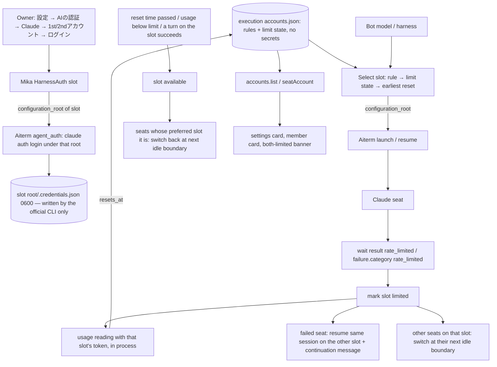

# Harness accounts: 1st/2nd slots, limit failover and return

Owner: Kiro (execution). Requested by the Owner via Trony, 2026-11-08 20:1x JST. Status: contract, not implemented.
Scope: Claude only. The shape is keyed by harness, so another harness can add slots later without a new contract; nothing Codex-specific is built.

Names in every UI and contract: 「1stアカウント」 (`slot: '1st'`, primary) and 「2ndアカウント」 (`slot: '2nd'`, fallback). No e-mail address is hard-coded. The Owner logs each slot in once from the app.

## Function map

| Function | Owner | Public contact |
| --- | --- | --- |
| Slot registry: harness × slot → config root, login label, limit state, model rules | execution (this doc) | `accounts.list()`, `accounts.setRules(rules)`, `transport.seatAccount(botId)` |
| Slot directory preparation (shared history, separate credentials) | execution | inside `accounts.prepare(harness, slot)`; called before login and before a launch |
| MCP registration in each slot's `.claude.json` | execution, reusing `mergeMcpConfig` of harness-config | same writer, one more target path per prepared slot |
| Login per slot | usage (Mika) HarnessAuth → Aiterm `agent_auth` | HarnessAuth `start/input/status/cancel(harness, {slot})` |
| Limit detection | execution | wait result (trigger) + usage reading (reset time) |
| Slot selection at launch / resume | execution | launch option `configuration_root` to Aiterm |
| Failover after a limit, return after reset | execution | existing reconfigure (apply at the next turn boundary) + capacity continuation message |
| Display | usage (Mika) settings card, members DTO (Molly), clients | `accounts.list()`, `seatAccount(botId)`, SSE topic `settings` |
| Per-seat config root on launch, resume and auth | Aiterm (Elegg) | E1–E3 below |

## Data flow

## Storage

| Item | Place | Notes |
| --- | --- | --- |
| 1st slot root | `$BELLTEAM_HOME/.claude` with `CLAUDE_CONFIG_DIR` unset (today's login) | unchanged; no migration |
| 2nd slot root | `$BELLTEAM_HOME/.bellteam-accounts/claude/2nd/` (0700) | `CLAUDE_CONFIG_DIR` set to this path |
| Credentials | `<root>/.credentials.json` (0600) | written and refreshed only by the official CLI. The parent reads the 2nd/1st token in process for the usage reading only; never logged, never returned, never put in env or argv |
| Account config | 1st: `$BELLTEAM_HOME/.claude.json`; 2nd: `<2nd root>/.claude.json` | holds the CLI's own account record and the MCP registration; not shared |
| Shared history | in the 2nd root, symlinks to the 1st root: `projects/`, `history.jsonl`, `settings.json`, `CLAUDE.md`, `AGENTS.md`, `skills/`, `commands/`, `plugins/`, `agents/`, `file-history/`, `todos/`, `session-env/`, `shell-snapshots/` | one physical transcript per conversation, so `--resume` under either root finds it, and Throughline/handoff readers keep reading `$HOME/.claude/projects` |
| Registry | `/srv/bellteam/state/harness-accounts.json`, schema `bellteam.harness-accounts.v1` | `{ rules:[{harness, modelPrefix, slot}], slots:{ claude:{ '1st':{limit}, '2nd':{limit} } } }`; `limit = {state:'available'|'limited', since, resetAt|null, source}`. No secrets |

`prepare` creates missing symlinks only and never overwrites an existing non-symlink entry (protection: overwriting existing state). If an entry is a real file, the slot is reported as `history: 'separate'` in `accounts.list()` and the Owner sees it. The slot still works: launch and login proceed, and resume finds only conversations written under that root.

## Limit detection

1. Trigger: a Claude wait result on a seat whose slot is S, either `outcome:'rate_limited'` (screen) or `failure.category:'rate_limited'` (transcript 429 / "You've hit your … limit"). S becomes `limited`. A trigger is evidence for the whole account, so it applies to every seat on S.
2. Reset time: right after the trigger, the parent reads the Anthropic usage endpoint that Claude Code itself uses (`/api/oauth/usage`, as in `scripts/claude-usage.py`) with S's token. `resetAt` = the latest `resets_at` among limits at 100 %. An unreadable reading (expired token, network) leaves `resetAt:null`.
3. Leaving `limited` (the self-exit): any one of these makes S `available`:
   - `resetAt` passes, by a single timer set to that time;
   - a usage reading shows every limit below 100 % (re-read every 10 minutes only while S is limited with `resetAt:null`);
   - a turn on S ends `done`.
4. Display reading: `accounts.list()` re-reads usage for each logged-in slot at most once per 60 s, only when it is asked. No AI is woken and no seat is started for it. A display reading never marks a slot limited. Usage limits can be scoped to one model (for example a Fable-only weekly limit), and the whole-slot state would move unrelated seats. Only a seat's own limit signal changes the selection.

## Selection, failover and return

Preferred slot for a seat = the first rule whose `harness` matches and whose `modelPrefix` is a prefix of the Bot's model (example: `{harness:'claude', modelPrefix:'claude-fable', slot:'2nd'}`), otherwise `1st`.

Effective slot = the preferred slot if it is available and logged in. Otherwise it is the other logged-in available slot. If no slot is available, it is the slot with the earliest `resetAt`, and an unknown reset sorts last. A launch is never refused for limits: the seat starts, the native CLI shows the limit, and the status surfaces show it plainly.

| Event | Action |
| --- | --- |
| A seat's turn ends rate-limited on S | Mark S limited. If another slot is available, reconfigure that seat to the other slot and resume the same vendor session (E2), then send the existing capacity-continuation message without changing harness or model. If none is available, the existing CapacityContinuation (another harness) runs unchanged. |
| Seat on a limited slot is idle or between turns | Switch it to its effective slot at the next turn boundary, through the existing configuration application (close at idle, resume). A running turn is never stopped. |
| Seat starting while its preferred slot is limited | Launch directly on the effective slot. |
| S becomes available | Each seat whose preferred slot is S and whose current slot differs switches back at its next idle boundary. |
| Both limited | `accounts.list()` returns `allLimited:true` and `earliestResetAt`. Mika shows it on the AIの認証 card and in the status banner. Seats keep running as described above. |

The switch reuses the existing resume path, so the conversation, docs and Throughline continue. The vendor session id stays the same, and the launch id changes as it does for a model change.

## Public interfaces (execution)

- `accounts.list()` → `{ harnesses:[{ harness:'claude', slots:[{ slot:'1st'|'2nd', loggedIn:boolean|null, label:string|null, history:'shared'|'separate', limit:{state, resetAt|null, since|null}, seats:[botId] }], allLimited, earliestResetAt|null }], rules }`. `label` is the account e-mail that `claude auth status --json` reports (E3); it is display text, not a credential.
- `accounts.setRules(rules)` → stored rules (validated: harness known, slot `1st`/`2nd`, non-empty prefix ≤ 64 chars). Changing a rule moves affected seats at their next idle boundary.
- `accounts.prepare(harness, slot)` → `{ configurationRoot }`. It is called by HarnessAuth before a login, and returns the root used for E3.
- `transport.seatAccount(botId)` → `{ harness, slot, preferredSlot } | null`.
- Change notification: the existing `watchQueue` stream (`botIds` of the moved seats) and the SSE topic `settings` for registry changes.

## What other owners add

- Elegg (Aiterm):
  - E1. `agent_launch` / `claude_agent` accept `configuration_root`: an absolute path that is either the default Claude root or a directory under `$HOME/.bellteam-accounts/claude/`. The seat runs with `CLAUDE_CONFIG_DIR` set to it, or unset for the default root. It is stored in the resume recipe. Anything else is rejected with a typed error (protection: credentials of an unintended directory).
  - E2. A resume of an existing session with a different `configuration_root` is allowed when the transcript `<new root>/projects/<slug>/<vendor_session_id>.jsonl` exists. It realpaths to the same file through the shared symlink. Today the recipe pins the original root.
  - E3. `agent_auth` accepts the same `configuration_root` for `start`, `status`, `respond` and `cancel`. `status` additionally returns the non-secret `account_label` (the e-mail from `claude auth status --json`) when logged in.
  - No reset-time parsing is needed; execution reads it from usage.
- Mika (usage, settings):
  - HarnessAuth takes `{slot}`. It gets the root from `accounts.prepare` and passes it to `agent_auth` (E3). The receipt carries `slot`.
  - The AIの認証 card shows Claude as two rows, 「1stアカウント」 and 「2ndアカウント」. Each row has the login state, the label, the limit state with its reset time (JST), the number of seats on it, and a log-in button.
  - A rule switch on the card: 「Fableを2ndアカウントで使う」 → `setRules`.
  - The both-limited banner, with the earliest reset.
- Molly (members DTO, common HTTP/MCP): Bot items carry `account: seatAccount(botId)`. `accounts.list` and `setRules` are routed for the settings card.
- Clients (Web, Apple, Windows): render the two slot rows, the rule switch, the banner, and the seat's slot on the member card.

## Live acceptance (Owner steps, natural limit only)

The test uses a limit that already exists, so no quota is burned on purpose: a seat that is already limited fails its first turn at once.

1. Precondition: the Aiterm E1–E3 release, the execution module and Mika's card are in production.
2. Owner: 設定 → AIの認証 → Claude → 2ndアカウント → ログイン, then log in with the account that is already limited for Fable. 1stアカウント stays the current container login.
3. Owner: turn on 「Fableを2ndアカウントで使う」.
4. Owner: pick one idle Bot on a Fable model; its member card shows 2ndアカウント. Send it one ordinary short message.
5. Expected:
   - The turn ends rate-limited without spending quota.
   - The 2ndアカウント row shows 上限中 with the reset time.
   - The member card shows 1stアカウント.
   - The same conversation continues with the capacity-continuation message and answers.
6. After the reset time: the Bot's next idle boundary moves it back to 2ndアカウント. No action is needed; check the member card when convenient.

## Not covered

- The usage endpoint is the one Claude Code uses; it is not a documented public API. If it changes, `resetAt` becomes null and the 10-minute re-read plus the successful-turn exit still return the slot.
- A seat already running on a slot whose credentials the Owner logs out is not moved; its next launch selects again.
- Codex and other harnesses: no slots now. Adding them means one more root kind (`CODEX_HOME`) in `prepare`, E1–E3 for that harness, and its own limit signal.
