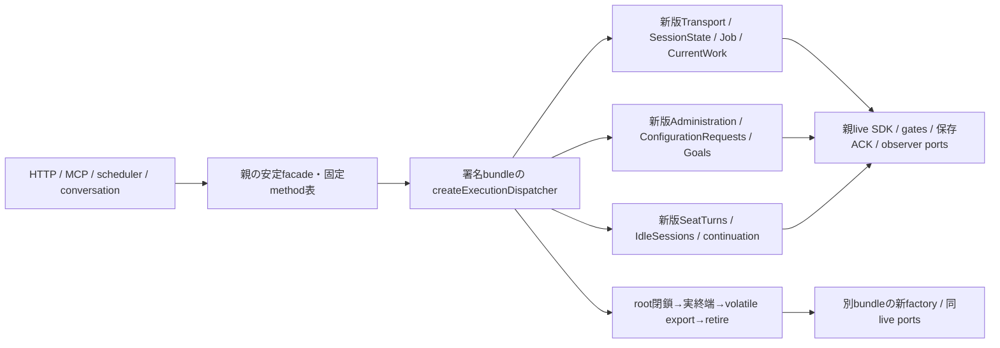
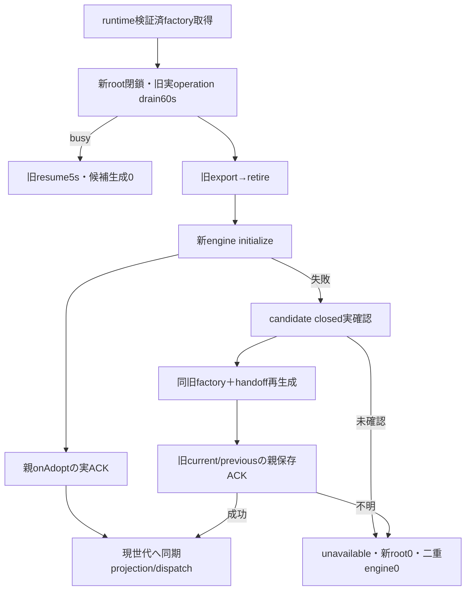
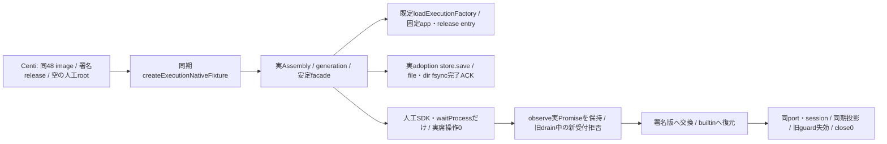

# host内のexecution engine交換

entryは`src/execution-dispatcher.mjs:createExecutionDispatcher({generation,ports,handoff})`。相対importのTransport/Admin/ConfigRequests/Goals/observer/Job/stateと依存全体を同じ署名bundleへ封入する。旧engineを返すport、任意method RPC、外部から与えるbusiness factoryはない。親SDK/nativePTYは共有のままcloseしない。

portsの閉集合は`native`（既AitermClient機械口）、`membersAdmission`、`conversationAdmission`、`bots`/`rooms`（既公開writer）、`configurationStorage`（親が取得したroot/trustedAnchor/必要時ownerUidだけ、保存検査writerは新bundle内で生成）、`access`（assertWorkAllowed/admitWork/requireMember/requireAccess）、`storage`（prepareStartup/updateSession/updateFastMode）、`seat`（既waitProcess/handoffContext/画像一時file）、`observer`（appendInterimWords/emitQueue/report）、`diagnostics`（record/goalError）、`continuation`（models/harnessAuth/messenger）。関数/opaqueはhostだけ、child DTOにはしない。

`dispatch({method,args})`は固定method表のみ、引数は既callerのhost値。同期getterは`project({method,args})`を安定facadeへ射影しPromise化しない。`.transport/.administration/.goals`に対応する実method名一覧を`EXECUTION_METHODS`で公開する。parent consumerは旧Transport参照を保存せず毎回現世代へ転送し、`.client/.membersAdmission`は共有機械portを親から別に注入する。watchQueue listenerは親の安定observerへ置く。新規listenerも交換対象engineの旧callbackを生かす経路にはしない。

`control(initialize)`でrestore後にrunning、`resume`で旧世代を再開、`quiesce`で同期root閉鎖し60秒actual drain、`exit`/`disconnect`で退役する。quiesce中は既watch終了用pollだけ残し新watchを始めない。idle producerは止める。caller timeoutはnative/Job/ACKをreleaseしない。長AI/観測不明はbusy、resumeで旧engineだけ再開し新engine0、AIabort0。retireは実zeroを再検査し全timer/listenerを止め、旧projection/captured callback/native口は世代失効。SDKclose/ptycloseはしない。

handoffはhost内volatile、同schema互換のみ。sessions/stopVersions/stopSessions/uncertainty identity、原pending/latest/rejectedPreparationsの同object graph、Administration applications、CurrentWork records/seq、followedTurns/shownWords、idle metadata、continuation finite budgetを引き継ぐ。Promise/SDK/client/本文のJSON化はしない。shownWordsは親が既に扱うopaque参照のvolatile移管で、本文再送の権限を作らない。export前は実operation0、未終端をstate化しない。CurrentWork timerはmetadataを消さず停止し新版で再開。原stage欠測を補わない。

未initializeのcreatedとinitialize失敗のfailed candidateは、公開disconnect/exitで実pending0を再検査して破棄できる。initialize本体の実Promiseが未終端ならbusyで保持し、caller timeoutで解放しない。cleanup開始と同stackでdiscardingへ進め、同時initialize/旧callbackの再入場を拒否し、timer/listener停止後にだけclosedを返す。running候補の破棄には従来どおりquiesceが必要。これで失敗candidateのclosed後だけ旧bundle再生成が可能で、closed欠測時の旧再生成は不可。

`test/execution-bundle-handoff.test.mjs`は別々の人工source rootからentryと相対engineをimportし、Administration実dependencyの変更が同期投影へ出ること、stop/uncertainty引渡し、初期化失敗candidateのclosed後に旧bundleを再生成できることを公開口だけで検査する。外部nativeはpty_listだけの人工port、署名/配置/loader/HTTP/main/imageの実証には使わない。fixture本文変更は一時source内だけで製品業務コードには入らない。

## 固有generation/controllerと親保存ACK

Epiから正式handoffした`src/execution-generation.mjs:createExecutionGeneration`がhost内の固有transactionを所有する。共通child controllerを複製しない。`loadFactory(versionId=null,{expectedRelease})`へbuiltin/SHAだけを渡し、runtime読取口のfrozen `{versionId,sourceCommit,createExecutionDispatcher}`だけで新engineを生成する。任意URL/import/外部business factory選択はHTTPへ出さない。reader比較用に`EXECUTION_STATE_COMPATIBILITY`を旧実値のままexportする。

親Mollyは同一ports、初期currentVersionId/previousVersionIdと既保存writerへの`onAdopt({currentVersionId,previousVersionId})`を注入する。onAdoptは実durable completion（`.completion`があればそれも）を含み、ACK前は新rootを開かない。別保存schema/writer無し。公開は`start/replace/reserve/snapshot/dispatch/project/close`。reserveはstart一回とcancel、実completionを持つ。projectは同期のまま常に現instanceへ転送する。親のtransport.client/membersAdmission/requestStopはliveportsのまま保持し、queue listenerは親observerへ。旧外側SeatTurns/IdleSessionsを別生成して二重producerにせず、factoryが一実体を持つ。

旧instanceは退役後resumeしない。初期化/保存待ちcallerの期限は実資源を解放しない。candidateのhandle/closed欠測、復元失敗/保存ACK不明はunavailable。close途中の遅いfactory読込から未来のengineを生成しない。SDK/nativePTYclose/AIabort/本文再送は行わない。共通readerの署名・設置と親のstable facade/ledger組立、通常main/imageは各本人の実接続結果を要する。

## 固有legacy caller facade

Mollyが未編集の薄いcaller adapterを正式handoffし、`src/execution-facade.mjs:createExecutionFacade({getController,client,membersAdmission,requestStop,watchQueue})`をexecution所有に追加。返却transport/administration/goalsは固定EXECUTION_METHODS表だけで組立て、同期projectとdispatchを区別し、呼ぶたびにgetControllerで現在を取得する。汎用Proxy/property/method転送無し。argument/options/opaqueと返却Promiseの`.completion`を同identityで維持しJSON化しない。client/gate/requestStop/watchQueueは親liveportsの同object。legacy transport.closeはcontroller.closeだけを呼び、SDKを閉じない。

Mollyはapplication-services/runtimeの親組立を所有したまま、旧外側SeatTurns/IdleSessionsを別生成しない。start/closeはengine/controller一実体に接続し、会話所有SelfTurnsは別に維持する。既BotGoals/Administrationもfacade側へ置換し旧業務engineを親に残さない。アプリ全終了時の共有SDK closeは親機械resourceの責任で、module closeへ混ぜない。onAdoptの既private保存、inventory/ledger/catalog、bootstrapの順序と同source初回image導入も親所有のまま。

`test/execution-loader-generation.test.mjs`はEpi reader選択の実実装→固有generation→安定facade→別sourceの実Administration engine→親atomic採用保存ACK→builtin戻しの一接点を検査する。runtimeの明示I/O test portsだけを人工identity/installed descriptor/import mappingへ置換するため、実root receipt/署名/inventory/本番imageの受入ではない。未導入usage/diagnosticsの読取依存はEpi07b99fがcomponent選択時だけ解決し、executionを他module導入待ちにしない。

## 親共有fileから呼ぶ固有組立helper

Mollyの明示handoffで`src/execution-assembly.mjs:createExecutionAssembly({ports,loadFactory,onAdopt,currentVersionId,previousVersionId,requestStop,watchQueue,exchangeMutex,onState})`をexecution所有とする。親が既private選択を読んだ2scalarと同liveportsを渡し、返却はfrozen `{controller,transport,administration,goals}`。helper自身は保存path/schema/HTTP/catalog/ledgerを持たず、初期化やnativeを発行しない。controller.startまでengine生成/observer起動0、start後はengineがSeatTurns/IdleSessionsを一つずつ所有する。別の外側producerやno-op producer adapterを返さない。

親bootstrapの遅い依存（rooms/メッセンジャー/onboarding/認証）はportsの固定公開method closureへ束縛し、全依存準備後にcontroller.startを呼ぶ。初期current/previousの読取とonAdoptの実保存は親が持つため、このhelperに第二のreader/writerを足さない。同期投影/argument opaque/実Promise completion/共有client・members gate・requestStop・watchQueueのidentityを既facadeのまま保つ。親application-services/runtimeの旧SeatTurns/IdleSessions生成/start/stopを削除し、親updateCenter/controller closeと一実体へ結び、会話SelfTurnsは維持する。

## PR304/main48の実交換検査guest

`test/helpers/execution-native-business.mjs:createExecutionNativeFixture({root})`は、センチの外側fixtureから使う同期constructor。rootはセンチが作る人工dataの絶対正規pathで、stateは同UID/GID・0700、初期のexecution-release.jsonは存在しないことを要求する。外側のroot権限、署名releaseの設置、実UID1001/両arch/imageの起動・driver・cleanupはセンチが所有する。guestは権限変更、署名の生成、installerの代替、既選択の上書きをしない。

返却する公開I/Oは`controller`、`start()`、`replace(target)`、`verify()`、`snapshot()`、`close()`。controllerは実Assemblyの同instanceで、外側が交換の同一性を確認できる。startは実loaderでbuiltinを読み、sourceCommitが`48e508bab1c1cad2f8c3220f062715b27bcd3376`と一致してから人工wakeを一回だけ行う。loadFactory/import/installed reader/identityの差替えportはguestに持たせない。

replaceは64桁SHA又はbuiltinだけを受け、同版要求は拒否する。各回に人工notify一件を実dispatcherで配送してassetのtask reminderを確認し、旧世代で捕捉したadmission guardを保存する。その後の実observe Promiseを保留したままcontroller.replaceを呼び、quiescing中は同期queue投影がEXECUTION_NOT_ACCEPTING、交換Promiseは未終端であることを確認する。observe解放後だけ退役・新世代へ進み、同guardがEXECUTION_GENERATION_RETIREDで失効することを確認する。onAdoptの実store.save/readとACK完了前後にも新受付が閉じていることを検査する。native/PTY close要求は即失敗し、SDKclose/PTYclose件数も0を要求する。

verifyは署名SHA→builtinの順の二回成功、三世代、保存0600と現選択、同親port/method/session、人工launch一回/send二回/設定reminder二回、保存ACK二回、失効guard二回を要求する。snapshotと各操作の返却はbool/整数だけで、本文・session・path・署名descriptorは含めない。closeは同controllerを閉じ、外側dataの削除はしない。読込/交換失敗はrejectし、保留observeはfinallyで解放する。既loader/store/readerの製品契約内で検査guestを追加し、runtimeコードは変更しない。

`test/execution-native-business.test.mjs`の新4件は同期休止、既選択拒否、実builtin不在時の代替無し失敗、人工loaderでのguest制御検査。最後の1件だけ隔離子processのmodule mockから同source実factoryを返し、制御のassertを検査する。これは実loader/署名release/UID1001/両arch/image交換の成功ではない。実交換の成立範囲はセンチの外側原本から結合する。476/38aの会話sourceはこの48署名への入力に加えない。
