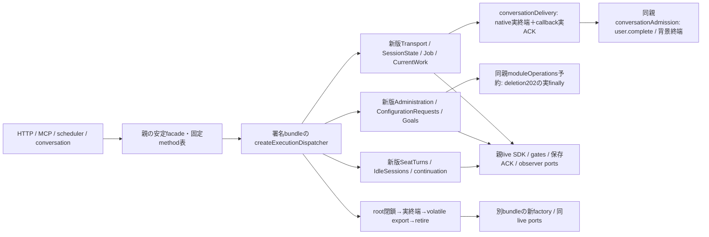
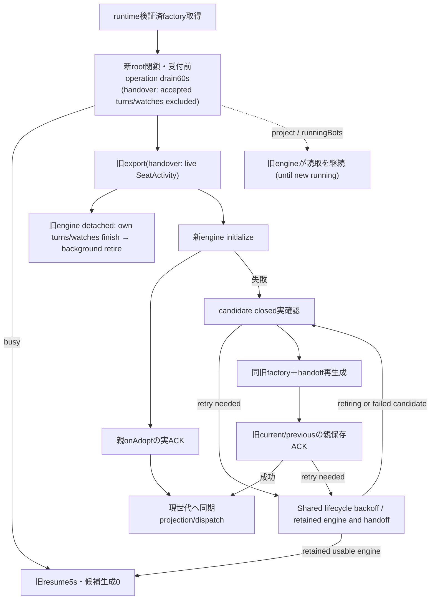
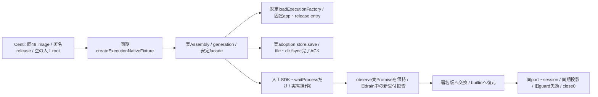
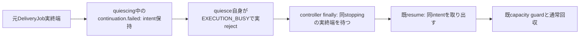
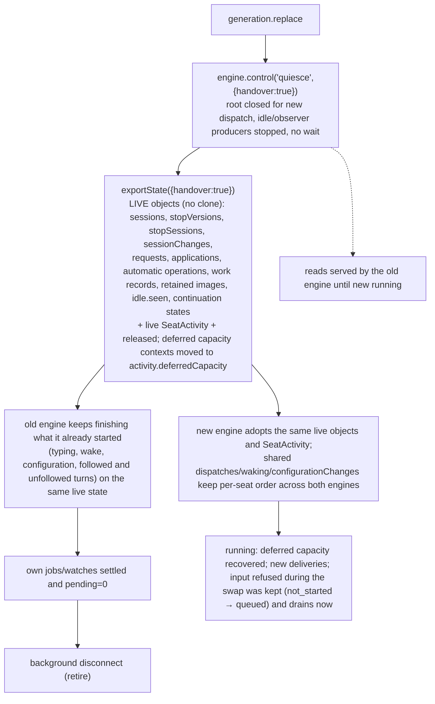
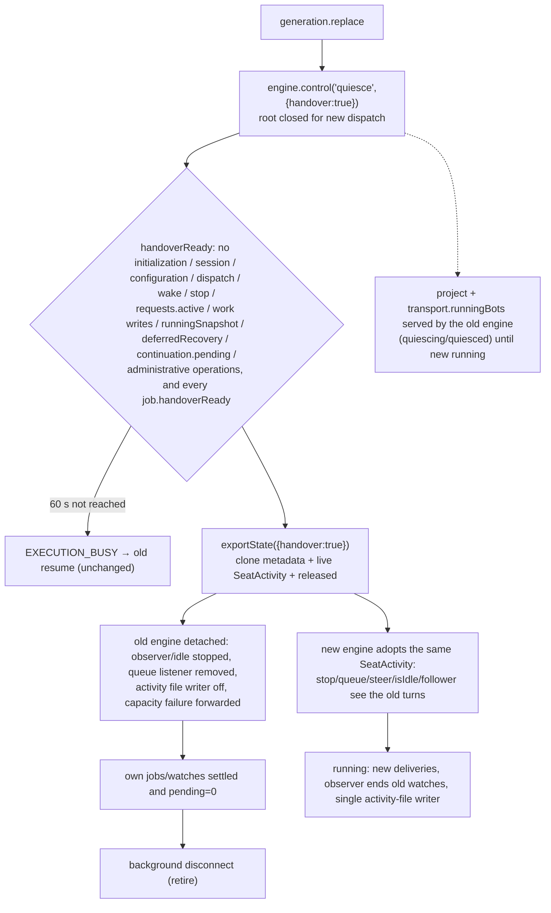

# host内のexecution engine交換

Runtime generation recovery follows the [single module lifecycle contract](../runtime/module-process.md#shared-automatic-lifecycle-recovery-owner-2026-11-07). Failed resume/cleanup/restore enters bounded backoff, retaining the same engine or captured handoff; actual native resource and identity protections remain here. No dispatch logic or business request is replayed by controller recovery.

entryは`src/execution-dispatcher.mjs:createExecutionDispatcher({generation,ports,handoff})`。相対importのTransport/Admin/ConfigRequests/Goals/observer/Job/stateと依存全体を同じ署名bundleへ封入する。旧engineを返すport、任意method RPC、外部から与えるbusiness factoryはない。親SDK/nativePTYは共有のままcloseしない。

portsの閉集合は`native`（既AitermClient機械口）、`membersAdmission`、`conversationAdmission`、`moduleOperations`（親の同operation二重予約opaque、Admin/deletionの実finallyまで保持）、`bots`/`rooms`（既公開writer）、`configurationStorage`（親が取得したroot/trustedAnchor/必要時ownerUidだけ、保存検査writerは新bundle内で生成）、`access`（assertWorkAllowed/admitWork/requireMember/requireAccess）、`storage`（prepareStartup/updateSession/updateFastMode）、`seat`（既waitProcess/handoffContext/画像一時file）、`observer`（appendInterimWords/emitQueue/report）、`diagnostics`（record/goalError）、`continuation`（models/harnessAuth/messenger）。関数/opaqueはhostだけ、child DTOにはしない。

`dispatch({method,args})`は固定method表のみ、引数は既callerのhost値。同期getterは`project({method,args})`を安定facadeへ射影しPromise化しない。`.transport/.administration/.goals`に対応する実method名一覧を`EXECUTION_METHODS`で公開する。parent consumerは旧Transport参照を保存せず毎回現世代へ転送し、`.client/.membersAdmission`は共有機械portを親から別に注入する。watchQueue listenerは親の安定observerへ置く。新規listenerも交換対象engineの旧callbackを生かす経路にはしない。

`control(initialize)`でrestore後にrunning、`resume`で旧世代を再開、`quiesce`で同期root閉鎖し60秒actual drain、`exit`/`disconnect`で退役する。quiesce中は既watch終了用pollだけ残し新watchを始めない。idle producerは止める。caller timeoutはnative/Job/ACKをreleaseしない。長AI/観測不明はbusy、resumeで旧engineだけ再開し新engine0、AIabort0。retireは実zeroを再検査し全timer/listenerを止め、旧projection/captured callback/native口は世代失効。SDKclose/ptycloseはしない。

handoffはhost内volatile、同schema互換のみ。sessions/stopVersions/stopSessions（uncertainty/uncertaintyVersionsは02e7f51a以降admission状態ではなく、旧reader互換の空欄として出すだけで受け取らない）、原pending/latest/rejectedPreparationsの同object graph、Administration applications、CurrentWork records/seq、followedTurns/shownWords、idle metadata、continuation finite budgetを引き継ぐ。Promise/SDK/client/本文のJSON化はしない。shownWordsは親が既に扱うopaque参照のvolatile移管で、本文再送の権限を作らない。export前は実operation0、未終端をstate化しない。CurrentWork timerはmetadataを消さず停止し新版で再開。原stage欠測を補わない。

未initializeのcreatedとinitialize失敗のfailed candidateは、公開disconnect/exitで実pending0を再検査して破棄できる。initialize本体の実Promiseが未終端ならbusyで保持し、caller timeoutで解放しない。cleanup開始と同stackでdiscardingへ進め、同時initialize/旧callbackの再入場を拒否し、timer/listener停止後にだけclosedを返す。running候補の破棄には従来どおりquiesceが必要。これで失敗candidateのclosed後だけ旧bundle再生成が可能で、closed欠測時の旧再生成は不可。

`test/execution-bundle-handoff.test.mjs`は別々の人工source rootからentryと相対engineをimportし、Administration実dependencyの変更が同期投影へ出ること、stop引渡しと旧uncertainty欄が受け取らず空で出ること、初期化失敗candidateのclosed後に旧bundleを再生成できることを公開口だけで検査する。外部nativeはpty_listだけの人工port、署名/配置/loader/HTTP/main/imageの実証には使わない。fixture本文変更は一時source内だけで製品業務コードには入らない。

## 固有generation/controllerと親保存ACK

Epiから正式handoffした`src/execution-generation.mjs:createExecutionGeneration`がhost内の固有transactionを所有する。共通child controllerを複製しない。`loadFactory(versionId=null,{expectedRelease})`へbuiltin/SHAだけを渡し、runtime読取口のfrozen `{versionId,sourceCommit,createExecutionDispatcher}`だけで新engineを生成する。任意URL/import/外部business factory選択はHTTPへ出さない。reader比較用に`EXECUTION_STATE_COMPATIBILITY`を旧実値のままexportする。

親Mollyは同一ports、初期currentVersionId/previousVersionIdと既保存writerへの`onAdopt({currentVersionId,previousVersionId})`を注入する。onAdoptは実durable completion（`.completion`があればそれも）を含み、ACK前は新rootを開かない。別保存schema/writer無し。公開は`start/replace/reserve/snapshot/dispatch/project/close`。reserveはstart一回とcancel、実completionを持つ。projectは同期のまま現instanceへ転送し、交換中（available=false）は旧engineが応答する。親のtransport.client/membersAdmission/requestStopはliveportsのまま保持し、queue listenerは親observerへ。旧外側SeatTurns/IdleSessionsを別生成して二重producerにせず、factoryが一実体を持つ。

旧instanceは退役後resumeしない。初期化/保存待ちcallerの期限は実資源を解放しない。Candidate cleanup, restore, or selection-save failure enters the shared backoff actor; a constructor failure without an accepted engine does not fence rollback. close途中の遅いfactory読込から未来のengineを生成しない。SDK/nativePTYclose/AIabort/本文再送は行わない。共通readerの署名・設置と親のstable facade/ledger組立、通常main/imageは各本人の実接続結果を要する。

## 固有legacy caller facade

Mollyが未編集の薄いcaller adapterを正式handoffし、`src/execution-facade.mjs:createExecutionFacade({getController,client,membersAdmission,requestStop,watchQueue})`をexecution所有に追加。返却transport/administration/goalsは固定EXECUTION_METHODS表だけで組立て、同期projectとdispatchを区別し、呼ぶたびにgetControllerで現在を取得する。汎用Proxy/property/method転送無し。argument/options/opaqueと返却Promiseの`.completion`を同identityで維持しJSON化しない。client/gate/requestStop/watchQueueは親liveportsの同object。legacy transport.closeはcontroller.closeだけを呼び、SDKを閉じない。

Mollyはapplication-services/runtimeの親組立を所有したまま、旧外側SeatTurns/IdleSessionsを別生成しない。start/closeはengine/controller一実体に接続し、会話所有SelfTurnsは別に維持する。既BotGoals/Administrationもfacade側へ置換し旧業務engineを親に残さない。アプリ全終了時の共有SDK closeは親機械resourceの責任で、module closeへ混ぜない。onAdoptの既private保存、inventory/ledger/catalog、bootstrapの順序と同source初回image導入も親所有のまま。

`test/execution-loader-generation.test.mjs`はEpi reader選択の実実装→固有generation→安定facade→別sourceの実Administration engine→親atomic採用保存ACK→builtin戻しの一接点を検査する。runtimeの明示I/O test portsだけを人工identity/installed descriptor/import mappingへ置換するため、実root receipt/署名/inventory/本番imageの受入ではない。未導入usage/diagnosticsの読取依存はEpi07b99fがcomponent選択時だけ解決し、executionを他module導入待ちにしない。

## 親共有fileから呼ぶ固有組立helper

Mollyの明示handoffで`src/execution-assembly.mjs:createExecutionAssembly({ports,loadFactory,onAdopt,currentVersionId,previousVersionId,requestStop,watchQueue,exchangeMutex,onState})`をexecution所有とする。親が既private選択を読んだ2scalarと同liveportsを渡し、返却はfrozen `{controller,transport,administration,goals}`。helper自身は保存path/schema/HTTP/catalog/ledgerを持たず、初期化やnativeを発行しない。controller.startまでengine生成/observer起動0、start後はengineがSeatTurns/IdleSessionsを一つずつ所有する。別の外側producerやno-op producer adapterを返さない。

親bootstrapの遅い依存（rooms/メッセンジャー/onboarding/認証）はportsの固定公開method closureへ束縛し、全依存準備後にcontroller.startを呼ぶ。初期current/previousの読取とonAdoptの実保存は親が持つため、このhelperに第二のreader/writerを足さない。同期投影/argument opaque/実Promise completion/共有client・members gate・requestStop・watchQueueのidentityを既facadeのまま保つ。親application-services/runtimeの旧SeatTurns/IdleSessions生成/start/stopを削除し、親updateCenter/controller closeと一実体へ結び、会話SelfTurnsは維持する。

会話結合時もnotify/submitは同optionsのadmissionCheckとconversationDeliveryを共存させる。native jobのcompletionからcapacity分類/新規継続を判断し、会話callbackのuser.complete/背景実ACKは別trackCompletionで保持する。acceptedとmembers admissionCompletionで実delivery/callback/202 cleanupを終端化しない。moduleOperationsは親の同objectをAdministrationへ渡し、新wire/schema/予約再構成を作らない。deletionは二重予約をfinallyで一回finishし、その実Promiseをengine trackCompletionへ登録する。

同gateが生成するcallbackは旧legacy callback wrapperを通らないため、Transportはnative前にdeliveryCompletion(同opaque)をengineのtrackCompletionへ登録する。背景turn.endやuser.complete ACKが残る間はexecutionもbusyとし、accepted/job idleだけで旧engineを退役しない。delivery自身へ自身のdoneを登録せず、親release ACKとの循環を作らない。
## PR304/main48の実交換検査guest

`test/helpers/execution-native-business.mjs:createExecutionNativeFixture({root})`は、センチの外側fixtureから使う同期constructor。rootはセンチが作る人工dataの絶対正規pathで、stateは同UID/GID・0700、初期のexecution-release.jsonは存在しないことを要求する。外側のroot権限、署名releaseの設置、実UID1001/両arch/imageの起動・driver・cleanupはセンチが所有する。guestは権限変更、署名の生成、installerの代替、既選択の上書きをしない。

返却する公開I/Oは`controller`、`start()`、`replace(target)`、`verify()`、`snapshot()`、`close()`。controllerは実Assemblyの同instanceで、外側が交換の同一性を確認できる。startは実loaderでbuiltinを読み、sourceCommitが`48e508bab1c1cad2f8c3220f062715b27bcd3376`と一致してから人工wakeを一回だけ行う。loadFactory/import/installed reader/identityの差替えportはguestに持たせない。

replaceは64桁SHA又はbuiltinだけを受け、同版要求は拒否する。各回に人工notify一件を実dispatcherで配送して、元の本文に追加suffixがないことを確認し、旧世代で捕捉したadmission guardを保存する。その後の実observe Promiseを保留したままcontroller.replaceを呼び、quiescing中は新dispatchがEXECUTION_NOT_ACCEPTINGで、同期queue投影は旧engineが応答し続け、交換Promiseは未終端であることを確認する。observe解放後だけ新世代へ進み、旧engineの背景退役後に同guardがEXECUTION_GENERATION_RETIREDで失効することを確認する。onAdoptの実store.save/readとACK完了前後にも新dispatchが閉じ、読取は応答することを検査する（[Busy exchange handover](#busy-exchange-handover-2026-11-08)）。native/PTY close要求は即失敗し、SDKclose/PTYclose件数も0を要求する。

verifyは署名SHA→builtinの順の二回成功、三世代、保存0600と現選択、同親port/method/session、人工launch一回/send二回/設定reminderなし、保存ACK二回、失効guard二回を要求する。snapshotと各操作の返却はbool/整数だけで、本文・session・path・署名descriptorは含めない。closeは同controllerを閉じ、外側dataの削除はしない。読込/交換失敗はrejectし、保留observeはfinallyで解放する。既loader/store/readerの製品契約内で検査guestを追加し、runtimeコードは変更しない。

`test/execution-native-business.test.mjs`の新4件は同期休止、既選択拒否、実builtin不在時の代替無し失敗、人工loaderでのguest制御検査。最後の1件だけ隔離子processのmodule mockから同source実factoryを返し、制御のassertを検査する。これは実loader/署名release/UID1001/両arch/image交換の成功ではない。実交換の成立範囲はセンチの外側原本から結合する。476/38aの会話sourceはこの48署名への入力に加えない。

## 同install-ID closeの私有execution証明

Root `same-install-id-reconciliation-contract-20261104.md` の初回close/fenceだけを対象とする。親Mollyの `withInstallReconciliationProof(componentId,operation)` は既共有exchangeMutexを一回外側で保持し、execution対象を同graphの `controller.withInstallReconciliationProof(operation)`、続いて同conversation固有proofへ接続し、両assertを合成する。各providerは既local operation排他だけを取る。start/replaceの共有排他は従来通り、bypass引数/token/再入機構を作らない。利用者JSON/保存scalar/診断snapshotを関数や証明へ変換しない。別component/installer worker/stage/保存writerの実barrierはそれぞれの所有者が証明する。

```mermaid
flowchart LR
  Parent["Molly: fresh認証 / 元ID / 現同graph / 共有mutex一回"] --> Exclusive["各providerの既local operation排他"]
  Exclusive --> Gate["新dispatch/project閉鎖 / 現instance捕捉"]
  Gate --> Drain["既quiesce / 実native callback completion終端"]
  Drain --> Proof["callback: 同期assertQuiescentを私有供給"]
  Proof --> Claim["親: claim前 / runtime直前後の再検査"]
  Claim --> End["callback実completion終端"]
  End --> Resume["同engineだけresume / 新候補0"]
```

providerは現在のinstance/generationを捕捉し、既local排他とquiesceを使う。新engineの `assertQuiescent()` は同期で `phase=quiesced && idleNow()` の時だけtrue、他は既EXECUTION_BUSY。controllerのclosureはcallback外/親close/別instance/別generation/available/未quiescedを拒否する。元native・unknown占有/実callback/producerが一つでも残れば既drainはbusy、callback0。同旧engineをresumeし、実占有を解除しない。

保持中の実available=falseを親current hashへそのまま束縛し、通常apply/planのavailable検査を変更しない。callbackは一回で、返却Promiseの `.completion` があれば同実completionまで既排他を保持する。親はclaim直前とruntime作用直前/後にassertする。provider自身もcallback前後にassertし、終了後はclosureを失効させる。遅着callbackや外部参照から新しい作用が生じた場合もidle不足で拒否する。callback失敗は伝播し、旧resume失敗はunavailable。親closeが先行するとproofは失効し、closeはprovider実終端を待つ。

旧署名engineに `assertQuiescent` が無い場合はquiesce前にEXECUTION_PROOF_UNAVAILABLE。既snapshotやavailableで補完せず、新署名供給は別工程。read専用T診断、原worker quiescence、全writer/fence/認可/元IDの証明とは別の接点。provider単独で本番closeを許可しない。SDK/PTYclose/abort/本文再送/新候補/保存schema/公開広告0。

## drain中に終端した容量失敗の保留

idleNowは保留intentを含む全既条件を維持する。drain中にdeferredRecoveryがあればresume前には空にできないため、同drain自身を既EXECUTION_BUSYで終端する。外側timeoutだけの拒否ではない。intentを消さず、callback/claim/新dispatchを発行せず、旧native/ACK/unknownを終端と扱わない。controller既finallyが元quiescing実終端後に同engine.resumeへ進み、既guardで保留intentを回収する。正常な実仕事は引き続き実zeroまで待ち、未終端中のproof成功はない。controller/runtime/共通HTTP/署名口の変更は不要。失敗意味/60秒期限/5秒resume期限は不変。

## 親側の世代別M port view

runtime readerは同namespaceの既EXECUTION_METHODSからsupportsModelHandoffをfrozen factoryへ付記する。親integration/model-handoff.mdの能力接続に従い、旧factoryはstorage3keyのまま、新M factoryだけdeliveryAnchorを受ける。元closed path/catalog/source/状態互換検証を維持し、旧exportを必須化しない。固有generation/controllerはこのmetadataを判断せず、渡された同factory constructorをconstruct/replace/rollbackで使う。MCP広告と発行前の同generation照合は親が所有する。

## Idempotent resume acknowledgement (runtime recovery contact)

Function/DFD: runtime retries retained-engine `control('resume')` after a lost ACK → initialized, running, non-draining same engine → `{resumed:true}` immediately. It neither starts producers again nor replays deferred recovery. Quiescing/quiesced retains the ordinary resume path; draining/initializing/retired and native/generation identity checks remain. This changes one owned lifecycle response only, not the controller's retry policy or writer-retirement proof.

## Module update swaps at once (2026-11-08, Owner ruling)

Owner (09:4x JST, after job 611ef3ae failed with EXECUTION_BUSY): "少し待つ必要がない。更新後に作業を継続すればいいだけだ。" A module update never waits for running work and never fails because work is running. The earlier handover still waited up to 60 s for `handoverReady` (no dispatch, wake, session/configuration change, administrative operation, deferred capacity recovery, and only followed jobs). Under real load that window never came.

| Contact | Contract |
| --- | --- |
| engine `quiesce(timeoutMs,{handover})` | Handover waits for nothing but a running initialization. No EXECUTION_BUSY. Without handover (close, install proof) the full `idleNow()` drain, 60 s and EXECUTION_BUSY are unchanged. |
| engine `exportState({handover})` | Passes the live objects instead of a clone, so writes from work the old engine is still finishing are seen by the successor. Adds `activity` and `released`, detaches the old producers, the queue listener and the activity-file writer, and forwards capacity `failed(context)` to `activity.recoverCapacity`. |
| engine handoff adoption | With `handoff.activity`, the session-state maps are taken by reference. The deferred capacity contexts on the activity are recovered when the successor becomes running. A legacy handoff without `activity` keeps the clone path. |
| generation `quiesce(handover)` | No `waitActive()` and no 60 s bound. Dispose/close keep both. |
| kept failure | Initialization still running: the replace waits for it (bounded by INITIALIZE_TIMEOUT 45 s). Protects a half-built engine from being exported. |

## Busy exchange handover (2026-11-08, superseded by the section above)

Incident: Centi job 611ef3ae (00:23:15–00:24:20 JST) failed with EXECUTION_BUSY after 60.7 s. GET /api/bots answered 503 EXECUTION_NOT_ACCEPTING for the whole window. Causes: an accepted delivery job stays in `SeatActivity.jobs` until its native turn ends, and a self-turn watch stays in `watches` until its turn ends. The engine's quiesce required `idleNow()` (all of them zero), and the generation's `waitActive()` additionally waited for every dispatch promise (`turn().completion` = turn end). With any Bot mid-turn the exchange could never succeed. Reads go through `requireCurrent()` (available only) and engine `enter()` (running only), so they were refused for the whole drain.

| Contact | Contract |
| --- | --- |
| `transport` job | Set `job.handoverReady=true` once acceptance is acknowledged and the native completion is followed (`nativeCompletion`). Unfollowed (legacy steer) or pre-acceptance jobs still drain. |
| engine `quiesce(timeoutMs,{handover})` | Same 60 s and EXECUTION_BUSY/resume semantics. With handover, wait for `handoverReady()` instead of `idleNow()`. Administrative operations (non-delivery dispatch results, Administration/ModelHandoff/Goals completions) are tracked separately and must be zero, so cloned metadata is never written by the old engine after export. Without handover (close, install proof), the existing full `idleNow()` drain is unchanged. |
| engine `exportState({handover})` | Adds `activity` (the live SeatActivity, in-process, not serialized) and `released` (a Promise for when the old engine's own items and pending settle). The old engine stops its observer/idle producers, unsubscribes its queue listener, sets its CurrentWork `activityPath=null` (the new engine is the only execution-activity.json writer, and observation-based `finishedActivity` heals it), and forwards capacity `failed(context)` to `activity.recoverCapacity`. |
| engine handoff adoption | When `handoff.activity` exists, the transport uses it instead of a new SeatActivity, and the clone fields for followedTurns/failed/shownWords are not applied. It sets `activity.recoverCapacity` to its own continuation. It requires the same `EXECUTION_STATE_COMPATIBILITY`, so a legacy handoff without `activity` keeps the clone path. |
| engine retire | A handed-over engine retires once its own items and pending settle. It never clears the shared listeners (only its own unsubscribe). |
| engine reads | `project` and dispatch `transport.runningBots` are accepted while running/quiescing/quiesced (reads only). Other dispatch remains running-only. |
| generation | `replace` uses handover; it skips `waitActive()` in that mode. If the handoff has `released`, the old engine is not disposed synchronously but retired in the background after `released`. A legacy old engine without `released` keeps the existing synchronous dispose. `readable` (the old engine) serves `project`/`transport.runningBots` while `available=false` during an exchange. close/proof keep the full drain. |

Guard inventory (guards.named-protection / self-exit):
- Pre-acceptance drain: kept. Protection: overwriting existing state (session/configuration/request/work writers and the native send order would otherwise split across two engines). Exit: these operations are short and finish; otherwise EXECUTION_BUSY with old resume (unchanged).
- Accepted-turn/watch drain: removed. Their only state is the live SeatActivity entry, now shared, and the native turn, which is never touched.
- Administrative operations: kept (same protection: their results are written to cloned maps). Exit: they finish within the drain, or BUSY/resume.
- Read refusal during exchange: removed for project/runningBots. The protection was none (read-only). currentWork may be stale until the new observer reads.

Impact: callers are unchanged. HTTP list/profile, MCP get_self/get_bot, room currentWork and queue projection keep their contracts and stop returning 503 during the drain. conversation admission/deliveryCompletion keep tracking the same delivery objects. Stop/interrupt on the new engine reaches old jobs through `stopTargets()`. Activation: execution-generation is body-resident (M14), so this takes effect only after a body image swap; the first module exchange away from the b1fe builtin still runs the old code. Limits: a capacity recovery forwarded from an old job uses that job's stop-version snapshot; a job with nativeUnconfirmed remains in the shared activity as before.
