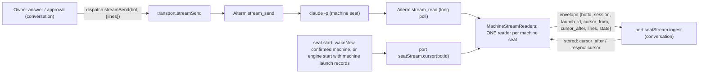

# Machine seat stream relay (a471-askuser-kiro, contract a471-stream-contract)

Owner: Kiro (execution relay only). Contract and storage: [conversation machine-stream.md](../conversation/machine-stream.md) (N102, PR #2015); Aiterm side: aiterm-mcp `docs/architecture/claude-machine-stream.md` (Elegg, `stream_read` / `stream_send`, 0.70.84). Owner ruling 13: the machine seat's stream-json is passed through as data; execution routes it and interprets nothing.

## Function contract

| Function | Input and output | Responsibility |
| --- | --- | --- |
| `MachineStreamReaders.start(bot, session)` | idempotent per session | Starts the one reader of a machine seat: only a main seat whose launch Aiterm confirmed as machine (`structuredContent.interface`), never a fork. Reads `port.cursor(botId)` first (after a restart) and continues from it when its session matches, else from the start of the launch |
| reader loop | `stream_read {session_id, cursor?, max_lines:1000, wait_ms:30000}` | Sends an envelope when it has lines or the `state` changed (a state-only envelope has `lines: []`; conversation closes cards from `state.pending`). `stored` -> cursor = `cursor_after`. `resync` -> cursor = the returned one. Aiterm `STREAM_CURSOR_STALE` -> cursor null (start of the current launch). `state: exited` after the final envelope -> the reader ends |
| failures | any other error of `stream_read` or `ingest` | Never gives up while the seat lives: wait 2 s, doubling to 30 s, read again from the same cursor. No tight loop. The reader leaves by the seat's exit, `stop(session)` at a seat close, or when the launch record no longer names this session |
| `AitermTransport.streamSend(bot, { lines })` | 1..20 JSON objects; Aiterm's result, or its error unchanged | Forwards to `stream_send` on the Bot's session. Owner-only (conversation's route); a Bot never reaches it. An engine without it answers `EXECUTION_REQUEST_INVALID` (503) to the caller |
| `EXECUTION_SEAT_STREAM` | engine flag | The parent passes `ports.seatStream {cursor, ingest}` only to an engine that exports it (as `EXECUTION_HARNESS_CLI`); an engine with no port has no reader, so a question stays held as today and nothing breaks |

## Data flow and ownership

| Datum | Owner | Lifetime |
| --- | --- | --- |
| stream lines, cursor | Aiterm (the launch's stream file) | the launch |
| stored events and the stored cursor | conversation | the Bot's log |
| reader state (cursor in memory, last sent `state`) | execution memory only | the reader; a body restart reads `port.cursor` again |

## Protects, and how it leaves

Protects the chat log from gaps and duplicates: only conversation's answer `stored` moves the cursor. Self-exit: the seat exits (`state: exited`), the seat is closed (`stop`), or the launch record names another session. No timer decides anything; the backoff only spaces retries of one unreachable read. A fork has no reader (nobody can answer its question; Aiterm denies it at once).
