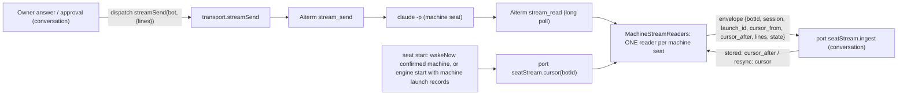
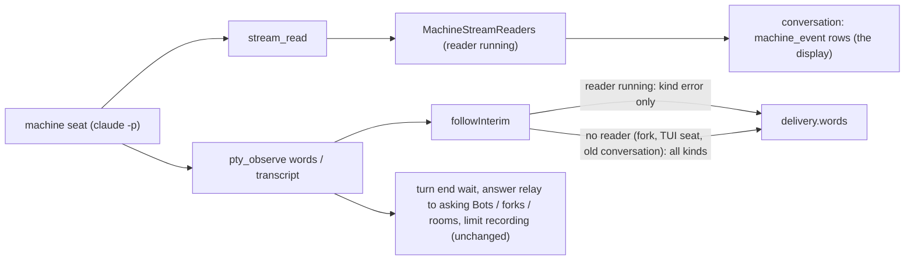

# Machine seat stream relay (a471-askuser-kiro, contract a471-stream-contract)

Owner: Kiro (execution relay only). Contract and storage: [conversation machine-stream.md](../conversation/machine-stream.md) (N102, PR #2015); Aiterm side: aiterm-mcp `docs/architecture/claude-machine-stream.md` (Elegg, `stream_read` / `stream_send`, 0.70.84). Owner ruling 13: the machine seat's stream-json is passed through as data; execution routes it and interprets nothing.

## Function contract

| Function | Input and output | Responsibility |
| --- | --- | --- |
| `MachineStreamReaders.start(bot, session)` | idempotent per session | Starts the one reader of a machine seat: only a main seat whose launch Aiterm confirmed as machine (`structuredContent.interface`), never a fork. Reads `port.cursor(botId)` first (after a restart) and continues from it when its session matches, else from the start of the launch |
| reader loop | `stream_read {session_id, cursor?, max_lines:1000, wait_ms:30000}` | Sends an envelope when it has lines or the `state` changed (a state-only envelope has `lines: []`; conversation closes cards from `state.pending`). `stored` -> cursor = `cursor_after`. `resync` -> cursor = the returned one. Aiterm `STREAM_CURSOR_STALE` (the launch's files are gone, seat closed) -> cursor null (start of the current launch). A previous launch stays readable after a wake or restart: its lines come with `launch_id` = the old one and `current_launch_id` = the new one; once `at_end` the next read starts at the current launch. `state: exited` of the current launch after the final envelope -> the reader ends. `STREAM_UNSUPPORTED` (a seat started by a screen-based machine host, aiterm-mcp 0.70.82/0.70.83) -> the reader ends; the seat's next launch starts one |
| engine lifetime | `stopAll()` on quiesce and retire; `start` replaces a stopped reader | A swapped-out engine gives up every reader (its native calls are refused from then on, so a kept reader would only log forever, and a reader still polling must not hand its last lines over). The successor's `initialize` (or the same engine's `resume`) runs `resumeMachineStreams`, which starts one reader per listed machine seat again from `port.cursor`. A seat that is down (container restart, hibernation) has no row; its reader starts at its next wake or resume launch |
| failures | any other error of `stream_read` or `ingest` | Never gives up while the seat lives: wait 2 s, doubling to 30 s, read again from the same cursor. No tight loop. The reader leaves by the seat's exit, `stop(session)` at a seat close or an idle hibernation (`closeIdle`, a478), or when the launch record no longer names this session |
| `AitermTransport.streamSend(bot, { lines })` | 1..20 JSON objects; Aiterm's result, or its error unchanged | Forwards to `stream_send` on the Bot's session. Owner-only (conversation's route); a Bot never reaches it. An engine without it answers `EXECUTION_REQUEST_INVALID` (503) to the caller |
| engine native allowlist | the dispatcher's `nativeMethods` | Includes `stream_read` and `stream_send`. A method outside it answers `EXECUTION_REQUEST_INVALID` before Aiterm is called: the reader's first read was refused that way on the live Z135 (a471-card-missing) and nothing was ever stored, so no card and no chat rows. The allowlist must grow with every Aiterm tool the engine calls |
| `EXECUTION_SEAT_STREAM` | engine flag | The parent passes `ports.seatStream {cursor, ingest}` only to an engine that exports it (as `EXECUTION_HARNESS_CLI`); an engine with no port has no reader, so a question stays held as today and nothing breaks |

## Display source: the stream only (a471-chat-from-stream)

Owner 2026-11-20 21:1x JST: the chat is drawn from the machine data by conversation, not through Aiterm's tools. Contract: [conversation machine-stream.md](../conversation/machine-stream.md) "Display source for a machine seat" (N102). Execution keeps the mechanics and stops being a display source for a seat whose stream it reads.

| Function | Rule |
| --- | --- |
| `MachineStreamReaders.displays(session)` | true only when the conversation port says `displayFromStream: true` AND a reader of this session runs. A fork, a seat the old way, a seat whose reader ended (`STREAM_UNSUPPORTED`, exited) is false: its words go on as before. The stream file is durable, so a reader in backoff loses nothing |
| `followInterim` | when `displays(session)`: only words of kind `error` go to `delivery.words` (the limit recording of a self-started turn depends on them); `interim` and `answer` are read but not relayed |
| `submit` answer step | when `displays(session)` the display answer (`onAnswer` of a turn nobody asked an answer of) is not read or relayed. The `transcript` answer returned to an asking Bot, fork or room is mechanics and stays |
| `user.complete` | gains `stream: true` (same condition) so conversation does not draw its saved copy of the answer |
| turn option `onStreamReply` | the Owner's direct turn (durable receipts -> `transport.turn`, no `conversationDelivery`) has no `user.complete`. `submit` calls `onStreamReply()` once, before the completion value is handed back, when `displays(session)` (same condition). The conversation-delivery route keeps `user.complete {stream: true}` and does not call it. Listed in the dispatcher's callback keys so it gets the alive/track wrapper |
| `execution.shown.read` | gains `stream: true` for the watch of a machine seat's self-started turn; conversation's SelfTurns then skips the answer and consumes |
| unchanged | `delivery.status`, `turn.end`, steer receipts, `stream_send` relay, forks |

Version skew: the flag is a key of the `seatStream` port, which an older engine rejects as an unknown key. The parent therefore passes `displayFromStream` only to an engine that exports `EXECUTION_SEAT_STREAM_DISPLAY` (loader `supportsSeatStreamDisplay`), and only from a body whose conversation understands `stream: true`. Old engine with a new body, or new engine with an old body: no flag, the words path is as it was (the chat shows both, as before). No timer, no refusal: the rule is decided turn by turn from the reader that runs.

## Data flow and ownership

| Datum | Owner | Lifetime |
| --- | --- | --- |
| stream lines, cursor | Aiterm (the launch's stream file) | the launch |
| stored events and the stored cursor | conversation | the Bot's log |
| reader state (cursor in memory, last sent `state`) | execution memory only | the reader; a body restart reads `port.cursor` again |

## Protects, and how it leaves

Protects the chat log from gaps and duplicates: only conversation's answer `stored` moves the cursor. Self-exit: the seat exits (`state: exited`), the seat is closed (`stop`), or the launch record names another session. No timer decides anything; the backoff only spaces retries of one unreachable read. A fork has no reader (nobody can answer its question; Aiterm denies it at once).
