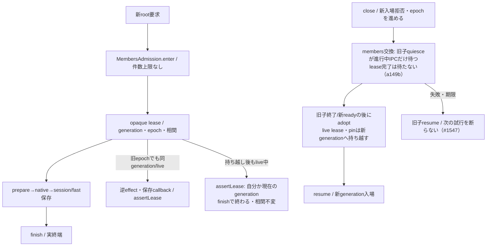
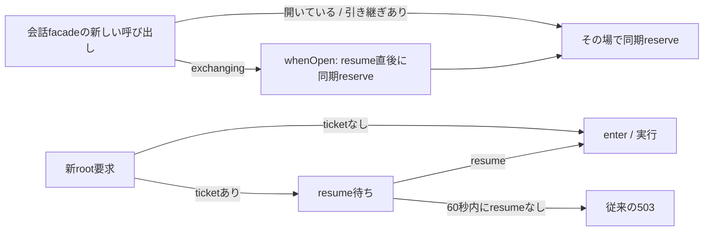
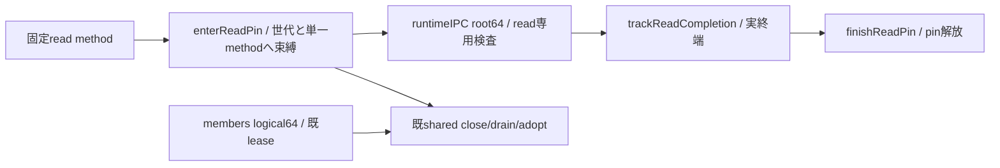

# members交換中の親実行lease

所有キロ。横断正本は `/srv/bellteam/bots/bot-7b140b27/docs/members-update-contract-20261103.md`。交換epochと全体停止世代は別。

`MembersAdmission(generation)`を親が一つ所有し、runtime controller/channelとtransportへ同じ実体を注入する。captureは待機開始時のgeneration/epoch、enter(expected?,correlation?)は親の信頼済み受付でだけ呼ぶ。leaseの件数上限は持たない（a505b、2026-11-22。守るものが無く、87席の同時起動で23席が503になった）。同時に処理するroot数はIPCのroot枠（MODULE_CONCURRENCY=64、超過はFIFOで待ち、各callの期限60秒で終わる）だけが抑える。交換/世代不一致は503・not_accepted/not_started。opaque objectは親内Setで同一性検査し、wireから再構成しない。runtimeはleaseIdを自分の固定channel相関へ対応付け、assertLease(opaque,{generation,correlation})で既effect/callbackを通す。live leaseのepochは比較しない。終了/別generation/相関違い/偽objectを拒否する。

finishは所有rootの終了要請。runtimeはwire送信試行前に`trackCompletion(opaque,realCompletionPromise)`で実終端を登録する。callerへtimeout/unknownを返した後も実completionがpendingなら、finish要請済みでもleaseをliveのまま保持し旧callbackを許す。後続依存completionもlive中は追加でき、全登録completionの実終端とfinish要請の両方で最後に解放する。callback deadlineは実completionをsettleしない。OScloseだけで未終端の親effectまで取消済みにしない。withLease(operation,{lease?,expected?})は既leaseなら再root化せず、所有時だけPromise終端でfinishを要請する。callbacksへ渡す引数は`{membersLease: opaque}`で、同root operationのprepare/session/fast保存に保持する。新root枠やmutation lockを取り直して折り返さない。

closeは同期に新入場を閉じepochを進め、同じ閉鎖中は同ticketを返す。drain(ticket)はlive rootだけ待ち、既AI/job/watch/長時間command完走を待たない。60秒予算と旧resume ACK/不明時新writer0はruntime controllerが持つ。resume(ticket)は有効ticketだけを開け、未終端旧leaseも同generationで続行可能。adopt(ticket,newGeneration)は閉鎖中・live0の時だけ。新ready/投影adoptionが成立してからruntimeが呼ぶ。旧generationへ戻す時も新しいgeneration識別子を使い、旧ticket/leaseを復活させない。

transportはwake prepare→native→session/fast保存、restart close→wake保存、idle closeを同leaseで覆う。reconfigureのidle待ちは外でcaptureし、発行前に同epoch/fresh本人/不明状態を確認してenterする。新入場停止中に元AIやwatch/出力/interruptを停止せず、uncertainChangesを消さない。schedulerの既commandJobsとmaintenanceDate、IdleSessionsは親実体のまま。

この公開口はlease相関/寿命だけ。IPCのroot/effect/callback別credit・byte上限・ACK期限はruntime、唯一writer/fresh本人/投影はmembers/common。channelに任意method/pathを公開するものではない。正式assemblyの共有注入とfresh callbackはMolly/Epi/Belortaの同公開窓口へ接続する。

## 交換は使用中のleaseを待たない（2026-11-15 a149b、Trony裁定、キロ合意）

本番13:37 JSTのmembers交換が、Owner turnの持つleaseを待ってMEMBERS_DRAIN_TIMEOUTになった。Owner 11/08「更新は仕事を待たない」に合わせる。保護対象「旧子が書き終える前に新子が書かない」は、members子の書き込みが進行中のIPC root/effect/callbackの中だけで起き、旧子のquiesceがそれを全部待ってからexitするので、leaseの寿命を待たなくても守られる。

- members交換・回復・起動は`drain(ticket)`（lease完了待ち）を呼ばない。旧子のquiesce（60秒）だけを待つ。`drain(ticket)`自体は他の利用者のために残す。
- `adopt(ticket, generation)`はlive lease/pinを拒否せず、新generationへ持ち越す。持ち越したleaseは`assertLease`で自分のgenerationか現在のgenerationなら通り、`finish`で終わる。相関は変わらない。
- `expected`/`capture`で旧generation・旧epochを掴んだ呼出し（`enter(expected)`など）は従来どおり拒否する。守るもの: 古いmembers状態を前提にした変更の適用。出口: 呼出し側がcaptureし直す。
- 失敗した試行（quiesce失敗・期限）は旧子をresumeして受付を開く。次の試行を断らない（#1547）。

| 入口 | 交換中（ticketあり）の動き |
| --- | --- |
| 既lease/既pinを渡すroot（members-process `request`） | 旧子がquiesceを終えるまでは旧子へ送る（continuation）。quiesce後の旧子はcontinuationも断る（members-ipc）ので、親はそのrootを既存の`whenOpen`で`resume`まで待たせ、新子で実行する。待ちの出口は既存の`MEMBERS_EXCHANGE_HOLD_MS`。新しい待ちやtimeoutは無い。 |

## 交換中の新rootは待って通す（2026-11-08、Molly、キロ確認）

Owner不具合: members子の単独更新中（13:37:44 JST、job d92d948e）に GET /api/bots 等が 503 MEMBERS_NOT_ACCEPTED になった。本体は動いており、部品の交換は呼び手に見えてはいけない。

| 入口 | 交換中（ticketあり）の動き |
| --- | --- |
| `withLease(op)` / `withReadPin(method, op)`（lease・pin・expected なし＝新root） | 拒否せず `resume(ticket)` まで待ち、新generationで入場して実行する。待ちの出口は resume（交換の成功・失敗・回復のどれでも必ず呼ばれる）。resume が来ない時（members が閉じたまま）の出口として `MEMBERS_EXCHANGE_HOLD_MS`=60秒後に従来の 503 |
| `expected` を渡す呼び出し、同期の `enter()` / `enterReadPin()` | 変更なし（旧epochに束縛された要求は従来どおり拒否）。既lease/既pinを渡すrootは上のa149bの行 |
| 会話facadeの新しい呼び出し（引き継ぐoperationContext・leaseなし。Owner HTTPのrooms.list・履歴・投稿など）（2026-11-15 a127） | `exchanging`の時だけ、予約（`moduleOperations.reserve()`＝同期`enter()`）を含む開始処理を`whenOpen`へ渡し、resume直後に同期で予約して始める（AT7の予定と同じ口、同じ60秒の出口）。開いている時と引き継ぎのある呼び出しは従来どおりその場で同期に始める。戻り値の`completion`（`user.turn`は`accepted`も）は保つ。BugHub ef83d4ee: 2026-11-14 23:02:31Z GET /api/roomsがmembers交換中に即503 MEMBERS_NOT_ACCEPTEDになった |
| 会話rootのmembers lease（2026-11-15 a149） | `conversation-assembly`のinvokeは、会話rootのmembers leaseへ`result.accepted ?? result`（turnは受付、他はrootの返答）だけを登録する。会話leaseは従来どおり`completion`まで保つ。受付後のAI完走でmembers交換を待たせない（本番11/15 13:37、Ownerのturn中にmembers交換がMEMBERS_DRAIN_TIMEOUT。Owner 11/08「更新は作業を待たない」）。部屋root（`room.post`/`room.reply`）は配送を発行した時点で返るので、その`execution.notify`は報告・fork返答の中継と同じく新しいmembers leaseで入り直す。受付後に同じleaseを使う会話側のeffectは無い（N102確認）。実行側のlease検査は受付前だけ（Kiro確認） |
| members表示projectionと交換（2026-11-15 a153、BugHub ef83d4ee） | `members-assembly`の`onState`、`members-facade.readProfiles` | (1) 計画的なquiesce（`phase: 'quiescing'`）ではprojectionを無効化しない。旧childは飛行中の作業を終えるまで名簿を送り続けるため、`pending`を消すと続きのrecordが`MEMBERS_PROJECTION_INVALID`で拒否され、読み取りが503になっていた（06:15:09Z `GET /api/rooms`）。次のchildへは`begin()`が表示を初期化する。喪失・失敗（`unavailable`/`closed`）は従来どおり無効化する。(2) 交換をまたいで引き継がれたlease/pin（#1554）は旧generationを持つので、projectionの確認は現在のadmission generationと比べる（以前はleaseの固定generationと比べ、再試行した読みが`MEMBERS_PROJECTION_UNCONFIRMED`になった） |
| 直接配送の入口でのsetup待ち（2026-11-15 a149c、Molly依頼、Kiro） | `direct-receipt-assembly`のdispatchは、`withLease`の前に親の既存`environmentReady(bot.project)`（`botEnvironments.ready`、そのBotのsetup.sh終了）を待つ。本体再起動直後、約68席のsetupは順に数分かかり、従来はleaseを取ってから席起動（`launchOptions`）の中でこの待ちに入ったため、保存済み受付のdrain・予定・sendmessageがlease枠64を埋め、他の入場が`enter()`で即拒否された（Z28 14:46 JST）。待ちはleaseの外なので枠を消費せず、出口は既存のsetup期限600秒（cli-registration）。新しい待ち・期限・拒否は足さない。登録の無いBotは即時。会話root（部屋・Owner turn）の同じ並べ替えは会話facadeの所有（N102）で、この変更の範囲外 |

新しい拒否・lockは追加しない。保護対象は従来どおり「旧子が書き終える前に新子が書かない」（旧子quiesce→exit→新子launch、a149b）で、待ちはその閉鎖の間だけ。待ちはlive leaseに数えないのでadoptを止めない。body-resident（親の`MembersAdmission`実体は本体の`/app/src`）。

## fresh readの世代pin（限定新契約）

`MEMBERS_READ_PIN_METHODS`はprofiles.read/profile.read/removals.read/owner.read/rules.read/schedules.listの固定6個。`enterReadPin(method,expected?,correlation?)`、`assertReadPin(pin,{method?,generation?,correlation?})`、`finishReadPin(pin)`、`trackReadCompletion(pin,realPromise)`、`withReadPin(method,operation,{pin?,expected?,correlation?})`を公開する。親opaqueをoptions.membersReadPinで渡し、wire5fieldは変えない。偽object/AIlease/別method/別generation/相関違い/終了pinは拒否。pinをassertLease/withLeaseへ渡してAIrootへ昇格しない。

pinはmembers logical64を消費せず、実requestはruntimeのIPCroot64/sharedcontrolで制限する。新pinもclose/epochを検査し、live pinは閉鎖後も同generationの元methodだけ完了できる。finishは終了要請であり登録済み実completion全終端までlive。drain/adoptはAIleaseとreadpin双方を待つ。timeout解放・mutation/callback転用は不可。複数methodは別pinに分ける。runtimeのread-only method検査とfacade/caller接続が揃うまでgate単独では通常GET回復を成立させない。Root限定裁定前のmain採用はしない。

## 必要callerの接続

`createManagedTransport({membersAdmission,requireMember,...})`は同じgateを受け、未指定の既builtinでは一つ生成する。`transport.membersAdmission`が共通controller/channelへの公開注入点。application-servicesのrequireMemberは同lease contextでregistry.refresh→存在確認、確認済み不存在のみ404。子facade導入時もこのhookをfresh readへ接続する。wake/restart/closeIdleの新rootは発行前入場、prepareStartup/updateSession/updateFastModeの追加context引数は同lease。onboardingの既固定appendもcontextを転送する。legacy writerは追加引数を使わず既挙動を維持し、新子facadeはroot権限を再生成せずcallbackとして処理する。

reconfigureはidle待ち開始時にepochをcaptureし入場可否を確認、idle終了後の新lease下でfresh requireMember/session certainty/停止世代を再検査する。まだidle待ちのPromiseをdrain対象にせず、交換後は旧epochを拒否し再発行しない。値消去等のrestart分岐は同leaseを引き継ぐ。既明示restartは新配送の停止世代を捕捉する前に同期で停止世代を進め、fresh readはnative前のpending内部で行う。登録喪失の既close→wake回復も一leaseにした。

native起動後のsession/fast保存callback失敗は元例外を維持し、親uncertainChangesにmembers_session_saveを残す。交換generation変更でこれを消さず、native再発行もしない。既agent_configure等の不明もそのまま。interruptと既stop forwardingはこの新入場を通らず継続する。削除のstop/任意設定のstopForConfigurationは既lease contextを受け、専用callbackをroot化し直さない。

予定のclaim/skipの唯一writerはmembers/Room側。親がlease下でclaimし、成功snapshotから既dispatch窓口へ一度だけ渡す接続はmembers/commonのcaller側と合わせる。commandJobs登録は同期で、runCommandScheduleが返す長時間completionをroot drainへ登録しない。commandの完了/失敗通知/停止は既親のまま。03時maintenanceDate/既restartIfIdleと30分IdleSessionsの別判定は移動しない。

予定claim等からの既leaseは`notify/turn/submit`のoptions.membersLeaseへ渡す。info/本文/queueへ保存しない。submitは受付開始時に同opaqueを検証し、dispatchInOrder→dispatch→（旧bridgeも含む）wake保存へ引き継ぐ。`completion.admissionCompletion`を同leaseの実completionへ同期登録する。成功はnative受付/onStatus runningの後で終端、受付前失敗はfailure callback/cleanup終端まで保持する。acceptedが返った後のAI/job完走はこのcompletionへ含めない。旧rootのfinish要請/交換が挟まっても、新root化せず受付まで継続する。終了leaseの再利用はjob登録前に拒否する。

会話lifetimeと上の準備用members leaseは別の寿命である。親の両予約operationContextは元opaqueの同identityを保つが、普通の会話でmembers準備64枠をAI完走まで延長しない。後発の固定不足報告は[会話execution adapter](conversation-effects.md)が元会話の派生権を維持し、membersだけ通常withLeaseでfresh準備/受付を再検証する。元operationContext内の終了membersLeaseを再利用・書換えせず、新会話rootも作らない。members閉鎖時は明示拒否し、後のresumeで自動再発行しない。
