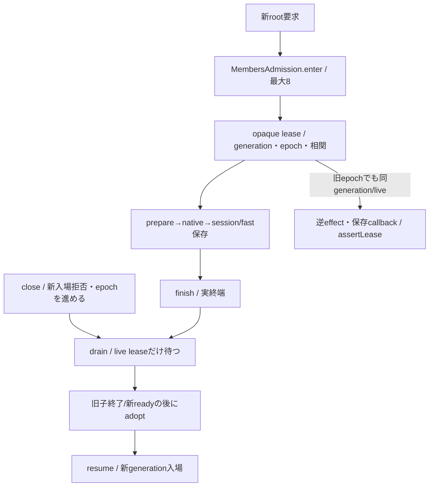
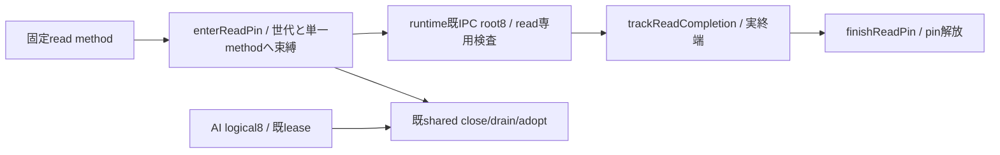

# members交換中の親実行lease

所有キロ。横断正本は `/srv/bellteam/bots/bot-7b140b27/docs/members-update-contract-20261103.md`。交換epochと全体停止世代は別。

`MembersAdmission(generation)`を親が一つ所有し、runtime controller/channelとtransportへ同じ実体を注入する。captureは待機開始時のgeneration/epoch、enter(expected?,correlation?)は親の信頼済み受付でだけ呼ぶ。最大8root、上限/交換/世代不一致は503・not_accepted/not_started。opaque objectは親内Setで同一性検査し、wireから再構成しない。runtimeはleaseIdを自分の固定channel相関へ対応付け、assertLease(opaque,{generation,correlation})で既effect/callbackを通す。live leaseのepochは比較しない。終了/別generation/相関違い/偽objectを拒否する。

finishは所有rootの終了要請。runtimeはwire送信試行前に`trackCompletion(opaque,realCompletionPromise)`で実終端を登録する。callerへtimeout/unknownを返した後も実completionがpendingなら、finish要請済みでもleaseをliveのまま保持し旧callbackを許す。後続依存completionもlive中は追加でき、全登録completionの実終端とfinish要請の両方で最後に解放する。callback deadlineは実completionをsettleしない。OScloseだけで未終端の親effectまで取消済みにしない。withLease(operation,{lease?,expected?})は既leaseなら再root化せず、所有時だけPromise終端でfinishを要請する。callbacksへ渡す引数は`{membersLease: opaque}`で、同root operationのprepare/session/fast保存に保持する。新root枠やmutation lockを取り直して折り返さない。

closeは同期に新入場を閉じepochを進め、同じ閉鎖中は同ticketを返す。drain(ticket)はlive rootだけ待ち、既AI/job/watch/長時間command完走を待たない。60秒予算と旧resume ACK/不明時新writer0はruntime controllerが持つ。resume(ticket)は有効ticketだけを開け、未終端旧leaseも同generationで続行可能。adopt(ticket,newGeneration)は閉鎖中・live0の時だけ。新ready/投影adoptionが成立してからruntimeが呼ぶ。旧generationへ戻す時も新しいgeneration識別子を使い、旧ticket/leaseを復活させない。

transportはwake prepare→native→session/fast保存、restart close→wake保存、idle closeを同leaseで覆う。reconfigureのidle待ちは外でcaptureし、発行前に同epoch/fresh本人/不明状態を確認してenterする。新入場停止中に元AIやwatch/出力/interruptを停止せず、uncertainChangesを消さない。schedulerの既commandJobsとmaintenanceDate、IdleSessionsは親実体のまま。

この公開口はlease相関/寿命だけ。IPCのroot/effect/callback別credit・byte上限・ACK期限はruntime、唯一writer/fresh本人/投影はmembers/common。channelに任意method/pathを公開するものではない。正式assemblyの共有注入とfresh callbackはMolly/Epi/Belortaの同公開窓口へ接続する。

## fresh readの世代pin（限定新契約）

`MEMBERS_READ_PIN_METHODS`はprofiles.read/profile.read/removals.read/owner.read/rules.read/schedules.listの固定6個。`enterReadPin(method,expected?,correlation?)`、`assertReadPin(pin,{method?,generation?,correlation?})`、`finishReadPin(pin)`、`trackReadCompletion(pin,realPromise)`、`withReadPin(method,operation,{pin?,expected?,correlation?})`を公開する。親opaqueをoptions.membersReadPinで渡し、wire5fieldは変えない。偽object/AIlease/別method/別generation/相関違い/終了pinは拒否。pinをassertLease/withLeaseへ渡してAIrootへ昇格しない。

pinはAIlogical8を消費せず、実requestはruntimeの既IPCroot8/sharedcontrolで制限する。新pinもclose/epochを検査し、live pinは閉鎖後も同generationの元methodだけ完了できる。finishは終了要請であり登録済み実completion全終端までlive。drain/adoptはAIleaseとreadpin双方を待つ。timeout解放・mutation/callback転用は不可。複数methodは別pinに分ける。runtimeのread-only method検査とfacade/caller接続が揃うまでgate単独では通常GET回復を成立させない。Root限定裁定前のmain採用はしない。

## 必要callerの接続

`createManagedTransport({membersAdmission,requireMember,...})`は同じgateを受け、未指定の既builtinでは一つ生成する。`transport.membersAdmission`が共通controller/channelへの公開注入点。application-servicesのrequireMemberは同lease contextでregistry.refresh→存在確認、確認済み不存在のみ404。子facade導入時もこのhookをfresh readへ接続する。wake/restart/closeIdleの新rootは発行前入場、prepareStartup/updateSession/updateFastModeの追加context引数は同lease。onboardingの既固定appendもcontextを転送する。legacy writerは追加引数を使わず既挙動を維持し、新子facadeはroot権限を再生成せずcallbackとして処理する。

reconfigureはidle待ち開始時にepochをcaptureし入場可否を確認、idle終了後の新lease下でfresh requireMember/session certainty/停止世代を再検査する。まだidle待ちのPromiseをdrain対象にせず、交換後は旧epochを拒否し再発行しない。値消去等のrestart分岐は同leaseを引き継ぐ。既明示restartは新配送の停止世代を捕捉する前に同期で停止世代を進め、fresh readはnative前のpending内部で行う。登録喪失の既close→wake回復も一leaseにした。

native起動後のsession/fast保存callback失敗は元例外を維持し、親uncertainChangesにmembers_session_saveを残す。交換generation変更でこれを消さず、native再発行もしない。既agent_configure等の不明もそのまま。interruptと既stop forwardingはこの新入場を通らず継続する。削除のstop/任意設定のstopForConfigurationは既lease contextを受け、専用callbackをroot化し直さない。

予定のclaim/skipの唯一writerはmembers/Room側。親がlease下でclaimし、成功snapshotから既dispatch窓口へ一度だけ渡す接続はmembers/commonのcaller側と合わせる。commandJobs登録は同期で、runCommandScheduleが返す長時間completionをroot drainへ登録しない。commandの完了/失敗通知/停止は既親のまま。03時maintenanceDate/既restartIfIdleと30分IdleSessionsの別判定は移動しない。

予定claim等からの既leaseは`notify/turn/submit`のoptions.membersLeaseへ渡す。info/本文/queueへ保存しない。submitは受付開始時に同opaqueを検証し、dispatchInOrder→dispatch→（旧bridgeも含む）wake保存へ引き継ぐ。`completion.admissionCompletion`を同leaseの実completionへ同期登録する。成功はnative受付/onStatus runningの後で終端、受付前失敗はfailure callback/cleanup終端まで保持する。acceptedが返った後のAI/job完走はこのcompletionへ含めない。旧rootのfinish要請/交換が挟まっても、新root化せず受付まで継続する。終了leaseの再利用はjob登録前に拒否する。

会話lifetimeと上の準備用members leaseは別の寿命である。親の両予約operationContextは元opaqueの同identityを保つが、普通の会話でmembers8枠をAI完走まで延長しない。後発の固定不足報告は[会話execution adapter](conversation-effects.md)が元会話の派生権を維持し、membersだけ通常withLeaseでfresh準備/受付を再検証する。元operationContext内の終了membersLeaseを再利用・書換えせず、新会話rootも作らない。members閉鎖時は明示拒否し、後のresumeで自動再発行しない。
