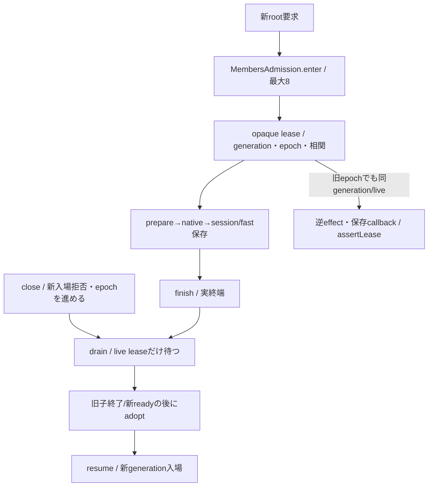

# members交換中の親実行lease

所有キロ。横断正本は `/srv/bellteam/bots/bot-7b140b27/docs/members-update-contract-20261103.md`。交換epochと全体停止世代は別。

`MembersAdmission(generation)`を親が一つ所有し、runtime controller/channelとtransportへ同じ実体を注入する。captureは待機開始時のgeneration/epoch、enter(expected?,correlation?)は親の信頼済み受付でだけ呼ぶ。最大8root、上限/交換/世代不一致は503・not_accepted/not_started。opaque objectは親内Setで同一性検査し、wireから再構成しない。runtimeはleaseIdを自分の固定channel相関へ対応付け、assertLease(opaque,{generation,correlation})で既effect/callbackを通す。live leaseのepochは比較しない。終了/別generation/相関違い/偽objectを拒否する。

finishは所有rootの終了要請。runtimeはwire送信試行前に`trackCompletion(opaque,realCompletionPromise)`で実終端を登録する。callerへtimeout/unknownを返した後も実completionがpendingなら、finish要請済みでもleaseをliveのまま保持し旧callbackを許す。後続依存completionもlive中は追加でき、全登録completionの実終端とfinish要請の両方で最後に解放する。callback deadlineは実completionをsettleしない。OScloseだけで未終端の親effectまで取消済みにしない。withLease(operation,{lease?,expected?})は既leaseなら再root化せず、所有時だけPromise終端でfinishを要請する。callbacksへ渡す引数は`{membersLease: opaque}`で、同root operationのprepare/session/fast保存に保持する。新root枠やmutation lockを取り直して折り返さない。

closeは同期に新入場を閉じepochを進め、同じ閉鎖中は同ticketを返す。drain(ticket)はlive rootだけ待ち、既AI/job/watch/長時間command完走を待たない。60秒予算と旧resume ACK/不明時新writer0はruntime controllerが持つ。resume(ticket)は有効ticketだけを開け、未終端旧leaseも同generationで続行可能。adopt(ticket,newGeneration)は閉鎖中・live0の時だけ。新ready/投影adoptionが成立してからruntimeが呼ぶ。旧generationへ戻す時も新しいgeneration識別子を使い、旧ticket/leaseを復活させない。

transportはwake prepare→native→session/fast保存、restart close→wake保存、idle closeを同leaseで覆う。reconfigureのidle待ちは外でcaptureし、発行前に同epoch/fresh本人/不明状態を確認してenterする。新入場停止中に元AIやwatch/出力/interruptを停止せず、uncertainChangesを消さない。schedulerの既commandJobsとmaintenanceDate、IdleSessionsは親実体のまま。

この公開口はlease相関/寿命だけ。IPCのroot/effect/callback別credit・byte上限・ACK期限はruntime、唯一writer/fresh本人/投影はmembers/common。channelに任意method/pathを公開するものではない。正式assemblyの共有注入とfresh callbackはMolly/Epi/Belortaの同公開窓口へ接続する。
