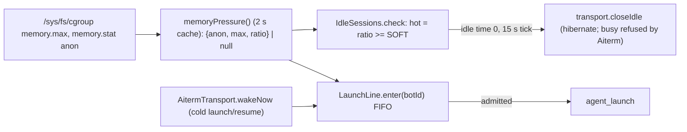

# Live-seat memory budget (a505b, Owner 2026-11-22 「1と2.だね。」)

Owner: Kiro (execution). Source of the rule: after the container restart at 09:59 JST 87 seats launched at once, the container went to 16-19 of 20 GiB with 24 OOM kills (seat processes, `oom_score_adj` 1000), and 1,086 kills had killed claude/host processes since 02:39 JST. A live seat costs about 0.75 GB (claude + host 2 x 171 MB RSS, plus ~10 MCP helper processes ~0.43 GB, measured 2026-11-22 on aiterm-mcp 0.70.93); with ~6 GiB of body and modules, only 18-25 seats fit in 20 GiB. The number of seats ALIVE is what must be bounded, not only the launch rate.

## What it protects, how it leaves

| Rule | Protects | Self-exit |
| --- | --- | --- |
| **Pressure sleep** (`IdleSessions`): while anon memory is at or above `SOFT` (55 % of the cgroup limit) a seat whose turn has ended sleeps at the next check (idle time 0, check every 15 s instead of 2 min). Only the existing quiet rule decides (`quietSession` + `transport.isIdle` + no pending Approval Box decision) and the existing `closeIdle` (hibernate, never a busy seat). Below `SOFT` the Owner's 10 minutes (2026-11-21) apply unchanged. | Seats that were killed by OOM; the container's memory | Memory falls below `SOFT`: the 10 minutes apply again. Nothing is held: a hibernated seat wakes on its next delivery. |
| **Launch line** (`LaunchLine`, in `wakeNow` before `agent_launch`): a cold launch or resume waits FIFO while `anon + reserved >= HOLD` (70 %). `reserved` = seats admitted in the last 30 s x 0.75 GB (a launch's memory shows up only after it ran). A delivery waiting for its launch is not failed: the wait ends when memory frees, or after `maxWaitMs` (45 s, under the 60 s deadline of an IPC call), when it launches anyway. One entry per seat: a later delivery for a seat already in the line (a sweep prompt) shares that entry and takes no second place. | A burst of launches (container restart, all-seat account move) | Memory frees (pressure sleep above), or 45 s. No reading (`memory.max` is `max`, file unreadable) = no pressure, the launch goes (unknown is not danger). |

Not done, named: a repeated Lattice sweep prompt to a seat whose launch waits is still a delivery (it shares the line entry but is delivered once the seat is up; the sweep repeats it). Dropping it needs the queue layer (the existing superseded code is recorded as a failure code), not this module.

## Function map

## Data flow

`memory.max` + `memory.stat` (read-only, kernel) -> `memoryPressure` -> two readers: `IdleSessions` (sleep sooner) and `LaunchLine` (wait before launching). No new stored state: the line is in memory; a body restart empties it (the deliveries are re-driven by their own durable receipts). Nothing is written to Aiterm beyond the existing launch and hibernate calls.

## States of one entry in the line

`waiting` -> (memory below HOLD with reservations, or 45 s) -> `admitted` -> the launch runs. A stop of the seat or a lost lease while waiting is the existing `requireStopVersion` / `assertLease` check right after the wait.
