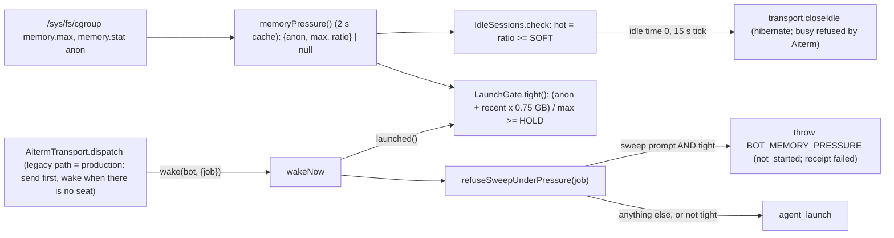
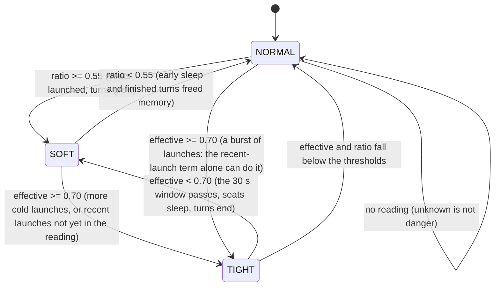
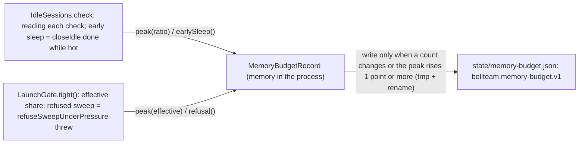

# Live-seat memory budget (a505b, reworked by a505c; Owner 2026-11-22 「キューとかいらないから断るだけじゃダメなの？」「必要なら催促が続くでしょ。」)

Owner: Kiro (execution). Why: after the container restart at 09:59 JST 87 seats launched at once, the container went to 16-19 of 20 GiB with 24 OOM kills (seat processes, `oom_score_adj` 1000); 1,086 kills had killed claude/host processes since 02:39 JST. A live seat costs about 0.75 GB (claude + host 2 x 171 MB RSS, plus ~10 MCP helper processes ~0.43 GB, measured 2026-11-22 on aiterm-mcp 0.70.93); with ~6 GiB of body and modules only 18-25 seats fit in 20 GiB. The number of seats ALIVE is what must be bounded.

There is no queue (a505b's FIFO launch line is removed). The Lattice sweep (the scheduler nudge, unchanged: Owner 「催促の仕組みを変えるな」) already repeats a prompt every minute, so a refused prompt needs no line behind it.

## What it protects, how it leaves

| Rule | Protects | Self-exit |
| --- | --- | --- |
| **Early sleep** (`IdleSessions`): while anon memory is at or above `SOFT` (55 % of the cgroup limit) a seat whose turn has ended sleeps at the next check (idle time 0, check every 15 s instead of 2 min). Only the existing quiet rule decides (`quietSession` + `transport.isIdle` + no pending Approval Box decision) and the existing `closeIdle` (hibernate; Aiterm refuses a busy seat). Below `SOFT` the Owner's 10 minutes (2026-11-21) apply unchanged. | The container's memory; seats that OOM kills | Memory falls below `SOFT`: the 10 minutes apply again. Nothing is held: a hibernated seat wakes on its next delivery. |
| **Sweep refusal** (`AitermTransport.refuseSweepUnderPressure`, called at the top of `wakeNow`, the one place every cold launch and resume passes; the delivery job reaches it through `wake(bot, { job })` from both delivery paths): a Lattice sweep prompt (`from: 'scheduler'` and text beginning `Lattice: you are not running` or `Lattice: on charts you created`, the two heads of `src/lattice/nudge.mjs`) that would start or resume a COLD seat is refused while `anon + recent admissions x 0.75 GB >= HOLD` (70 %). The refusal is a designed one like a463's image refusal: error code `BOT_MEMORY_PRESSURE`, `effect: not_started`, typed `EXECUTION_BUSY/not_started`; the receipt is saved `failed` (not queued, not retried), no BugHub report, no seat touched. A warm seat (already running) is not affected. | The cold start that would add a seat to a full container | The next sweep (1 minute) asks again; it goes through once memory is below `HOLD` (early sleep frees it). No reading (`memory.max` is `max`, file unreadable) = no pressure, nothing is refused. |
| **Never refused** (11-07 ruling: a dead seat is woken by its delivery): messages from the Owner, members/Bots, rooms, calls and every other schedule wake the seat at once, whatever the memory. Every cold launch counts as an admission for the next 30 s (`launched()`), refused or not, so the refusal sees what is about to be used. | Deliveries a person or a Bot waits on | n/a |

## Function map

## Data flow

`memory.max` + `memory.stat` (read-only, kernel) -> `memoryPressure` -> `IdleSessions` (sleep sooner) and `LaunchGate` (refuse a sweep prompt). `LaunchGate` keeps only the times of the last launches in memory (a body restart empties it). Nothing is written to Aiterm beyond the existing launch and hibernate calls; the refused delivery is recorded as `failed` with code `BOT_MEMORY_PRESSURE` in the existing receipt history.

## State transitions (a507a)

Two state machines meet at every delivery: the container's memory (what `memoryPressure` + `LaunchGate` read) and a seat (what Aiterm shows). Nothing is stored for either; each is recomputed from the cgroup and from Aiterm on every check or delivery.

### Memory state

`ratio` = cgroup anon / `memory.max` (read every check, 2 s cache). `effective` = (anon + seats launched in the last 30 s x 0.75 GB) / max (what `LaunchGate.tight()` uses: a launch shows in the reading only after it ran). Thresholds: `SOFT` 0.55, `HOLD` 0.70. No reading (`memory.max` is `max`, or the files cannot be read) = `NORMAL`.

| State | What `IdleSessions` does | What a Lattice sweep prompt to a cold seat meets |
| --- | --- | --- |
| NORMAL (ratio < 55 %, effective < 70 %) | The Owner's rule: a quiet seat sleeps after 10 minutes, checks every 2 minutes | Wakes the seat |
| SOFT (ratio >= 55 %) | A quiet seat sleeps at the next check (idle time 0), checks every 15 s | Wakes the seat while effective < 70 % |
| TIGHT (effective >= 70 %) | Same as SOFT (TIGHT implies the early sleep is already running unless the recent-launch term alone made it tight) | Refused: `BOT_MEMORY_PRESSURE`, receipt `failed`, the seat stays as it was |

### Seat state x delivery

Seat states: **never launched** (no Aiterm record), **hibernated** (record, no process; wakes by resume), **dead** (pane left, harness exited, e.g. OOM-killed; wakes by a fresh launch), **warm, turn running**, **warm, turn ended** (quiet: no background work, no child delivery, no pending Approval Box decision). The first three are COLD: a delivery has to launch or resume them in `wakeNow`.

```mermaid
stateDiagram-v2
  state "cold (never launched / hibernated / dead)" as COLD
  state "warm, turn running" as RUN
  state "warm, turn ended" as QUIET
  [*] --> COLD
  COLD --> RUN: delivery from the Owner, a member, a room, a call or another schedule (wakeNow always launches; launched() recorded)
  COLD --> RUN: Lattice sweep prompt while NOT tight (launched() recorded)
  COLD --> COLD: Lattice sweep prompt while TIGHT (refused in wakeNow, nothing launched, nothing recorded as a launch)
  RUN --> QUIET: the turn ends
  QUIET --> RUN: any delivery (no launch: the seat is warm)
  QUIET --> COLD: closeIdle (hibernate): SOFT or TIGHT at the next 15 s check; NORMAL after 10 quiet minutes
  RUN --> COLD: only by OOM kill or a stop (never by this budget: Aiterm refuses to hibernate a running turn)
```

| Delivery from | Seat COLD, memory not tight | Seat COLD, TIGHT | Seat warm |
| --- | --- | --- | --- |
| Owner, member/Bot, room, call, other schedule, other Lattice notice | Wakes it | Wakes it (11-07 ruling) | Sent into the turn or as a new turn, no launch |
| Lattice sweep prompt (`Lattice: you are not running`, `Lattice: on charts you created`) | Wakes it | **Refused** | Delivered (no launch) |

### How the refusal ends on its own (guards.self-exit)

The refusal is a give-up, so its exit is stated as a transition, not as a hope:

1. Each refusal costs the seat nothing: it stays COLD, no record is kept, nothing is queued. The Lattice sweep (unchanged, every minute) asks again; the first ask after the state left TIGHT goes through.
2. TIGHT is left by one of: (a) the 30 s window of recent launches expiring (`launched()` times are dropped), (b) a warm seat's turn ending and the seat sleeping at the next 15 s check (SOFT/TIGHT early sleep), (c) memory becoming unreadable (no reading = NORMAL).
3. The exit needs seat memory to be the part that is high. If the base (body, modules) alone stood at or above 70 % of the limit, no seat sleeping could bring the ratio down and sweep prompts to cold seats would stay refused; cold launches are not safe in that state either, and every other sender still wakes its seat. The base is about 6 of 20 GiB today (30 %); this is the named limit of the exit, not a case seen.
4. A refused sweep prompt is recorded once per attempt as a failed delivery with `BOT_MEMORY_PRESSURE` and produces no BugHub report, so a long TIGHT period leaves history lines, not a pile of reports or a queue.

## Why a505c did not fire in lab Z172 (a505d, 2026-11-22)

`createManagedTransport` builds the production transport, which delivers through `AitermTransport.dispatch` (send first, wake when the seat has no registration); the former `dispatchExecution` bridge path no longer exists (a532b2 stage 1). a505c asked in `dispatchExecution` only. The refusal now sits in `wakeNow`, which both paths and the resume path of a hibernated seat go through, and the tests drive the production path (`createManagedTransport`'s shape: no bridge, a never-launched seat) as well as the bridge path.

## The record (a525, 2026-11-23)

Question it answers (Tronie, Owner): did the memory control act, and how full did the container get? Nothing recorded it: an early sleep was one stderr line, a refusal only a failed delivery, the peak nowhere. Reader: whoever asks (Tronie, the Owner, Kiro), with `sudo cat /srv/bellteam/state/memory-budget.json` like the other execution state files.

The record protects nothing and blocks nothing (not a guard): a write that fails is dropped, and delivery, sleep and refusal never wait for it.

Data: `{ schema, since, early_sleep: { count, last_at }, refusal: { count, last_at }, peak: { share, at } }`. Counts and `since` are for this body process (a restart starts a new record: `since` says when); the file holds the last record until the next change. Times are ISO UTC; read them in JST.

State: one record per process, no transitions other than the counters going up and `peak` rising; nothing reads the file back, and nothing leaves a state it could be stuck in.

## The body's own heap (body-heap-oom-20261124, 2026-11-24)

The control above reads the container's cgroup (`memory.stat` anon / `memory.max`, the 20 GiB box) and acts only on seats (sleep a quiet seat above SOFT 0.55, hold cold launches above HOLD 0.70). It never reads the body process's own V8 heap, which has a separate ceiling: node's default, 4192 MiB in this image. On 2026-11-24 04:11:40 JST the body (`supervisor.mjs`, node pid 7) died of "JavaScript heap out of memory" at ~4.07 GB while the container sat at ~10 of 20 GiB (ratio ~0.5, below SOFT), so the control had nothing to act on; after the restart the heap was back at 3.99-4.16 GB within ~30 min.

What fills it: the conversation module's `MachineStream` (src/machine-stream.mjs, contract [conversation machine-stream.md](../conversation/machine-stream.md), N102) reads every `state/machine-stream/<bot>.jsonl` at start and keeps every line plus four projections in memory. Measured on a copy of production (image 8618f834, `initialize({ readOnly: true })`): 2040 MB of files -> 3272 MB of heap after GC. The files grew 1169 MB (11-21), 596 MB (11-22), 274 MB (11-23 to 04:4x). The direct-message log (306 MB) with every Bot view adds ~460 MB. The ceiling was crossed on 11-23/24.

| Part | Owner | Change |
| --- | --- | --- |
| Start argv of the body (`scripts/server-start.c`) | Molly (box) | `node --max-old-space-size=8192 /app/src/supervisor.mjs`: an outage fix that gives the body headroom inside the 20 GiB box; the heap still grows with the machine-stream files, so it buys days, not a fix. |
| `MachineStream` keeps a bounded window in memory and reads older lines from disk on demand | N102 (conversation) | the root fix: the newest 2000 records per Bot in memory (`WINDOW_RECORDS`), older pages, `line(seq)` and `rowSource` from the file; contract and diagram in [conversation machine-stream.md](../conversation/machine-stream.md) "The body holds a window". Measured on a synthetic 113 MB log: 7 MB of heap after load (load 37 ms), the first older page 0.2 s (builds the file index once), later pages 13 ms. |

The body's heap counts in the cgroup anon, so a larger heap makes the seat control act earlier, never later.
