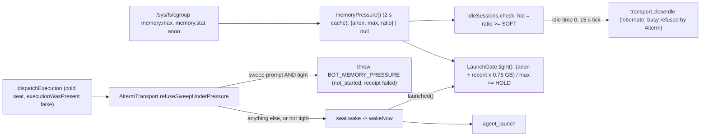

# Live-seat memory budget (a505b, reworked by a505c; Owner 2026-11-22 「キューとかいらないから断るだけじゃダメなの？」「必要なら催促が続くでしょ。」)

Owner: Kiro (execution). Why: after the container restart at 09:59 JST 87 seats launched at once, the container went to 16-19 of 20 GiB with 24 OOM kills (seat processes, `oom_score_adj` 1000); 1,086 kills had killed claude/host processes since 02:39 JST. A live seat costs about 0.75 GB (claude + host 2 x 171 MB RSS, plus ~10 MCP helper processes ~0.43 GB, measured 2026-11-22 on aiterm-mcp 0.70.93); with ~6 GiB of body and modules only 18-25 seats fit in 20 GiB. The number of seats ALIVE is what must be bounded.

There is no queue (a505b's FIFO launch line is removed). The Lattice sweep (the scheduler nudge, unchanged: Owner 「催促の仕組みを変えるな」) already repeats a prompt every minute, so a refused prompt needs no line behind it.

## What it protects, how it leaves

| Rule | Protects | Self-exit |
| --- | --- | --- |
| **Early sleep** (`IdleSessions`): while anon memory is at or above `SOFT` (55 % of the cgroup limit) a seat whose turn has ended sleeps at the next check (idle time 0, check every 15 s instead of 2 min). Only the existing quiet rule decides (`quietSession` + `transport.isIdle` + no pending Approval Box decision) and the existing `closeIdle` (hibernate; Aiterm refuses a busy seat). Below `SOFT` the Owner's 10 minutes (2026-11-21) apply unchanged. | The container's memory; seats that OOM kills | Memory falls below `SOFT`: the 10 minutes apply again. Nothing is held: a hibernated seat wakes on its next delivery. |
| **Sweep refusal** (`AitermTransport.refuseSweepUnderPressure`, called by `dispatchExecution` right before `wake`): a Lattice sweep prompt (`from: 'scheduler'` and text beginning `Lattice: you are not running`) that would start or resume a COLD seat is refused while `anon + recent admissions x 0.75 GB >= HOLD` (70 %). The refusal is a designed one like a463's image refusal: error code `BOT_MEMORY_PRESSURE`, `effect: not_started`, typed `EXECUTION_BUSY/not_started`; the receipt is saved `failed` (not queued, not retried), no BugHub report, no seat touched. A warm seat (already running) is not affected. | The cold start that would add a seat to a full container | The next sweep (1 minute) asks again; it goes through once memory is below `HOLD` (early sleep frees it). No reading (`memory.max` is `max`, file unreadable) = no pressure, nothing is refused. |
| **Never refused** (11-07 ruling: a dead seat is woken by its delivery): messages from the Owner, members/Bots, rooms, calls and every other schedule wake the seat at once, whatever the memory. Every cold launch counts as an admission for the next 30 s (`launched()`), refused or not, so the refusal sees what is about to be used. | Deliveries a person or a Bot waits on | n/a |

## Function map

## Data flow

`memory.max` + `memory.stat` (read-only, kernel) -> `memoryPressure` -> `IdleSessions` (sleep sooner) and `LaunchGate` (refuse a sweep prompt). `LaunchGate` keeps only the times of the last launches in memory (a body restart empties it). Nothing is written to Aiterm beyond the existing launch and hibernate calls; the refused delivery is recorded as `failed` with code `BOT_MEMORY_PRESSURE` in the existing receipt history.
