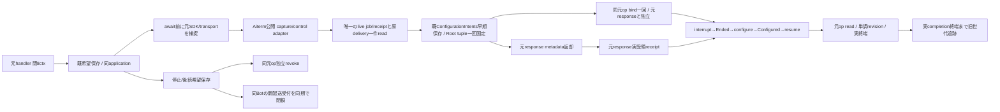
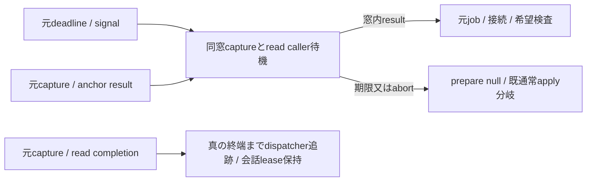

# 同元MCP要求に束縛した設定切替consumer

所有キロ。元handler/fullExtra/_meta/assemblyはMolly、native内部はElegg、原delivery一件read/継続はN102。

**休止中（bd05、2026-11-14）**：Aitermは `model-handoff-*` と `ai.aiterm/handoff.{control,full}.v1` を一度も公開していない（0.65.0〜0.70.58、Elegg確認）。BellTeamはその3つのファイルを読まない。`AitermClient` は `captureHandoffConnection` を持たないので、`ModelHandoff.prepare` は常に `null` を返し、`update_self` は通常の設定経路だけを通る。`ConfigurationIntents.handoffTerminal` はAitermのschemaを読まず、保存前に `accept()` が確かめた値をそのまま形だけ確かめる。再開はAitermが新しい公開の入口と能力を先に約束してから（Owner未廃止）。

Aiterm世代: 捕捉するconnectionは渡すjobのpin（`job.native`）から取る。prepareは捕捉中、beginは`operation.completion`までjobのpinをholdする（[aiterm-generation-pin.md](aiterm-generation-pin.md)）。

元接続をawait前に捕捉し、currentConnectionで欠測/connecting/元参照不一致を拒否する。control/full capabilityもcapture前に確認し、capture-onlyから全M metadataを作らない。新connect/別SDK/OS probeを発行しない。既AITERM_DISTの提供済公開distだけを利用する。capture5秒/元signalの窓と実同call検証、受領後作用の独立gateを分ける。本文/opaque tokenを公開投影へ混ぜない。sourceはPR407固定cfbc693fを基準にV/T/J保存終端契約を維持する。納品の成立範囲はconsumer-source-result.jsonへ固定する。

停止時は既ordinary stopの成功/失敗契約を保ち、同時にoperationのadmissionStoppedを同期で立てる。submit入口と発行前checkはその同Botだけを拒否し、旧operationの実終端・耐久保存まで保持する。通常設定不明の配送許可はconfiguration-delivery.mdの既契約を維持する。capture/一件read/各control Promiseと元operation completionは既dispatcher trackへ登録し、元responseの時間切れで実寿命を解放しない。

早期保存はConfigurationRequests.unboundHandoffsで「耐久保存済み・bind未発行」の参照を同processだけに保持する。capture窓が閉じた場合、元希望/停止世代が有効な同applicationの通常applyは、同UUID/同launch/保存済み全settingsを一度引き継ぐ。beginでclaimした参照は直ちに削除し、bind後・保存不明・再起動からの原intentはこの口へ入れない。後続設定/停止で元希望が失効した場合だけ、元未発行の耐久完了を保存する。fallbackの発行前も元application/希望/停止世代を同期で再検査する。

captureのdeadlineはconfigureFromMcp開始時の5秒窓一つを渡し、同窓のAbortSignalと元signalを実readへ結ぶ。Root tupleのUTF8 bytesと元capture snapshotをprivate operationに保ち、origin digestを一回固定。control結果は公開adapterの閉schema/receipt検証に加え、元binding/context digest/server/thread/turnと既deliveryを比較する。resumed.turn_idを元turn_idから生成せず、元turnと異なる実IDを要求する。terminalを既intentへ耐久保存した返却snapshotだけがcompletionを解放する。

callerはMollyの元handler/scoped configure→同graph固定dispatch→BotAdministration.configureFromMcp、GET→readConfigurationOperation、既SeatTurns.poll→ModelHandoff.poll、ordinary stop→transport.interrupt/interruptMany、通常配送→submit/check。全同Bot applyは早期application UUID/希望/停止世代へ束縛し、旧apply準備中もcompletionへ並べて二重作用を防ぐ。begin直前にも元希望・capture窓・元接続を比較する。元response終了時はエラー経路でもcapture窓を閉じる。

親はprivate ports.storage.deliveryAnchor(input,options)を非asyncで同actorのconversationAssembly.run→facade.store.deliveryAnchorへ直接接続し、実completionを保つ（Molly所有）。native portは既shared AitermClientにcaptureHandoffConnectionを供給し、bind/commit/read/revokeはその元SDK closureへ限定する。両方無しでは作用不成立。新しい公開HTTP tool schemaや永続queueは増やさない。

load closureで新規必要fileはsrc/model-handoff.mjs。既clientと新intentが使うsrc/aiterm-hooks.mjsもEXECUTION_FILES収録が必要。producer変更/署名はCenti、親src/aiterm-client.mjsの採用と元handler配線はMolly。同sourceのcapture/control distとschemaはAiterm 0.63.7/native7139295d/Aiterm4452c410のElegg供給を使用する。package/lock変更0。先行DTO、普通の設定不明配送許可、JのdeferredRecovery即busyは既契約を保つ。

## capture/readのcaller待機と実終端（read-window修理）

元configureFromMcpのdeadline/元signalを一つだけ使用し、captureとanchor readのcaller待機を同窓で打ち切る。期限後はprepare=nullで既希望/停止世代の検査を経た通常applyへ戻す。子readの取消は要求しない。元captureと元reading.completionのtrackを競合Promiseで置換しない。

| producer → consumer | データ/状態と失敗 | 保存・寿命所有 |
| --- | --- | --- |
| 元MCP/metadata窓 → prepare | 同deadline/AbortSignal。期限又はabortでcaller待機を拒否 | 元窓はconsumer所有、readごとに延長しない |
| Aiterm capture / 会話read → caller | 元result又は拒否。窓内のみ後続checkへ、失効後は遅着を回収するだけ | 読取結果から失効後prepareHandoff/metadata新発行0 |
| 元capture / reading.completion → dispatcher | 真の実終端まで元Promise identityを追跡 | 会話leaseは会話所有。caller打切りで終端を偽造・早期解放しない |

対象は元await二か所の有限化。prepareHandoffの耐久保存や通常設定applyを含む全HTTP wall時間の上限、子強制取消ACKを保証しない。

親seat-mcpのbudgetはnull固定であり数値のRPC残budgetは未取得。現実装はconfigureFromMcp入口で作るperformance.now()+5000と元signal/window.signalを使う。元signalのabortは窓へ伝わるが、未取得のRPC deadlineを推定しない。
