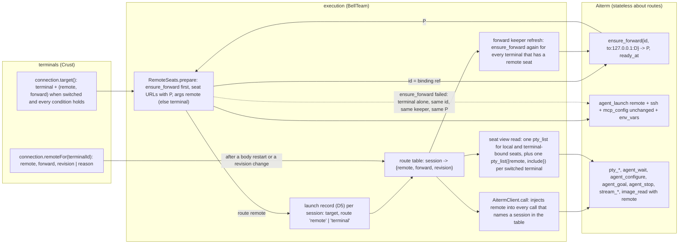

# Remote seat route carried by BellTeam (a532b2 stage 2, 2026-11-23)

Owner: execution (Kiro). Ruling: Tronie 2026-11-23, option B: BellTeam carries `remote`; Aiterm keeps no session map for it. Stage 2 ships in the SAME body train as stage 3 ([seat-view-shadow.md](seat-view-shadow.md)), all three terminals switch in that one train with a per-terminal fallback to the old `terminal` route (no one-terminal-at-a-time rollout); Centi's lab runs on that train. Related: terminals README "Terminals on Aiterm's generic remote surface" and "Stage 3" (Crust: `target()` returns `remote` + `forward` beside `terminal`; `remoteFor(terminalId)` for the route table), [remote-seat.md](remote-seat.md), [aiterm-boundary-move.md](aiterm-boundary-move.md) row 2. Aiterm side (Elegg, 0.70.111): `agent_launch` with `remote` + `remote.ssh` takes the final `mcp_config` unchanged (no seat-URL rewrite, no D->P mapping), private values travel on the private line (`env_vars`, plain headers), the remote Aiterm must be at the harness minimum and, for post_launch, 0.70.100; there is no session map for `remote`, so every later call carries the same `remote`; `ensure_forward` is called again to keep the route; `agent_stop` takes an optional `remote` for every listed id.

## Function and data flow

## Rules

| Item | Contract |
| --- | --- |
| Who is in the table | Only a seat launched on `remote`: its launch record says `route: 'remote'`. A seat launched on `terminal` (before the switch, or by the fallback) is routed by Aiterm's binding map and is never in the table; its calls carry no `remote`. The route of a running seat never changes under it: a switch (or its reversal) takes effect at the seat's next launch |
| Launch | `prepare` takes `target()`. With `remote` present: `ensure_forward({id: forward.id, to: {host: '127.0.0.1', port: D}})` (D = `remoteSeatPort`), writes the seat URLs `http://127.0.0.1:P/api/seat-mcp...` itself, keeps headers as `${NAME}` templates with values on the private line (`env_vars` names), adds `AITERM_SEAT_FORWARD_PORT` = P to the names (non-secret, read by the door's post_launch), and passes `remote` (no `terminal`). `ensure_forward` failed: this launch uses `terminal` as today (same id, same keeper, same P), so the existing `SEAT_FORWARD_UNAVAILABLE` exit and the launch notice are unchanged |
| Every later call | `AitermClient.call(name, args)` looks the session up in the table (`args.session_id`, `args.session_ids`, `args.session_name`) and adds the same `remote`. A call that names no session, or one not in the table, is sent unchanged. `agent_stop` with several ids is split by route (ids on `remote` one call per terminal, the rest as today) because Aiterm applies one `remote` to every listed id. The generic reads of the seat view (stage 3) take the per-terminal `pty_list({remote, include})` for switched terminals; the one relayed `pty_list` keeps serving local and `terminal`-bound seats |
| After a body restart | The table is empty. An entry is rebuilt lazily at the first call for a session whose launch record says `route: 'remote'`: `remoteFor(terminalId)` (Crust; reloads the key into the per-terminal agent first when empty). Until it answers `remote`, the call WAITS, then fails with the terminal's reason if it still cannot: it never falls back to `terminal` (Aiterm holds no binding for that seat). The wait is bounded by the call's own deadline; the next call asks again |
| Revision change | `remoteFor(...).revision` (registry + host-trust revision) differs from the entry: the entry is replaced at the next call or keeper refresh (the known_hosts file name changes when the Owner confirms a new host key). terminals pushes no event |
| Keeper | A seat route needs its forward kept: `ensure_forward` again for every terminal that has a seat in the table, on the existing poll tick, at most once a minute per terminal. A failed refresh is reported once as a launch-level notice and retried; no seat is touched |
| Close | `pty_close` / restart / session change removes the entry after Aiterm answers; a closed seat's record keeps `route` for the Throughline replay only |
| Version gate | The seat's terminal Aiterm for the launch side >= 0.70.111 and the container >= 0.70.111 (Elegg); Crust's conditions (both >= 0.70.101, trust copy, agent identity) already decide whether `target()` returns `remote`. A condition that fails leaves `terminal` alone: nothing is refused |
| Failure and fallback | Per terminal: no `remote` from `target()` -> `terminal`; `ensure_forward` failed -> `terminal` for that launch. After a `remote` launch no fallback exists (the exit of a stuck seat is the existing restart/hibernate path, which launches again and can choose `terminal`) |

No new guard: the only protection is "never fall back to `terminal` for a `remote` seat" (named: Aiterm has no binding for it, so a call without `remote` would address the wrong or no seat); its exit is the next call asking `remoteFor` again.

## What stage 3 reads for a switched terminal

`sessions[]` of `pty_list({remote, include: ["turn", "own_work"]})` per terminal, one call per terminal per tick, the same row shape as the local ones (Elegg to confirm). A terminal whose Aiterm is older than `include` returns rows without `turn`: read as not returned (the unread of today), same rule as stage 3.

## Open items (answers asked from Elegg and Crust)

1. Elegg: do `aiterm-wait` (the wait process), `stream_read` / `stream_send` and `image_read` need `remote`, and how is a relayed `wait_process` built for a `remote` seat? The transcript read (`aiterm-transcript-read`, remote-seats.mjs `transcript`) also names `--session` only: does it take `--remote`?
2. Elegg: does `ensure_forward` need a periodic refresh to keep the keeper (grace after the last seat), or does a running seat keep it?
3. Crust: `remoteFor(terminalId)` (answered yes: after Tronie's ruling, no memberId, no C8, returns `{remote, forward, revision}` or `{reason}`).

## Order inside the stage

1. This design, with the answers above.
2. One implementation PR: `prepare` + route table + `AitermClient.call` injection + keeper refresh + per-terminal seat view read + launch record `route`; tests with a fake Aiterm that has no session map and a fake `remoteFor`.
3. Same train as stage 3's switch; Centi's lab on a real remote seat (launch, send, read, wait, stop, restart, body restart rebuild); Crust then switches the three terminals in that train.
