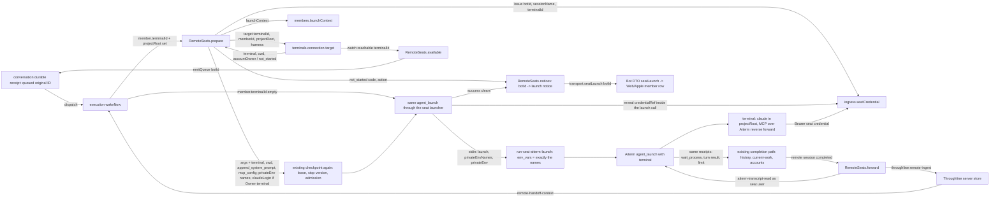

# Remote seats (C2 lifecycle, C7 capture)

Owner: Kiro (execution). Request: Trony, 2026-11-09 (F-SEAT-HOST, `remote-seat-plan-20261109.md`). **Owner ruling 2026-11-09 16:1x JST: ONE launch path.** Cross contracts: [terminals](../terminals/README.md) (`connection.target`, `watch`; Crust), Aiterm `agent_launch` with `terminal` + `cwd` (Elegg, next Aiterm release), seat launcher + seat credential (Molly, PR #793), members `launchContext` (Belota, #768), Throughline 0.17.0 `remote-ingest` / `remote-handoff-context` (Rivalin). P1 scope: the Owner's Mac + Claude Code.

A remote seat is the same BellTeam seat (same Bot, same session name, same delivery, same accounts logic) whose Claude process runs on a registered terminal with `cwd = projectRoot`. Execution launches it through **the same `agent_launch` call** as a local seat, adding the terminal target and folder. After the launch every call (`pty_send`, `pty_observe`, `pty_read`, `pty_key`, `claude_turn`, `agent_stop`, `pty_close`, the receipt's `wait_process`) is the same session call as a local seat. No routing, no bound port, no relay seat, no new queue, no second history writer.

## Function diagram



## Seat binding (execution-owned, existing identity)

| Field | Source | Notes |
| --- | --- | --- |
| `botId` | members | unchanged |
| `sessionName` | execution, today's rule | `bot-xxxx` or account seat `bot-xxxx-<1st\|2nd>-<base36>`; no terminal-specific scheme |
| `launchId` | launch receipt | 32 hex, today's `AITERM_AGENT_LAUNCH_ID` |
| `target` | member `terminalId` + `projectRoot` (`seatTarget(bot)`, `''` = local) | written into the existing launch record D5 (`execution-runtime-launches.json`: `{generation, capturedAt, harness, target, botId, launchId}`) for remote launches. Survives a body restart |
| `accountOwner` | terminals `connection.target` result | `'owner'` = the Owner's 1st/2nd slots apply; anything else = the terminal's own Claude login |

In memory: `RemoteSeats.seats: Map<sessionName, {sessionName, botId, launchId, cursor}>`, a cache of the launch record (rebuilt from it after a body restart; the generation exchange hands the same Map over so the Throughline cursor survives it).

## Launch (`wakeNow` → `RemoteSeats.prepare` → `changeSession('agent_launch')`)

1. `terminals.connection.target({terminalId, memberId: botId, projectRoot, harness})` → `{terminal: {ref, target: {host, user, port}, trustRevision, credentialRevision}, cwd, accountOwner}`, passed unchanged. terminals runs its Claude upkeep inside it.
2. `bots.launchContext(botId, {sessionName, shortTermMemory}, {membersLease})` → `{text}`; members writes nothing for a remote member. `shortTermMemory` = `throughline remote-handoff-context --bot <botId> --json` on the server (empty when unavailable; the seat still starts).
3. `ingress.seatCredential.issue({botId, sessionName, terminalId})` → `{url, credentialRef}` (url = `http://127.0.0.1:4183/api/seat-mcp`, `SEAT_FORWARD_UNAVAILABLE` 503 `effect: not_started` while the listener cannot bind, the same not-started code as a refused forward; Aiterm rewrites the origin to the reverse forward).
4. The transport's existing checkpoint (members lease, stop version, admission) runs again after these async steps.
5. The same `agent_launch` args plus `terminal`, `cwd = projectRoot`, `append_system_prompt = text`, `mcp_config = {bellteam, call-bridge}` with headers `Authorization: Bearer ${BELLTEAM_MCP_TOKEN}`, `X-Bellteam-Seat: ${AITERM_SESSION_ID}`, `X-Bellteam-Launch-Id: ${AITERM_AGENT_LAUNCH_ID}` (names only). Launch options add `privateEnv = {names: ['BELLTEAM_MCP_TOKEN', + 'CLAUDE_CODE_OAUTH_TOKEN' when the Owner's 2nd slot applies], resolve}`. `AitermClient.call` resolves it (`seatCredential.reveal`) only inside the launch call and hands the seat launcher `privateEnvNames` + `privateEnv` on stdin (never argv, log or disk); the launcher forwards exactly those names as `env_vars` (no server PATH/HOME). The launcher still runs in the server member project; only a launch with `terminal` may have `cwd` ≠ that project.
6. Receipt validated as today. Then `RemoteSeats.launched` caches `{botId, launchId}` and the launch record gets `target, botId, launchId`.

Every OS (Mac, Linux, Windows; Elegg/Crust 2026-11-10) uses this same launch with no per-OS branch: `cwd` is the terminal's native form (Windows `X:\...`) and passes through untouched, Aiterm picks the runtime from the terminal's actual platform, and a declared/actual mismatch is Aiterm's coded `TERMINAL_OS_MISMATCH` (a launch refusal, Launch notice). terminals' top-level `target.os` is read only for the Owner's login text (`loginAction`).

A credential issued for a launch that never issued `agent_launch` (or failed `not_started`/`not_issued`) is revoked. A successful `pty_close` of a remote session revokes its credential. Another seat of the same Bot under another name (account-slot move, #750/#756) is untouched until its own `pty_close`; a reissue for the same name replaces the token.

Wrong-target guard (kept): a remote member with no terminals/ingress ports (older parent) throws `TERMINALS_UNAVAILABLE`, `effect: not_started`. Protects: starting in the server folder. Exit: the next body start with the ports drains the same queued ID.

## Terminal key set from the app (R13, Aiterm 0.67.0; ruling 2026-11-09 17:3x)

A terminal whose SSH key was set from the app has no native key in Aiterm. Its `connection.target` value carries `terminal.credential = {handle, revision}` (Mika's opaque handle, Crust #811) instead of `credentialRevision`. Before `agent_launch`, `RemoteSeats.loadKey` asks the parent to load it:

```text
ports.ingress.seatCredential.loadTerminalKey({terminalId, memberId: botId, ref: terminal.ref, handle, revision})
  -> aiterm.credential-load.v1 {accepted: true, ref, handle, revision}
```

- Molly #813: the parent resolves the handle through Mika (`purpose: terminal.ssh`, expected revision) and pipes the raw key to `aiterm-remote-terminal credential-load --ref R --terminal-id ID --handle UUID --revision N --purpose ssh-key` on stdin as UID1000. Execution never holds the value; it never lands on disk, argv, env, logs, MCP arguments or the PTY.
- A receipt that is not `accepted` for the same handle/revision, or any error (binding error code, `TERMINAL_KEY_LOAD_UNAVAILABLE`, `TERMINAL_KEY_LOAD_INVALID`, `CREDENTIAL_UNAVAILABLE`, Mika's stale revision), is `CREDENTIAL_UNAVAILABLE` (`not_started`); `loadKey`'s caller arms terminals' observer, and Mika's availability event (terminals `onCredentialEvent`) drains the wait.
- Native-key terminals (`credentialRevision`, no `credential`) are unchanged: no load.
- `CREDENTIAL_NOT_LOADED` / `CREDENTIAL_REVISION_STALE` from Aiterm (agent removed after the last seat, host restart, a new key revision) are not delivery failures: on `agent_launch`, `wakeNow` loads again (fresh `connection.target`), reruns the existing checkpoint (members lease, stop version, admission) after that async reload, and launches once more only when the fresh target keeps the same intent (same `accountOwner`, `cwd`, binding `ref` and host target; only credential/trust revisions may differ). Otherwise the prepared login/options (the Owner's 2nd login is decided by `accountOwner`) would be mixed with another target, so it is `TERMINAL_TARGET_CHANGED` (`not_started`, credential revoked, terminals' observer drains it and the next wake prepares afresh); on a session call of a held remote seat, `RemoteSeats.route` reloads for that seat's terminal and issues the same call once more (`route` reads the code from Aiterm >= 0.70.5's `result._meta["aiterm/error_code"]` = `{schema: 'aiterm.error-code.v1', code}` (reason only, never the effect; `AitermClient.call` keeps it as `error.aitermErrorCode`), else from the returned text `aiterm: CODE: ...`, which stays while a 0.70.4 container relay drops `_meta`; before 2026-11-10 it read only `error.code`, so after a body swap — container restart, key agent gone — the restart's `pty_close` of a live Mac seat failed and the seat was not replaced) (Aiterm refuses before contacting the terminal, so nothing was sent). A second refusal is returned as is.

## Target revision (member terminal/folder change)

Member updates reach the registry by two paths: the HTTP profile PATCH (`administration.update`) and members' MCP `update_bot`/`update_self`, which saves `terminalId`/`projectRoot` straight to the registry without execution. The delivery is the boundary both share, so the move is in `dispatch` (before the send): when the launch record's `target` of the current session differs from `seatTarget(bot)` now (terminal or folder revision, or local ↔ remote), `dispatch` observes the seat; an idle or absent seat is closed (`pty_close`; a remote close revokes its credential) and woken on the new target through the existing `memberOperation` + `wake`, then the message is sent there. A seat whose turn is running keeps today's delivery (the same rule as the wake-first recovery: never close a running turn); the next delivery moves it. No record (launched before records existed) = unchanged. Account-slot seats on an unchanged target are not touched.

## Pending delivery while the terminal is away (Owner ruling 2026-11-09 13:38)

```mermaid
stateDiagram-v2
  [*] --> Queued: conversation saved original ID
  Queued --> Preparing: drain -> wakeNow
  Preparing --> Launched: target + context + credential + agent_launch ready
  Preparing --> Failed: not_started (terminals / members / ingress / Aiterm terminal codes): onStatus failed + remote-seat not-started proof
  Failed --> Queued: durable receipt sees the proof bound to this deliveryId + target (integration message-receipt.md)
  Launched --> Delivered: pty_send accepted (same ID once)
  Queued --> Preparing: terminals watch reachable -> RemoteSeats.available -> emitQueue(botId) -> drain
  Queued --> Preparing: next drain of the member's queue (its next delivery or launch; Claude auth not ready / Aiterm launch refusal)
  Delivered --> Delivered: lost SSH is not a seat end; calls by session reconnect (Aiterm)
```



Not-started codes and their exits. The delivery does call `onStatus('failed')` (history shows the attempt) and rejects; the error carries the remote-seat not-started proof below, and the durable receipt (Molly, integration) turns the same ID back to `queued` only on that proof. No timer, no AI polling, no new queue, no immediate wake: the exit column is what drains it again.

| Codes | Raised by | Exit |
| --- | --- | --- |
| `TERMINAL_UNAVAILABLE`, `CREDENTIAL_UNAVAILABLE` / `CREDENTIAL_*`, `UNREACHABLE`, `HOST_TRUST_STALE`, `SEAT_FORWARD_UNAVAILABLE`, `TERMINAL_TARGET_CHANGED` (R13 retry) | terminals `target()` (it arms its own observer) or Aiterm `agent_launch` after a successful target (`RemoteSeats.launchFailed` calls `terminals.connection.observe(terminalId)`, Crust) | terminals' non-AI observer → `watch` `reachable: true` → `emitQueue` for the Bots recorded under that terminal. From RS01 (listener down, `ingress.seatCredential.issue`): the parent's non-AI bind retry (30 s, only while a refused terminal waits) → first successful bind → the same `watch` `reachable: true` for that terminal (remote-seat-ingress.md RS01/RS08) |
| `TARGET_MISMATCH`, `HOST_KEY_MISMATCH`, `TERMINAL_NOT_FOUND` | terminals / Aiterm | the Owner's registry revision (terminals' registry-change edge emits the same `reachable: true` event) |
| `TERMINALS_UNAVAILABLE` (no ports), `SEAT_CREDENTIAL_INVALID`, `BOT_REMOTE_BINDING_MISSING`, `MEMBERS_EFFECT_UNSUPPORTED` | execution / ingress / members before any terminal contact | the next body start with the ports / the member revision (the next delivery) |
| `CLAUDE_AUTH_NOT_AUTHENTICATED`, `CLAUDE_AUTH_STATUS_UNCONFIRMED`, `CLAUDE_AUTH_STATUS_TIMEOUT` (the last only from terminals with Aiterm < 0.70.1) | Aiterm `agent_launch` on the terminal: Claude auth preflight refused before any session (`aiterm.agent-launch-error.v1`, `phase: authentication_preflight`, `effect: not_issued`, `session_created: false`; `RemoteSeats.launchFailed`, only with that exact structure as `error.agentLaunchError`). `AitermClient.call` reads it from `structuredContent` (Aiterm < 0.70.0) or `result._meta["aiterm/launch_error"]` (Aiterm >= 0.70.0, c493df6) | the next drain of the member's queue: its next delivery or launch attempt after the Owner logs in (the durable receipt drains every queued ID of the target in saved order, `durable-message-receipts.mjs` `drainTarget`). No terminals observer and no `wait()` entry: no event sees a login (Trony ruling 2026-11-10, common rule `guards.give-up-is-a-guard`) |

| Any other code with Aiterm's launch refusal (e.g. `CWD_UNAVAILABLE`: the folder is missing on the terminal; `REMOTE_AITERM_TOO_OLD`) | Aiterm >= 0.70.0 `agent_launch`: refused before any seat exists, `result._meta["aiterm/launch_error"]` = `{schema: 'aiterm.agent-launch-error.v1', harness, code, phase: 'terminal' \| 'native_create' \| 'authentication_preflight' \| 'input', effect: 'not_started' \| 'not_issued', session_created: false, action}` (codes that may have started get none). Aiterm >= 0.70.5 also answers a local fresh launch whose created session a full listing proved gone with `code: 'AGENT_LAUNCH_NOT_STARTED', phase: 'native_create'`; when it cannot prove that it answers text-only `AGENT_LAUNCH_UNCONFIRMED` (no `_meta`, unchanged handling). Aiterm >= 0.70.7 answers every refusal decided from the arguments alone (all harnesses, e.g. Codex `CODEX_MCP_SERVER_CONFLICT`) with `code: 'AGENT_LAUNCH_NOT_STARTED', phase: 'input'`. `AitermClient.call` keeps it as `error.launchRefusal` (`launchRefusal`, `src/agent-launch-error.mjs`: exact values, `code` `^[A-Z][A-Z0-9_]{0,63}$`, `action` 1-500 chars, no control characters) and sets `error.code`; `RemoteSeats.launchFailed` uses it only when its `code` is the thrown code | the same next drain of the member's queue, after the Owner fixes the folder or updates the terminal (Crust/Elegg 2026-11-10, same ruling as the row above) |

Without that refusal (Aiterm < 0.70.0, or a seat launcher that does not yet forward `launchRefusal` across its process boundary) `CWD_UNAVAILABLE` and `REMOTE_AITERM_TOO_OLD` stay today's visible delivery failure (not queued).

Seat launcher (Molly, runtime `cli-registration`): a remote launch runs through `run-seat-aiterm-launch.mjs`, whose fixed error projection forwards `code`, `agentLaunchError` and `launchRefusal` (re-validated by `launchRefusal()`, invalid dropped). The Claude auth row works with this execution alone; the other row needs a body carrying that launcher, and on an older body it degrades to the visible failure above.

Login screen (Aiterm >= 0.70.1, Elegg): a slow auth check now proceeds, and a logged-out Claude stops at its first screen in a created session (`aiterm.agent-launch-result.v1`, `startup: {status: 'blocked', reason: 'vendor_onboarding_required'}`). A session exists on the terminal, so it is not a not-started launch: no proof, and the delivery stays today's visible failure. It does need a visible reason: `launchFailed` sets the Launch notice `{code: 'VENDOR_ONBOARDING_REQUIRED', action: loginAction(os)}` (「<OS>のclaudeにログインが必要」, below).

### Remote-seat not-started proof (2026-11-10, Crust / Molly)

Without it the parent wraps the invoked failure as `effect: 'unknown'` and the receipt never replays it (first real case: delivery 46427226, macbook `TARGET_MISMATCH`). Execution attaches one closed, delivery-bound field to the rejected error:

```text
error.remoteSeatNotStarted = {
  schema: 'bellteam.remote-seat-not-started.v1',
  code,        // one of the not-started codes in the table above (CWD_UNAVAILABLE / REMOTE_AITERM_TOO_OLD only with Aiterm's launch refusal; never VENDOR_ONBOARDING_REQUIRED)
  deliveryId,  // the delivery's queue groupId (= durable receipt delivery_id)
  botId,       // the target member
  terminalId,  // the terminal the launch was for
}
```

- Built by `remoteSeatNotStarted(bot, deliveryId, error)` (`src/remote-seats.mjs`) in `AitermTransport.submit`'s failure branch, next to the stale-generation marker and under the same conditions: no receipt, not stopped, `!job.inputMayHaveStarted` (no `pty_send` that may have reached the CLI), a `groupId`, a remote member, and `error.effect === 'not_started'` with a not-started code. `effect` is set only by `RemoteSeats.prepare` (before `agent_launch`), `RemoteSeats.launchFailed` (Aiterm answered a not-started code) or the `TERMINALS_UNAVAILABLE` guard.
- Exact keys only, strings only; no message, host, key or path. The parent wrapper copies it unchanged (`Object.assign(..., error, {effect: 'unknown'})`).
- Parent acceptance (Molly, PR #901): no observed acceptance (with or without the saved `failed`), exact schema/keys, `code` `^[A-Z][A-Z0-9_]{0,63}$`, `terminalId` 1-128 chars, `deliveryId === record.delivery_id` and `botId === record.target` → append `queued`; no `onPending`. Anything else keeps today's `unknown`. The receipt's "unknown is never replayed" guard (duplicate input) is unchanged.

## Launch notice for the Owner (2026-11-10, Crust / Trony)

A not-started remote launch calls `onStatus('failed')` and rejects; when the code has an exit, the rejected error carries the remote-seat not-started proof and the durable receipt puts the same ID back to `queued` ("Pending delivery" above). `CWD_UNAVAILABLE` and `REMOTE_AITERM_TOO_OLD` without Aiterm's launch refusal stay a visible delivery failure. While the ID waits queued, the history alone does not say why or what the Owner should do (first real case: macbook answered `HOST_TRUST_MISSING` → `TARGET_MISMATCH`, action "confirm the host key of 192.168.1.12"). Execution keeps the latest not-started outcome per member and projects it; it is information only and changes no queue, retry or guard.

```text
transport.seatLaunch(botId)   (sync project method, like seatAccount)
  -> null | {code, action, terminalId, at}
```

| Field | Value |
| --- | --- |
| `code` | the not-started code (`TARGET_MISMATCH`, `TERMINAL_UNAVAILABLE`, `CREDENTIAL_UNAVAILABLE`, …; table above) |
| `action` | terminals'/Aiterm's plain next step (`error.action`, at most 500 characters) or `null`; for an Aiterm launch refusal its fixed `action` sentence; for `CLAUDE_AUTH_*` and `VENDOR_ONBOARDING_REQUIRED` the fixed Owner text 「<OS>のclaudeにログインが必要」 (`loginAction(os)`, Trony's ruling; it takes precedence over Aiterm's auth sentence). `<OS>` is `Mac` / `Windows` / `Linux` from terminals' top-level `target.os` (`macos` / `windows` / `linux`, Crust 2026-11-10), kept per terminal at the last `target`; with no `os` (a terminals module before it) it is `Mac`. Raw native text, hosts' secrets and key values never appear (terminals already drops raw native text) |
| `terminalId` | the terminal the launch was for |
| `at` | ISO time of the failure |

- Set by `RemoteSeats.notice` on every not-started remote launch: a failed `target`/context/credential step in `prepare`, or Aiterm's not-started code in `launchFailed` (Claude auth preflight included), and on the login-screen failure above.
- Cleared by `RemoteSeats.launched` (the launch on the terminal succeeded). Read as `null` once the member is no longer bound to that `terminalId` (moved to another terminal or to local), so no stale notice remains.
- Each set/clear emits `{topics: ['bots'], botIds: []}` on the existing change stream, so Web/Apple re-read `/api/bots`. `botIds` stays empty on purpose: a change naming the Bot triggers the direct drain, which would relaunch at once and loop on the same failure.
- The generation exchange hands the Map over with the seats Map.
- Bot DTO key `seatLaunch` (same value; absent when the body or the engine has no `seatLaunch`): projected by the members list/profile next to `account`. Shown on the member row and the member's conversation header by Web (Admi) and Apple (Ziz) as a plain failure line: 「端末で起動できません：<action or code>」 (full-width colon; with neither action nor code 「端末で起動できません。」; OS-neutral, Kiro 2026-11-10: the same line serves Mac, Windows and Linux terminals with no DTO `os`; where the OS matters the `action` already names it, e.g. 「Windowsのclaudeにログインが必要」).

## Accounts (Owner rulings 2 and 4 of 13:38)

- `accountOwner === 'owner'`: today's per-model selection; 2nd = `claudeLogin: '2nd'` read by the seat launcher as today, its name added to `privateEnvNames`.
- Otherwise: the terminal's own Claude login; the Owner's slot tokens are never sent.
- Switch = fresh seat on the other slot on the same terminal and projectRoot, old seat retained (`harness-accounts.md`). Limit detection is unchanged (same receipts).

## Capture (C7)

After a remote session's wait returns `done` / `error` / `rate_limited` (`RemoteSeats.waitProcess` wraps the same wait runner), `RemoteSeats.forward`: `aiterm-transcript-read --session S [--cursor-session ID --offset N] --max-bytes 1048576` as the seat user (`aiterm.transcript-read.v1`: whole lines through the latest Stop-recorded offset, `cursor = {claudeSessionId, offset}`) → `throughline remote-ingest --json` (stdin through a `node -e` bridge; argv pieces of at most 96 KiB UTF-8 bytes, cut only between code points; joined they are the exact JSON) → keep `ackedCursor` in memory. `E_REMOTE_GAP` / `E_REMOTE_CONFLICT` move to `expectedCursor`; other failures keep the cursor for the next completion. At most 64 pages per completion; one pass at a time per seat. Without a `launchId` nothing is forwarded. After a body restart the cursor starts at null; Throughline's replay is idempotent.

A remote **fork** seat (execution/fork.md) is never in `RemoteSeats.seats`, so the wait wrapper does not forward it. `forkInquiry` calls `forward(forkSeat)` itself once, after the fork's turn (answer or failure) and before `pty_close`. That pass uses `throughline remote-ingest --fork --json` with `sessionKind: 'fork'`, `parentSessionId` = receipt `fork_of.vendor_session_id` (the value Aiterm 0.70.6 puts in the seat's `THROUGHLINE_PARENT_SESSION_ID`) and `forkId` = BellTeam forkId (= `THROUGHLINE_FORK_ID`). All three come from execution's launch receipt and registry, never from model input. Throughline >= 0.18.0 (Throughline#34) labels the session as a fork before bodies and keeps it out of `remote-handoff-context`. Throughline 0.17.0 refuses any argv other than `['--json']` with `E_REMOTE_INPUT` before reading stdin, so it stores nothing and the fork has no record there; it never becomes main memory. Main seats keep `remote-ingest --json` with no fork fields.

## Not changed

Local seats (no `terminalId`): today's path, including env forwarding. Delivery ordering, durable receipt, history writer, current-work DTO, accounts registry schema. `resumePreviouslyActive` skips remote members (the normal wake launches them on their terminal).

## P1 implementation

| Piece | Where |
| --- | --- |
| Ports | `createExecutionDispatcher`: `ports.terminals = {connection: {target, observe}, watch}`, `ports.ingress = {seatCredential: {issue, revoke, reveal, loadTerminalKey}}`, `ports.bots.launchContext`; `EXECUTION_REMOTE_SEATS = true` → loader `supportsRemoteSeats` (#773). `RemoteSeats` exists only when all three are present |
| Remote member | `isRemoteBot(bot)`, `seatTarget(bot)` (`src/remote-seats.mjs`) |
| Launch inputs | `RemoteSeats.prepare` / `launched`; `AitermTransport.wakeNow` |
| Private env | `AitermClient.call` option `privateEnv` (agent_launch with `terminal` only) |
| Target revision | `AitermTransport.seatTargetChanged` + `dispatch`; D5 record `target` |
| App-set terminal key (R13) | `RemoteSeats.target` / `loadKey` / `reloadKey`; `wakeNow` launch retry; `RemoteSeats.route` session-call retry |
| Queue on launch failure | `RemoteSeats.launchFailed` (from `wakeNow`; Claude auth preflight via `authenticationPreflightFailure`, other Aiterm refusals via `launchRefusal`, `src/agent-launch-error.mjs`; `_meta` read in `AitermClient.call`); proof `remoteSeatNotStarted` (from `AitermTransport.submit` failure branch) |
| Launch notice | `RemoteSeats.notice` / `launchNotice`; `AitermTransport.seatLaunch` (sync project method); handover `remoteNotices` |
| Distribution | `scripts/web_gateway_artifact.py` `EXECUTION_FILES` includes `src/remote-seats.mjs` (54, Molly's authorization) |
| Credential release | `RemoteSeats.route` (successful `pty_close`) |
| Queue edge | `RemoteSeats.wait` / `available` |
| C7 | `RemoteSeats.waitProcess` / `forward` / `handoffContext` |

Test: `test/remote-seats.test.mjs`; `_meta` reading: `test/auth-launch-diagnostic.test.mjs`.

## Deployment order

1. Deploy a body image from adopted #765 main (or a successor) first. It must contain the parent `AitermClient.privateEnv`, #793 seat launcher, #792 `connection.target`, #804 `connection.observe`, and the signed execution-manifest closure reader.
2. Then install the execution module containing `src/remote-seats.mjs`.
3. Live remote seats additionally require the next Aiterm release with `agent_launch`'s `terminal` argument and the `aiterm-transcript-read` CLI. Adoption or installation before that release is not a live Mac result.
