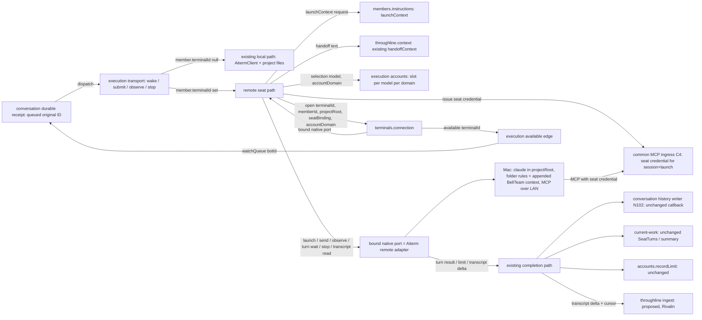
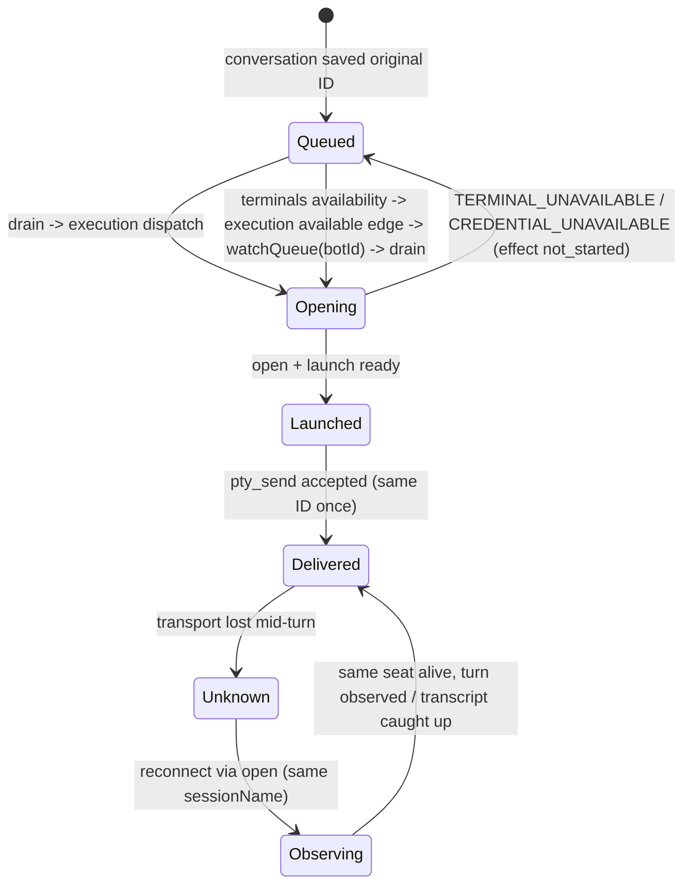

# Remote seats (C2 lifecycle, C7 capture)

Owner: Kiro (execution). Request: Trony, 2026-11-09 (F-SEAT-HOST, `remote-seat-plan-20261109.md`). Cross contracts: [terminals](../terminals/README.md) C1–C9 (PR #764). Status: **P0 design; no code yet.** P1 scope is the Owner's Mac + Claude Code, no sudo, SSH key already registered.

A remote seat is the same BellTeam seat (same Bot, same session name, same delivery, same accounts logic) whose process runs on a registered terminal with `cwd = projectRoot`. Execution changes only **where** the native calls go and **what** it hands the launch instead of writing files. No relay seat, no new queue, no second history writer.

## Function diagram



## Seat binding (execution-owned, existing identity)

| Field | Source | Notes |
| --- | --- | --- |
| `botId` | members | unchanged |
| `sessionName` | execution, today's rule | `bot-xxxx` or account seat `bot-xxxx-<1st\|2nd>-<base36>`; no terminal-specific scheme. MCP ingress already maps both to the Bot (`seat-mcp.mjs` `seatCandidates`) |
| `launchId` | native launch receipt | 32 hex, today's `AITERM_AGENT_LAUNCH_ID` |
| `terminalId`, `projectRoot` | members (C1) | captured at launch; a later change of either is a member revision: execution closes the old binding at the next idle boundary and launches fresh (never re-`cd`) |
| `accountDomain` | terminals registry `accountOwner` | `owner` or `terminal:<terminalId>` |
| `slot` | `accounts.selection('claude', model)` within `accountDomain` | see Accounts |
| `connectionRef` | terminals.connection | opaque; held only in memory; every reconnect re-enters `open` |

Held in the existing in-memory `sessions` / `seatHarnesses` maps plus one `remoteSeats: Map<botId, {terminalId, projectRoot, accountDomain, connectionRef}>`. Nothing new persisted by execution beyond today's session record.

## Calls execution makes (P1)

1. `members.instructions.launchContext({botId, sessionName, shortTermMemory})` → `{text, revision}`. `text` = what members writes today into the local project (`AGENTS.md` with common rules, Owner info, user rules, member profile, `AGENTS.local.md`) plus `memory/previous-session.md` content, composed in memory. Members writes **nothing** for a remote member. `shortTermMemory` = today's `handoffContext` output. Failure → the launch returns `effect: 'not_started'` with the members error code.
2. `ingress.seatCredential.issue({botId, sessionName, terminalId})` → `{url, credentialRef}` (C4, Molly). `url` = LAN MCP endpoint; `credentialRef` opaque, never a value in execution JSON. Revoked by `ingress.seatCredential.revoke({sessionName})` when execution closes or replaces the seat.
3. `terminals.connection.open({terminalId, memberId: botId, projectRoot, seatBinding: {botId, sessionName}, accountOwner})` → `{connectionRef, native}` or a classified error. `native` is a bound port with the **same method surface as today's AitermClient native calls** (`callTool(name, args, options)` for `agent_launch`, `pty_send`, `pty_observe`, `pty_read`, `claude_turn`/wait, `agent_stop`, `pty_close`), plus `transcript.read(cursor)` (C7). Execution routes every native call for that Bot through this port instead of the shared client; all other execution logic is unchanged.
4. Launch through `native.callTool('agent_launch', launchPlan, privateOptions)`:

```js
launchPlan = { // same keys as today's local agent_launch args
  harness: 'claude-code', cwd: projectRoot, session_name: sessionName, trust_project: true,
  model, reasoning_effort, fast }
privateOptions = { // never in argv, PTY capture, logs or the receipt
  appendSystemPrompt: launchContext.text,          // Claude --append-system-prompt equivalent; Elegg picks the carrier
  mcpServers: { bellteam: { type: 'http', url, credentialRef }, 'call-bridge': { type: 'http', url: url + '/call-bridge', credentialRef } },
  claudeLogin: slot === '1st' ? null : slot,       // slot name only; the value is resolved in the private channel
}
```

The receipt must stay `aiterm.agent-launch-result.v1` with `session_id === sessionName`, `launch_id`, `startup.status`, `fast`. Execution validates it exactly as today.

## Pending delivery while the terminal is away (Owner ruling 2026-11-09 13:38)



- Unreachable/asleep/offline and credential-unavailable map to a top-level `{code, effect: 'not_started'}`. The durable receipt already returns such an ID to `queued` without a failed callback (`conversation/durable-receipt.md`). No failure is shown to the sender.
- Exit is automatic: terminals' non-AI availability observer emits `available(terminalId)`; execution emits `watchQueue(botId)` for each idle Bot bound to that terminal (the existing running/available edge), and the existing drain claims the same original ID. No timer, no AI polling, no new queue.
- Wrong target (`TARGET_MISMATCH`) is the same `not_started`; its exit is the Owner's corrective revision (terminals), after which the same edge fires.
- A lost connection after `pty_send` acceptance is never a resend: the turn stays with its native references; reconnect re-opens and observes the same session. Execution does not replay the business input.

## Accounts (C2, Owner rulings 2 and 4 of 13:38)

- `accountDomain = owner` (Owner's own terminals, P1): today's per-model selection, today's limit registry. 1st = the terminal's own Claude login (assumption to confirm on the Mac: it is the Owner's 1st account). 2nd = `claudeLogin: '2nd'`; the token is read by the seat-side launcher as today and travels only in the private credential channel to the Owner's terminal.
- `accountDomain = terminal:<id>` (others' machines, P3): selection keyed by that domain; the Owner's slot tokens are never selected. Until that terminal owner registers a 2nd login, the seat runs on the terminal's own login and a limit waits for reset there.
- Switch = fresh seat on the other slot on **the same terminal and projectRoot**, old seat retained under today's policy (`harness-accounts.md`).
- Limit detection is unchanged: the bound port's turn wait must return the same `rate_limited` classification and limit text as local.

## Capture (C7)

| Need | Source on the bound port | Consumer (unchanged writer) |
| --- | --- | --- |
| Turn completion / answer / failure category incl. `rate_limited` | `claude_turn` wait result, same schema as local | delivery callback → conversation history (N102), accounts.recordLimit |
| Live activity for member cards | `pty_observe` / SeatTurns observations, same schema | current-work, background summary (unchanged) |
| Session transcript for short-term memory | `transcript.read({sessionName, cursor})` → `{entries: [...jsonl lines], cursor}`; cursor = `{claudeSessionId, offset}` of `~/.claude/projects/<cwd>/<id>.jsonl` on the terminal | Throughline ingest (proposed, Rivalin): execution forwards `{botId, sessionName, launchId, entries, cursor}` after each turn end and after reconnect; Throughline acks the cursor it stored; execution keeps only the last acked cursor in memory |

Completion boundary (Rivalin 2026-11-09, Throughline ADR0002): `transcript.read` returns entries only through the end of the latest turn **the native adapter confirmed complete** for that Claude session (the same completion its `claude_turn` wait reports), never an unfinished tail, including after reconnect. Assistant presence, file mtime or process exit is not completion. Execution calls `transcript.read` only after it holds a native completion for that session; after a mid-turn reconnect it first waits that turn's completion through the bound port, then reads. Byte contract (Rivalin): each entry is a complete original JSONL line with its original line ending; `offset` is the exclusive UTF-8 byte offset; range start = end − Σ byteLength(entries).

Reconnect reads from the last acked cursor, so nothing is duplicated and no delivered input is replayed. The terminal keeps no BellTeam history copy; history stays the conversation module's.

## Not changed

Local seats (no `terminalId`): byte-for-byte today's path. Delivery ordering, durable receipt, history writer, current-work DTO, accounts registry schema.

## Open contracts (owners)

- terminals (Crust): `open` returns the bound native port above; `available(terminalId)` event; classified codes `TERMINAL_UNAVAILABLE`, `CREDENTIAL_UNAVAILABLE`, `TARGET_MISMATCH`.
- Aiterm remote adapter (Elegg): `privateOptions` carrier (instructions, MCP config with credential, login) excluded from argv/capture; same receipts; `transcript.read`.
- members (Belorta): `launchContext`.
- common ingress (Molly): `seatCredential.issue/revoke`, LAN endpoint, verification of the credential against `{botId, sessionName, launchId}` instead of trusting `X-Bellteam-Seat`.
- Throughline (Rivalin): ingest with cursor ack, and `handoffContext` reading that ingest for remote seats.
