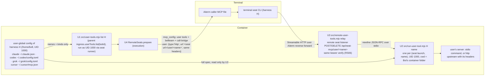

# Container user-global MCP tools on terminal seats (a134–a137, 2026-11-15)

Owner (11/15): 「グローバルに設定したものは、ユーザー設定のツールでもラピの席で使えるようにして。…守るもののない守る機能を作るな。」
Owner of this contract: execution (Kiro). The U3 route lives in the remote seat listener ([remote-seat-ingress](../integration/remote-seat-ingress.md), integration/Molly).
Reviewed: Trony a135 (2026-11-15). Spec trail: Kiro docs `a134-remote-user-tools-spec-20261115.md`.

A terminal seat of harness H gets every MCP server the container's user registered globally for H, under the same name.
The tool runs in the container as the seat user (UID 1000) where its credentials are; nothing is installed on the terminal and
no credential leaves the container. Not part of the image or `harness-products.json`. Aiterm accepts any number of `http`
caller servers for claude/codex/grok/cursor (`harnesses/caller-mcp.js parseCallerMcp`), so no Aiterm change is needed
for the transport itself.

## Data flow

## Functions

| ID | Contract |
| --- | --- |
| U1 `listUserTools(harness)` | Reads only harness H's file. Returns `[{name, kind:'stdio'|'http'}]`; never command/args/env/url/headers. Skips `MANAGED_MCP_IDS` (bellteam, aiterm, call-bridge — the one list, `src/user-tools.mjs`, also used by `harness-config.mjs`), entries with `enabled=false`/`disabled:true`, `sse` entries and names outside `[A-Za-z0-9_-]{1,64}` (Aiterm's caller-name rule). A missing file is an empty list. Parent port `ingress.userTools.list(botId)` runs it through `createSeatProcessRunner(bot.project)` and accepts only `bellteam.user-tools.v1`; offered to the execution engine only when it exports `EXECUTION_REMOTE_USER_TOOLS` (loader `supportsRemoteUserTools`). |
| U2 `run-user-tool.mjs <harness> <name>` | Re-reads H's config as UID 1000. stdio: runs the configured command/args with its env (`${VAR}`, `${VAR:-x}`, `${env:VAR}` expanded from the seat environment), stdio inherited. http: one MCP client of the configured url with its headers (literal/expanded, codex `http_headers`, `env_http_headers`, `bearer_token_env_var`), relaying each stdin message and writing every reply (JSON or SSE body); keeps the upstream `Mcp-Session-Id`, sends DELETE at stdin end. Not found/disabled: exit 3 `USER_TOOL_NOT_CONFIGURED` before anything starts. |
| U3 relay | `POST`: `initialize` starts a fresh host for (seat, name) and mints `Mcp-Session-Id`; a request with the current id is relayed; a request with an unknown or missing id under a valid seat bearer is **adopted**: a new host is started, the relay sends `initialize` (protocol version from the request's `MCP-Protocol-Version`, else 2025-06-18) and `notifications/initialized` itself, then forwards (a135 change 3: works after a body restart without the CLI re-initializing, on every harness). Notifications only -> 202. A server-to-client request gets a JSON-RPC error back to the server (no client to answer). `DELETE` ends the host; `GET` 405. A host exit answers its pending requests with `USER_TOOL_EXITED`. |
| U4 prepare | Only when the parent says `ingress.userTools.callerReplace === true` (the bundled Aiterm is >= 0.70.62, `aitermCallerReplaceSupported`, so it keeps a terminal's own same-name server and accepts `replace`; body and Aiterm ship together); otherwise the config is exactly the previous `{bellteam, call-bridge}`. After `seatCredential.issue`, `ingress.userTools.list(bot.id)`; each name becomes `{type:'http', url:\`${url}/user/${name}\`, headers}` with the same three seat headers as `bellteam`. A list failure logs `BellTeam remote seat: user tools unavailable: <bot>: <code>` (body stderr) and the launch goes on with bellteam + call-bridge. Fork seats get the same list (a local fork loads the same user config). |
| Name precedence (a135 change 2, a138) | Evidence (Claude 2.1.325, probe servers): a `--mcp-config` server replaces a same-name user- or local-scope server; different names both start. Rule: the terminal's own server wins for user tools. Aiterm (a138, Elegg) does not write a caller server whose name the terminal's own harness config already defines, and reports the dropped names in the launch receipt; BellTeam only logs them. Aiterm 0.70.62 (Elegg, 2026-11-15) reads the seat's own config on the terminal at launch (claude user/local/project scope, codex/grok config.toml; cursor runs caller servers beside its own, nothing dropped) and returns `caller_mcp {dropped, replaced}` in the launch receipt; `RemoteSeats.launched` logs non-empty lists (`BellTeam remote seat: caller MCP dropped|replaced …`). A terminal below 0.70.62 gets the config with `replace` removed and keeps its old precedence. BellTeam's managed servers (`bellteam`, `call-bridge`) carry `replace: true`, because every terminal today has its own stdio `call-bridge` and the seat needs BellTeam's seat-identity one (Trony ruling 2026-11-15). User tools never carry it. |

## Lifecycle

```mermaid
stateDiagram-v2
  [*] --> Listed: prepare (U1 at each launch / wake)
  Listed --> Idle: agent_launch writes the caller file
  Idle --> Running: POST initialize, or any request under a valid bearer (adopt)
  Running --> Running: requests
  Running --> Gone: DELETE / credential issue for the seat (launch replaced) / revoke (RS04, seat closed)
  Running --> Idle: body restart (hosts end with the body; the next request is adopted)
  Gone --> [*]
```

There is no idle stop (a135 change 1): a host lives for its seat launch. A tool added or removed in the container appears or
disappears on the terminal seat at that seat's next launch or wake; a running CLI reads its MCP list only at start.

## Failure handling

| Case | Result | Protects / self-exit |
| --- | --- | --- |
| U1 fails | Launch continues without user tools; one stderr line per launch | Nothing stopped. Exit: next launch lists again |
| Unknown/removed name | U2 exits `USER_TOOL_NOT_CONFIGURED`; the request gets that error | Not a guard: nothing to run. Exit: next launch omits it |
| Invalid bearer / other seat | Existing RS06 refusal | Existing: wrong target, another seat's tools |
| Host start fails / exits | Pending requests get `USER_TOOL_EXITED` (last stderr line in the body log) | Exit: the next request starts a new host (adopt) |
| Upstream http error | JSON-RPC error `USER_TOOL_UPSTREAM_HTTP_<status>` / `USER_TOOL_UPSTREAM_UNREACHABLE` | — |

No lock, cap, wait or timeout is added.

## What the user does

1. Register the tool globally in the container as usual (e.g. `claude mcp add --scope user <name> …`, or the harness file above).
2. Restart the terminal seat (Home restart / `restart_session`) or let it wake. The tool appears with the same name.

## Limits (accepted by Trony a135)

- The tool runs in the container: a tool that acts on local files or apps acts on the container, not the terminal.
- A running terminal seat sees a change only after restart/wake.
- Remote seats on non-Owner terminals get the Bot's same user tools (the tools are the Bot's).

## Tests

`test/remote-user-tools.test.mjs`: U1 five harness files (managed/disabled/sse/bad names skipped, no secret field), U3 initialize/relay/adopt/DELETE/GET/closeSeat with a fake host, U4 entries and list-failure launch. Lab a137 (Centi): a same-name terminal server keeps working; a call after a body restart without a seat restart; no credential files on the terminal.
