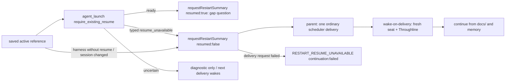

# Previously active conversations after box restart

Root R-resume author appointment2026-11-06: Molly bounded execution author, Kiro permanent owner; native admission Elegg. Parent has one existing execution.controller.start; no second startup loop or parent-private writer.

| Function | Input/output and state owner |
| --- | --- |
| CurrentWork restart activity | Existing actual accepted dispatch/steer and native working-turn observation→execution-owned active-only reference fields in state/execution-activity.json using existing writeAtomic. UI freshness/summary state remains independent. Actual completion/idle/explicit invalidation removes reference; no queued/hibernated inference |
| Cold initialize | Restore configuration then consume saved active references once before producers; track each reconnect as an existing per-target configuration operation so startup timeout is unchanged and new input waits that target operation. Live module handoff carries references and does not trigger box-resume. Idle/missing/unsupported entries create no work |
| Supported resume | Exact Bot/native saved session reference with current profile/session and existing config/member/stop guards→promptless agent_launch require_existing_resume:true. Current native tool must advertise the optional boolean; no old-version silent-ignore or fresh fallback |
| Not resumable here | A saved working reference whose harness has no resume support (grok/cursor/antigravity) or whose Bot now has another session throws typed `RESUME_CAPABILITY_UNAVAILABLE` (effect not_started) before any native call, so it takes the fresh route below instead of being skipped silently. A remote seat still returns null: it survives on its terminal and the next ordinary wake takes it over (remote-seat.md) |
| Native unavailable | Existing _meta aiterm/resume_unavailable typed refusal (AGENT_RESUME_UNAVAILABLE / RESUME_CAPABILITY_UNAVAILABLE) is retained through AitermClient/seat-launch wrapper; only this requested resume did not start. Owner 2026-11-08 (seats come back after a body swap): execution then calls `requestRestartSummary({botId,from,to,resumed:false})`, and the parent sends one ordinary scheduler delivery. Wake-on-delivery starts the seat fresh (Throughline memory), and the delivery tells it to continue the interrupted work from its docs/ and memory. That is a recovery, not a failure: no diagnostic. Only when that delivery request itself fails is `RESTART_RESUME_UNAVAILABLE` reported, with `continuation:"failed"`. Real uncertain resume failures still get no fresh launch (named protection: a resume that may have happened would get a second session). Their self-exit is the next ordinary delivery, whose wake takes the existing seat |
| Gap summary | After confirmed reconnect, known last-observed-work→actual reconnect JST interval, one conditional question about any missed output via parent-authorized existing messenger/history. Times describe observation gap, not invented exact box downtime. Consumed references prevent restart of the same summary action |

Known limit (production 2026-11-09 22:24 JST, body fb923ca4): when a body swap changes the bundled Aiterm closure, the installer resets the Aiterm state volume (`aiterm=reset reason=RESUME_STATE_READER_UNCONFIRMED`, [runtime/resume.md](../runtime/resume.md)). The new Aiterm has no saved record for any session, so every working seat gets `AGENT_RESUME_UNAVAILABLE` and comes back on the fresh route; the vendor transcript in HOME stays but is not reattached. Carrying working conversations across such a reset needs Aiterm H1 checkpoint of a working seat whose native is gone (today hibernated only) and installer H1 targets read from the stopped old body's `state/execution-activity.json` (`targets[].{sessionId,launchId}` → `[{session_id,launch_id}]`). Neither exists yet; execution needs no change for it.

DFD: real native working/accepted reference→CurrentWork missing activity fields→existing private execution state/write queue→cold initialize consume→existing guarded native launch with resume-only→ready existing conversation→existing authorized parent summary sender→durable conversation/normal output callbacks. Idle/missing ref/capability/unavailable→no auto launch/input; existing USER-start/Throughline path unchanged. Unknown business effects/configuration are not reset. Snapshot data contains IDs/harness/times only, no task body/credential/transcript.

Only active reference fields are persisted; no new delivery queue, IDs, recovery service, checkpoint generation or duplicated execution writer. Activity-save failures are reported and cannot fabricate saved work; corrupt state disables automatic reconnect while ordinary application startup remains available. The cold snapshot is consumed before resume issuance; crash/unknown outcome is not reissued automatically. Quiescence/hot handoff waits the same activity write queue.

Changed-contact case: injected native/clock/files exercises accepted active and idle/absent refs, existing-resume-only flag/refusal, one known interval summary, no fresh/old-task input, preservation of config guards; native author's own cases are inherited.
