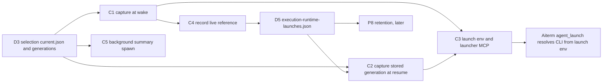

# Runtime capture at native launch (Z-b2 slice C, execution side)

Owner: Kiro. Contract owner of P6 (`src/runtime-selection.mjs`) and D2/D3: Molly, [runtime-updates](../runtime/runtime-updates.md). Aiterm side (binary resolution inside Aiterm, `AITERM_DIST` imports, hook registration): Elegg and Molly.

## Functions

| ID | Function: input → output | Code |
| --- | --- | --- |
| C1 | Logical launch (wake) → `captureRuntime()` once, frozen object kept for that launch | `AitermTransport.wakeNow` |
| C2 | Resume of a saved session → `captureRuntime({ generation })` with the generation recorded for that session (C4); no record → current capture. Aiterm's `require_existing_resume` additionally re-executes the session's saved recipe executable and environment | `AitermTransport.resumePreviouslyActive` |
| C3 | Capture → launch hand-off to Aiterm. The short-lived launcher MCP process gets, in its own env before it starts (Aiterm reads `resolveAgentBin` inputs from its process env, not per request): `CODEX_BIN`, `CLAUDE_BIN` (captured absolute bins), `PATH` with the four captured `bin` dirs first, `BELLTEAM_RUNTIME_GENERATION` (sha or `''`). The capture is also passed as the `AitermClient` option `runtimeCapture`; which aiterm-mcp code that launcher runs is Elegg's constructor/connect contract | `AitermClient.launchOptions(project, runtime)` → `call` env launcher / seat `run-seat-aiterm-launch` |
| C4 | Accepted launch → D5 live reference `{generation, capturedAt}` keyed by native session name | `AitermTransport.recordRuntimeLaunch` |
| C5 | Background summary → `captureRuntime()` per run, spawn the captured absolute `claude` / `codex` | `createBackgroundSummaryRunner` |

## Store D5

`<execution state dir>/execution-runtime-launches.json` (next to `execution-activity.json`, body-writable, 0700 dir), written with the existing `writeAtomic` through one in-process queue:

`{schema:"bellteam.runtime-launches.v1", launches:{<sessionName>:{generation: sha|null, capturedAt: ISO}}}`

One entry per native session name, overwritten by the next launch of that name. Entries are not removed at close: P8 then over-retains a closed launch's closure, never under-retains a live one. Before P8 exists nothing deletes closures.

## Failure and guards

| Case | Result |
| --- | --- |
| `captureRuntime` throws `RUNTIME_BINDING_UNAVAILABLE` (established selection unreadable, stored generation file absent/invalid) | that one launch is refused with the same code, `effect:"not_started"`; no builtin fallback; no other launch is affected |
| D5 read fails (absent file) | no record → resume uses the current capture |
| D5 write fails | reported as `RUNTIME_LAUNCH_RECORD_UNAVAILABLE`; the accepted launch stands (the record only feeds resume pinning and later retention) |

No new guard is added. While no selection exists the capture equals the builtin `/usr/local` paths, so the hand-off values equal what Aiterm resolves today.
