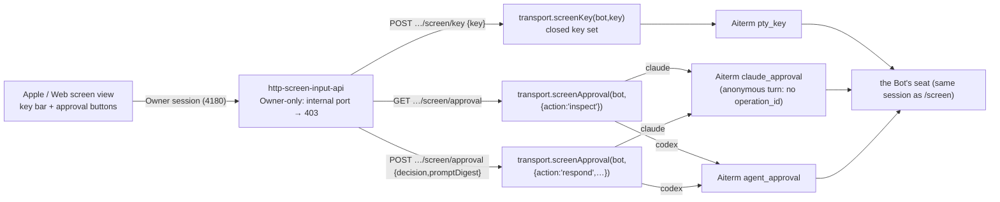

# Screen input from the Bot screen view (N5, Owner 2026-11-08)

Owner: Kiro (execution). Owner request: 「こういう時に、キー操作を挿入する機能が欲しい」. The Owner watched a seat stuck on a Claude Code permission dialog in the app's Bot screen view and could not answer it.

From the Bot screen view, the Owner sends one key, or answers the approval dialog currently on screen, to that Bot's seat. Only Aiterm's public tools are used. Bots (the internal port) cannot call this.

## HTTP contract (for Bell / Admi)

All routes need the Owner's authenticated app session. A request on the internal (Bot) port gets `403 {error:"SCREEN_INPUT_OWNER_REQUIRED"}`; an unknown Bot gets `404 {error:"BOT_NOT_FOUND"}`.

| Route | Body | Success | Errors |
| --- | --- | --- | --- |
| `POST /api/bots/:id/screen/key` | `{"key": K}`. K is one of `Enter`, `Escape`, `Tab`, `Up`, `Down`, `Left`, `Right`, `0`–`9`, `C-c` | `200 {"key":K,"outcome":"accepted"}`: the key reached the terminal. That is not proof of what the CLI did with it | `400 SCREEN_KEY_INVALID`, `409 SCREEN_SEAT_ABSENT` (no live seat), `502 SCREEN_INPUT_FAILED` (Aiterm refused or the result is unknown: do not auto-retry) |
| `GET /api/bots/:id/screen/approval` | none | `200 {"status":"none"}` or `200 {"status":"approval_required","promptDigest":"sha256:…","choices":[{"decision":"approve_once"\|"deny","label":"…"}]}` | `409 SCREEN_SEAT_ABSENT` |
| `POST /api/bots/:id/screen/approval` | `{"decision":"approve_once"\|"deny","promptDigest":"sha256:…"}` (the digest from the GET) | `200 {"status":"submitted","decision":…}` | `400 SCREEN_APPROVAL_INVALID`, `409 SCREEN_APPROVAL_CHANGED` (the dialog changed or is gone: GET again), `422 SCREEN_APPROVAL_UNSUPPORTED` (harness without a public approval tool: use the key bar), `502 SCREEN_INPUT_FAILED` |

Client guidance: show the key bar whenever the screen view is open. Poll GET approval with the screen tick, or when the Owner taps it. Show approval buttons only for `approval_required`, with the returned labels. Permanent approval is not offered, because Aiterm does not expose it.

## Execution contract

| Contact | Contract |
| --- | --- |
| `transport.screenKey(bot,key)` | Validates the closed set, then calls `pty_key({session_id,key})` on the Bot's current session. Aiterm serializes it with its own native operation lock against concurrent `pty_send`. No BellTeam queue, wait or refusal is added. |
| `transport.screenApproval(bot,{action,decision?,promptDigest?})` | claude → `claude_approval` (operation_id omitted, which is Aiterm's form for ordinary `pty_send` turns), codex → `agent_approval`. Inspect: a structured result with `status="approval_required"` maps to choices; anything else is `{status:"none"}`. Respond: sends the exact digest; Aiterm rechecks the dialog and refuses if it changed. Grok/Cursor/Antigravity → `SCREEN_APPROVAL_UNSUPPORTED` (their dialogs are answered with keys). |
| compatibility | Both methods are execution dispatch methods. An older execution engine rejects them with `EXECUTION_REQUEST_INVALID`, which the HTTP layer maps to `503 SCREEN_INPUT_UNAVAILABLE`. |

No text input is offered (`pty_send` free text stays the delivery path). No secret, transcript or screen text is stored.
