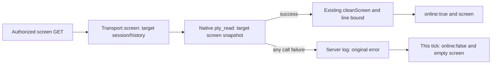

# Target screen reads

Owner: Kiro. Root's 2026-11-07 screen-latency contract; public HTTP assembly is Molly, native implementation is Elegg, client history/polling is Bell/Web. Overall connections remain execution `observation` and Aiterm `native` in [module.json](module.json).

## Function contract

| Function | Input and output | Responsibility |
| --- | --- | --- |
| HTTP `GET /api/bots/:id/screen` | Existing authorized Bot; only `history=1` enables history | Existing `http-bot-api.mjs` calls `transport.screen(bot,{history})`; authorization and DTO unchanged |
| `AitermTransport.screen` | Bot session; default 40 native lines/25 cleaned output lines, history 10000/10000; `{online,screen}` | Read only the target with `pty_read(screen:true,raw:true,timeout:0)`. Do not call `isRunning`, `runningBots` or `pty_list` before capture. No launch/input/configuration, shared output offset or persistent cache |
| Read failure | Any exception from this tick's single native call | Log the original error only to the server log; return `{online:false,screen:''}` for this tick. This is display availability, not proof that the native session is absent. The next normal client poll can succeed independently |
| `cleanScreen` | Existing screen text and line bound | Preserve cleanup, trimming and existing output bounds |

## Data flow

Target session identity is selected by the existing `session(bot)` function. Screen reads do not enumerate or mutate other sessions. List deduplication remains the independent `runningBots` contract. Native capture and HTTP latency are measured by their owners after normal supply/deployment; a focused mock check proves request/error behavior only, not a sub-second runtime guarantee.

Root's13:55 ruling supersedes the earlier typed-missing precondition: one tick of offline display does not justify a native release dependency. No error-code/text parsing, extra presence read or internal retry is required. A typed missing envelope may be adopted separately later. The normal client poll, not a new server retry, leaves the offline display on the next successful read.

Implementation: `src/aiterm-transport.mjs`. Direct caller: `src/http-bot-api.mjs`; no client/HTTP API change. Changed-contact check: `test/terminal-history.test.mjs` uses a mocked client, target success/history bounds and one thrown read error with server-log capture; the existing concurrent-list fixture remains scoped to list sharing.

## Cleanup-cost evidence and limits

Molly's Root-requested measurement is inherited without a rerun: one Node invocation of the actual exported `cleanScreen` and JSON serialization, synthetic mixed Japanese/ASCII with short ANSI, 43325 UTF-8 bytes / 522 lines. This is synthetic input, not terminal contents or a server/native call.

| Output bound | cleanScreen | JSON.stringify | Cleaned output | JSON bytes |
| --- | --- | --- | --- | --- |
| 25 | 7.110 ms | 0.035 ms | 2074 bytes / 25 lines | 2375 |
| 10000 | 1.235 ms | 0.272 ms | 43325 bytes / 522 lines | 49093 |

The 25-line case ran first/cold; there is one sample per case. This input does not support a three-second cleanup/serialization cause, so cleanup is unchanged. Elegg's separately connected native read40/read10000 differed12ms; because that connection differs from the public server's, neither result establishes the exact server/native latency share. Aggregate producer record: Molly `integrations/display-incident-sse-20261107/screen-cleanup-cost.json`. Actual public 40-line/history latency remains Molly's post-supply measurement, not inferred from these samples.
